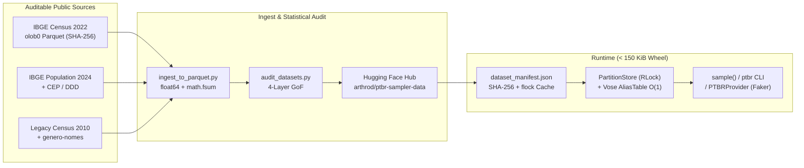

# `ptbr-sampler` `0.3.0` — Statistical Brazilian Demographic Data Generator

[](https://pypi.org/project/ptbr-sampler/)
[](https://www.python.org/downloads/)
[](https://github.com/jandira-tech/ptbr-sampler/blob/main/LICENSE)
[](https://ptbr-sampler.readthedocs.io/)
[](https://huggingface.co/datasets/arthrod/ptbr-sampler-data)

Generate Brazilian full names, municipalities, postal codes (CEPs), addresses, phone numbers, and check-digit-valid synthetic documents (CPF, state-specific RG, PIS, CNPJ, and CEI) **proportional to empirical Brazilian population distributions** and grounded in auditable public datasets.

Starting in **`0.3.0`**, `ptbr-sampler` defaults to **IBGE Demographic Census 2022** (`census_year=2022`, `TimePeriod.ALL`, $N = 203{,}080{,}756$ residents), provides a first-class **Faker** integration (`pip install "ptbr-sampler[faker]"`), threads explicit thread-safe `random.Random` instances (`rng=`) across every generator, and serves its `195` runtime artifacts on demand from Hugging Face Hub ([`arthrod/ptbr-sampler-data`](https://huggingface.co/datasets/arthrod/ptbr-sampler-data)) with `SHA-256` verification — keeping the published PyPI wheel at **`102.8 KiB` (105,225 bytes, `< 150 KiB`)**.

*Leia em Português: [README.md](https://github.com/jandira-tech/ptbr-sampler/blob/main/README.md) | Comprehensive Technical Report: [docs/technical-report.md](https://github.com/jandira-tech/ptbr-sampler/blob/main/docs/technical-report.md) | Documentation: [ptbr-sampler.readthedocs.io](https://ptbr-sampler.readthedocs.io/)*

---

## Contents

1. [Highlights in `0.3.0`](#highlights-in-030)
2. [Installation & Offline / Docker Dataset Pre-Warming](#installation--offline--docker-dataset-pre-warming)
3. [Quick Start: CLI, Python API, RNG Injection, & Faker](#quick-start-cli-python-api-rng-injection--faker)
4. [Data & Sampling Architecture](#data--sampling-architecture)
5. [Mathematical & Statistical Foundations](#mathematical--statistical-foundations)
6. [Documented Methodological Boundaries](#documented-methodological-boundaries)
7. [Credits, Data Provenance, & License](#credits-data-provenance--license)

---

## Highlights in `0.3.0`

- **IBGE Census 2022 by Default (`census_year=2022`, `TimePeriod.ALL`):** `128,458` given names (`99.8207%` directly observed empirical sex mass; `0.0%` LLM-assigned mass) and `201,601` national + 27 UF-conditioned surnames (`Santos` leading Sergipe at `43.38%` presence; `Silva` leading Alagoas at `35.75%` and Pernambuco at `34.23%`), ingested from [`olob0/ibge-nomes-no-brasil-2022`](https://huggingface.co/datasets/olob0/ibge-nomes-no-brasil-2022) (`05efb85c92af43da2ed4ed088d1e0c9f17160e65`). Historical Census 2010 remains available via `census_year=2010` / `--census-year 2010`.
- **Ultra-Slim Wheel (`< 150 KiB`) + Cryptographically Pinned Hugging Face Cache:** Only `ptbr_sampler/data/dataset_manifest.json` (`~16 KiB`) ships inside the `.whl`. `float64` Parquet partitions download lazily from [`arthrod/ptbr-sampler-data`](https://huggingface.co/datasets/arthrod/ptbr-sampler-data) at an immutable 40-char commit SHA, verified against per-file `SHA-256` digests under cross-process `fcntl.flock` locks before atomic `os.replace` into `~/.cache/ptbr-sampler/<hf_revision>/`.
- **First-Class `Faker` Provider (`ptbr-sampler[faker]`):** `PTBRProvider` and `install_ptbr(fake, aliases=False)` expose internally coherent profiles (`fake.ptbr_profile()`) and fast $O(1)$ scalar formatters (`fake.ptbr_name()`, `fake.ptbr_cpf()`, `fake.ptbr_rg()`, `fake.ptbr_cep()`, `fake.ptbr_address()`, `fake.ptbr_phone()`), leaving standard `Faker('pt_BR')` methods untouched unless `aliases=True` is explicitly requested.
- **Isolated Stream Determinism (`rng=random.Random(...)`) & Thread Safety:** All randomness flows through an optional `random.Random` instance without mutating module-global `random` or `numpy.random` state, backed by `RLock`-synchronized caches and synchronous execution safe inside active `asyncio` event loops (Jupyter, FastAPI, marimo).
- **Strict Observed Marginals vs. Lazy Bayes Conditioning:** `conditioning_mode='strict'` (default) serves only directly observed IBGE tables (`national`, `national × sex`, `national × cohort`, `UF`); `conditioning_mode='estimated'` enables lazy in-memory Bayes reweighting (`< 5 ms`) for `UF × sex` and `cohort × sex`.
- **Kahan-Compensated Walker–Vose $O(1)$ Alias Tables:** Exact induced probability vector reconstruction with $L_\infty = 1.39 \times 10^{-17}$ in `float64`, verified by a four-layer statistical test suite with Holm–Bonferroni FWER control ($\alpha_{\text{FWER}} = 0.001$).

---

## Installation & Offline / Docker Dataset Pre-Warming

```bash
# Core package (< 150 KiB wheel)
pip install ptbr-sampler
# or with official Faker integration:
pip install "ptbr-sampler[faker]"

# With uv:
uv add ptbr-sampler
uv add "ptbr-sampler[faker]"
```

Outside a git checkout, `ptbr-sampler` downloads only the partitions touched on first call (`~3.1 MiB` for the default national path). For **Docker images, CI runners, or air-gapped environments**:

```bash
# Pre-download and SHA-256-verify all Census 2022 runtime partitions
ptbr datasets prefetch --census-year 2022

# Pre-download all vintages (2022 + historical 2010, 195 artifacts)
ptbr datasets prefetch --all-vintages

# Inspect cache location and verify all SHA-256 digests
ptbr datasets status --verify

# Enforce zero runtime network egress (raises RuntimeError on any cache miss)
PTBR_SAMPLER_OFFLINE=1 ptbr generate --qty 5 --uf SP
```

| Environment Variable | Behavior |
| --- | --- |
| `PTBR_SAMPLER_CACHE_DIR` | User cache root (default: `$XDG_CACHE_HOME/ptbr-sampler` or `~/.cache/ptbr-sampler`). |
| `PTBR_SAMPLER_DATA_DIR` | Pre-populated read-only runtime data directory (ideal for multi-stage Docker images). |
| `PTBR_SAMPLER_HF_REPO` | Mirror dataset repository on Hugging Face Hub (default: `arthrod/ptbr-sampler-data`). |
| `PTBR_SAMPLER_OFFLINE` | When `1` or `true`, forbids all runtime HTTP requests. |

---

## Quick Start: CLI, Python API, RNG Injection, & Faker

### 1. Command Line Interface (`ptbr`)

```bash
# 0.3.0 default: Census 2022 (TimePeriod.ALL) + weighted geography + Rich table
ptbr generate --qty 5

# Pin a specific Federation Unit (SP names, surnames, municipalities, CEPs, DDD, and SSP-SP RG)
ptbr generate --qty 5 --uf SP --format json

# Empirical UF conditioning across all 27 states weighted by IBGE population
ptbr generate --qty 5 --uf-conditioning

# Observed sex conditioning ('M', 'F', balanced 'mixed' 50/50, or empirical 'population' 48.56% M / 51.44% F)
ptbr generate --qty 5 --sex-conditioning population

# Joint UF × sex conditioning via Bayes conditional independence (explicit opt-in)
ptbr generate --qty 5 --uf BA --sex-conditioning F --conditioning-mode estimated

# Census 2022 birth-decade cohort (e.g., residents born 2010–2019)
ptbr generate --qty 5 --time-period ate2020

# Historical Census 2010 opt-in and uniform mode ("realism off")
ptbr generate --qty 5 --census-year 2010
ptbr generate --qty 5 --random

# Auditable data-origin catalog
ptbr sources --census-year 2022
```

### 2. Python API & Isolated `random.Random` Injection

```python
import random
from ptbr_sampler import BrazilianNameSampler, TimePeriod, sample

# Isolated deterministic stream: never mutates global random.seed() or numpy.random.seed()
rng = random.Random(2026)

# Coherent full profile (name, UF, city, CEP, street, phone, CPF, RG, PIS, CNPJ, CEI)
profile = sample(q=1, all_data=True, uf_conditioning=True, rng=rng)

# Fixed UF filter + joint UF × sex conditioning (explicit 'estimated' opt-in)
rj_batch = sample(
    q=5,
    uf='RJ',
    sex_conditioning='F',
    conditioning_mode='estimated',
    formatted=False,  # raw digits for documents
    rng=random.Random(42),
)

# Survivors born between 2020 and 1 August 2022 (Census 2022)
recent_cohort = sample(q=5, time_period=TimePeriod.PERIOD_2020_2022, rng=random.Random(7))

# Direct Parquet name sampler (O(1) per sample once the alias table is cached)
name_sampler = BrazilianNameSampler.from_parquet(census_year=2022)
person = name_sampler.get_random_name(uf='SE', return_components=True, rng=random.Random(99))
```

### 3. Official `Faker` Integration (`ptbr_sampler.faker`)

```python
from faker import Faker
from ptbr_sampler.faker import install_ptbr

# By default (aliases=False), standard Faker('pt_BR') methods remain untouched
fake = install_ptbr(
    Faker('pt_BR'),
    uf_conditioning=True,
    sex_conditioning='population',
    conditioning_mode='estimated',
)
fake.seed_instance(12345)

profile = fake.ptbr_profile()       # Internally coherent dict (UF <-> city <-> CEP <-> DDD <-> RG)
full_name = fake.ptbr_name()        # Census 2022 frequency-weighted full name
surname = fake.ptbr_surname()       # Two-slot surname without stem duplication (s2 != s1)
cpf = fake.ptbr_cpf(formatted=True) # Modulo-11 valid synthetic CPF
rg_sp = fake.ptbr_rg(uf='SP')       # SSP-SP state-specific RG format

# Optional opt-in: also bind standard formatter aliases (fake.name(), fake.cpf(), fake.city(), ...)
fake_aliased = install_ptbr(Faker('pt_BR'), aliases=True, uf='MG')
```

---

## Data & Sampling Architecture



Full storage layout, Parquet schemas, and cache security invariants are documented in [`docs/architecture.md`](https://github.com/jandira-tech/ptbr-sampler/blob/main/docs/architecture.md) and [`docs/data-origins.md`](https://github.com/jandira-tech/ptbr-sampler/blob/main/docs/data-origins.md).

---

## Mathematical & Statistical Foundations

Every statistical and numerical design choice in `ptbr-sampler` `0.3.0` is verified in automated tests and derived in full in the [Comprehensive Technical Report (`docs/technical-report.md`)](https://github.com/jandira-tech/ptbr-sampler/blob/main/docs/technical-report.md).

### 1. Kahan-Compensated Walker–Vose $O(1)$ Alias Method

Given a finite vocabulary of size $M$ with positive integer census counts $(c_1, \dots, c_M)$ (up to $M = 201{,}601$ national surnames), empirical weights $w_i = c_i / \sum_{j=1}^M c_j$ are computed in `float64` using Shewchuk's exact floating-point summation (`math.fsum`), guaranteeing $\bigl|\sum_{i=1}^M w_i - 1\bigr| < 10^{-15}$.

The Walker (1977) and Vose (1991) worklist algorithm partitions scaled weights $s_i = M w_i$ into `small` ($s_i < 1$) and `large` ($s_i \ge 1$) queues, building $(\text{prob}, \text{alias}) \in [0,1]^M \times \{0,\dots,M-1\}^M$ in $O(M)$ time. Naive subtraction $s_\ell \leftarrow (s_\ell + s_s) - 1$ suffers $O(M\varepsilon_{\text{mach}})$ catastrophic cancellation when a head hub such as `Silva` ($s_{\text{Silva}} \approx 20{,}571$) absorbs tens of thousands of long-tail deficits. `AliasTable.from_weights` eliminates this drift via:
1. Bulk C-level `math.fsum` absorption when a single `large` hub remains; and
2. Kahan (1965) compensated summation across general `large`/`small` transitions.

The exact categorical probability vector induced by $(\text{prob}, \text{alias})$ is reconstructed deterministically in $O(M)$ without Monte Carlo noise:

$$p_j^{\text{alias}} = \frac{1}{M}\left(\text{prob}[j] + \sum_{i:\,\text{alias}[i]=j} \bigl(1 - \text{prob}[i]\bigr)\right)$$

Across Census 2022 partitions, the measured worst-case error is $\|p^{\text{alias}} - w\|_\infty = 1.39 \times 10^{-17}$ (`float64` machine precision), compared with $\sim 10^{-7}$ under `float32` weights. Sampling each item takes $O(1)$ time independent of $M$: draw $I \sim \text{Uniform}\{0,\dots,M-1\}$ and $U \sim \text{Uniform}[0,1)$, returning $I$ if $U < \text{prob}[I]$ else $\text{alias}[I]$.

### 2. IBGE `Liv102228` Confidentiality Censoring & Exact 4-Regime Decomposition

Per [IBGE Technical Note Liv102228](https://biblioteca.ibge.gov.br/visualizacao/livros/liv102228.pdf), Census 2022 applies **decreasing** disclosure-suppression thresholds at finer geographic grains:
- **Brazil national and Brazil × birth decade:** cells with count **`< 20`** are suppressed;
- **Federation Unit (UF):** cells with count **`< 15`** are suppressed;
- **Municipality:** cells with count **`< 10`** are suppressed.

For each published national given name $i$ ($N_i \ge 20$), `name_detail` exposes $(N_{i,M}^{\text{obs}}, N_{i,F}^{\text{obs}}) \in (\mathbb{Z}_{\ge 20} \cup \{\text{NULL}\})^2$. By exact conservation $N_i = N_{i,M} + N_{i,F}$, `ptbr-sampler` partitions all `128,458` given names (`190,383,184` occurrences) into four disjoint regimes:

| Censoring Regime | Defining Identity | Distinct Names | Mass / Residual | Statistical Treatment |
| --- | --- | ---: | ---: | --- |
| `both_observed` | $N_{i,M} \ge 20 \land N_{i,F} \ge 20$ | `10,582` | `0` residual | Exact empirical rates $p_{i,s} = N_{i,s}/N_i$ |
| `one_null_exact_zero` | Single `NULL` and $N_i - N_{i,\text{obs}} = 0$ | `55,210` | `0` residual | Deduced exact zero ($p_{i,\text{obs}} = 1$, $p_{i,\text{null}} = 0$) |
| `one_null_suppressed_positive` | Single `NULL` and $1 \le N_i - N_{i,\text{obs}} \le 19$ | `57,941` | `232,758` (`0.1223%`) | $p_{i,\text{obs}} = N_{i,\text{obs}}/N_i < 1$; suppressed cell stays `NaN` (never imputed as zero) |
| `both_null_suppressed` | Both `NULL` ($20 \le N_i \le 38$, $1 \le N_{i,M}, N_{i,F} \le 19$) | `4,725` | `108,522` (`0.0570%`) | Retained in unconditioned national table; excluded from sex-conditioned tables |

This yields five transparent sex-coverage metrics in Census 2022: **96.32%** vocabulary lookup coverage, **99.8207%** directly observed empirical population mass, **55,210** deduced exact zeros, **0.0%** LLM-assigned mass, and **0.1793%** (`341,280` occurrences) suppressed mass.

### 3. Bayes Conditional Independence (`strict` vs. `estimated`)

IBGE publishes 1D marginals (`national`, `national × sex`, `national × decade`, `UF`) rather than the full `UF × decade × sex` cube.
- Under `conditioning_mode='strict'` (default), only directly observed IBGE marginals are served; unobserved multi-axis intersections raise `ValueError`.
- Under `conditioning_mode='estimated'`, assuming conditional invariance of a name's sex ratio across $G \in \{\text{UF}, \text{cohort}\}$, $P(S = s \mid X = i, G = g) \approx \hat{P}_{\text{nat}}(S = s \mid X = i)$, the posterior table is built lazily in memory in $< 5\text{ ms}$ via Bayes' rule:

$$\hat{P}(X = i \mid G = g, S = s) = \frac{P_{\text{obs}}(X = i \mid G = g)\,\hat{p}_{i,s}^{\text{obs}}}{\sum_{k \in \mathcal{S}_{g,s}} P_{\text{obs}}(X = k \mid G = g)\,\hat{p}_{k,s}^{\text{obs}}}, \qquad \hat{p}_{i,s}^{\text{obs}} = \frac{N_{i,s}^{\text{obs}}}{N_i}$$

restricted to observed support $\mathcal{S}_{g,s}$ where $N_{i,s}^{\text{obs}} \ge 20$. `UF × cohort` remains rejected in all modes because demographic age pyramids vary substantially across states.

### 4. Surname Token-Slot Share vs. Person-Level Presence

IBGE's headline `Silva = 16.76%` (`34,030,104 / 203,080,756`) measures **person-level union presence** across all surname tokens carried by an individual. Because published surname counts sum to $\sum_k C_k = 333{,}496{,}261$, residents carry an average of $\bar{L} \approx 1.6422$ published surname tokens, and the normalized single-slot probability is:

$$q_i = \frac{C_i}{\sum_{k=1}^{M_S} C_k} \implies q_{\text{Silva}} = 10.2040\%, \quad q_{\text{Santos}} = 6.4071\%$$

In two-surname mode (`with_only_one_surname=False` under `census_year=2022`), slot 2 is sampled conditionally without stem replacement ($S_2 \neq S_1$):

$$P(S_1 = i, S_2 = j) = \frac{q_i\,q_j}{1 - q_i}\,\mathbf{1}_{[i \neq j]}$$

preventing unrealistic duplicate stems (`"Maria da Silva Silva"`) and yielding a two-slot person-level presence $P(i \in \{S_1, S_2\}) = q_i + \sum_{k \neq i} q_k \frac{q_i}{1 - q_k} \approx 19.65\%$ for `Silva`.

### 5. Four-Layer Goodness-of-Fit Validation

Rather than applying two-sample Kolmogorov–Smirnov tests to nominal categories (statistically invalid because KS depends on arbitrary string ordering) or truncating Pearson $\chi^2$ to rescaled top-50 heads (blind to head-to-tail mass leaks), `ptbr_sampler/sampling/validation.py` enforces:
1. **Layer A (Deterministic conservation):** exact count sums, `pa.float64` schemas, `SHA-256` digests, and 4-regime censoring identities.
2. **Layer B (Exact $O(M)$ alias reconstruction):** $\mathrm{TVD}(p^{\text{alias}}, w) = \frac{1}{2}\|p^{\text{alias}} - w\|_1 < 10^{-13}$ across every partition.
3. **Layer C (Exhaustive Monte Carlo multinomial GoF):** adaptive tail pooling into exhaustive disjoint bins ($\sum_j p_j = 1$) with expected counts $E_j = n p_j \ge 5$, Pearson statistic $X^2 = \sum_{j=1}^K (O_j - E_j)^2 / E_j \sim \chi^2_{K-1}$, Holm (1979) step-down FWER control at $\alpha = 0.001$, and two mandatory negative controls (2% head-to-tail mass leak and `top_40` truncation).
4. **Layer D (Cross-table demographic coherence):** population-weighted UF mixture vs. national marginal ($\mathrm{TVD} = 0.030919$, bounded by `< 15` UF suppression) and birth-decade sum vs. national given-name sum (`0.978767`, bounded by `< 20` per-decade suppression).

---

## Documented Methodological Boundaries

- **Mixed reference dates (`2022` names vs. `2024` geography):** Default names reflect **1 August 2022** Census resident stock (`203.08M`), whereas municipal/state location weights (`locations_data.json` and `cities_with_ceps.json`) reflect **1 July 2024** IBGE population estimates (`212.6M`).
- **Upstream IBGE 2022 diacritic folding:** Official IBGE 2022 tables fold diacritics (`Joao`, `Goncalves`) while preserving distinct letter roots (`Ana` vs. `Anna`, `Luis` vs. `Luiz`). `ptbr-sampler` applies Title Case without inventing heuristic accents.
- **Second given names & surname connectives:** IBGE disseminates only the first given name and bare surname roots. Second-name incidence (`percentage_with_second = 30.99%` in `middle_names.json`, sanitized via `vocabulary.py`) and connectives (`da`, `de`, `dos`) come from documented authorial/civil-registry conventions.
- **Purely synthetic identifiers:** CPFs, RGs, PIS, CNPJs, CEIs, offline street names, and phone subscriber numbers are generated algorithmically from check-digit rules and never reference real individuals.

---

## Credits, Data Provenance, & License

### Data & Theoretical Credits
- **IBGE — Brazilian Institute of Geography and Statistics:** *Censo Demográfico 2022: Nomes no Brasil* and [Technical Note Liv102228](https://biblioteca.ibge.gov.br/visualizacao/livros/liv102228.pdf) (2025); *Censo Demográfico 2010 — Nomes API v2* (2016); *Estimativas da População Residente nos Municípios* (2024). Public statistical data under IBGE open dissemination policy (Decree No. 8,777/2016).
- **Gabriel Lobo (`olob0`):** reproducible public Parquet compilation [`olob0/ibge-nomes-no-brasil-2022`](https://huggingface.co/datasets/olob0/ibge-nomes-no-brasil-2022) (pinned at commit `05efb85c92af43da2ed4ed088d1e0c9f17160e65`).
- **Álvaro Justen (`@turicas`) and Brasil.IO:** [`genero-nomes`](https://brasil.io/dataset/genero-nomes/files/) ([CC BY-SA 4.0](https://creativecommons.org/licenses/by-sa/4.0/)), used strictly in optional historical `census_year=2010` mode.
- **Arpen-Brasil (Civil Registry Transparency Portal):** annual newborn registration rankings referenced as flow-vs-stock benchmarks ([`docs/sources/arpen-2024-rankings.md`](https://github.com/jandira-tech/ptbr-sampler/blob/main/docs/sources/arpen-2024-rankings.md)).
- **Correios / ViaCEP & Anatel:** municipal CEP postal spans and DDD area codes.
- **Theoretical Foundations:** A. J. Walker (*ACM TOMS*, 1977); M. D. Vose (*IEEE TSE*, 1991); W. Kahan (*CACM*, 1965); S. Holm (*Scandinavian Journal of Statistics*, 1979). Full citations in [`docs/sources/bibliography.md`](https://github.com/jandira-tech/ptbr-sampler/blob/main/docs/sources/bibliography.md).

### License
Repository source code is licensed under the **MIT License** (`Copyright (c) 2026 Jandira Tech`) — see [`LICENSE`](https://github.com/jandira-tech/ptbr-sampler/blob/main/LICENSE). Third-party dataset attributions and public-sector terms are documented in [`THIRD_PARTY_NOTICES.md`](https://github.com/jandira-tech/ptbr-sampler/blob/main/THIRD_PARTY_NOTICES.md).
