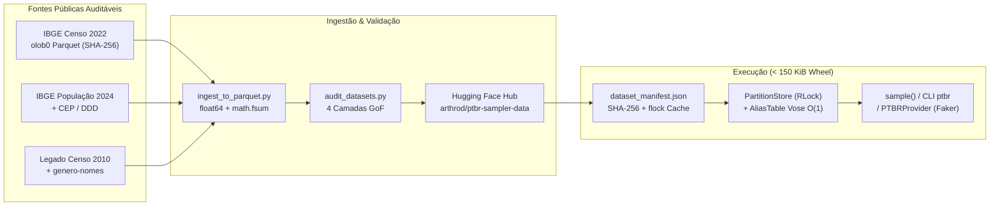

# `ptbr-sampler` `0.3.0` — Gerador Estatístico de Dados Demográficos Brasileiros

[](https://pypi.org/project/ptbr-sampler/)
[](https://www.python.org/downloads/)
[](https://github.com/jandira-tech/ptbr-sampler/blob/main/LICENSE)
[](https://ptbr-sampler.readthedocs.io/)
[](https://huggingface.co/datasets/arthrod/ptbr-sampler-data)

Gere nomes completos, localizações municipais, CEPs, endereços, telefones e documentos sintéticos brasileiros (CPF, RG estadual, PIS, CNPJ e CEI) **proporcionais às distribuições populacionais empíricas do Brasil** e fundamentados em dados públicos auditáveis.

A partir da versão **`0.3.0`**, o `ptbr-sampler` adota o **Censo Demográfico 2022 do IBGE** (`census_year=2022`, `TimePeriod.ALL`, $N = 203.080.756$ residentes) como padrão primário, integra-se nativamente ao **Faker** (`pip install "ptbr-sampler[faker]"`), suporta injeção determinística e *thread-safe* de `random.Random` (`rng=`), e distribui suas `195` partições de execução via Hugging Face Hub ([`arthrod/ptbr-sampler-data`](https://huggingface.co/datasets/arthrod/ptbr-sampler-data)) com verificação `SHA-256` sob demanda — mantendo o pacote `.whl` publicado no PyPI em **`102,8 KiB` (105.225 bytes, `< 150 KiB`)**.

*Read in English: [README.en.md](https://github.com/jandira-tech/ptbr-sampler/blob/main/README.en.md) | Relatório Técnico Completo: [docs/technical-report.md](https://github.com/jandira-tech/ptbr-sampler/blob/main/docs/technical-report.md) | Documentação: [ptbr-sampler.readthedocs.io](https://ptbr-sampler.readthedocs.io/)*

---

## Sumário

1. [Destaques da Versão `0.3.0`](#destaques-da-versão-030)
2. [Instalação e Pré-Aquecimento Offline / Docker](#instalação-e-pré-aquecimento-offline--docker)
3. [Uso Rápido: CLI, Python, Injeção de RNG e Faker](#uso-rápido-cli-python-injeção-de-rng-e-faker)
4. [Arquitetura de Dados e Amostragem](#arquitetura-de-dados-e-amostragem)
5. [Fundamentação Teórica e Matemática](#fundamentação-teórica-e-matemática)
6. [Limitações Metodológicas Declaradas](#limitações-metodológicas-declaradas)
7. [Créditos, Fontes de Dados e Licença](#créditos-fontes-de-dados-e-licença)

---

## Destaques da Versão `0.3.0`

- **Censo Demográfico 2022 por Padrão (`census_year=2022`, `TimePeriod.ALL`):** `128.458` prenomes (`99,8207%` da massa nacional com sexo observado diretamente pelo IBGE; `0,0%` de massa atribuída por LLM) e `201.601` sobrenomes nacionais e por UF (`Santos` liderando em Sergipe com `43,38%` de presença; `Silva` em Alagoas `35,75%` e Pernambuco `34,23%`), compilados a partir de [`olob0/ibge-nomes-no-brasil-2022`](https://huggingface.co/datasets/olob0/ibge-nomes-no-brasil-2022) (`05efb85c92af43da2ed4ed088d1e0c9f17160e65`). O Censo 2010 permanece disponível via `census_year=2010` / `--census-year 2010`.
- **Wheel Ultraleve (`< 150 KiB`) + Cache Criptograficamente Fixado no Hugging Face:** O `.whl` embarca apenas `ptbr_sampler/data/dataset_manifest.json` (`~16 KiB`). Partições Parquet em `float64` são baixadas sob demanda de [`arthrod/ptbr-sampler-data`](https://huggingface.co/datasets/arthrod/ptbr-sampler-data) em commit imutável de 40 caracteres, validadas por `SHA-256` sob lock `fcntl.flock` e gravadas atomicamente em `~/.cache/ptbr-sampler/<hf_revision>/`.
- **Provedor Nativo para `Faker` (`ptbr-sampler[faker]`):** `PTBRProvider` e `install_ptbr(fake, aliases=False)` oferecem perfis coerentes (`fake.ptbr_profile()`) e métodos escalares em $O(1)$ (`fake.ptbr_name()`, `fake.ptbr_cpf()`, `fake.ptbr_rg()`, `fake.ptbr_cep()`, `fake.ptbr_address()`, `fake.ptbr_phone()`), preservando os métodos padrão de `Faker('pt_BR')` a menos que `aliases=True` seja solicitado explicitamente.
- **Determinismo Isolado (`rng=random.Random(...)`) e Thread Safety:** Toda aleatoriedade flui por uma instância injetável de `random.Random` sem jamais alterar o estado global de `random` ou `numpy.random`, com caches protegidos por `RLock` e execução síncrona segura mesmo dentro de loops `asyncio` ativos (Jupyter, FastAPI, marimo).
- **Separação Estrita entre Marginais Observadas e Estimativas de Bayes:** `conditioning_mode='strict'` (padrão) serve exclusivamente tabelas publicadas pelo IBGE (`nacional`, `nacional × sexo`, `nacional × coorte`, `UF`); `conditioning_mode='estimated'` habilita reponderação preguiçosa via regra de Bayes para `UF × sexo` e `coorte × sexo` em memória (`< 5 ms`).
- **Amostragem em $O(1)$ via Método de Alias de Walker–Vose Compensado (Kahan):** Reconstrução exata do vetor de probabilidades com erro $L_\infty = 1,39 \times 10^{-17}$ em `float64` e validação estatística em quatro camadas com controle de erro familiar de Holm–Bonferroni ($\alpha_{\text{FWER}} = 0,001$).

---

## Instalação e Pré-Aquecimento Offline / Docker

```bash
# Pacote principal (< 150 KiB wheel)
pip install ptbr-sampler
# ou com integração oficial ao Faker:
pip install "ptbr-sampler[faker]"

# Com uv:
uv add ptbr-sampler
uv add "ptbr-sampler[faker]"
```

Na primeira execução fora de um checkout git, apenas as partições efetivamente requisitadas são baixadas (`~3,1 MiB` no caminho nacional padrão). Para **containers Docker, pipelines de CI ou ambientes sem acesso externo (*air-gapped*)**:

```bash
# Pré-baixa e verifica o SHA-256 de todas as partições do Censo 2022
ptbr datasets prefetch --census-year 2022

# Pré-baixa ambos os censos (2022 + legado 2010, 195 arquivos)
ptbr datasets prefetch --all-vintages

# Inspeciona o diretório de cache e audita todos os digests SHA-256
ptbr datasets status --verify

# Execução estritamente offline (falha imediatamente se faltar algum artefato)
PTBR_SAMPLER_OFFLINE=1 ptbr generate --qty 5 --uf SP
```

| Variável de Ambiente | Comportamento |
| --- | --- |
| `PTBR_SAMPLER_CACHE_DIR` | Diretório raiz do cache de usuário (padrão: `$XDG_CACHE_HOME/ptbr-sampler` ou `~/.cache/ptbr-sampler`). |
| `PTBR_SAMPLER_DATA_DIR` | Diretório imutável pré-populado com os artefatos de execução (ideal para imagens Docker multi-stage). |
| `PTBR_SAMPLER_HF_REPO` | Repositório espelho no Hugging Face Hub (padrão: `arthrod/ptbr-sampler-data`). |
| `PTBR_SAMPLER_OFFLINE` | Quando `1` ou `true`, bloqueia qualquer chamada HTTP de rede em tempo de execução. |

---

## Uso Rápido: CLI, Python, Injeção de RNG e Faker

### 1. Interface de Linha de Comando (`ptbr`)

```bash
# Padrão 0.3.0: Censo 2022 (TimePeriod.ALL) + geografia ponderada + tabela Rich
ptbr generate --qty 5

# Fixar uma Unidade da Federação específica (nomes, sobrenomes, cidades, CEPs, DDD e RG de SP)
ptbr generate --qty 5 --uf SP --format json

# Condicionamento empírico por UF sorteada segundo a população IBGE
ptbr generate --qty 5 --uf-conditioning

# Condicionamento por sexo observado ('M', 'F', 'mixed' 50/50 ou 'population' empírico 48,56% M / 51,44% F)
ptbr generate --qty 5 --sex-conditioning population

# Condicionamento conjunto UF × sexo via independência condicional de Bayes (opt-in explícito)
ptbr generate --qty 5 --uf BA --sex-conditioning F --conditioning-mode estimated

# Coorte decenal de nascimento do Censo 2022 (ex.: nascidos em 2010–2019)
ptbr generate --qty 5 --time-period ate2020

# Modo histórico Censo 2010 e modo uniforme ("realismo desativado")
ptbr generate --qty 5 --census-year 2010
ptbr generate --qty 5 --random

# Catálogo auditável de fontes de dados
ptbr sources --census-year 2022
```

### 2. API Python e Injeção Determinística de `random.Random`

```python
import random
from ptbr_sampler import BrazilianNameSampler, TimePeriod, sample

# Stream determinístico isolado: não altera random.seed() nem numpy.random.seed() globais
rng = random.Random(2026)

# Perfil completo coerente (nome, UF, município, CEP, endereço, telefone, CPF, RG, PIS, CNPJ, CEI)
perfil = sample(q=1, all_data=True, uf_conditioning=True, rng=rng)

# Filtragem por UF fixa + condicionamento conjunto UF × sexo (opt-in 'estimated')
amostra_rj = sample(
    q=5,
    uf='RJ',
    sex_conditioning='F',
    conditioning_mode='estimated',
    formatted=False,  # dígitos puros para documentos
    rng=random.Random(42),
)

# Coorte de nascidos entre 2020 e 01/08/2022 (Censo 2022)
coorte_recente = sample(q=5, time_period=TimePeriod.PERIOD_2020_2022, rng=random.Random(7))

# Uso direto do amostrador vetorial em Parquet (O(1) por amostra após carga da tabela de alias)
name_sampler = BrazilianNameSampler.from_parquet(census_year=2022)
pessoa = name_sampler.get_random_name(uf='SE', return_components=True, rng=random.Random(99))
```

### 3. Integração Oficial com `Faker` (`ptbr_sampler.faker`)

```python
from faker import Faker
from ptbr_sampler.faker import install_ptbr

# Por padrão (aliases=False), os métodos padrão do Faker('pt_BR') permanecem intactos
fake = install_ptbr(
    Faker('pt_BR'),
    uf_conditioning=True,
    sex_conditioning='population',
    conditioning_mode='estimated',
)
fake.seed_instance(12345)

perfil = fake.ptbr_profile()        # Dicionário completo e internamente coerente (UF <-> cidade <-> CEP <-> DDD <-> RG)
nome = fake.ptbr_name()             # Nome completo ponderado pelo Censo 2022
sobrenome = fake.ptbr_surname()     # Sobrenome composto sem repetição de raiz (s2 != s1)
cpf = fake.ptbr_cpf(formatted=True) # Dígitos verificadores módulo-11 válidos
rg_sp = fake.ptbr_rg(uf='SP')       # RG com regra oficial SSP-SP

# Opcional: substituir também os formatadores padrão (fake.name(), fake.cpf(), fake.city(), ...)
fake_aliased = install_ptbr(Faker('pt_BR'), aliases=True, uf='MG')
```

---

## Arquitetura de Dados e Amostragem



Detalhes completos de armazenamento, esquemas Parquet e invariantes de cache estão em [`docs/architecture.md`](https://github.com/jandira-tech/ptbr-sampler/blob/main/docs/architecture.md) e [`docs/data-origins.md`](https://github.com/jandira-tech/ptbr-sampler/blob/main/docs/data-origins.md).

---

## Fundamentação Teórica e Matemática

Toda decisão estatística e numérica do `ptbr-sampler` `0.3.0` é formalmente verificada em código e descrita em profundidade no [Relatório Técnico (`docs/technical-report.md`)](https://github.com/jandira-tech/ptbr-sampler/blob/main/docs/technical-report.md).

### 1. Método de Alias de Walker–Vose em $O(1)$ com Compensação de Kahan

Dado um vocabulário finito de tamanho $M$ com contagens inteiras positivas $(c_1, \dots, c_M)$ (por exemplo, $M = 201.601$ sobrenomes nacionais), os pesos empíricos $w_i = c_i / \sum_{j=1}^M c_j$ são computados em `float64` usando soma exata em ponto flutuante (`math.fsum`, algoritmo de Shewchuk), garantindo $\bigl|\sum_{i=1}^M w_i - 1\bigr| < 10^{-15}$.

O algoritmo de Walker (1977) e Vose (1991) particiona os pesos escalados $s_i = M w_i$ em conjuntos `small` ($s_i < 1$) e `large` ($s_i \ge 1$), construindo em tempo linear $O(M)$ dois vetores $(\text{prob}, \text{alias}) \in [0,1]^M \times \{0,\dots,M-1\}^M$. Para evitar o acúmulo de erro de cancelamento catastrófico $O(M \varepsilon_{\text{mach}})$ quando um *hub* massivo como `Silva` ($s_{\text{Silva}} \approx 20.571$) absorve dezenas de milhares de resíduos da cauda longa, `AliasTable.from_weights` aplica:
1. Absorção em lote via `math.fsum` quando um único item `large` permanece; e
2. Soma compensada de Kahan (1965) nas transições gerais `large`/`small`.

A distribuição categórica exata induzida pelas tabelas construídas é reconstruída deterministicamente em $O(M)$ (sem ruído de Monte Carlo):

$$p_j^{\text{alias}} = \frac{1}{M}\left(\text{prob}[j] + \sum_{i:\,\text{alias}[i]=j} \bigl(1 - \text{prob}[i]\bigr)\right)$$

Nas partições do Censo 2022, a discrepância máxima medida é $\|p^{\text{alias}} - w\|_\infty = 1,39 \times 10^{-17}$ (precisão de máquina `float64`), contra $\sim 10^{-7}$ em implementações ingênuas em `float32`. Cada sorteio consome tempo constante $O(1)$ independentemente de $M$: sorteia-se $I \sim \text{Uniform}\{0,\dots,M-1\}$ e $U \sim \text{Uniform}[0,1)$, retornando $I$ se $U < \text{prob}[I]$ ou $\text{alias}[I]$ caso contrário.

### 2. Censura de Confidencialidade IBGE (`Liv102228`) e Decomposição Exata em 4 Regimes

Conforme a [Nota Técnica IBGE Liv102228](https://biblioteca.ibge.gov.br/visualizacao/livros/liv102228.pdf), o Censo 2022 aplica limiares de supressão **decrescentes** conforme a granularidade geográfica aumenta:
- **Brasil e Brasil × década de nascimento:** células com contagem **`< 20`** são suprimidas;
- **Unidade da Federação (UF):** células com contagem **`< 15`** são suprimidas;
- **Município:** células com contagem **`< 10`** são suprimidas.

Para cada prenome $i$ publicado no ranking nacional ($N_i \ge 20$), a tabela de detalhes por sexo divulga $(N_{i,M}^{\text{obs}}, N_{i,F}^{\text{obs}}) \in (\mathbb{Z}_{\ge 20} \cup \{\text{NULL}\})^2$. Pela lei de conservação $N_i = N_{i,M} + N_{i,F}$, o `ptbr-sampler` classifica exatamente os `128.458` prenomes (`190.383.184` ocorrências) em quatro regimes disjuntos:

| Regime de Censura | Condição Matemática | Prenomes | Massa / Resíduo | Tratamento Estatístico |
| --- | --- | ---: | ---: | --- |
| `both_observed` | $N_{i,M} \ge 20 \land N_{i,F} \ge 20$ | `10.582` | Resíduo `0` | Taxas empíricas exatas $p_{i,s} = N_{i,s}/N_i$ |
| `one_null_exact_zero` | Um sexo `NULL` e $N_i - N_{i,\text{obs}} = 0$ | `55.210` | Resíduo `0` | Zero exato deduzido ($p_{i,\text{obs}} = 1$, $p_{i,\text{null}} = 0$) |
| `one_null_suppressed_positive` | Um sexo `NULL` e $1 \le N_i - N_{i,\text{obs}} \le 19$ | `57.941` | `232.758` (`0,1223%`) | $p_{i,\text{obs}} = N_{i,\text{obs}}/N_i < 1$; célula suprimida permanece `NaN` (jamais imputada como zero) |
| `both_null_suppressed` | Ambos `NULL` ($20 \le N_i \le 38$, $1 \le N_{i,M}, N_{i,F} \le 19$) | `4.725` | `108.522` (`0,0570%`) | Mantido na marginal nacional não condicionada; excluído de condicionais de sexo |

Isso resulta em cinco métricas de cobertura transparentes no Censo 2022: **96,32%** de tipos no vocabulário com sexo observado, **99,8207%** de massa populacional empírica observada diretamente, **55.210** zeros exatos deduzidos, **0,0%** de massa vinda de LLM e **0,1793%** (`341.280` ocorrências) de massa suprimida.

### 3. Independência Condicional de Bayes (`strict` vs. `estimated`)

O IBGE publica marginais unidimensionais (`nacional`, `nacional × sexo`, `nacional × década`, `UF`), mas não o cubo cruzado completo `UF × década × sexo`.
- Em `conditioning_mode='strict'` (padrão), apenas distribuições diretamente observadas são servidas; combinações não observadas levantam `ValueError`.
- Em `conditioning_mode='estimated'`, sob a hipótese explícita de invariância condicional da razão de sexo dado o prenome $P(S = s \mid X = i, G = g) \approx \hat{P}_{\text{nat}}(S = s \mid X = i)$ para $G \in \{\text{UF}, \text{coorte}\}$, a distribuição a posteriori é construída em memória via regra de Bayes:

$$\hat{P}(X = i \mid G = g, S = s) = \frac{P_{\text{obs}}(X = i \mid G = g)\,\hat{p}_{i,s}^{\text{obs}}}{\sum_{k \in \mathcal{S}_{g,s}} P_{\text{obs}}(X = k \mid G = g)\,\hat{p}_{k,s}^{\text{obs}}}, \qquad \hat{p}_{i,s}^{\text{obs}} = \frac{N_{i,s}^{\text{obs}}}{N_i}$$

onde $\mathcal{S}_{g,s}$ restringe-se às células com $N_{i,s}^{\text{obs}}$ observado ($\ge 20$). A combinação `UF × coorte` permanece rejeitada em ambos os modos, pois a estrutura etária difere substancialmente entre UFs.

### 4. Participação por Slot vs. Presença Populacional de Sobrenomes

O percentual divulgado pelo IBGE para `Silva` (`16,76%` = `34.030.104 / 203.080.756`) mede a **presença por pessoa** (união sobre todos os sobrenomes do indivíduo). Como a soma nacional das contagens de sobrenomes é $\sum_k C_k = 333.496.261$, cada residente possui em média $\bar{L} \approx 1,6422$ tokens de sobrenome publicados, e a probabilidade de um único slot é:

$$q_i = \frac{C_i}{\sum_{k=1}^{M_S} C_k} \implies q_{\text{Silva}} = 10,2040\%, \quad q_{\text{Santos}} = 6,4071\%$$

No modo padrão de dois sobrenomes (`with_only_one_surname=False` em `census_year=2022`), o segundo sobrenome é amostrado condicionalmente sem reposição de raiz ortográfica ($S_2 \neq S_1$):

$$P(S_1 = i, S_2 = j) = \frac{q_i\,q_j}{1 - q_i}\,\mathbf{1}_{[i \neq j]}$$

evitando nomes irreais como `"Maria da Silva Silva"` e aproximando a incidência de presença em dois slots $P(i \in \{S_1, S_2\}) = q_i + \sum_{k \neq i} q_k \frac{q_i}{1 - q_k} \approx 19,65\%$ para `Silva`.

### 5. Validação de Aderência (*Goodness-of-Fit*) em Quatro Camadas

Em vez de aplicar o teste de Kolmogorov–Smirnov a categorias nominais (inválido por depender da ordenação arbitrária dos rótulos) ou truncar o qui-quadrado apenas no top-50 reescalonado (cego a vazamentos de massa cabeça–cauda), a suíte `ptbr_sampler/sampling/validation.py` verifica:
1. **Camada A (Conservação determinística):** somas exatas, esquemas Arrow `float64`, digests `SHA-256` e invariantes dos 4 regimes de censura.
2. **Camada B (Reconstrução exata da tabela de alias):** $\mathrm{TVD}(p^{\text{alias}}, w) = \frac{1}{2}\|p^{\text{alias}} - w\|_1 < 10^{-13}$ em todas as partições.
3. **Camada C (Monte Carlo multinomial exaustivo):** agrupamento adaptativo da cauda longa em *bins* disjuntos exaustivos ($\sum_j p_j = 1$) com contagem esperada $E_j = n p_j \ge 5$, estatística de Pearson $X^2 = \sum_{j=1}^K (O_j - E_j)^2 / E_j \sim \chi^2_{K-1}$, controle de taxa de erro familiar (FWER) pelo procedimento *step-down* de Holm (1979) em $\alpha = 0,001$, e dois controles negativos obrigatórios (vazamento de 2% de massa para a cauda e truncamento `top_40`).
4. **Camada D (Coerência demográfica entre tabelas):** mistura das UFs ponderada pela população vs. marginal nacional ($\mathrm{TVD} = 0,030919$, limitada pela censura `< 15` por UF) e razão entre soma das décadas e total nacional (`0,978767`, limitada pela censura `< 20` por década).

---

## Limitações Metodológicas Declaradas

- **Datas de referência mistas (`2022` vs. `2024`):** Prenomes e sobrenomes padrão refletem o estoque residente em **1º de agosto de 2022** (`203,08M`), enquanto os pesos municipais/estaduais de localização (`locations_data.json` e `cities_with_ceps.json`) utilizam as Estimativas da População IBGE de **1º de julho de 2024** (`212,6M`).
- **Normalização diacrítica do IBGE 2022:** As tabelas oficiais do Censo 2022 removem sinais diacríticos (`Joao`, `Goncalves`), preservando distinções consonantais/vocálicas (`Ana` vs. `Anna`, `Luis` vs. `Luiz`). O `ptbr-sampler` aplica *Title Case* sem inventar acentuação heurística.
- **Nomes compostos (segundo prenome) e preposições:** O IBGE divulga apenas o primeiro prenome e raízes de sobrenomes sem conectivos. A incidência de segundo prenome (`percentage_with_second = 30,99%` em `middle_names.json`, higienizado por `vocabulary.py`) e os conectivos (`da`, `de`, `dos`) provêm de convenções autorais/cartorárias documentadas.
- **Documentos e endereços 100% sintéticos:** CPFs, RGs, PIS, CNPJs, CEIs, logradouros offline e números de telefone são gerados algoritmicamente a partir de regras matemáticas de dígitos verificadores; nenhuma pessoa real é referenciada.

---

## Créditos, Fontes de Dados e Licença

### Créditos e Fontes Estatísticas
- **IBGE — Instituto Brasileiro de Geografia e Estatística:** *Censo Demográfico 2022: Nomes no Brasil* e [Nota Técnica Liv102228](https://biblioteca.ibge.gov.br/visualizacao/livros/liv102228.pdf) (2025); *Censo Demográfico 2010 — API Nomes v2* (2016); *Estimativas da População Residente nos Municípios* (2024). Dados públicos sob a política de disseminação aberta do IBGE (Decreto nº 8.777/2016).
- **Gabriel Lobo (`olob0`):** compilação pública reproduzível em Parquet [`olob0/ibge-nomes-no-brasil-2022`](https://huggingface.co/datasets/olob0/ibge-nomes-no-brasil-2022) (fixada no commit `05efb85c92af43da2ed4ed088d1e0c9f17160e65`).
- **Álvaro Justen (`@turicas`) e Brasil.IO:** dataset [`genero-nomes`](https://brasil.io/dataset/genero-nomes/files/) ([CC BY-SA 4.0](https://creativecommons.org/licenses/by-sa/4.0/)), utilizado exclusivamente no modo histórico opcional `census_year=2010`.
- **Arpen-Brasil (Portal da Transparência do Registro Civil):** rankings anuais de registros de nascimento utilizados como referência comparativa de fluxo vs. estoque ([`docs/sources/arpen-2024-rankings.md`](https://github.com/jandira-tech/ptbr-sampler/blob/main/docs/sources/arpen-2024-rankings.md)).
- **Correios / ViaCEP e Anatel:** faixas postais de CEP e códigos nacionais de área (DDD) por município.
- **Referências Teóricas:** A. J. Walker (*ACM TOMS*, 1977); M. D. Vose (*IEEE TSE*, 1991); W. Kahan (*CACM*, 1965); S. Holm (*Scandinavian Journal of Statistics*, 1979). Bibliografia completa em [`docs/sources/bibliography.md`](https://github.com/jandira-tech/ptbr-sampler/blob/main/docs/sources/bibliography.md).

### Licença
O código-fonte deste repositório é distribuído sob a **Licença MIT** (`Copyright (c) 2026 Jandira Tech`) — veja [`LICENSE`](https://github.com/jandira-tech/ptbr-sampler/blob/main/LICENSE). As atribuições e termos específicos de cada base pública ou compilação de terceiros estão detalhados em [`THIRD_PARTY_NOTICES.md`](https://github.com/jandira-tech/ptbr-sampler/blob/main/THIRD_PARTY_NOTICES.md).
