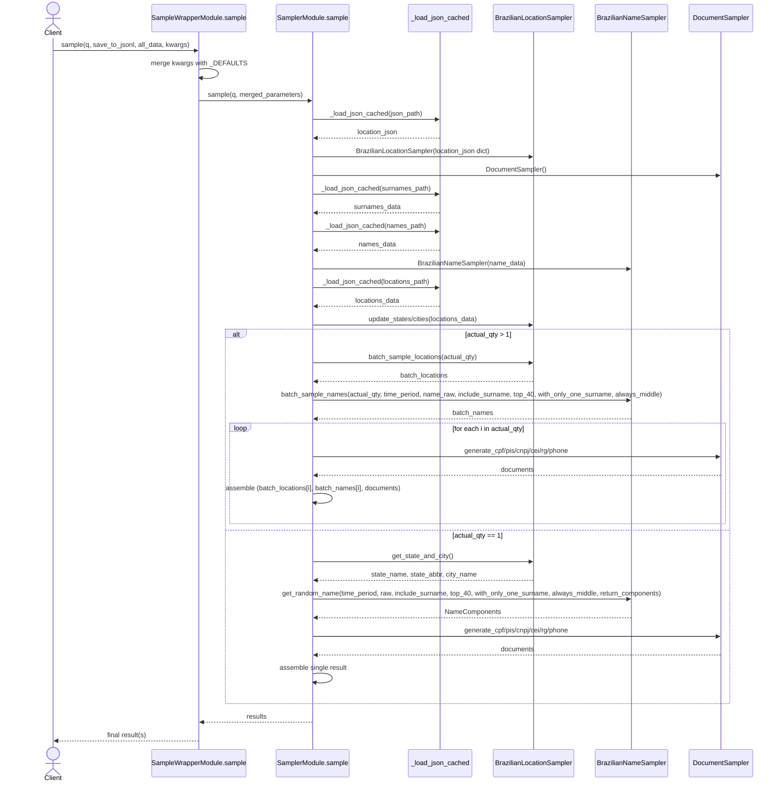
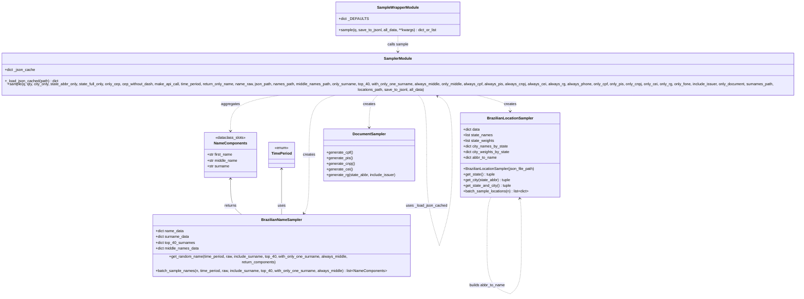

# PR Comments Export

> Exported from [https://github.com/arthrod/ptbr-sampler/pull/31](https://github.com/arthrod/ptbr-sampler/pull/31)  
> 34 of 34 comments selected  
> Generated by [Cicero](https://cicero.im) on 4/24/2026, 8:55:51 AM

---

### gemini-code-assist[bot] &mdash; 2/24/2026, 6:00:52 AM

> File: `src/br_location_class.py`

<details><summary>Code context</summary>

```diff
@@ -107,6 +112,12 @@ def _calculate_weights(self) -> None:
             if total > 0:
                 self.city_weights_by_state[state] = [w / total for w in self.city_weights_by_state[state]]
 
+        # Build reverse lookup: state abbreviation -> full state name
+        self.abbr_to_name: dict[str, str] = {
+            data['state_abbr']: name
+            for name, data in self.data['states'].items()
+        }
```
</details>


The addition of `abbr_to_name` for reverse lookup (state abbreviation to full state name) is a useful enhancement. This can simplify code that needs to convert abbreviations to full names, improving maintainability and potentially performance by avoiding repeated lookups or string manipulations.

---

### gemini-code-assist[bot] &mdash; 2/24/2026, 6:00:52 AM

> File: `src/__init__.py`

<details><summary>Code context</summary>

```diff
@@ -14,7 +14,14 @@
 
 from src.br_location_class import BrazilianLocationSampler
 from src.br_name_class import BrazilianNameSampler, TimePeriod
-from src.cli import app, main
+
+# CLI module uses different import paths (ptbr_sampler.*) that may not be
+# available in all environments. Import lazily to avoid breaking core imports.
+try:
+    from src.cli import app, main
+except ImportError:
+    app = None  # type: ignore[assignment]
+    main = None  # type: ignore[assignment]
```
</details>


Lazily importing `app` and `main` from `src.cli` is a good approach to prevent `ImportError` in environments where the CLI dependencies might not be available. This makes the core library more robust and flexible.

---

### gemini-code-assist[bot] &mdash; 2/24/2026, 6:00:52 AM

> File: `src/sampler.py`

<details><summary>Code context</summary>

```diff
@@ -527,26 +559,25 @@ def sample(
                 if always_cei or only_cei:
                     documents['cei'] = doc_sampler.generate_cei()
                 if always_rg or only_rg:
-                    # Always use the state from our location for RG generation
                     documents['rg'] = f'{doc_sampler.generate_rg(state_abbr, include_issuer)}'
                 if always_phone or only_fone:
-                    # Get the DDD from the city data
                     city_data = location_sampler.city_data_by_name.get(city_name, {})
                     ddd = city_data.get('ddd', None)
                     documents['phone'] = generate_phone_number(ddd)
 
-                # Generate name components if needed
-                name_components = None
-
-                name_components = name_sampler.get_random_name(
-                    time_period=time_period,
-                    raw=name_raw,
-                    include_surname=True,
-                    top_40=top_40,
-                    with_only_one_surname=with_only_one_surname,
-                    always_middle=always_middle,
-                    return_components=True,
-                )
+                # Use batched name if available, otherwise single draw
+                if batch_names is not None:
+                    name_components = batch_names[i]
+                else:
+                    name_components = name_sampler.get_random_name(
+                        time_period=time_period,
+                        raw=name_raw,
+                        include_surname=True,
+                        top_40=top_40,
+                        with_only_one_surname=with_only_one_surname,
+                        always_middle=always_middle,
+                        return_components=True,
+                    )
```
</details>


Similar to location sampling, this block correctly integrates the `batch_names` results. Using `batch_names[i]` when available ensures that name components are retrieved efficiently from the pre-generated batch, falling back to `get_random_name` for single-sample scenarios.

---

### gemini-code-assist[bot] &mdash; 2/24/2026, 6:00:52 AM

> File: `src/sampler.py`

<details><summary>Code context</summary>

```diff
@@ -562,10 +593,14 @@ def sample(
         if progress_callback:
             progress_callback(actual_qty // 2, 'Preparing address data')  # Show approximately half-way progress
 
-        # For all types of generation
+        # Batch-draw locations for address generation
+        addr_locations = location_sampler.batch_sample_locations(actual_qty) if actual_qty > 1 else None
         for i in range(actual_qty):
-            # Generate a new state and city
-            state_name, state_abbr, city_name = location_sampler.get_state_and_city()
+            if addr_locations is not None:
+                loc = addr_locations[i]
+                state_name, state_abbr, city_name = loc['state_name'], loc['state_abbr'], loc['city_name']
+            else:
+                state_name, state_abbr, city_name = location_sampler.get_state_and_city()
```
</details>


The application of batch sampling for address generation (`addr_locations`) is a good consistency improvement. This ensures that all parts of the sampling process that can be batched are, further optimizing performance for `qty > 1`.

---

### gemini-code-assist[bot] &mdash; 2/24/2026, 6:00:52 AM

> File: `tests/conftest.py`

<details><summary>Code context</summary>

```diff
@@ -0,0 +1,138 @@
+"""Shared test configuration and fixtures."""
+
+import json
+from pathlib import Path
+
+import pytest
+
+from src.br_name_class import TimePeriod
+
+DATA_DIR = Path(__file__).parent.parent / 'src' / 'data'
+
+
+@pytest.fixture(scope='session')
+def locations_data() -> dict:
+    """Load location dataset once for the entire test session."""
+    path = DATA_DIR / 'cities_with_ceps.json'
+    if not path.exists():
+        pytest.skip(f'Test data not found: {path}')
+    with path.open(encoding='utf-8') as f:
+        return json.load(f)
+
+
+@pytest.fixture(scope='session')
+def location_sampler():
+    """Session-scoped location sampler instance using real data."""
+    from src.br_location_class import BrazilianLocationSampler
+
+    path = DATA_DIR / 'cities_with_ceps.json'
+    if not path.exists():
+        pytest.skip(f'Test data not found: {path}')
+    return BrazilianLocationSampler(path)
+
+
+@pytest.fixture(scope='session')
+def name_sampler():
+    """Session-scoped name sampler instance using real data."""
+    from src.br_name_class import BrazilianNameSampler
+
+    surnames_path = DATA_DIR / 'surnames_data.json'
+    names_path = DATA_DIR / 'names_data.json'
+    middle_names_path = DATA_DIR / 'middle_names.json'
+
+    for p in (surnames_path, names_path, middle_names_path):
+        if not p.exists():
+            pytest.skip(f'Test data not found: {p}')
+
+    # Build combined data dict the same way sampler.py does
+    with surnames_path.open(encoding='utf-8') as f:
+        surnames_data = json.load(f)
+    with names_path.open(encoding='utf-8') as f:
+        names_data = json.load(f)
+
+    name_data = {'surnames': surnames_data['surnames']}
+    name_data.update(names_data)
+
+    return BrazilianNameSampler(name_data, middle_names_path, None)
+
+
+@pytest.fixture
+def mock_location_data() -> dict:
+    """Minimal valid location data structure for unit tests."""
+    return {
+        'states': {
+            'São Paulo': {
+                'state_abbr': 'SP',
+                'population_percentage': 0.6,
+            },
+            'Rio de Janeiro': {
+                'state_abbr': 'RJ',
+                'population_percentage': 0.4,
+            },
+        },
+        'cities': {
+            'sao_paulo': {
+                'city_name': 'São Paulo',
+                'city_uf': 'SP',
+                'population_percentage_state': 0.5,
+                'cep_range_begins': '01000-000',
+                'cep_range_ends': '05999-999',
+            },
+            'campinas': {
+                'city_name': 'Campinas',
+                'city_uf': 'SP',
+                'population_percentage_state': 0.5,
+                'cep_range_begins': '13000-000',
+                'cep_range_ends': '13139-999',
+            },
+            'rio_de_janeiro': {
+                'city_name': 'Rio de Janeiro',
+                'city_uf': 'RJ',
+                'population_percentage_state': 1.0,
+                'cep_range_begins': '20000-000',
+                'cep_range_ends': '23799-999',
+            },
+        },
+    }
+
+
+@pytest.fixture
+def mock_name_data() -> dict:
+    """Minimal valid name data structure for unit tests."""
+    return {
+        'common_names_percentage': {
+            period.value: {
+                'names': {
+                    'Maria': {'percentage': 0.3},
+                    'João': {'percentage': 0.3},
+                    'Ana': {'percentage': 0.2},
+                    'Pedro': {'percentage': 0.2},
+                },
+                'total': 100,
+            }
+            for period in TimePeriod
+        },
+        'surnames': {
+            'Silva': {'percentage': 0.3},
+            'Santos': {'percentage': 0.2},
+            'Oliveira': {'percentage': 0.15},
+            'Souza': {'percentage': 0.15},
+            'Costa': {'percentage': 0.1},
+            'Pereira': {'percentage': 0.1},
+            'top_40': {
+                'Silva': {'percentage': 0.5},
+                'Santos': {'percentage': 0.5},
+            },
+        },
+    }
+
+
+@pytest.fixture
+def seeded_random():
+    """Fixture that seeds random for deterministic tests, restores state after."""
+    import random
+
+    state = random.getstate()
+    random.seed(42)
+    yield
+    random.setstate(state)
```
</details>


The `conftest.py` file is well-structured, providing session-scoped fixtures for `location_sampler` and `name_sampler` using real data, and also offering mock data fixtures for unit tests. This setup promotes efficient and reproducible testing, which is crucial for a comprehensive test suite.

---

### gemini-code-assist[bot] &mdash; 2/24/2026, 6:00:52 AM

> File: `sample.py`

<details><summary>Code context</summary>

```diff
@@ -5,11 +5,55 @@
 This module wraps the src.sampler.sample function and makes it easier to use programmatically.
 """
 
+from pathlib import Path
+
 from src.br_name_class import TimePeriod
 from src.sampler import sample as sampler_function
 
+# Default data paths (relative to project root, matching CLI defaults)
+_DATA_DIR = Path(__file__).parent / 'src' / 'data'
+
+_DEFAULTS = {
+    'qty': 1,
+    'city_only': False,
+    'state_abbr_only': False,
+    'state_full_only': False,
+    'only_cep': False,
+    'cep_without_dash': False,
+    'make_api_call': False,
+    'time_period': TimePeriod.UNTIL_2010,
+    'return_only_name': False,
+    'name_raw': False,
+    'json_path': _DATA_DIR / 'cities_with_ceps.json',
+    'names_path': _DATA_DIR / 'names_data.json',
+    'middle_names_path': _DATA_DIR / 'middle_names.json',
+    'only_surname': False,
+    'top_40': False,
+    'with_only_one_surname': False,
+    'always_middle': False,
+    'only_middle': False,
+    'always_cpf': True,
+    'always_pis': False,
+    'always_cnpj': False,
+    'always_cei': False,
+    'always_rg': True,
+    'always_phone': True,
+    'only_cpf': False,
+    'only_pis': False,
+    'only_cnpj': False,
+    'only_cei': False,
+    'only_rg': False,
+    'only_fone': False,
+    'include_issuer': True,
+    'only_document': False,
+    'surnames_path': _DATA_DIR / 'surnames_data.json',
+    'locations_path': _DATA_DIR / 'locations_data.json',
+    'save_to_jsonl': None,
+    'all_data': False,
+}
```
</details>


The `_DEFAULTS` dictionary is quite large and contains many boolean flags. While it centralizes default values, it might be more maintainable to group related flags into sub-dictionaries or use a dataclass for better organization and type hinting, especially if the number of parameters continues to grow. This would improve readability and make it easier to understand the purpose of each group of parameters.

---

### gemini-code-assist[bot] &mdash; 2/24/2026, 6:00:52 AM

> File: `tests/test_location_sampler.py`

<details><summary>Code context</summary>

```diff
@@ -0,0 +1,227 @@
+"""Tests for the BrazilianLocationSampler class."""
+
+import random
+
+import pytest
+
+from src.br_location_class import BrazilianLocationSampler
+
+
+class TestInitialization:
+    def test_init_from_dict(self, mock_location_data):
+        sampler = BrazilianLocationSampler(mock_location_data)
+        assert sampler.data == mock_location_data
+        assert len(sampler.state_weights) == 2
+        assert len(sampler.city_weights_by_state) == 2
+
+    def test_init_missing_cities_raises(self):
+        with pytest.raises(ValueError, match="Missing 'cities' or 'states'"):
+            BrazilianLocationSampler({'states': {'X': {}}, 'cities': {}})
+
+    def test_init_missing_states_raises(self):
+        with pytest.raises(ValueError, match="Missing 'cities' or 'states'"):
+            BrazilianLocationSampler({'states': {}, 'cities': {'x': {}}})
+
+    def test_abbr_to_name_built(self, mock_location_data):
+        sampler = BrazilianLocationSampler(mock_location_data)
+        assert sampler.abbr_to_name == {'SP': 'São Paulo', 'RJ': 'Rio de Janeiro'}
+
+
+class TestGetState:
+    def test_returns_valid_state(self, mock_location_data):
+        sampler = BrazilianLocationSampler(mock_location_data)
+        random.seed(42)
+        state_name, state_abbr = sampler.get_state()
+        assert state_name in ['São Paulo', 'Rio de Janeiro']
+        assert state_abbr in ['SP', 'RJ']
+
+    def test_weighted_distribution(self, mock_location_data):
+        """SP has 60% weight, RJ 40%. Over many draws, SP should appear more."""
+        sampler = BrazilianLocationSampler(mock_location_data)
+        random.seed(0)
+        counts = {'SP': 0, 'RJ': 0}
+        for _ in range(1000):
+            _, abbr = sampler.get_state()
+            counts[abbr] += 1
+        assert counts['SP'] > counts['RJ']
+
+
+class TestGetCity:
+    def test_returns_valid_city_for_state(self, mock_location_data):
+        sampler = BrazilianLocationSampler(mock_location_data)
+        city_name, state_abbr = sampler.get_city('SP')
+        assert city_name in ['São Paulo', 'Campinas']
+        assert state_abbr == 'SP'
+
+    def test_rj_city(self, mock_location_data):
+        sampler = BrazilianLocationSampler(mock_location_data)
+        city_name, state_abbr = sampler.get_city('RJ')
+        assert city_name == 'Rio de Janeiro'
+        assert state_abbr == 'RJ'
+
+    def test_invalid_state_raises(self, mock_location_data):
+        sampler = BrazilianLocationSampler(mock_location_data)
+        with pytest.raises(ValueError, match='No cities found for state: XX'):
+            sampler.get_city('XX')
+
+    def test_random_state_when_none(self, mock_location_data):
+        sampler = BrazilianLocationSampler(mock_location_data)
+        city_name, state_abbr = sampler.get_city()
+        assert city_name in ['São Paulo', 'Campinas', 'Rio de Janeiro']
+        assert state_abbr in ['SP', 'RJ']
+
+
+class TestGetStateAndCity:
+    def test_returns_consistent_tuple(self, mock_location_data):
+        sampler = BrazilianLocationSampler(mock_location_data)
+        random.seed(42)
+        state_name, state_abbr, city_name = sampler.get_state_and_city()
+        assert state_name in ['São Paulo', 'Rio de Janeiro']
+        assert state_abbr in ['SP', 'RJ']
+        # City must belong to the returned state
+        city_data = sampler.city_data_by_name[city_name]
+        assert city_data['city_uf'] == state_abbr
+
+
+class TestCepFormatting:
+    def test_format_with_dash(self, mock_location_data):
+        sampler = BrazilianLocationSampler(mock_location_data)
+        assert sampler._format_cep('12345678', True) == '12345-678'
+
+    def test_format_without_dash(self, mock_location_data):
+        sampler = BrazilianLocationSampler(mock_location_data)
+        assert sampler._format_cep('12345-678', False) == '12345678'
+
+    def test_format_already_dashed(self, mock_location_data):
+        sampler = BrazilianLocationSampler(mock_location_data)
+        assert sampler._format_cep('12345-678', True) == '12345-678'
+
+
+class TestRandomCep:
+    def test_cep_in_range(self, mock_location_data):
+        sampler = BrazilianLocationSampler(mock_location_data)
+        random.seed(42)
+        cep_str = sampler._get_random_cep_for_city('Campinas')
+        cep_int = int(cep_str.replace('-', ''))
+        assert 13000000 <= cep_int <= 13139999
+
+    def test_city_not_found_raises(self, mock_location_data):
+        sampler = BrazilianLocationSampler(mock_location_data)
+        with pytest.raises(ValueError, match='City not found'):
+            sampler._get_random_cep_for_city('Nonexistent')
+
+
+class TestBatchSampleLocations:
+    def test_returns_correct_length(self, mock_location_data):
+        sampler = BrazilianLocationSampler(mock_location_data)
+        results = sampler.batch_sample_locations(100)
+        assert len(results) == 100
+
+    def test_single_draw(self, mock_location_data):
+        sampler = BrazilianLocationSampler(mock_location_data)
+        results = sampler.batch_sample_locations(1)
+        assert len(results) == 1
+        assert 'state_name' in results[0]
+        assert 'state_abbr' in results[0]
+        assert 'city_name' in results[0]
+
+    def test_all_entries_valid(self, mock_location_data):
+        sampler = BrazilianLocationSampler(mock_location_data)
+        results = sampler.batch_sample_locations(200)
+        valid_states = {'São Paulo', 'Rio de Janeiro'}
+        valid_abbrs = {'SP', 'RJ'}
+        valid_cities = {'São Paulo', 'Campinas', 'Rio de Janeiro'}
+        for entry in results:
+            assert entry['state_name'] in valid_states
+            assert entry['state_abbr'] in valid_abbrs
+            assert entry['city_name'] in valid_cities
+            # City belongs to its state
+            city_data = sampler.city_data_by_name[entry['city_name']]
+            assert city_data['city_uf'] == entry['state_abbr']
+
+    def test_batch_with_real_data(self, location_sampler):
+        """Test batch with full production dataset."""
+        results = location_sampler.batch_sample_locations(50)
+        assert len(results) == 50
+        for entry in results:
+            assert entry['state_name']
+            assert entry['state_abbr']
+            assert entry['city_name']
+
+
+class TestUpdateData:
+    def test_update_cities(self, mock_location_data):
+        sampler = BrazilianLocationSampler(mock_location_data)
+        new_city = {
+            'new_city': {
+                'city_name': 'Nova Cidade',
+                'city_uf': 'SP',
+                'population_percentage_state': 0.1,
+                'cep_range_begins': '14000-000',
+                'cep_range_ends': '14999-999',
+            }
+        }
+        sampler.update_cities(new_city)
+        assert 'Nova Cidade' in sampler.city_data_by_name
+
+    def test_update_cities_invalid_raises(self, mock_location_data):
+        sampler = BrazilianLocationSampler(mock_location_data)
+        with pytest.raises(ValueError, match='cities_data must be a dictionary'):
+            sampler.update_cities('not a dict')
+
+    def test_update_states(self, mock_location_data):
+        sampler = BrazilianLocationSampler(mock_location_data)
+        new_state = {
+            'Minas Gerais': {
+                'state_abbr': 'MG',
+                'population_percentage': 0.1,
+            }
+        }
+        sampler.update_states(new_state)
+        assert 'Minas Gerais' in sampler.state_names
+
+    def test_update_states_invalid_raises(self, mock_location_data):
+        sampler = BrazilianLocationSampler(mock_location_data)
+        with pytest.raises(ValueError, match='states_data must be a dictionary'):
+            sampler.update_states(42)
+
+
+class TestFormatting:
+    def test_format_full_location(self, mock_location_data):
+        sampler = BrazilianLocationSampler(mock_location_data)
+        location = sampler.format_full_location('Campinas', 'São Paulo', 'SP')
+        assert 'Campinas' in location
+        assert 'São Paulo' in location
+        assert 'SP' in location
+
+    def test_format_full_location_no_cep(self, mock_location_data):
+        sampler = BrazilianLocationSampler(mock_location_data)
+        location = sampler.format_full_location('Campinas', 'São Paulo', 'SP', include_cep=False)
+        assert location == 'Campinas, São Paulo (SP)'
+
+    def test_get_random_location_city_only(self, mock_location_data):
+        sampler = BrazilianLocationSampler(mock_location_data)
+        loc = sampler.get_random_location(city_only=True)
+        assert loc in ['São Paulo', 'Campinas', 'Rio de Janeiro']
+
+    def test_get_random_location_state_abbr_only(self, mock_location_data):
+        sampler = BrazilianLocationSampler(mock_location_data)
+        loc = sampler.get_random_location(state_abbr_only=True)
+        assert loc in ['SP', 'RJ']
+
+    def test_get_random_location_state_full_only(self, mock_location_data):
+        sampler = BrazilianLocationSampler(mock_location_data)
+        loc = sampler.get_random_location(state_full_only=True)
+        assert loc in ['São Paulo', 'Rio de Janeiro']
+
+    def test_get_random_location_cep_only(self, mock_location_data):
+        sampler = BrazilianLocationSampler(mock_location_data)
+        loc = sampler.get_random_location(only_cep=True)
+        assert len(loc) == 9
+        assert loc[5] == '-'
+
+    def test_get_random_location_cep_no_dash(self, mock_location_data):
+        sampler = BrazilianLocationSampler(mock_location_data)
+        loc = sampler.get_random_location(only_cep=True, cep_without_dash=True)
+        assert len(loc) == 8
+        assert '-' not in loc
```
</details>


This new test file provides comprehensive unit tests for `BrazilianLocationSampler`, covering initialization, state/city retrieval, CEP formatting, batch sampling, and data updates. The use of mock data for unit tests and real data for integration-like tests (via `location_sampler` fixture) is a good strategy.

---

### gemini-code-assist[bot] &mdash; 2/24/2026, 6:00:52 AM

> File: `tests/test_name_sampler.py`

<details><summary>Code context</summary>

```diff
@@ -0,0 +1,207 @@
+"""Tests for the BrazilianNameSampler class."""
+
+import random
+
+import pytest
+
+from src.br_name_class import BrazilianNameSampler, NameComponents, TimePeriod
+
+
+class TestInitialization:
+    def test_init_from_dict(self, mock_name_data):
+        sampler = BrazilianNameSampler(mock_name_data)
+        assert sampler.name_data is not None
+        assert sampler.surname_data is not None
+        assert sampler.top_40_surnames is not None
+
+    def test_init_invalid_path_raises(self):
+        with pytest.raises(FileNotFoundError):
+            BrazilianNameSampler('nonexistent_path.json')
+
+    def test_init_missing_surnames_raises(self):
+        data = {
+            'common_names_percentage': {
+                p.value: {'names': {'Test': {'percentage': 1.0}}, 'total': 1}
+                for p in TimePeriod
+            }
+        }
+        with pytest.raises(ValueError, match="Missing 'surnames' data"):
+            BrazilianNameSampler(data)
+
+    def test_init_missing_names_raises_key_error(self):
+        """When no names_path and no common_names_percentage, KeyError is raised."""
+        data = {'surnames': {'Test': {'percentage': 1.0}, 'top_40': {}}}
+        with pytest.raises(KeyError):
+            BrazilianNameSampler(data)
+
+
+class TestValidation:
+    def test_valid_data_passes(self, mock_name_data):
+        sampler = BrazilianNameSampler(mock_name_data)
+        sampler._validate_data()  # Should not raise
+
+    def test_missing_period_raises(self, mock_name_data):
+        mock_name_data['common_names_percentage'].pop('ate1930')
+        with pytest.raises(ValueError, match='Missing data for time period'):
+            BrazilianNameSampler(mock_name_data)
+
+    def test_missing_names_key_raises(self, mock_name_data):
+        mock_name_data['common_names_percentage']['ate1930'] = {'total': 1}
+        with pytest.raises(ValueError, match='Missing names data for time period'):
+            BrazilianNameSampler(mock_name_data)
+
+
+class TestNameGeneration:
+    def test_returns_string_by_default(self, mock_name_data):
+        sampler = BrazilianNameSampler(mock_name_data)
+        name = sampler.get_random_name()
+        assert isinstance(name, str)
+        assert len(name) > 0
+
+    def test_returns_components(self, mock_name_data):
+        sampler = BrazilianNameSampler(mock_name_data)
+        result = sampler.get_random_name(return_components=True)
+        assert isinstance(result, NameComponents)
+        assert result.first_name
+        assert result.surname
+
+    def test_raw_format(self, mock_name_data):
+        sampler = BrazilianNameSampler(mock_name_data)
+        random.seed(42)
+        result = sampler.get_random_name(raw=True, return_components=True)
+        assert result.first_name.isupper()
+
+    def test_time_period_selection(self, mock_name_data):
+        sampler = BrazilianNameSampler(mock_name_data)
+        for period in TimePeriod:
+            name = sampler.get_random_name(time_period=period)
+            assert isinstance(name, str)
+            assert len(name) > 0
+
+    def test_no_surname(self, mock_name_data):
+        sampler = BrazilianNameSampler(mock_name_data)
+        result = sampler.get_random_name(include_surname=False, return_components=True)
+        assert result.surname == ''
+
+
+class TestSurnameGeneration:
+    def test_default_two_surnames(self, mock_name_data):
+        sampler = BrazilianNameSampler(mock_name_data)
+        random.seed(42)
+        surname = sampler.get_random_surname()
+        assert isinstance(surname, str)
+        assert len(surname) > 0
+
+    def test_single_surname(self, mock_name_data):
+        sampler = BrazilianNameSampler(mock_name_data)
+        random.seed(42)
+        surname = sampler.get_random_surname(with_only_one_surname=True)
+        # A single surname may still have a prefix like "da Silva"
+        assert isinstance(surname, str)
+        assert len(surname) > 0
+
+    def test_top_40(self, mock_name_data):
+        sampler = BrazilianNameSampler(mock_name_data)
+        random.seed(42)
+        surname = sampler.get_random_surname(top_40=True)
+        # With our mock data, top_40 only has Silva and Santos
+        assert isinstance(surname, str)
+
+    def test_raw_surname(self, mock_name_data):
+        sampler = BrazilianNameSampler(mock_name_data)
+        random.seed(42)
+        surname = sampler.get_random_surname(raw=True)
+        # Raw means uppercase
+        parts = surname.split()
+        for part in parts:
+            # Prefixes may be lowercase even in raw mode if not matched, but
+            # actual surname tokens should be uppercase
+            assert part.isupper() or part.lower() in ('da', 'de', 'do', 'dos', 'das', 'e', "d'")
+
+
+class TestApplyPrefix:
+    def test_unknown_surname_no_prefix(self, mock_name_data):
+        sampler = BrazilianNameSampler(mock_name_data)
+        assert sampler._apply_prefix('Unknown') == 'Unknown'
+
+    def test_prefix_not_allowed(self, mock_name_data):
+        sampler = BrazilianNameSampler(mock_name_data)
+        assert sampler._apply_prefix('Silva', allow_prefix=False) == 'Silva'
+
+    def test_known_surname_gets_prefix_or_not(self, mock_name_data):
+        """Silva is in SURNAME_PREFIXES, so result is either prefixed or raw."""
+        sampler = BrazilianNameSampler(mock_name_data)
+        results = set()
+        for seed in range(200):
+            random.seed(seed)
+            results.add(sampler._apply_prefix('Silva'))
+        # Should see at least the unprefixed and one prefixed variant
+        assert len(results) > 1
+
+
+class TestNameComponentsSlots:
+    def test_slots_are_used(self):
+        nc = NameComponents('João', 'Pedro', 'Silva')
+        assert nc.first_name == 'João'
+        assert nc.middle_name == 'Pedro'
+        assert nc.surname == 'Silva'
+        # Verify __slots__ is in effect: assigning a new attribute should fail
+        with pytest.raises(AttributeError):
+            nc.new_attr = 'test'
+
+
+class TestBatchSampleNames:
+    def test_returns_correct_length(self, mock_name_data):
+        sampler = BrazilianNameSampler(mock_name_data)
+        results = sampler.batch_sample_names(100)
+        assert len(results) == 100
+
+    def test_single_draw(self, mock_name_data):
+        sampler = BrazilianNameSampler(mock_name_data)
+        results = sampler.batch_sample_names(1)
+        assert len(results) == 1
+        assert isinstance(results[0], NameComponents)
+
+    def test_all_entries_are_name_components(self, mock_name_data):
+        sampler = BrazilianNameSampler(mock_name_data)
+        results = sampler.batch_sample_names(50)
+        for nc in results:
+            assert isinstance(nc, NameComponents)
+            assert nc.first_name
+            assert nc.surname
+
+    def test_raw_mode(self, mock_name_data):
+        sampler = BrazilianNameSampler(mock_name_data)
+        random.seed(42)
+        results = sampler.batch_sample_names(20, raw=True)
+        for nc in results:
+            assert nc.first_name.isupper()
+
+    def test_single_surname_mode(self, mock_name_data):
+        sampler = BrazilianNameSampler(mock_name_data)
+        random.seed(42)
+        results = sampler.batch_sample_names(20, with_only_one_surname=True)
+        for nc in results:
+            assert isinstance(nc.surname, str)
+            assert len(nc.surname) > 0
+
+    def test_no_surname_mode(self, mock_name_data):
+        sampler = BrazilianNameSampler(mock_name_data)
+        results = sampler.batch_sample_names(20, include_surname=False)
+        for nc in results:
+            assert nc.surname == ''
+
+    def test_batch_with_real_data(self, name_sampler):
+        """Test batch with full production dataset."""
+        results = name_sampler.batch_sample_names(50)
+        assert len(results) == 50
+        for nc in results:
+            assert nc.first_name
+            assert nc.surname
+
+    def test_always_middle(self, name_sampler):
+        """With always_middle, every entry should have a middle name."""
+        results = name_sampler.batch_sample_names(50, always_middle=True)
+        for nc in results:
+            assert nc.middle_name is not None
+            assert len(nc.middle_name) > 0
```
</details>


This new test file provides comprehensive unit tests for `BrazilianNameSampler`, covering initialization, name generation, surname generation, prefix application, and batch sampling. The specific tests for `NameComponents` slots are also a good detail to ensure the memory optimization works as expected.

---

### gemini-code-assist[bot] &mdash; 2/24/2026, 6:00:52 AM

> File: `tests/test_sample_api.py`

<details><summary>Code context</summary>

```diff
@@ -0,0 +1,80 @@
+"""Tests for the public sample.py API wrapper."""
+
+import pytest
+
+from sample import TimePeriod, sample
+
+
+@pytest.fixture(autouse=True)
+def _skip_if_no_data():
+    """Skip if data files are missing."""
+    from pathlib import Path
+
+    data_dir = Path(__file__).parent.parent / 'src' / 'data'
+    required = [
+        data_dir / 'cities_with_ceps.json',
+        data_dir / 'names_data.json',
+        data_dir / 'surnames_data.json',
+        data_dir / 'middle_names.json',
+    ]
+    for p in required:
+        if not p.exists():
+            pytest.skip(f'Test data not found: {p}')
+
+
+class TestBasicAPI:
+    def test_single_sample_returns_dict(self):
+        result = sample(q=1)
+        assert isinstance(result, dict)
+
+    def test_multiple_samples_returns_list(self):
+        result = sample(q=5)
+        assert isinstance(result, list)
+        assert len(result) == 5
+
+    def test_default_q_returns_dict(self):
+        result = sample()
+        assert isinstance(result, dict)
+
+
+class TestKwargs:
+    def test_all_data(self):
+        result = sample(q=1, all_data=True)
+        assert result['cpf']
+        assert result['rg']
+        assert result['pis']
+        assert result['cnpj']
+        assert result['cei']
+
+    def test_time_period(self):
+        result = sample(q=1, time_period=TimePeriod.UNTIL_1950)
+        assert result['name']
+
+    def test_name_raw(self):
+        result = sample(q=1, name_raw=True)
+        assert result['name'].isupper()
+
+    def test_only_cpf(self):
+        result = sample(q=1, only_cpf=True)
+        assert result['cpf']
+
+    def test_city_only(self):
+        result = sample(q=1, city_only=True)
+        assert result['city']
+
+
+class TestSaveToJsonl:
+    def test_save_creates_file(self, tmp_path):
+        output = tmp_path / 'test_output.jsonl'
+        sample(q=2, save_to_jsonl=str(output))
+        assert output.exists()
+        lines = output.read_text().strip().split('\n')
+        assert len(lines) == 2
+
+
+class TestTypeAnnotation:
+    def test_signature_accepts_none(self):
+        """Verify the fixed type annotation works: str | None = None."""
+        # This test just verifies the function can be called with save_to_jsonl=None
+        result = sample(q=1, save_to_jsonl=None)
+        assert isinstance(result, dict)
```
</details>


This new test file specifically targets the public `sample.py` API wrapper, ensuring its functionality and parameter handling are correct. The `_skip_if_no_data` fixture is a practical way to manage test execution when data files might be missing, and the test for the fixed type annotation is a good catch.

---

### gemini-code-assist[bot] &mdash; 2/24/2026, 6:00:52 AM

> File: `tests/test_sampler.py`

<details><summary>Code context</summary>

```diff
@@ -0,0 +1,164 @@
+"""Integration tests for src.sampler.sample()."""
+
+from pathlib import Path
+
+import pytest
+
+from src.br_name_class import TimePeriod
+from src.sampler import sample
+
+DATA_DIR = Path(__file__).parent.parent / 'src' / 'data'
+
+# Default paths matching CLI defaults
+DEFAULT_KWARGS = {
+    'qty': 1,
+    'q': None,
+    'city_only': False,
+    'state_abbr_only': False,
+    'state_full_only': False,
+    'only_cep': False,
+    'cep_without_dash': False,
+    'make_api_call': False,
+    'time_period': TimePeriod.UNTIL_2010,
+    'return_only_name': False,
+    'name_raw': False,
+    'json_path': DATA_DIR / 'cities_with_ceps.json',
+    'names_path': DATA_DIR / 'names_data.json',
+    'middle_names_path': DATA_DIR / 'middle_names.json',
+    'only_surname': False,
+    'top_40': False,
+    'with_only_one_surname': False,
+    'always_middle': False,
+    'only_middle': False,
+    'always_cpf': True,
+    'always_pis': False,
+    'always_cnpj': False,
+    'always_cei': False,
+    'always_rg': True,
+    'always_phone': True,
+    'only_cpf': False,
+    'only_pis': False,
+    'only_cnpj': False,
+    'only_cei': False,
+    'only_rg': False,
+    'only_fone': False,
+    'include_issuer': True,
+    'only_document': False,
+    'surnames_path': DATA_DIR / 'surnames_data.json',
+    'locations_path': DATA_DIR / 'locations_data.json',
+    'save_to_jsonl': None,
+    'all_data': False,
+}
+
+
+def _sample(**overrides):
+    """Call sample() with default args plus any overrides."""
+    kwargs = {**DEFAULT_KWARGS, **overrides}
+    return sample(**kwargs)
+
+
+@pytest.fixture(autouse=True)
+def _skip_if_no_data():
+    """Skip all tests in this module if data files are missing."""
+    required = [
+        DATA_DIR / 'cities_with_ceps.json',
+        DATA_DIR / 'names_data.json',
+        DATA_DIR / 'surnames_data.json',
+        DATA_DIR / 'middle_names.json',
+    ]
+    for p in required:
+        if not p.exists():
+            pytest.skip(f'Test data not found: {p}')
+
+
+class TestSingleSample:
+    def test_returns_dict(self):
+        result = _sample(qty=1)
+        assert isinstance(result, dict)
+
+    def test_has_required_keys(self):
+        result = _sample(qty=1)
+        for key in ('name', 'city', 'state', 'state_abbr', 'cpf', 'rg'):
+            assert key in result
+
+    def test_name_is_nonempty(self):
+        result = _sample(qty=1)
+        assert result['name']
+
+    def test_city_is_nonempty(self):
+        result = _sample(qty=1)
+        assert result['city']
+
+
+class TestMultipleSamples:
+    def test_returns_list(self):
+        result = _sample(qty=3)
+        assert isinstance(result, list)
+        assert len(result) == 3
+
+    def test_each_has_keys(self):
+        results = _sample(qty=3)
+        for r in results:
+            assert 'name' in r
+            assert 'city' in r
+
+    def test_batch_path_used(self):
+        """With qty > 1, batch methods should produce valid results."""
+        results = _sample(qty=10)
+        assert len(results) == 10
+        for r in results:
+            assert r['name']
+            assert r['city']
+
+
+class TestAllData:
+    def test_all_data_flag(self):
+        result = _sample(qty=1, all_data=True)
+        assert result['cpf']
+        assert result['rg']
+        assert result['phone']
+        assert result['pis']
+        assert result['cnpj']
+        assert result['cei']
+
+
+class TestDocumentOnly:
+    def test_only_document(self):
+        result = _sample(qty=1, only_document=True, always_cpf=True)
+        assert isinstance(result, dict)
+        assert result['cpf']
+
+    def test_only_cpf(self):
+        result = _sample(qty=1, only_cpf=True)
+        assert isinstance(result, dict)
+        assert result['cpf']
+
+
+class TestNameOnly:
+    def test_return_only_name(self):
+        result = _sample(qty=1, return_only_name=True)
+        assert isinstance(result, dict)
+        assert result['name']
+
+    def test_only_surname(self):
+        result = _sample(qty=1, only_surname=True)
+        assert isinstance(result, dict)
+        assert result['surnames']
+
+
+class TestLocationFormats:
+    def test_city_only(self):
+        result = _sample(qty=1, city_only=True)
+        assert isinstance(result, dict)
+        assert result['city']
+
+    def test_state_abbr_only(self):
+        result = _sample(qty=1, state_abbr_only=True)
+        assert isinstance(result, dict)
+
+
+class TestQAlias:
+    def test_q_takes_precedence(self):
+        result = _sample(qty=1, q=3)
+        assert isinstance(result, list)
+        assert len(result) == 3
```
</details>


This new test file provides integration tests for `src.sampler.sample()`, covering single and multiple samples, `all_data` flag, document-only, name-only, and location format options. The `_sample` helper function and `_skip_if_no_data` fixture contribute to clean and efficient testing.

---

### gemini-code-assist[bot] &mdash; 2/24/2026, 6:00:52 AM

> File: `tests/test_smoke.py`

<details><summary>Code context</summary>

```diff
@@ -0,0 +1,109 @@
+"""Smoke tests: verify imports, basic generation, and CLI help."""
+
+import subprocess
+import sys
+from pathlib import Path
+
+import pytest
+
+DATA_DIR = Path(__file__).parent.parent / 'src' / 'data'
+
+
+def test_imports():
+    """Verify all public modules import without error."""
+    from sample import TimePeriod, sample  # noqa: F401
+    from src.br_location_class import BrazilianLocationSampler  # noqa: F401
+    from src.br_name_class import BrazilianNameSampler, NameComponents  # noqa: F401
+    from src.document_sampler import DocumentSampler  # noqa: F401
+    from src.sampler import sample as sampler_sample  # noqa: F401
+
+
+def test_time_period_enum():
+    """Verify TimePeriod enum has expected members."""
+    from src.br_name_class import TimePeriod
+
+    assert len(TimePeriod) == 9
+    assert TimePeriod.UNTIL_2010.value == 'ate2010'
+    assert TimePeriod.UNTIL_1930.value == 'ate1930'
+
+
+@pytest.fixture
+def _skip_if_no_data():
+    """Skip if data files are missing."""
+    required = [
+        DATA_DIR / 'cities_with_ceps.json',
+        DATA_DIR / 'names_data.json',
+        DATA_DIR / 'surnames_data.json',
+        DATA_DIR / 'middle_names.json',
+    ]
+    for p in required:
+        if not p.exists():
+            pytest.skip(f'Test data not found: {p}')
+
+
+@pytest.mark.usefixtures('_skip_if_no_data')
+def test_sample_returns_dict():
+    """Basic smoke test: sample(q=1) returns a dict."""
+    from sample import sample
+
+    result = sample(q=1)
+    assert isinstance(result, dict)
+    assert 'name' in result
+
+
+@pytest.mark.usefixtures('_skip_if_no_data')
+def test_sample_returns_list_for_multiple():
+    """sample(q=5) returns a list of 5 dicts."""
+    from sample import sample
+
+    result = sample(q=5)
+    assert isinstance(result, list)
+    assert len(result) == 5
+    assert all(isinstance(r, dict) for r in result)
+
+
+def test_document_sampler_generates():
+    """DocumentSampler produces valid document strings."""
+    from src.document_sampler import DocumentSampler
+
+    ds = DocumentSampler()
+    cpf = ds.generate_cpf()
+    assert isinstance(cpf, str)
+    assert len(cpf) > 0
+
+    pis = ds.generate_pis()
+    assert isinstance(pis, str)
+
+    cnpj = ds.generate_cnpj()
+    assert isinstance(cnpj, str)
+
+    cei = ds.generate_cei()
+    assert isinstance(cei, str)
+
+
+@pytest.mark.usefixtures('_skip_if_no_data')
+def test_location_sampler_basic():
+    """BrazilianLocationSampler loads and returns a state."""
+    from src.br_location_class import BrazilianLocationSampler
+
+    sampler = BrazilianLocationSampler(DATA_DIR / 'cities_with_ceps.json')
+    state_name, state_abbr = sampler.get_state()
+    assert isinstance(state_name, str)
+    assert len(state_abbr) == 2
+
+
+def test_name_components_creation():
+    """NameComponents dataclass with slots works correctly."""
+    from src.br_name_class import NameComponents
+
+    nc = NameComponents('João', 'Pedro', 'Silva')
+    assert nc.first_name == 'João'
+    assert nc.middle_name == 'Pedro'
+    assert nc.surname == 'Silva'
+
+
+def test_json_cache_module_attribute():
+    """Verify the JSON cache exists at module level in sampler."""
+    from src.sampler import _json_cache
+
+    assert isinstance(_json_cache, dict)
```
</details>


The `test_smoke.py` file provides essential smoke tests to verify basic imports, enum functionality, core sampling, and document generation. This ensures that the most critical parts of the library are functional, providing a quick health check for the codebase.

---

### gemini-code-assist[bot] &mdash; 2/24/2026, 6:00:51 AM

> File: `src/br_location_class.py`

<details><summary>Code context</summary>

```diff
@@ -1,23 +1,28 @@
 import json
 import random
+from collections import Counter
 from pathlib import Path
 
 
 class BrazilianLocationSampler:
     """Brazilian location sampling class for generating realistic location data."""
 
-    def __init__(self, json_file_path: str | Path):
-        """Initialize the sampler with population data from JSON files.
+    def __init__(self, json_file_path: str | Path | dict):
+        """Initialize the sampler with population data from JSON files or a dict.
 
         Args:
-            json_file_path: Path to main JSON file with population data
+            json_file_path: Path to main JSON file with population data, or
+                a pre-loaded dictionary with the same structure.
 
         Raises:
             ValueError: If required data is missing or invalid
             FileNotFoundError: If JSON files cannot be found
         """
-        with Path(json_file_path).open(encoding='utf-8') as file:
-            self.data = json.load(file)
+        if isinstance(json_file_path, dict):
+            self.data = json_file_path
+        else:
+            with Path(json_file_path).open(encoding='utf-8') as file:
+                self.data = json.load(file)
```
</details>

 

While allowing `json_file_path` to accept either a file path or a pre-loaded dictionary is a flexible design choice that benefits performance, the `__init__` method of `BrazilianLocationSampler` is critically vulnerable to path traversal. The `json_file_path` parameter, which is controllable by the user, is used to open a file without proper validation. This allows an attacker to read arbitrary files from the system.

---

### gemini-code-assist[bot] &mdash; 2/24/2026, 6:00:51 AM

> File: `src/sampler.py`

<details><summary>Code context</summary>

```diff
@@ -17,6 +17,22 @@
 from .br_name_class import BrazilianNameSampler, NameComponents, TimePeriod
 from .document_sampler import DocumentSampler
 
+# Module-level JSON cache to avoid re-parsing on repeated sample() calls.
+_json_cache: dict[str, dict] = {}
+
+
+def _load_json_cached(path: str | Path) -> dict:
+    """Load JSON data from a file, returning a cached copy after first load.
+
+    The returned dict is shared — callers that need to mutate it should
+    copy it first.
+    """
+    key = str(Path(path).resolve())
+    if key not in _json_cache:
+        with Path(path).open(encoding='utf-8') as f:
+            _json_cache[key] = json.load(f)
+    return _json_cache[key]
```
</details>

 

While the `_load_json_cached` function and the module-level `_json_cache` are excellent additions for performance optimization, the `_load_json_cached` function is critically vulnerable to a path traversal attack. The `path` parameter, which can be controlled by the user through the `sample.py` wrapper, is used to construct a file path that is then opened without proper validation. An attacker could provide a relative path (e.g., `../../../../etc/passwd`) to read sensitive files from the server's filesystem. This same vulnerability pattern is present in `src/br_location_class.py` and `src/br_name_class.py`.

---

### gemini-code-assist[bot] &mdash; 2/24/2026, 6:00:51 AM

> File: `src/br_name_class.py`

<details><summary>Code context</summary>

```diff
@@ -207,6 +207,123 @@ def get_random_name(
         name_parts.append(surname)
         return ' '.join(name_parts)
 
+    def batch_sample_names(
+        self,
+        n: int,
+        time_period: TimePeriod = TimePeriod.UNTIL_2010,
+        raw: bool = False,
+        include_surname: bool = True,
+        top_40: bool = False,
+        with_only_one_surname: bool = False,
+        always_middle: bool = False,
+    ) -> list[NameComponents]:
+        """Draw n name samples with batched random calls.
+
+        Batches the main random.choices draws for first names, middle names,
+        and surnames to amortize per-call overhead. The prefix logic remains
+        per-entry due to its conditional branching complexity.
+
+        Args:
+            n: Number of name samples to draw.
+            time_period: Time period for first name selection.
+            raw: Return names in uppercase format.
+            include_surname: Whether to include surnames.
+            top_40: Use only top 40 surnames.
+            with_only_one_surname: Use single surname instead of two.
+            always_middle: Always include a middle name.
+
+        Returns:
+            List of NameComponents dataclass instances.
+        """
+        # Prepare first name pool
+        period_data = self.name_data[time_period.value]
+        names_data = period_data['names']
+        first_name_pool = list(names_data.keys())
+        first_name_weights = [info['percentage'] for info in names_data.values()]
+
+        # Batch draw first names
+        drawn_first_names = random.choices(first_name_pool, weights=first_name_weights, k=n)
+        if raw:
+            drawn_first_names = [name.upper() for name in drawn_first_names]
+
+        # Batch middle name decisions and draws
+        middle_names: list[str | None] = [None] * n
+        if self.middle_names_data:
+            threshold = self.middle_names_data['percentage_with_second'] / 100
+
+            # Prepare middle name pool once
+            second_names = self.middle_names_data.get('second_names', {})
+            mn_pool: list[str] = []
+            mn_weights: list[float] = []
+            for name, data in second_names.items():
+                try:
+                    pct = float(data['percentage'])
+                    if pct > 0:
+                        mn_pool.append(name)
+                        mn_weights.append(pct)
+                except (ValueError, TypeError):
+                    continue
+
+            if mn_pool:
+                total_w = sum(mn_weights)
+                mn_weights = [w / total_w for w in mn_weights]
+
+                if always_middle:
+                    drawn_middles = random.choices(mn_pool, weights=mn_weights, k=n)
+                    for i in range(n):
+                        middle_names[i] = drawn_middles[i].upper() if raw else drawn_middles[i]
+                else:
+                    # Batch random decisions
+                    decisions = [random.random() < threshold for _ in range(n)]
+                    need_count = sum(decisions)
+                    if need_count > 0:
+                        drawn_middles = random.choices(mn_pool, weights=mn_weights, k=need_count)
+                        j = 0
+                        for i in range(n):
+                            if decisions[i]:
+                                middle_names[i] = drawn_middles[j].upper() if raw else drawn_middles[j]
+                                j += 1
+
+        if not include_surname:
+            return [
+                NameComponents(drawn_first_names[i], middle_names[i], '')
+                for i in range(n)
+            ]
+
+        # Prepare surname pool
+        source = self.top_40_surnames if top_40 else self.surname_data
+        surname_pool: list[str] = []
+        surname_weights: list[float] = []
+        for surname, info in source.items():
+            if surname != 'top_40':
+                surname_pool.append(surname)
+                surname_weights.append(info['percentage'])
+
+        # Batch draw surnames (2 per sample unless single surname)
+        drawn_surnames1 = random.choices(surname_pool, weights=surname_weights, k=n)
+        if not with_only_one_surname:
+            drawn_surnames2 = random.choices(surname_pool, weights=surname_weights, k=n)
+
+        # Assemble results (prefix application stays per-entry)
+        results: list[NameComponents] = []
+        for i in range(n):
+            s1 = drawn_surnames1[i].upper() if raw else drawn_surnames1[i]
+            s1 = self._apply_prefix(s1, allow_prefix=True)
+
+            if with_only_one_surname:
+                surname = s1
+            else:
+                s2 = drawn_surnames2[i].upper() if raw else drawn_surnames2[i]
+                if s2.upper() in ('JUNIOR', 'JR'):
+                    s2 = 'JR' if raw else 'Jr.'
+                else:
+                    s2 = self._apply_prefix(s2, allow_prefix=False)
+                surname = f'{s1} {s2}'
+
+            results.append(NameComponents(drawn_first_names[i], middle_names[i], surname))
+
+        return results
```
</details>


The `batch_sample_names` method is a crucial optimization for name generation. Similar to location sampling, batching random draws for first names, middle names, and surnames significantly reduces per-call overhead. The detailed implementation, including handling middle name decisions and surname prefixes, demonstrates a thorough approach to maintaining correctness while optimizing performance.

---

### gemini-code-assist[bot] &mdash; 2/24/2026, 6:00:51 AM

> File: `tests/test_batch_parity.py`

<details><summary>Code context</summary>

```diff
@@ -0,0 +1,127 @@
+"""Statistical parity tests: verify batched draws match theoretical distributions."""
+
+import random
+from collections import Counter
+
+import pytest
+
+from src.br_location_class import BrazilianLocationSampler
+from src.br_name_class import BrazilianNameSampler, NameComponents
+
+
+@pytest.mark.slow
+class TestLocationBatchParity:
+    def test_batch_matches_theoretical_state_distribution(self, location_sampler):
+        """Batched state draws should match the theoretical weight distribution.
+
+        Compares observed batch counts against expected counts derived from
+        the sampler's weight vector. A p-value > 0.01 means we cannot reject
+        the null hypothesis that the batch draws follow the correct weights.
+        """
+        from scipy.stats import chisquare
+
+        n = 50_000
+
+        random.seed(54321)
+        batched = location_sampler.batch_sample_locations(n)
+        batched_states = Counter(r['state_name'] for r in batched)
+
+        # Build expected counts from theoretical weights
+        expected_counts = []
+        observed_counts = []
+        for state_name, weight in zip(location_sampler.state_names, location_sampler.state_weights):
+            expected_counts.append(weight * n)
+            observed_counts.append(batched_states.get(state_name, 0))
+
+        # Filter out states with expected < 5 (chi-squared requirement)
+        filtered_obs = []
+        filtered_exp = []
+        for obs, exp in zip(observed_counts, expected_counts):
+            if exp >= 5:
+                filtered_obs.append(obs)
+                filtered_exp.append(exp)
+
+        stat, p_value = chisquare(filtered_obs, f_exp=filtered_exp)
+        assert p_value > 0.01, (
+            f'Distribution mismatch: chi2={stat:.2f}, p={p_value:.4f}. '
+            f'Batched sampling may not preserve weights correctly.'
+        )
+
+    def test_batch_city_distribution_within_state(self, location_sampler):
+        """Within each state, batched city draws should match the weighted distribution."""
+        n = 50_000
+
+        random.seed(99999)
+        batched = location_sampler.batch_sample_locations(n)
+
+        # Group by state
+        by_state: dict[str, Counter] = {}
+        for entry in batched:
+            abbr = entry['state_abbr']
+            if abbr not in by_state:
+                by_state[abbr] = Counter()
+            by_state[abbr][entry['city_name']] += 1
+
+        # For each state, verify cities have reasonable spread
+        for abbr, city_counts in by_state.items():
+            total = sum(city_counts.values())
+            if total < 100:
+                continue
+            # At least one city should be present
+            assert len(city_counts) >= 1
+
+
+@pytest.mark.slow
+class TestNameBatchParity:
+    def test_batch_matches_theoretical_first_name_distribution(self, name_sampler):
+        """Batched first name draws should match the theoretical weight distribution.
+
+        Compares observed batch counts against expected counts derived from
+        the name data weights for the UNTIL_2010 period.
+        """
+        from scipy.stats import chisquare
+
+        from src.br_name_class import TimePeriod
+
+        n = 20_000
+
+        random.seed(22222)
+        batched = name_sampler.batch_sample_names(n)
+        batched_names = Counter(nc.first_name for nc in batched)
+
+        # Build expected counts from theoretical weights
+        period_data = name_sampler.name_data[TimePeriod.UNTIL_2010.value]
+        names_data = period_data['names']
+
+        total_weight = sum(info['percentage'] for info in names_data.values())
+
+        # Only test names with expected count >= 5 (chi-squared assumption)
+        filtered_obs = []
+        filtered_exp = []
+        for name, info in names_data.items():
+            exp = (info['percentage'] / total_weight) * n
+            if exp >= 5:
+                filtered_obs.append(batched_names.get(name, 0))
+                filtered_exp.append(exp)
+
+        # Rescale expected to match observed sum (required by scipy chisquare)
+        obs_total = sum(filtered_obs)
+        exp_total = sum(filtered_exp)
+        if exp_total > 0:
+            filtered_exp = [e * obs_total / exp_total for e in filtered_exp]
+
+        stat, p_value = chisquare(filtered_obs, f_exp=filtered_exp)
+        assert p_value > 0.01, (
+            f'Name distribution mismatch: chi2={stat:.2f}, p={p_value:.4f}.'
+        )
+
+    def test_batch_surname_has_prefixes(self, name_sampler):
+        """Verify that batched names include surname prefixes (da, de, dos, etc.)."""
+        random.seed(42)
+        results = name_sampler.batch_sample_names(500)
+        prefix_count = sum(
+            1 for nc in results
+            if any(p in nc.surname.lower() for p in ['da ', 'de ', 'do ', 'dos ', 'das '])
+        )
+        # At least some entries should have prefixes
+        assert prefix_count > 0, 'No surname prefixes found in 500 batched samples.'
```
</details>


The addition of statistical parity tests using `scipy.stats.chisquare` is a strong validation of the batch sampling optimizations. Verifying that batched draws match theoretical probability distributions is essential to ensure the correctness and integrity of the generated data. Marking these tests as `slow` is also a good practice for test management.

---

### gemini-code-assist[bot] &mdash; 2/24/2026, 6:00:51 AM

> File: `src/sampler.py`

<details><summary>Code context</summary>

```diff
@@ -494,13 +509,30 @@ def sample(
                     progress_callback(i + 1, 'Generating names')
         else:
             # Full sample generation with location, name, and documents
+            # Use batch methods for bulk draws when generating multiple samples
+            if actual_qty > 1:
+                batch_locations = location_sampler.batch_sample_locations(actual_qty)
+                batch_names = name_sampler.batch_sample_names(
+                    actual_qty,
+                    time_period=time_period,
+                    raw=name_raw,
+                    include_surname=True,
+                    top_40=top_40,
+                    with_only_one_surname=with_only_one_surname,
+                    always_middle=always_middle,
+                )
```
</details>


This conditional block correctly leverages the new batch sampling methods (`batch_sample_locations` and `batch_sample_names`) when `actual_qty > 1`. This is the core integration of the performance optimizations and should lead to significant speedups for bulk generation tasks.

---

### gemini-code-assist[bot] &mdash; 2/24/2026, 6:00:51 AM

> File: `src/br_location_class.py`

<details><summary>Code context</summary>

```diff
@@ -149,6 +160,61 @@ def get_state_and_city(self) -> tuple[str, str, str]:
         city_name, _ = self.get_city(state_abbr)
         return state_name, state_abbr, city_name
 
+    def batch_sample_locations(self, n: int) -> list[dict[str, str]]:
+        """Draw n location samples with batched random calls.
+
+        Mathematically identical to calling get_state_and_city() n times —
+        random.choices(k=N) produces N independent draws from the same
+        categorical distribution. Batching amortizes per-call overhead.
+
+        Args:
+            n: Number of location samples to draw.
+
+        Returns:
+            List of dicts with keys: state_name, state_abbr, city_name
+        """
+        # Stage 1: batch-draw all states (self.state_names holds full names)
+        drawn_state_names = random.choices(
+            self.state_names, weights=self.state_weights, k=n
+        )
+
+        # Map full names to abbreviations for city lookup
+        state_abbr_map = {
+            name: self.data['states'][name]['state_abbr']
+            for name in set(drawn_state_names)
+        }
+
+        # Stage 2: count per-state, batch-draw cities
+        state_name_counts = Counter(drawn_state_names)
+        city_draws: dict[str, list[str]] = {}
+
+        for state_name, count in state_name_counts.items():
+            abbr = state_abbr_map[state_name]
+            if abbr in self.city_names_by_state:
+                city_draws[state_name] = random.choices(
+                    self.city_names_by_state[abbr],
+                    weights=self.city_weights_by_state[abbr],
+                    k=count,
+                )
+            else:
+                city_draws[state_name] = ['Unknown'] * count
+
+        # Stage 3: reassemble in original order
+        state_idx: dict[str, int] = {s: 0 for s in state_name_counts}
+        results: list[dict[str, str]] = []
+
+        for state_name in drawn_state_names:
+            abbr = state_abbr_map[state_name]
+            city_name = city_draws[state_name][state_idx[state_name]]
+            state_idx[state_name] += 1
+            results.append({
+                'state_name': state_name,
+                'state_abbr': abbr,
+                'city_name': city_name,
+            })
+
+        return results
```
</details>


The `batch_sample_locations` method is a significant optimization. By batching `random.choices` calls for states and cities, it amortizes the overhead associated with individual calls, leading to improved performance when generating multiple location samples. The three-stage process (batch-draw states, count per-state and batch-draw cities, reassemble) is a well-thought-out approach to maintain mathematical equivalence while gaining efficiency.

---

### gemini-code-assist[bot] &mdash; 2/24/2026, 6:00:51 AM

> File: `src/br_name_class.py`

<details><summary>Code context</summary>

```diff
@@ -20,7 +20,7 @@ class TimePeriod(str, Enum):
     UNTIL_2010 = 'ate2010'
 
 
-@dataclass
+@dataclass(slots=True)
```
</details>


Adding `slots=True` to the `NameComponents` dataclass is an excellent optimization. This reduces memory overhead, which can be substantial when creating a large number of `NameComponents` objects, as would happen during batch sampling. It also slightly improves attribute access speed.

---

### gemini-code-assist[bot] &mdash; 2/24/2026, 6:00:51 AM

> File: `src/sampler.py`

<details><summary>Code context</summary>

```diff
@@ -494,13 +509,30 @@ def sample(
                     progress_callback(i + 1, 'Generating names')
         else:
             # Full sample generation with location, name, and documents
+            # Use batch methods for bulk draws when generating multiple samples
+            if actual_qty > 1:
+                batch_locations = location_sampler.batch_sample_locations(actual_qty)
+                batch_names = name_sampler.batch_sample_names(
+                    actual_qty,
+                    time_period=time_period,
+                    raw=name_raw,
+                    include_surname=True,
+                    top_40=top_40,
+                    with_only_one_surname=with_only_one_surname,
+                    always_middle=always_middle,
+                )
+            else:
+                batch_locations = None
+                batch_names = None
+
             for i in range(actual_qty):
                 documents = {}
 
-                # No need to reload location data - already loaded once at the beginning
-
-                # Generate location first to ensure proper state handling
-                state_name, state_abbr, city_name = location_sampler.get_state_and_city()
+                if batch_locations is not None:
+                    loc = batch_locations[i]
+                    state_name, state_abbr, city_name = loc['state_name'], loc['state_abbr'], loc['city_name']
+                else:
+                    state_name, state_abbr, city_name = location_sampler.get_state_and_city()
```
</details>


The logic to use `batch_locations[i]` if available, otherwise fall back to `location_sampler.get_state_and_city()`, is correctly implemented. This ensures that individual samples within a batch benefit from the batched draws while maintaining compatibility with single-sample generation.

---

### gemini-code-assist[bot] &mdash; 2/24/2026, 6:00:51 AM

> File: `src/sampler.py`

<details><summary>Code context</summary>

```diff
@@ -339,34 +355,33 @@ def sample(
         only_document = False
 
     try:
-        # Initialize samplers only once
-        location_sampler = BrazilianLocationSampler(json_path)
+        # Initialize samplers — use cached JSON to avoid re-parsing on repeated calls
+        location_json = _load_json_cached(json_path)
+        import copy
+        location_sampler = BrazilianLocationSampler(copy.deepcopy(location_json))
```
</details>


Using `copy.deepcopy(location_json)` when initializing `BrazilianLocationSampler` with cached data is important. Since `_load_json_cached` returns a shared dictionary, deep copying prevents accidental modifications to the cached data by the sampler instance, ensuring data integrity across different sampler uses.

---

### gemini-code-assist[bot] &mdash; 2/24/2026, 6:00:51 AM

## Code Review

The pull request introduces significant improvements by adding a comprehensive test suite and optimizing batch sampling for the Brazilian data generator, enhancing performance for bulk generation and improving code quality. However, a critical path traversal vulnerability was identified where the new `sample.py` wrapper accepts arbitrary keyword arguments (`**kwargs`) used as file paths in `src/sampler.py`, `src/br_location_class.py`, and `src/br_name_class.py` without proper validation. This could allow an attacker to read arbitrary files or write to arbitrary locations, leading to a full system compromise. The new test infrastructure, including statistical parity tests, JSON caching, dataclass slots, API enhancements, and dependency updates are positive changes, but addressing the critical vulnerability is paramount.

---

### coderabbitai[bot] &mdash; 2/24/2026, 5:55:29 AM

**Actionable comments posted: 3**

> [!CAUTION]
> Some comments are outside the diff and can’t be posted inline due to platform limitations.
> 
> 
> 
> <details>
> <summary>⚠️ Outside diff range comments (2)</summary><blockquote>
> 
> <details>
> <summary>pyproject.toml (1)</summary><blockquote>
> 
> `31-31`: _⚠️ Potential issue_ | _🟠 Major_
> 
> **`pytest-cov` should not be a runtime dependency.**
> 
> `pytest-cov` is a test tool and is already correctly listed under `[project.optional-dependencies].test` (line 41). Having it in the main `dependencies` list means it will be installed for all users of the package, including in production.
> 
> 
> <details>
> <summary>🛠️ Proposed fix</summary>
> 
> ```diff
>      'loguru',
>      #'aiosmtplib',
>      ...
>      "rich>=13.9.4",
> -    "pytest-cov>=6.0.0",
>      "richer>=0.1.6",
>      "aiofiles>=24.1.0",
> ```
> </details>
> 
> <details>
> <summary>🤖 Prompt for AI Agents</summary>
> 
> ```
> Verify each finding against the current code and only fix it if needed.
> 
> In `@pyproject.toml` at line 31, Remove the test-only package from runtime
> dependencies: delete the "pytest-cov>=6.0.0" entry from the main dependencies
> block in pyproject.toml (the line shown in the diff) since pytest-cov is already
> listed under [project.optional-dependencies].test; ensure no other occurrences
> remain in the main dependencies section so pytest-cov is only an optional/test
> dependency.
> ```
> 
> </details>
> 
> </blockquote></details>
> <details>
> <summary>src/sampler.py (1)</summary><blockquote>
> 
> `596-610`: _⚠️ Potential issue_ | _🟠 Major_
> 
> **Second batch-draw for addresses produces locations that can conflict with the document-phase locations.**
> 
> Lines 514 and 597 each draw an independent set of locations. The result is that RG state and phone DDD are initially generated from the first batch (line 562, 564–566), but then:
> - The final output location comes from the **second** batch (line 636).
> - The phone is re-generated on line 646 using the second batch's city — correcting the DDD mismatch.
> - But **RG is not re-generated**, so a person may have an RG issued by state X while the output shows them in state Y.
> 
> This appears to be a pre-existing architectural issue (not introduced by this PR), but the batching makes the two independent draws more explicit. Consider reusing the same locations from the first batch instead of drawing new ones.
> 
> 
> <details>
> <summary>🛠️ Proposed fix — reuse the first batch</summary>
> 
> ```diff
> -        # Batch-draw locations for address generation
> -        addr_locations = location_sampler.batch_sample_locations(actual_qty) if actual_qty > 1 else None
>          for i in range(actual_qty):
> -            if addr_locations is not None:
> -                loc = addr_locations[i]
> -                state_name, state_abbr, city_name = loc['state_name'], loc['state_abbr'], loc['city_name']
> -            else:
> -                state_name, state_abbr, city_name = location_sampler.get_state_and_city()
> +            # Reuse locations from the results phase
> +            location, name_components, documents = results[i]
> +            # Extract state/city from the already-generated data
> +            if batch_locations is not None:
> +                loc = batch_locations[i]
> +                state_name, state_abbr, city_name = loc['state_name'], loc['state_abbr'], loc['city_name']
> +            else:
> +                # For non-batch paths (only_document, name-only, etc.),
> +                # fall back to a new draw or parse from results
> +                state_name, state_abbr, city_name = location_sampler.get_state_and_city()
> ```
> 
> A more thorough fix would store the per-sample `(state_name, state_abbr, city_name)` tuples during the first loop and reuse them here, for all code paths.
> </details>
> 
> <details>
> <summary>🤖 Prompt for AI Agents</summary>
> 
> ```
> Verify each finding against the current code and only fix it if needed.
> 
> In `@src/sampler.py` around lines 596 - 610, The code draws a second independent
> batch of locations into addr_locations causing state/city to differ from the
> earlier document-phase batch; fix by reusing the first-batch per-sample location
> tuples instead of calling batch_sample_locations or get_state_and_city again
> here: use the previously stored list (e.g. saved_state_city_tuples or the
> existing all_state_city_info captured during the first loop) to set state_name,
> state_abbr, city_name for each index i, then call
> location_sampler._get_random_cep_for_city and location_sampler._format_cep as
> before so phone DDD, RG issuance state and final output city/state are
> consistent.
> ```
> 
> </details>
> 
> </blockquote></details>
> 
> </blockquote></details>

<details>
<summary>🧹 Nitpick comments (5)</summary><blockquote>

<details>
<summary>src/sampler.py (1)</summary><blockquote>

`358-361`: **Move `import copy` to the module level.**

Placing the import inside the function body works but is unconventional and incurs a (tiny) repeated lookup cost. Module-level imports are the standard practice.


<details>
<summary>♻️ Proposed fix</summary>

Add at the top of the file with the other imports:
```python
import copy
```

Then on line 361:
```diff
-        import copy
         location_sampler = BrazilianLocationSampler(copy.deepcopy(location_json))
```
</details>

<details>
<summary>🤖 Prompt for AI Agents</summary>

```
Verify each finding against the current code and only fix it if needed.

In `@src/sampler.py` around lines 358 - 361, The local import "import copy" inside
the function should be moved to the module level with the other imports to
follow standard practice and avoid repeated lookups; remove the inline import
and ensure the function still uses the module-level copy when creating
BrazilianLocationSampler(copy.deepcopy(location_json)); keep references to
_load_json_cached, location_json, and BrazilianLocationSampler to locate the
change.
```

</details>

</blockquote></details>
<details>
<summary>src/br_location_class.py (1)</summary><blockquote>

`163-216`: **Batch location sampling — well-implemented.**

The three-stage approach (batch-draw states → per-state batch-draw cities → reassemble) is correct and preserves the same distribution as sequential `get_state_and_city()` calls.

One minor observation: the `'Unknown'` fallback on line 200 silently masks a data inconsistency (a state with no cities). Consider logging a warning here so data issues don't go unnoticed.

<details>
<summary>🤖 Prompt for AI Agents</summary>

```
Verify each finding against the current code and only fix it if needed.

In `@src/br_location_class.py` around lines 163 - 216, The fallback of inserting
'Unknown' silently in batch_sample_locations masks missing-city data; update the
function to log a warning when a state's abbreviation is missing from
city_names_by_state (use state_name/state_abbr from state_abbr_map) before
assigning the ['Unknown'] * count so data inconsistencies are visible—e.g., emit
a warning via your logger inside the loop that builds city_draws (referencing
state_name, abbr, and count) and then continue to populate city_draws as
currently done.
```

</details>

</blockquote></details>
<details>
<summary>src/__init__.py (1)</summary><blockquote>

`17-24`: **Guarded CLI import is reasonable, but consumers get a silent `None`.**

If a consumer does `from src import app; app()`, they'll get `TypeError: 'NoneType' object is not callable` with no hint about the missing CLI dependency. Consider either logging a warning or raising a more descriptive error via a lazy proxy. That said, this is a minor usability concern and fine for now.

<details>
<summary>🤖 Prompt for AI Agents</summary>

```
Verify each finding against the current code and only fix it if needed.

In `@src/__init__.py` around lines 17 - 24, Replace the silent None assignment in
src.__init__.py with lightweight lazy proxies for app and main that raise a
clear, descriptive error when invoked (e.g., RuntimeError or ImportError
indicating the CLI dependency/import path is missing and how to enable it), or
alternately log a warning at import time; update the except ImportError block to
set app and main to these callables so users who do "from src import app; app()"
get an informative message instead of a TypeError, and keep the original
try/except fallback behavior intact.
```

</details>

</blockquote></details>
<details>
<summary>tests/conftest.py (1)</summary><blockquote>

`23-31`: **Session-scoped mutable sampler — consider the implications.**

`location_sampler` is session-scoped, meaning all tests share the same instance. `BrazilianLocationSampler` has mutable state (`update_cities`, `update_states`). If any test mutates the sampler, it will silently affect all subsequent tests. This is fine as long as tests treat it as read-only, but worth noting with a comment.

<details>
<summary>🤖 Prompt for AI Agents</summary>

```
Verify each finding against the current code and only fix it if needed.

In `@tests/conftest.py` around lines 23 - 31, The session-scoped fixture
location_sampler returns a mutable BrazilianLocationSampler (methods
update_cities/update_states) which can leak state across tests; either change
the fixture to function scope (use `@pytest.fixture`(scope='function') on
location_sampler so each test gets a fresh BrazilianLocationSampler(path)
instance) or, if you must keep session scope, add a clear comment above
location_sampler warning tests not to mutate it and return a defensive copy for
each test (e.g., instantiate and return a new BrazilianLocationSampler(path) per
test or use deepcopy) while referencing the BrazilianLocationSampler,
location_sampler, update_cities and update_states symbols so reviewers can find
the code to update.
```

</details>

</blockquote></details>
<details>
<summary>tests/test_batch_parity.py (1)</summary><blockquote>

`32-42`: **`zip()` calls without `strict=` (Ruff B905).**

Both `zip` calls on lines 32 and 39 pair lists that are constructed in lock-step and should always have equal length. Adding `strict=False` explicitly silences the Ruff B905 warning and documents the intent; using `strict=True` would catch any future length divergence automatically.

<details>
<summary>🛠️ Proposed fix</summary>

```diff
-        for state_name, weight in zip(location_sampler.state_names, location_sampler.state_weights):
+        for state_name, weight in zip(location_sampler.state_names, location_sampler.state_weights, strict=True):
 ...
-        for obs, exp in zip(observed_counts, expected_counts):
+        for obs, exp in zip(observed_counts, expected_counts, strict=True):
```
</details>

<details>
<summary>🤖 Prompt for AI Agents</summary>

```
Verify each finding against the current code and only fix it if needed.

In `@tests/test_batch_parity.py` around lines 32 - 42, The two zip calls that
iterate over location_sampler.state_names with location_sampler.state_weights
and over observed_counts with expected_counts should be made explicit about
length expectations to silence Ruff B905 and catch future mismatches; update
both zip(...) invocations to include strict=True (e.g.,
zip(location_sampler.state_names, location_sampler.state_weights, strict=True)
and zip(observed_counts, expected_counts, strict=True)) so any future length
divergence is raised immediately and the intent is documented.
```

</details>

</blockquote></details>

</blockquote></details>

<details>
<summary>🤖 Prompt for all review comments with AI agents</summary>

```
Verify each finding against the current code and only fix it if needed.

Inline comments:
In `@sample.py`:
- Around line 108-116: The current sample() implementation always sets
merged['q']=q which makes the 'qty' entry in _DEFAULTS ineffective; fix by
either setting the sample() parameter q default to None and only assign
merged['q']=q when q is not None (so kwargs like qty can take effect in
sampler_function), or remove 'qty' from _DEFAULTS and document that q is the
sole count parameter; update the sample() signature and the merged assignment
logic (referencing sample(), _DEFAULTS, merged, q, qty, and sampler_function)
accordingly.

In `@tests/test_batch_parity.py`:
- Around line 65-71: The loop over by_state uses an unused variable abbr and
contains a trivially true assertion; change the loop header to use _abbr (or _)
instead of abbr to satisfy Ruff B007 and replace the no-op assertion assert
len(city_counts) >= 1 with a stronger check such as assert len(city_counts) >= 2
to ensure at least two distinct cities are present for states with total >= 100;
keep the existing total calculation and guard, and update any surrounding
comment to reflect the new expectation.
- Around line 29-48: The chi-square call fails or is invalid because
expected_counts are computed as weight * n without ensuring state_weights sum to
1, and after filtering out small expected cells filtered_obs and filtered_exp
can have mismatched totals; fix by normalizing location_sampler.state_weights
(or compute expected_counts as (weight / sum(location_sampler.state_weights)) *
n) when building expected_counts, then after filtering recompute a rescale
factor = sum(filtered_obs) / sum(filtered_exp) and multiply filtered_exp by that
factor before calling scipy.stats.chisquare; also guard against empty filtered
lists (skip/assert) to avoid calling chisquare with no categories.

---

Outside diff comments:
In `@pyproject.toml`:
- Line 31: Remove the test-only package from runtime dependencies: delete the
"pytest-cov>=6.0.0" entry from the main dependencies block in pyproject.toml
(the line shown in the diff) since pytest-cov is already listed under
[project.optional-dependencies].test; ensure no other occurrences remain in the
main dependencies section so pytest-cov is only an optional/test dependency.

In `@src/sampler.py`:
- Around line 596-610: The code draws a second independent batch of locations
into addr_locations causing state/city to differ from the earlier document-phase
batch; fix by reusing the first-batch per-sample location tuples instead of
calling batch_sample_locations or get_state_and_city again here: use the
previously stored list (e.g. saved_state_city_tuples or the existing
all_state_city_info captured during the first loop) to set state_name,
state_abbr, city_name for each index i, then call
location_sampler._get_random_cep_for_city and location_sampler._format_cep as
before so phone DDD, RG issuance state and final output city/state are
consistent.

---

Nitpick comments:
In `@src/__init__.py`:
- Around line 17-24: Replace the silent None assignment in src.__init__.py with
lightweight lazy proxies for app and main that raise a clear, descriptive error
when invoked (e.g., RuntimeError or ImportError indicating the CLI
dependency/import path is missing and how to enable it), or alternately log a
warning at import time; update the except ImportError block to set app and main
to these callables so users who do "from src import app; app()" get an
informative message instead of a TypeError, and keep the original try/except
fallback behavior intact.

In `@src/br_location_class.py`:
- Around line 163-216: The fallback of inserting 'Unknown' silently in
batch_sample_locations masks missing-city data; update the function to log a
warning when a state's abbreviation is missing from city_names_by_state (use
state_name/state_abbr from state_abbr_map) before assigning the ['Unknown'] *
count so data inconsistencies are visible—e.g., emit a warning via your logger
inside the loop that builds city_draws (referencing state_name, abbr, and count)
and then continue to populate city_draws as currently done.

In `@src/sampler.py`:
- Around line 358-361: The local import "import copy" inside the function should
be moved to the module level with the other imports to follow standard practice
and avoid repeated lookups; remove the inline import and ensure the function
still uses the module-level copy when creating
BrazilianLocationSampler(copy.deepcopy(location_json)); keep references to
_load_json_cached, location_json, and BrazilianLocationSampler to locate the
change.

In `@tests/conftest.py`:
- Around line 23-31: The session-scoped fixture location_sampler returns a
mutable BrazilianLocationSampler (methods update_cities/update_states) which can
leak state across tests; either change the fixture to function scope (use
`@pytest.fixture`(scope='function') on location_sampler so each test gets a fresh
BrazilianLocationSampler(path) instance) or, if you must keep session scope, add
a clear comment above location_sampler warning tests not to mutate it and return
a defensive copy for each test (e.g., instantiate and return a new
BrazilianLocationSampler(path) per test or use deepcopy) while referencing the
BrazilianLocationSampler, location_sampler, update_cities and update_states
symbols so reviewers can find the code to update.

In `@tests/test_batch_parity.py`:
- Around line 32-42: The two zip calls that iterate over
location_sampler.state_names with location_sampler.state_weights and over
observed_counts with expected_counts should be made explicit about length
expectations to silence Ruff B905 and catch future mismatches; update both
zip(...) invocations to include strict=True (e.g.,
zip(location_sampler.state_names, location_sampler.state_weights, strict=True)
and zip(observed_counts, expected_counts, strict=True)) so any future length
divergence is raised immediately and the intent is documented.
```

</details>

---

<details>
<summary>ℹ️ Review info</summary>

**Configuration used**: Organization UI

**Review profile**: CHILL

**Plan**: Pro

<details>
<summary>📥 Commits</summary>

Reviewing files that changed from the base of the PR and between b24863cf1a1ef37a354f37404b620249bdb41111 and 45b0e5a63418132f1a64d6afea814a04e2ad6cbf.

</details>

<details>
<summary>⛔ Files ignored due to path filters (1)</summary>

* `uv.lock` is excluded by `!**/*.lock`

</details>

<details>
<summary>📒 Files selected for processing (15)</summary>

* `.gitignore`
* `pyproject.toml`
* `sample.py`
* `src/__init__.py`
* `src/br_location_class.py`
* `src/br_name_class.py`
* `src/sampler.py`
* `tests/__init__.py`
* `tests/conftest.py`
* `tests/test_batch_parity.py`
* `tests/test_location_sampler.py`
* `tests/test_name_sampler.py`
* `tests/test_sample_api.py`
* `tests/test_sampler.py`
* `tests/test_smoke.py`

</details>

</details>

<!-- This is an auto-generated comment by CodeRabbit for review status -->

---

### coderabbitai[bot] &mdash; 2/24/2026, 5:55:27 AM

> File: `sample.py`

<details><summary>Code context</summary>

```diff
@@ -61,24 +105,15 @@ def sample(q: int = 1, save_to_jsonl: str = None | None, all_data: bool = False,
         - cnpj: CNPJ number (if requested)
         - cei: CEI number (if requested)
     """
-    # Map the 'q' parameter to 'qty' expected by cli_sample
-    if 'q' in kwargs:
-        # If both q and qty are provided, use qty
-        pass
-    elif q != 1:
-        # Only set qty if q is different from default
-        kwargs['qty'] = q
-
-    # Handle save_to_jsonl parameter
-    if save_to_jsonl:
-        kwargs['save_to_jsonl'] = save_to_jsonl
+    # Build full kwargs with defaults, letting explicit kwargs override
+    merged = {**_DEFAULTS, **kwargs}
 
-    # Handle all_data parameter
-    if all_data:
-        kwargs['all_data'] = all_data
+    # Map the top-level parameters
+    merged['q'] = q
+    merged['save_to_jsonl'] = save_to_jsonl
+    merged['all_data'] = all_data
 
-    # Call the underlying sample function
-    return sampler_function(q=q, **kwargs)
+    return sampler_function(**merged)
```
</details>

_⚠️ Potential issue_ | _🟡 Minor_

**`q` always overrides `qty`, making the `qty` default in `_DEFAULTS` dead code.**

Since `sample()` accepts `q` with a default of `1` and unconditionally sets `merged['q'] = q`, the `'qty': 1` entry in `_DEFAULTS` never influences the actual quantity. If a user passes `qty=10` via `**kwargs`, it's silently ignored because `actual_qty = q if q is not None else qty` in the underlying sampler, and `q` is always non-None (it defaults to `1`).

Consider either:
- Changing the `q` parameter default to `None` so users can control quantity via either `q` or `qty`, or
- Removing `qty` from `_DEFAULTS` and documenting that `q` is the only way to set count.


<details>
<summary>Option A: Allow `qty` to work when `q` is not explicitly passed</summary>

```diff
-def sample(q: int = 1, save_to_jsonl: str | None = None, all_data: bool = False, **kwargs) -> dict | list[dict]:
+def sample(q: int | None = None, save_to_jsonl: str | None = None, all_data: bool = False, **kwargs) -> dict | list[dict]:
```
</details>

<details>
<summary>🤖 Prompt for AI Agents</summary>

```
Verify each finding against the current code and only fix it if needed.

In `@sample.py` around lines 108 - 116, The current sample() implementation always
sets merged['q']=q which makes the 'qty' entry in _DEFAULTS ineffective; fix by
either setting the sample() parameter q default to None and only assign
merged['q']=q when q is not None (so kwargs like qty can take effect in
sampler_function), or remove 'qty' from _DEFAULTS and document that q is the
sole count parameter; update the sample() signature and the merged assignment
logic (referencing sample(), _DEFAULTS, merged, q, qty, and sampler_function)
accordingly.
```

</details>

<!-- fingerprinting:phantom:medusa:phoenix -->

<!-- This is an auto-generated comment by CodeRabbit -->

---

### coderabbitai[bot] &mdash; 2/24/2026, 5:55:27 AM

> File: `tests/test_batch_parity.py`

<details><summary>Code context</summary>

```diff
@@ -0,0 +1,127 @@
+"""Statistical parity tests: verify batched draws match theoretical distributions."""
+
+import random
+from collections import Counter
+
+import pytest
+
+from src.br_location_class import BrazilianLocationSampler
+from src.br_name_class import BrazilianNameSampler, NameComponents
+
+
+@pytest.mark.slow
+class TestLocationBatchParity:
+    def test_batch_matches_theoretical_state_distribution(self, location_sampler):
+        """Batched state draws should match the theoretical weight distribution.
+
+        Compares observed batch counts against expected counts derived from
+        the sampler's weight vector. A p-value > 0.01 means we cannot reject
+        the null hypothesis that the batch draws follow the correct weights.
+        """
+        from scipy.stats import chisquare
+
+        n = 50_000
+
+        random.seed(54321)
+        batched = location_sampler.batch_sample_locations(n)
+        batched_states = Counter(r['state_name'] for r in batched)
+
+        # Build expected counts from theoretical weights
+        expected_counts = []
+        observed_counts = []
+        for state_name, weight in zip(location_sampler.state_names, location_sampler.state_weights):
+            expected_counts.append(weight * n)
+            observed_counts.append(batched_states.get(state_name, 0))
+
+        # Filter out states with expected < 5 (chi-squared requirement)
+        filtered_obs = []
+        filtered_exp = []
+        for obs, exp in zip(observed_counts, expected_counts):
+            if exp >= 5:
+                filtered_obs.append(obs)
+                filtered_exp.append(exp)
+
+        stat, p_value = chisquare(filtered_obs, f_exp=filtered_exp)
+        assert p_value > 0.01, (
+            f'Distribution mismatch: chi2={stat:.2f}, p={p_value:.4f}. '
+            f'Batched sampling may not preserve weights correctly.'
+        )
```
</details>

_⚠️ Potential issue_ | _🟡 Minor_

**`chisquare` will raise `ValueError` if `state_weights` don't sum to 1, and the missing post-filter rescaling is inconsistent with the name parity test.**

For Pearson's chi-squared test, the total observed and expected counts must match for the p-value to accurately reflect the probability of observing such an extreme value of the statistic. `scipy.stats.chisquare` enforces this and raises a `ValueError` when sums disagree beyond floating-point tolerance.

Two problems here:

1. `expected_counts.append(weight * n)` is only correct if `sum(state_weights) == 1.0`. If weights are raw population numbers (or percentages not summing to 1), `sum(filtered_exp) != n`, and scipy raises a `ValueError` before the assertion is even evaluated.

2. After filtering states with `exp < 5`, `sum(filtered_obs)` and `sum(filtered_exp)` can diverge (the dropped states' observations aren't removed from `filtered_obs`'s underlying total). The `TestNameBatchParity` test correctly rescales on lines 107–111 before calling `chisquare`; this test does not.

Apply the same approach used in `test_batch_matches_theoretical_first_name_distribution`:

<details>
<summary>🛠️ Proposed fix</summary>

```diff
-        # Build expected counts from theoretical weights
-        expected_counts = []
-        observed_counts = []
-        for state_name, weight in zip(location_sampler.state_names, location_sampler.state_weights):
-            expected_counts.append(weight * n)
-            observed_counts.append(batched_states.get(state_name, 0))
+        # Build expected counts from theoretical weights (normalize first)
+        total_weight = sum(location_sampler.state_weights)
+        expected_counts = []
+        observed_counts = []
+        for state_name, weight in zip(location_sampler.state_names, location_sampler.state_weights, strict=False):
+            expected_counts.append((weight / total_weight) * n)
+            observed_counts.append(batched_states.get(state_name, 0))

         # Filter out states with expected < 5 (chi-squared requirement)
         filtered_obs = []
         filtered_exp = []
         for obs, exp in zip(observed_counts, expected_counts, strict=False):
             if exp >= 5:
                 filtered_obs.append(obs)
                 filtered_exp.append(exp)

+        # Rescale expected to match observed sum (required by scipy chisquare)
+        obs_total = sum(filtered_obs)
+        exp_total = sum(filtered_exp)
+        if exp_total > 0:
+            filtered_exp = [e * obs_total / exp_total for e in filtered_exp]
+
         stat, p_value = chisquare(filtered_obs, f_exp=filtered_exp)
```
</details>

<details>
<summary>🧰 Tools</summary>

<details>
<summary>🪛 Ruff (0.15.2)</summary>

[warning] 32-32: `zip()` without an explicit `strict=` parameter

Add explicit value for parameter `strict=`

(B905)

---

[warning] 39-39: `zip()` without an explicit `strict=` parameter

Add explicit value for parameter `strict=`

(B905)

</details>

</details>

<details>
<summary>🤖 Prompt for AI Agents</summary>

```
Verify each finding against the current code and only fix it if needed.

In `@tests/test_batch_parity.py` around lines 29 - 48, The chi-square call fails
or is invalid because expected_counts are computed as weight * n without
ensuring state_weights sum to 1, and after filtering out small expected cells
filtered_obs and filtered_exp can have mismatched totals; fix by normalizing
location_sampler.state_weights (or compute expected_counts as (weight /
sum(location_sampler.state_weights)) * n) when building expected_counts, then
after filtering recompute a rescale factor = sum(filtered_obs) /
sum(filtered_exp) and multiply filtered_exp by that factor before calling
scipy.stats.chisquare; also guard against empty filtered lists (skip/assert) to
avoid calling chisquare with no categories.
```

</details>

<!-- fingerprinting:phantom:poseidon:churro -->

<!-- This is an auto-generated comment by CodeRabbit -->

---

### coderabbitai[bot] &mdash; 2/24/2026, 5:55:27 AM

> File: `tests/test_batch_parity.py`

<details><summary>Code context</summary>

```diff
@@ -0,0 +1,127 @@
+"""Statistical parity tests: verify batched draws match theoretical distributions."""
+
+import random
+from collections import Counter
+
+import pytest
+
+from src.br_location_class import BrazilianLocationSampler
+from src.br_name_class import BrazilianNameSampler, NameComponents
+
+
+@pytest.mark.slow
+class TestLocationBatchParity:
+    def test_batch_matches_theoretical_state_distribution(self, location_sampler):
+        """Batched state draws should match the theoretical weight distribution.
+
+        Compares observed batch counts against expected counts derived from
+        the sampler's weight vector. A p-value > 0.01 means we cannot reject
+        the null hypothesis that the batch draws follow the correct weights.
+        """
+        from scipy.stats import chisquare
+
+        n = 50_000
+
+        random.seed(54321)
+        batched = location_sampler.batch_sample_locations(n)
+        batched_states = Counter(r['state_name'] for r in batched)
+
+        # Build expected counts from theoretical weights
+        expected_counts = []
+        observed_counts = []
+        for state_name, weight in zip(location_sampler.state_names, location_sampler.state_weights):
+            expected_counts.append(weight * n)
+            observed_counts.append(batched_states.get(state_name, 0))
+
+        # Filter out states with expected < 5 (chi-squared requirement)
+        filtered_obs = []
+        filtered_exp = []
+        for obs, exp in zip(observed_counts, expected_counts):
+            if exp >= 5:
+                filtered_obs.append(obs)
+                filtered_exp.append(exp)
+
+        stat, p_value = chisquare(filtered_obs, f_exp=filtered_exp)
+        assert p_value > 0.01, (
+            f'Distribution mismatch: chi2={stat:.2f}, p={p_value:.4f}. '
+            f'Batched sampling may not preserve weights correctly.'
+        )
+
+    def test_batch_city_distribution_within_state(self, location_sampler):
+        """Within each state, batched city draws should match the weighted distribution."""
+        n = 50_000
+
+        random.seed(99999)
+        batched = location_sampler.batch_sample_locations(n)
+
+        # Group by state
+        by_state: dict[str, Counter] = {}
+        for entry in batched:
+            abbr = entry['state_abbr']
+            if abbr not in by_state:
+                by_state[abbr] = Counter()
+            by_state[abbr][entry['city_name']] += 1
+
+        # For each state, verify cities have reasonable spread
+        for abbr, city_counts in by_state.items():
+            total = sum(city_counts.values())
+            if total < 100:
+                continue
+            # At least one city should be present
+            assert len(city_counts) >= 1
```
</details>

_⚠️ Potential issue_ | _🟡 Minor_

**Unused loop variable `abbr` (Ruff B007) and trivially true assertion weaken the test.**

Two issues:

1. `abbr` is assigned on line 66 but never referenced in the loop body — the Ruff B007 lint warning is valid. Use `_` or `_abbr` as the key variable.

2. `assert len(city_counts) >= 1` (line 71) is unconditionally true: the `total < 100` guard on line 68 only continues when `total == sum(city_counts.values()) >= 100`, which implies `len(city_counts) >= 1`. The assertion adds no signal and the test body is effectively a no-op. Consider asserting `len(city_counts) >= 2` (at least 2 distinct cities appeared) to actually exercise distribution spread for states with multiple cities.

<details>
<summary>🛠️ Proposed fix</summary>

```diff
-        for abbr, city_counts in by_state.items():
+        for _abbr, city_counts in by_state.items():
             total = sum(city_counts.values())
             if total < 100:
                 continue
-            # At least one city should be present
-            assert len(city_counts) >= 1
+            # At least two distinct cities should appear for a well-distributed state
+            assert len(city_counts) >= 2, (
+                f'Expected city spread within state but only {len(city_counts)} city seen.'
+            )
```
</details>

<!-- suggestion_start -->

<details>
<summary>📝 Committable suggestion</summary>

> ‼️ **IMPORTANT**
> Carefully review the code before committing. Ensure that it accurately replaces the highlighted code, contains no missing lines, and has no issues with indentation. Thoroughly test & benchmark the code to ensure it meets the requirements.

```suggestion
        # For each state, verify cities have reasonable spread
        for _abbr, city_counts in by_state.items():
            total = sum(city_counts.values())
            if total < 100:
                continue
            # At least two distinct cities should appear for a well-distributed state
            assert len(city_counts) >= 2, (
                f'Expected city spread within state but only {len(city_counts)} city seen.'
            )
```

</details>

<!-- suggestion_end -->

<details>
<summary>🧰 Tools</summary>

<details>
<summary>🪛 Ruff (0.15.2)</summary>

[warning] 66-66: Loop control variable `abbr` not used within loop body

(B007)

</details>

</details>

<details>
<summary>🤖 Prompt for AI Agents</summary>

```
Verify each finding against the current code and only fix it if needed.

In `@tests/test_batch_parity.py` around lines 65 - 71, The loop over by_state uses
an unused variable abbr and contains a trivially true assertion; change the loop
header to use _abbr (or _) instead of abbr to satisfy Ruff B007 and replace the
no-op assertion assert len(city_counts) >= 1 with a stronger check such as
assert len(city_counts) >= 2 to ensure at least two distinct cities are present
for states with total >= 100; keep the existing total calculation and guard, and
update any surrounding comment to reflect the new expectation.
```

</details>

<!-- fingerprinting:phantom:poseidon:churro -->

<!-- This is an auto-generated comment by CodeRabbit -->

---

### sourcery-ai[bot] &mdash; 2/24/2026, 5:48:01 AM

> File: `tests/test_location_sampler.py`

<details><summary>Code context</summary>

```diff
@@ -0,0 +1,227 @@
+"""Tests for the BrazilianLocationSampler class."""
+
+import random
+
+import pytest
+
+from src.br_location_class import BrazilianLocationSampler
+
+
+class TestInitialization:
+    def test_init_from_dict(self, mock_location_data):
+        sampler = BrazilianLocationSampler(mock_location_data)
+        assert sampler.data == mock_location_data
+        assert len(sampler.state_weights) == 2
+        assert len(sampler.city_weights_by_state) == 2
+
+    def test_init_missing_cities_raises(self):
+        with pytest.raises(ValueError, match="Missing 'cities' or 'states'"):
+            BrazilianLocationSampler({'states': {'X': {}}, 'cities': {}})
+
+    def test_init_missing_states_raises(self):
+        with pytest.raises(ValueError, match="Missing 'cities' or 'states'"):
+            BrazilianLocationSampler({'states': {}, 'cities': {'x': {}}})
+
+    def test_abbr_to_name_built(self, mock_location_data):
+        sampler = BrazilianLocationSampler(mock_location_data)
+        assert sampler.abbr_to_name == {'SP': 'São Paulo', 'RJ': 'Rio de Janeiro'}
+
+
+class TestGetState:
+    def test_returns_valid_state(self, mock_location_data):
+        sampler = BrazilianLocationSampler(mock_location_data)
+        random.seed(42)
+        state_name, state_abbr = sampler.get_state()
+        assert state_name in ['São Paulo', 'Rio de Janeiro']
+        assert state_abbr in ['SP', 'RJ']
+
+    def test_weighted_distribution(self, mock_location_data):
+        """SP has 60% weight, RJ 40%. Over many draws, SP should appear more."""
+        sampler = BrazilianLocationSampler(mock_location_data)
+        random.seed(0)
+        counts = {'SP': 0, 'RJ': 0}
+        for _ in range(1000):
+            _, abbr = sampler.get_state()
+            counts[abbr] += 1
+        assert counts['SP'] > counts['RJ']
+
+
+class TestGetCity:
+    def test_returns_valid_city_for_state(self, mock_location_data):
+        sampler = BrazilianLocationSampler(mock_location_data)
+        city_name, state_abbr = sampler.get_city('SP')
+        assert city_name in ['São Paulo', 'Campinas']
+        assert state_abbr == 'SP'
+
+    def test_rj_city(self, mock_location_data):
+        sampler = BrazilianLocationSampler(mock_location_data)
+        city_name, state_abbr = sampler.get_city('RJ')
+        assert city_name == 'Rio de Janeiro'
+        assert state_abbr == 'RJ'
+
+    def test_invalid_state_raises(self, mock_location_data):
+        sampler = BrazilianLocationSampler(mock_location_data)
+        with pytest.raises(ValueError, match='No cities found for state: XX'):
+            sampler.get_city('XX')
+
+    def test_random_state_when_none(self, mock_location_data):
+        sampler = BrazilianLocationSampler(mock_location_data)
+        city_name, state_abbr = sampler.get_city()
+        assert city_name in ['São Paulo', 'Campinas', 'Rio de Janeiro']
+        assert state_abbr in ['SP', 'RJ']
+
+
+class TestGetStateAndCity:
+    def test_returns_consistent_tuple(self, mock_location_data):
+        sampler = BrazilianLocationSampler(mock_location_data)
+        random.seed(42)
+        state_name, state_abbr, city_name = sampler.get_state_and_city()
+        assert state_name in ['São Paulo', 'Rio de Janeiro']
+        assert state_abbr in ['SP', 'RJ']
+        # City must belong to the returned state
+        city_data = sampler.city_data_by_name[city_name]
+        assert city_data['city_uf'] == state_abbr
+
+
+class TestCepFormatting:
+    def test_format_with_dash(self, mock_location_data):
+        sampler = BrazilianLocationSampler(mock_location_data)
+        assert sampler._format_cep('12345678', True) == '12345-678'
+
+    def test_format_without_dash(self, mock_location_data):
+        sampler = BrazilianLocationSampler(mock_location_data)
+        assert sampler._format_cep('12345-678', False) == '12345678'
+
+    def test_format_already_dashed(self, mock_location_data):
+        sampler = BrazilianLocationSampler(mock_location_data)
+        assert sampler._format_cep('12345-678', True) == '12345-678'
+
+
+class TestRandomCep:
+    def test_cep_in_range(self, mock_location_data):
+        sampler = BrazilianLocationSampler(mock_location_data)
+        random.seed(42)
+        cep_str = sampler._get_random_cep_for_city('Campinas')
+        cep_int = int(cep_str.replace('-', ''))
+        assert 13000000 <= cep_int <= 13139999
+
+    def test_city_not_found_raises(self, mock_location_data):
+        sampler = BrazilianLocationSampler(mock_location_data)
+        with pytest.raises(ValueError, match='City not found'):
+            sampler._get_random_cep_for_city('Nonexistent')
+
+
+class TestBatchSampleLocations:
+    def test_returns_correct_length(self, mock_location_data):
+        sampler = BrazilianLocationSampler(mock_location_data)
+        results = sampler.batch_sample_locations(100)
+        assert len(results) == 100
+
+    def test_single_draw(self, mock_location_data):
+        sampler = BrazilianLocationSampler(mock_location_data)
+        results = sampler.batch_sample_locations(1)
+        assert len(results) == 1
```
</details>

**suggestion (testing):** Add an edge-case test for `batch_sample_locations(0)`

This class currently tests `n=1` and larger, but not `n=0`. Please add a test (e.g. `test_zero_draws`) that asserts the expected behavior of `batch_sample_locations(0)` (likely an empty list). This will document the contract for callers and protect against regressions for the zero case.

---

### sourcery-ai[bot] &mdash; 2/24/2026, 5:48:01 AM

> File: `tests/test_smoke.py`

<details><summary>Code context</summary>

```diff
@@ -0,0 +1,109 @@
+"""Smoke tests: verify imports, basic generation, and CLI help."""
+
+import subprocess
+import sys
+from pathlib import Path
+
+import pytest
+
+DATA_DIR = Path(__file__).parent.parent / 'src' / 'data'
+
+
+def test_imports():
+    """Verify all public modules import without error."""
+    from sample import TimePeriod, sample  # noqa: F401
+    from src.br_location_class import BrazilianLocationSampler  # noqa: F401
+    from src.br_name_class import BrazilianNameSampler, NameComponents  # noqa: F401
+    from src.document_sampler import DocumentSampler  # noqa: F401
+    from src.sampler import sample as sampler_sample  # noqa: F401
+
+
+def test_time_period_enum():
+    """Verify TimePeriod enum has expected members."""
+    from src.br_name_class import TimePeriod
+
+    assert len(TimePeriod) == 9
+    assert TimePeriod.UNTIL_2010.value == 'ate2010'
+    assert TimePeriod.UNTIL_1930.value == 'ate1930'
+
+
+@pytest.fixture
+def _skip_if_no_data():
+    """Skip if data files are missing."""
+    required = [
+        DATA_DIR / 'cities_with_ceps.json',
+        DATA_DIR / 'names_data.json',
+        DATA_DIR / 'surnames_data.json',
+        DATA_DIR / 'middle_names.json',
+    ]
+    for p in required:
+        if not p.exists():
+            pytest.skip(f'Test data not found: {p}')
+
+
+@pytest.mark.usefixtures('_skip_if_no_data')
+def test_sample_returns_dict():
+    """Basic smoke test: sample(q=1) returns a dict."""
+    from sample import sample
+
+    result = sample(q=1)
+    assert isinstance(result, dict)
+    assert 'name' in result
+
+
+@pytest.mark.usefixtures('_skip_if_no_data')
+def test_sample_returns_list_for_multiple():
+    """sample(q=5) returns a list of 5 dicts."""
+    from sample import sample
+
+    result = sample(q=5)
+    assert isinstance(result, list)
+    assert len(result) == 5
+    assert all(isinstance(r, dict) for r in result)
+
+
+def test_document_sampler_generates():
+    """DocumentSampler produces valid document strings."""
+    from src.document_sampler import DocumentSampler
+
+    ds = DocumentSampler()
+    cpf = ds.generate_cpf()
+    assert isinstance(cpf, str)
+    assert len(cpf) > 0
+
+    pis = ds.generate_pis()
+    assert isinstance(pis, str)
+
+    cnpj = ds.generate_cnpj()
+    assert isinstance(cnpj, str)
+
+    cei = ds.generate_cei()
+    assert isinstance(cei, str)
+
+
+@pytest.mark.usefixtures('_skip_if_no_data')
+def test_location_sampler_basic():
+    """BrazilianLocationSampler loads and returns a state."""
+    from src.br_location_class import BrazilianLocationSampler
+
+    sampler = BrazilianLocationSampler(DATA_DIR / 'cities_with_ceps.json')
+    state_name, state_abbr = sampler.get_state()
+    assert isinstance(state_name, str)
+    assert len(state_abbr) == 2
+
+
+def test_name_components_creation():
+    """NameComponents dataclass with slots works correctly."""
+    from src.br_name_class import NameComponents
+
+    nc = NameComponents('João', 'Pedro', 'Silva')
+    assert nc.first_name == 'João'
+    assert nc.middle_name == 'Pedro'
+    assert nc.surname == 'Silva'
+
+
+def test_json_cache_module_attribute():
+    """Verify the JSON cache exists at module level in sampler."""
+    from src.sampler import _json_cache
+
+    assert isinstance(_json_cache, dict)
```
</details>

**suggestion (testing):** Strengthen tests around the JSON caching behavior in `src.sampler`

This test only asserts that `_json_cache` exists and is a dict. Given that JSON caching is a key optimization, please add a targeted test that verifies its behavior—for example, monkeypatch `Path.open` or `json.load` to count calls and assert that multiple `sample()` calls with the same path result in a single load. That will confirm the caching logic actually works, not just that the cache object exists.

Suggested implementation:

```python
def test_json_cache_module_attribute():
    """Verify the JSON cache exists at module level in sampler."""
    from src.sampler import _json_cache

    assert isinstance(_json_cache, dict)


def test_json_cache_behavior(monkeypatch, tmp_path):
    """sample() should load a given JSON file only once due to caching."""
    from src import sampler

    # Prepare a dummy JSON file
    json_path = tmp_path / "data.json"
    json_path.write_text("[]", encoding="utf-8")

    # Spy on json.load inside sampler to count calls
    load_calls = {"count": 0}
    real_json_load = sampler.json.load

    def counting_json_load(*args, **kwargs):
        load_calls["count"] += 1
        return real_json_load(*args, **kwargs)

    monkeypatch.setattr(sampler.json, "load", counting_json_load)

    # Call sample() twice with the same JSON path
    sampler.sample(json_path)
    sampler.sample(json_path)

    # The JSON file should have been loaded only once thanks to the cache
    assert load_calls["count"] == 1

```

Depending on the actual `src.sampler.sample` signature and behavior, you may need to:
1. Adjust the calls to `sampler.sample(json_path)` to match the real parameters (e.g., `sampler.sample(path=json_path)` or additional required arguments).
2. Ensure that `src.sampler` exposes a `json` module attribute used by `sample` for loading JSON (e.g., `import json` at module level and `json.load(...)` in the implementation). If it uses a different import style (e.g., `from json import load`), change the monkeypatch target accordingly.
3. Confirm that `sample` uses the provided `json_path` for loading JSON so the cache is exercised; if it uses strings rather than `Path` objects, replace `json_path` with `str(json_path)` in the test.

---

### sourcery-ai[bot] &mdash; 2/24/2026, 5:48:01 AM

> File: `tests/test_batch_parity.py`

<details><summary>Code context</summary>

```diff
@@ -0,0 +1,127 @@
+"""Statistical parity tests: verify batched draws match theoretical distributions."""
+
+import random
+from collections import Counter
+
+import pytest
+
+from src.br_location_class import BrazilianLocationSampler
+from src.br_name_class import BrazilianNameSampler, NameComponents
+
+
+@pytest.mark.slow
+class TestLocationBatchParity:
```
</details>

**suggestion (testing):** Consider isolating RNG state in parity tests to avoid cross-test interference

These parity tests set the global `random` seed, which can cause subtle cross-test interference if other tests depend on RNG state. Since you already have a `seeded_random` fixture in `conftest.py`, consider using that (or a local `random.Random` instance) so these tests remain deterministic without mutating global state.

Suggested implementation:

```python
class TestLocationBatchParity:
    def test_batch_matches_theoretical_state_distribution(self, location_sampler, seeded_random):

```

```python
        n = 50_000

        rng = seeded_random

```

To fully isolate RNG state and avoid using the global `random` module, you should also:
1. Replace any `random.<fn>(...)` calls inside `test_batch_matches_theoretical_state_distribution` with `rng.<fn>(...)` (e.g., `random.choices(...)` → `rng.choices(...)`, `random.random()` → `rng.random()`, etc.).
2. If other tests in this file also call `random.seed(...)` for parity checks, update them to accept `seeded_random` and follow the same `rng = seeded_random` / `rng.<fn>(...)` pattern.

---

### sourcery-ai[bot] &mdash; 2/24/2026, 5:48:01 AM

Hey - I've found 3 issues, and left some high level feedback:

- In `src/sampler.sample`, `_load_json_cached` returns shared mutable dicts but you only deep-copy `location_json` before passing it into `BrazilianLocationSampler`; consider consistently copying for all cached JSON consumers (e.g., `locations_data`, `surnames_data`, `names_json`) to avoid subtle cross-call mutations of the cached structures.
- The `import copy` inside `sample()` is executed on every call and is easy to overlook; moving this import to the module top-level would make the dependency clearer and avoid repeated imports in a hot path.

<details>
<summary>Prompt for AI Agents</summary>

~~~markdown
Please address the comments from this code review:

## Overall Comments
- In `src/sampler.sample`, `_load_json_cached` returns shared mutable dicts but you only deep-copy `location_json` before passing it into `BrazilianLocationSampler`; consider consistently copying for all cached JSON consumers (e.g., `locations_data`, `surnames_data`, `names_json`) to avoid subtle cross-call mutations of the cached structures.
- The `import copy` inside `sample()` is executed on every call and is easy to overlook; moving this import to the module top-level would make the dependency clearer and avoid repeated imports in a hot path.

## Individual Comments

### Comment 1
<location path="tests/test_location_sampler.py" line_range="114-123" />
<code_context>
+class TestBatchSampleLocations:
</code_context>
<issue_to_address>
**suggestion (testing):** Add an edge-case test for `batch_sample_locations(0)`

This class currently tests `n=1` and larger, but not `n=0`. Please add a test (e.g. `test_zero_draws`) that asserts the expected behavior of `batch_sample_locations(0)` (likely an empty list). This will document the contract for callers and protect against regressions for the zero case.
</issue_to_address>

### Comment 2
<location path="tests/test_smoke.py" line_range="105-109" />
<code_context>
+    assert nc.surname == 'Silva'
+
+
+def test_json_cache_module_attribute():
+    """Verify the JSON cache exists at module level in sampler."""
+    from src.sampler import _json_cache
+
+    assert isinstance(_json_cache, dict)
</code_context>
<issue_to_address>
**suggestion (testing):** Strengthen tests around the JSON caching behavior in `src.sampler`

This test only asserts that `_json_cache` exists and is a dict. Given that JSON caching is a key optimization, please add a targeted test that verifies its behavior—for example, monkeypatch `Path.open` or `json.load` to count calls and assert that multiple `sample()` calls with the same path result in a single load. That will confirm the caching logic actually works, not just that the cache object exists.

Suggested implementation:

```python
def test_json_cache_module_attribute():
    """Verify the JSON cache exists at module level in sampler."""
    from src.sampler import _json_cache

    assert isinstance(_json_cache, dict)


def test_json_cache_behavior(monkeypatch, tmp_path):
    """sample() should load a given JSON file only once due to caching."""
    from src import sampler

    # Prepare a dummy JSON file
    json_path = tmp_path / "data.json"
    json_path.write_text("[]", encoding="utf-8")

    # Spy on json.load inside sampler to count calls
    load_calls = {"count": 0}
    real_json_load = sampler.json.load

    def counting_json_load(*args, **kwargs):
        load_calls["count"] += 1
        return real_json_load(*args, **kwargs)

    monkeypatch.setattr(sampler.json, "load", counting_json_load)

    # Call sample() twice with the same JSON path
    sampler.sample(json_path)
    sampler.sample(json_path)

    # The JSON file should have been loaded only once thanks to the cache
    assert load_calls["count"] == 1

```

Depending on the actual `src.sampler.sample` signature and behavior, you may need to:
1. Adjust the calls to `sampler.sample(json_path)` to match the real parameters (e.g., `sampler.sample(path=json_path)` or additional required arguments).
2. Ensure that `src.sampler` exposes a `json` module attribute used by `sample` for loading JSON (e.g., `import json` at module level and `json.load(...)` in the implementation). If it uses a different import style (e.g., `from json import load`), change the monkeypatch target accordingly.
3. Confirm that `sample` uses the provided `json_path` for loading JSON so the cache is exercised; if it uses strings rather than `Path` objects, replace `json_path` with `str(json_path)` in the test.
</issue_to_address>

### Comment 3
<location path="tests/test_batch_parity.py" line_range="12-13" />
<code_context>
+from src.br_name_class import BrazilianNameSampler, NameComponents
+
+
+@pytest.mark.slow
+class TestLocationBatchParity:
+    def test_batch_matches_theoretical_state_distribution(self, location_sampler):
+        """Batched state draws should match the theoretical weight distribution.
</code_context>
<issue_to_address>
**suggestion (testing):** Consider isolating RNG state in parity tests to avoid cross-test interference

These parity tests set the global `random` seed, which can cause subtle cross-test interference if other tests depend on RNG state. Since you already have a `seeded_random` fixture in `conftest.py`, consider using that (or a local `random.Random` instance) so these tests remain deterministic without mutating global state.

Suggested implementation:

```python
class TestLocationBatchParity:
    def test_batch_matches_theoretical_state_distribution(self, location_sampler, seeded_random):

```

```python
        n = 50_000

        rng = seeded_random

```

To fully isolate RNG state and avoid using the global `random` module, you should also:
1. Replace any `random.<fn>(...)` calls inside `test_batch_matches_theoretical_state_distribution` with `rng.<fn>(...)` (e.g., `random.choices(...)` → `rng.choices(...)`, `random.random()` → `rng.random()`, etc.).
2. If other tests in this file also call `random.seed(...)` for parity checks, update them to accept `seeded_random` and follow the same `rng = seeded_random` / `rng.<fn>(...)` pattern.
</issue_to_address>
~~~

</details>

***

<details>
<summary>Sourcery is free for open source - if you like our reviews please consider sharing them ✨</summary>

- [X](https://twitter.com/intent/tweet?text=I%20just%20got%20an%20instant%20code%20review%20from%20%40SourceryAI%2C%20and%20it%20was%20brilliant%21%20It%27s%20free%20for%20open%20source%20and%20has%20a%20free%20trial%20for%20private%20code.%20Check%20it%20out%20https%3A//sourcery.ai)
- [Mastodon](https://mastodon.social/share?text=I%20just%20got%20an%20instant%20code%20review%20from%20%40SourceryAI%2C%20and%20it%20was%20brilliant%21%20It%27s%20free%20for%20open%20source%20and%20has%20a%20free%20trial%20for%20private%20code.%20Check%20it%20out%20https%3A//sourcery.ai)
- [LinkedIn](https://www.linkedin.com/sharing/share-offsite/?url=https://sourcery.ai)
- [Facebook](https://www.facebook.com/sharer/sharer.php?u=https://sourcery.ai)

</details>

<sub>
Help me be more useful! Please click 👍 or 👎 on each comment and I'll use the feedback to improve your reviews.
</sub>

---

### gemini-code-assist[bot] &mdash; 2/24/2026, 5:46:49 AM

## Summary of Changes

Hello @arthrod, I'm Gemini Code Assist[^1]! I'm currently reviewing this pull request and will post my feedback shortly. In the meantime, here's a summary to help you and other reviewers quickly get up to speed!

This pull request significantly enhances the Brazilian data generator by introducing a robust test suite and optimizing its performance for bulk data generation. The changes ensure the accuracy of generated data through statistical validation and drastically reduce processing time for multiple samples by implementing batching strategies and data caching. Additionally, it refines the API and improves code quality through memory optimizations and better type handling.

### Highlights

* **Comprehensive Test Suite Added**: A new, extensive test suite has been introduced, covering location sampling, name generation, document generation, and integration tests. This includes shared test fixtures and statistical parity tests using chi-squared to verify batched draws match theoretical probability distributions.
* **Batch Sampling Optimization Implemented**: New `batch_sample_names()` and `batch_sample_locations()` methods have been added to `BrazilianNameSampler` and `BrazilianLocationSampler` respectively. These methods batch random draws to significantly improve performance for generating multiple samples by amortizing per-call overhead.
* **JSON Caching for Data Loading**: A module-level JSON caching mechanism (`_load_json_cached()`) was added to `src/sampler.py` to prevent redundant parsing of JSON data files on repeated calls, enhancing performance.
* **Improved API Wrapper and Type Safety**: The `sample.py` API wrapper now includes default parameter constants and features a corrected type annotation for `save_to_jsonl` from `str = None | None` to `str | None = None`, improving clarity and type safety.
* **Memory Optimization for Name Components**: The `NameComponents` dataclass now uses `slots=True`, which reduces memory overhead, especially beneficial when handling large batches of name objects.
* **Flexible Location Sampler Initialization**: The `BrazilianLocationSampler` can now be initialized with either a file path or a pre-loaded dictionary, offering greater flexibility and enabling the new caching strategy.
* **Dependency Updates and New Logging Library**: The project now includes `loguru` for enhanced logging and has updated test dependencies, including `pytest>=8.0`, `pytest-cov>=6.0`, and added `scipy>=1.14` for statistical testing.

<details>
<summary><b>Changelog</b></summary>

* **.gitignore**
    * Added common Python-specific ignore patterns such as __pycache__, *.pyc, .coverage, and .venv.
* **pyproject.toml**
    * Added 'loguru' to project dependencies.
    * Updated 'pytest' to version >=8.0 and 'pytest-cov' to >=6.0.
    * Added 'scipy>=1.14' to test dependencies for statistical tests.
    * Introduced a pytest marker 'slow' for statistical validation tests.
* **sample.py**
    * Added a `_DEFAULTS` dictionary to define default parameter constants.
    * Corrected the type annotation for the `save_to_jsonl` parameter.
    * Refactored the `sample` function to merge default parameters with provided keyword arguments.
* **src/__init__.py**
    * Modified the import of `cli` module to be lazy, preventing ImportError in environments where it might not be available.
* **src/br_location_class.py**
    * Updated the `__init__` method to accept a dictionary directly for `json_file_path`, alongside file paths.
    * Added `abbr_to_name` dictionary for efficient reverse lookup of state abbreviations to full names.
    * Implemented `batch_sample_locations()` method for efficient bulk generation of location data.
* **src/br_name_class.py**
    * Added `slots=True` to the `NameComponents` dataclass for memory optimization.
    * Implemented `batch_sample_names()` method for efficient bulk generation of name components.
* **src/sampler.py**
    * Added a module-level `_json_cache` dictionary and `_load_json_cached()` function to cache JSON data file contents.
    * Updated data loading logic to utilize the new `_load_json_cached()` function for `json_path`, `locations_path`, `surnames_path`, and `names_path`.
    * Integrated `batch_sample_locations()` and `batch_sample_names()` into the main `sample()` function when `qty > 1`.
* **tests/conftest.py**
    * Added `locations_data` fixture to load location dataset once per session.
    * Added `location_sampler` fixture for a session-scoped `BrazilianLocationSampler` instance.
    * Added `name_sampler` fixture for a session-scoped `BrazilianNameSampler` instance.
    * Added `mock_location_data` fixture for minimal valid location data for unit tests.
    * Added `mock_name_data` fixture for minimal valid name data for unit tests.
    * Added `seeded_random` fixture to ensure deterministic random behavior in tests.
* **tests/test_batch_parity.py**
    * Added `TestLocationBatchParity` class with tests to verify batched state and city distributions against theoretical weights using chi-squared tests.
    * Added `TestNameBatchParity` class with tests to verify batched first name distributions and surname prefixes.
* **tests/test_location_sampler.py**
    * Added comprehensive unit tests for `BrazilianLocationSampler` initialization, state/city retrieval, CEP formatting, and batch sampling functionality.
    * Included tests for updating city and state data and various location formatting options.
* **tests/test_name_sampler.py**
    * Added comprehensive unit tests for `BrazilianNameSampler` initialization, data validation, name generation, surname generation, and prefix application.
    * Included tests specifically for `NameComponents` dataclass slots and the new `batch_sample_names` method.
* **tests/test_sample_api.py**
    * Added tests for the public `sample.py` API wrapper, covering single/multiple samples, various keyword arguments, saving to JSONL, and type annotation correctness.
* **tests/test_sampler.py**
    * Added integration tests for `src.sampler.sample()` covering single and multiple samples, `all_data` flag, document-only, name-only, location formats, and `q` alias.
* **tests/test_smoke.py**
    * Added smoke tests to verify module imports, `TimePeriod` enum, basic `sample()` functionality, `DocumentSampler` generation, `BrazilianLocationSampler` loading, `NameComponents` creation, and the existence of the JSON cache.
</details>

<details>
<summary><b>Activity</b></summary>

* The pull request introduces a significant amount of new code for testing and optimization, indicating a focused development effort by the author.
* No specific reviewer comments or discussions are available in the provided context, suggesting a smooth review process or that this summary is being generated early in the PR lifecycle.
</details>

<details>
<summary><b>Using Gemini Code Assist</b></summary>
<br>

The full guide for Gemini Code Assist can be found on our [documentation page](https://developers.google.com/gemini-code-assist/docs/review-github-code), here are some quick tips.

<b>Invoking Gemini</b>

You can request assistance from Gemini at any point by creating a comment using either `/gemini <command>` or `@gemini-code-assist <command>`. Below is a summary of the supported commands on the current page.

Feature | Command | Description
--- | --- | ---
Code Review | `/gemini review` | Performs a code review for the current pull request in its current state.
Pull Request Summary | `/gemini summary` | Provides a summary of the current pull request in its current state.
Comment | @gemini-code-assist | Responds in comments when explicitly tagged, both in pull request comments and review comments.
Help | `/gemini help` | Displays a list of available commands.

<b>Customization</b>

To customize Gemini Code Assist for GitHub experience, repository maintainers can create a configuration file and/or provide a custom code review style guide (such as PEP-8 for Python) by creating and adding files to a `.gemini/` folder in the base of the repository. Detailed instructions can be found [here](https://developers.google.com/gemini-code-assist/docs/customize-gemini-behavior-github).

<b>Limitations & Feedback</b>

Gemini Code Assist may make mistakes. Please leave feedback on any instances where its feedback is incorrect or counter productive. You can react with :thumbsup: and :thumbsdown: on @gemini-code-assist comments. If you're interested in giving your feedback about your experience with Gemini Code Assist for Github and other Google products, sign up [here](https://google.qualtrics.com/jfe/form/SV_2cyuGuTWsEw84yG).

<b>You can also get AI-powered code generation, chat, as well as code reviews directly in the IDE at no cost with the [Gemini Code Assist IDE Extension](https://cloud.google.com/products/gemini/code-assist).</b>
</details>


[^1]: Review the [Privacy Notices](https://policies.google.com/privacy), [Generative AI Prohibited Use Policy](https://policies.google.com/terms/generative-ai/use-policy), [Terms of Service](https://policies.google.com/terms), and learn how to configure Gemini Code Assist in GitHub [here](https://developers.google.com/gemini-code-assist/docs/customize-gemini-behavior-github). Gemini can make mistakes, so double check it and [use code with caution](https://support.google.com/legal/answer/13505487).


---

### coderabbitai[bot] &mdash; 2/24/2026, 5:46:39 AM

<!-- This is an auto-generated comment: summarize by coderabbit.ai -->
<!-- walkthrough_start -->

<details>
<summary>📝 Walkthrough</summary>

<!-- This is an auto-generated comment: release notes by coderabbit.ai -->

## Summary by CodeRabbit

* **New Features**
  * Added batch sampling methods for efficient bulk generation of locations and names
  * Introduced data update capabilities for location datasets
  * Implemented JSON caching to improve performance and reduce file I/O overhead

* **Tests**
  * Added comprehensive test suite including batch sampling validation, API functionality tests, and statistical distribution verification

* **Chores**
  * Updated dependencies: loguru, pytest, scipy
  * Added Python project .gitignore configuration

<!-- end of auto-generated comment: release notes by coderabbit.ai -->
## Walkthrough

The PR introduces batch sampling capabilities to location and name samplers, implements JSON caching for performance optimization in the sampler module, updates project dependencies, adds comprehensive test coverage, and improves error handling with guarded imports in the module initialization.

## Changes

|Cohort / File(s)|Summary|
|---|---|
|**Configuration** <br> `.gitignore`, `pyproject.toml`|Adds Python project-specific .gitignore rules; bumps pytest (≥8.0) and pytest-cov (≥6.0), adds scipy and loguru dependencies, includes "slow" pytest marker.|
|**Core Module Plumbing** <br> `sample.py`, `src/__init__.py`|Refactors sample() to use merged defaults dictionary for parameter handling; exports sample and TimePeriod. Guards CLI imports with try/except to allow graceful degradation if ptbr_sampler paths unavailable.|
|**Sampler Classes** <br> `src/br_location_class.py`, `src/br_name_class.py`|Adds batch_sample_locations() and batch_sample_names() methods for bulk data generation; extends BrazilianLocationSampler constructor to accept dict/path, adds update_cities/update_states methods with validation, introduces abbr_to_name reverse lookup; enables NameComponents dataclass slots for memory efficiency.|
|**Sampler Implementation** <br> `src/sampler.py`|Introduces module-level JSON caching (_json_cache, _load_json_cached) to reduce repeated parsing; optimizes sample() with pre-drawn batch locations/names for multi-sample generation; routes batch address data retrieval through new get_address_data_batch path.|
|**Test Infrastructure** <br> `tests/conftest.py`|Establishes session-scoped fixtures for locations_data, location_sampler, name_sampler, mock_location_data, mock_name_data, and seeded_random; gracefully skips tests if required data files missing.|
|**Test Suites** <br> `tests/test_batch_parity.py`, `tests/test_location_sampler.py`, `tests/test_name_sampler.py`, `tests/test_sample_api.py`, `tests/test_sampler.py`, `tests/test_smoke.py`|Adds comprehensive coverage: statistical parity validation for batched outputs via chi-squared tests, unit tests for location and name samplers (initialization, data updates, batch operations), integration tests for sample() API, and smoke tests for module imports and basic functionality.|

## Estimated code review effort

🎯 4 (Complex) | ⏱️ ~60 minutes

## Poem

> 🐰 *Batch by batch, the sampler grew,*  
> *With caches swift and locations new,*  
> *Names in groups now swiftly fly,*  
> *Tests abound beneath the sky,*  
> *Data flows through depths of code,*  
> *A faster, sturdier rabbit road!* 🚀

</details>

<!-- walkthrough_end -->


<!-- pre_merge_checks_walkthrough_start -->

<details>
<summary>🚥 Pre-merge checks | ✅ 2 | ❌ 1</summary>

### ❌ Failed checks (1 warning)

|     Check name     | Status     | Explanation                                                                           | Resolution                                                                         |
| :----------------: | :--------- | :------------------------------------------------------------------------------------ | :--------------------------------------------------------------------------------- |
| Docstring Coverage | ⚠️ Warning | Docstring coverage is 36.13% which is insufficient. The required threshold is 80.00%. | Write docstrings for the functions missing them to satisfy the coverage threshold. |

<details>
<summary>✅ Passed checks (2 passed)</summary>

|     Check name    | Status   | Explanation                                                                                                                                                                                |
| :---------------: | :------- | :----------------------------------------------------------------------------------------------------------------------------------------------------------------------------------------- |
|    Title check    | ✅ Passed | The title accurately summarizes the main changes: adding a comprehensive test suite and optimizing batch sampling, which aligns with the primary objectives of the PR.                     |
| Description check | ✅ Passed | The description is comprehensive and directly related to the changeset, detailing testing infrastructure, batch sampling optimizations, code quality improvements, and dependency updates. |

</details>

<sub>✏️ Tip: You can configure your own custom pre-merge checks in the settings.</sub>

</details>

<!-- pre_merge_checks_walkthrough_end -->

<!-- finishing_touch_checkbox_start -->

<details>
<summary>✨ Finishing Touches</summary>

- [ ] <!-- {"checkboxId": "7962f53c-55bc-4827-bfbf-6a18da830691"} --> 📝 Generate docstrings (stacked PR)
- [ ] <!-- {"checkboxId": "3e1879ae-f29b-4d0d-8e06-d12b7ba33d98"} --> 📝 Generate docstrings (commit on current branch)
<details>
<summary>🧪 Generate unit tests (beta)</summary>

- [ ] <!-- {"checkboxId": "f47ac10b-58cc-4372-a567-0e02b2c3d479", "radioGroupId": "utg-output-choice-group-unknown_comment_id"} -->   Create PR with unit tests
- [ ] <!-- {"checkboxId": "07f1e7d6-8a8e-4e23-9900-8731c2c87f58", "radioGroupId": "utg-output-choice-group-unknown_comment_id"} -->   Post copyable unit tests in a comment
- [ ] <!-- {"checkboxId": "6ba7b810-9dad-11d1-80b4-00c04fd430c8", "radioGroupId": "utg-output-choice-group-unknown_comment_id"} -->   Commit unit tests in branch `claude/optimize-test-restructure-nXyK5`

</details>

</details>

<!-- finishing_touch_checkbox_end -->

<!-- tips_start -->

---


<sub>Comment `@coderabbitai help` to get the list of available commands and usage tips.</sub>

<!-- tips_end -->

<!-- internal state start -->


<!-- DwQgtGAEAqAWCWBnSTIEMB26CuAXA9mAOYCmGJATmriQCaQDG+Ats2bgFyQAOFk+AIwBWJBrngA3EsgEBPRvlqU0AgfFwA6NPEgQAfACgjoCEYDEZyAAUASpETZWaCrKPR1AGxJcAgrXpMzLwksGSIkiSQNIi49tjqkZj0+NzizPAAXpEC1Ayw9mhBHvAYRAYAco4ClFwAzACMBgCqNgAyXLC4uNyIHAD0fUTqsNgCGoF9zriwFIp9qQIUYIiF3F4U89geHn0NzYg16BTTs7QGAMr42BQM2VQYeVwMHmjYSn0paZkkYNG4YBRpLgKNgxNcfhgABqyADSAFYDNBnKRYotMI9IMxtBgLrhqNhevxuGQDABhQHUOjoTiQABMAAZaQA2MCMsC0gAs0Hq9I4HKZHFptIAWm4EMhbOh/Mg0AogoDQhhwlIokC4glIAAzfB8aaRABCVAy8GKmEgtGostI5CoBD4SRQGGBilB0kgOVweQKRRKRCJXwy1Hg+CVWp1KHl+Ck9GJFG1FCxD0iAHdFZBrcpxKVMVtxGtIisitINEYYSR5HlMKRegYoNAgb7HZqqDEQWDARwDJBdJByiRk6qYpiXV5CX8APoefAMIMh8eF/MUDTcWQAGkHuHHGEKJHnq3Wy7XG73RaXK/XE49eXH3Gc6lkh4vQPnzHwAGsSI/jwuvOO0Nx4EPEtuygc5YGcKlNXgAAPXBwWQEoFAwTU/kPMM+FuJ0qGKLJ6FfBg33NS10AwegDkQcIQ2WJhiTI/dKEQYCe3OPFxBieAZw8Hg71weQ/mQAlGzyeBlgAR2wCD6H4yAAApuDACQ0A8bBIhOaRYHwDx6D0SB6Q0el6gASiifBICkCh4E1eQr1CehaCoZNkCxT18j1HUSHETjzSQYF4AEPBgyVEsoH1XJ8h/RtPngdJA3EENOxAyBDTQY1TQwcod3Oeilxsk98y3HdEBk4yCHdMLzQc5B4y1eAKBiPp0n8Lw+gcChtzYRiux7ZLUvgTBWmnWcMCy08NFyn9dynGc4qVYqTLKlz7FYkg+gYe97BILwxECzrEsQG4WuytCJrm7BuAtGgpNMglsnKthpkUZBUzISBRN4yAdPqYLIFJRRInEpT1odHwrAASQjXgoxINgnRrRLJ3wNBaHHIREDnGc8joObEIms8+NMjHQm4uqqQAKXOAB5cp3XkQE0Y8aMaq8bjpiYqAMrYX6ghDdhkAutBnjQCikKgohwXoZNhnsKdcEQABeaAQU/LqoAAMRgqleOJEiMHwVjAvQgopHHAgUbRjAuNvKh7soNmkqNE0+owAbpsCkbF3QBhblSKqTUiW9pmQcNgjAKckapWgONlgBuKUlHoFRFhN/ACrYSBAXMg5MX/ADSjtia0OTKhuFjc0SE1V4PFl1aQxiTBZZIuzp0cdghoh2YpBh2XvoAERIYlSLINa3QdP4TM0uGez8ePICnMWQTt+shyUAelAeeA3TOi66C4Fc/j0OWAA59PXPegTAJgJAPpkT7jqlEDWldDbrtjPKUjdOqgUGiy7tvdeiBK3U7oeQ0rQZAwQDgUBVM5UIzkOLvxIOJSQSkh6qVMgccS7A+pcXsmgRysl7i0BYOMDSHE3SS2mJAN8ctyiGUXkCASWcBB63yPhQiDoKQ4MtLHF+Pl4GWx4nxBhRxIglGeG8TWBMQxQQTN5VsfkAohh4HTSgikZolgMBYH6LB0ixA6isascQnAuCMF/LCLpbj0HGvRBGrta4yQwMZB01iiyp2kA4pxpFICS0BFJWBjpSr7QYIdUaT9qpvXkJ9WOSMZ6ylfLQLYPwvBSC4uTKmjABZE1KmgCQ+B4D0EBMSSkMZnDhDzrWSAABZcOvYdxc24DzWG6BIAAAF+aCwojJRAMt5aKxUoZaJ/gqSJwoMnNx6cSCZ0iFOd8Z1onbHwMmKkPVHb9UGjNd26x5oC29rESOYhECxygtBe+9E0Ja0SBgf+bcHRFxzpQMuFdcyf0gDYIEbY4K+I/gE0ysp+J9G8oCMQOp5AUPCjBMMDAbp4RHCPLxTBkKoRXIMmewkxISS+Vbda0kZJYgoB+MiU5kyeICNI+A88qRnxiLHQpOpLqQAAJxMm+beCijYHSX2UKQTEHkLIMCquGJggJGAvAosWCp08qRz2uNgMuq8h7yAdLKDQQxxBEF1oCGl0MoaktYOoel44byyEJruccTNpCxyxEoewB1DUlHUIatC4FSLM0WO+F6pJWjg2ig044nVaxgEMAYEwUAyDJE1DgAgxAyCZipIELuu8+CCBENtKQMgKx/SoKodQWgdD6GDeAOs4oUAyiwK8KNGZbRxp0ewLgDkjF4ushmpQWa1CaG0LoQNRgC2mAMCq9Q5KNXeAMAAIjHZoywPhQbRptMUhtzh5D4AjZWUo0gjDTxlJAftaqh0i3JdcNu1UrCyAelgSGKbZbrjEcpSO2YA40DasgUqg73JylfFgfyJoE7HEsgLBuDpj2nuWMSNaUEGD8DwNwPANYv7qtfYalcJrDWAtEHaDeiAKmgzg8KwIAEvD0EAxpLAUFRxcAAFSHgYOuCjK58CYew5ETlVBuUOipbEE1XBxhQ2YyQdch4Jwmr6PR3dkd5H+Rmo3biBE0BDGzFcbo0HyMaBIEQIgYASjaj6OuUTuAtPuniFpITsHd0SFqnBBBGBTOzAwF3QkGgpCWaEwYAA2niIgABdSA5hJ1V0zDteaeoy6C1tP5pdkASDQV9fS4OoxijgaweINdFRTIRai1SGLAg4tBZeCF2u3jKCRHiZZDetANFaOqRgSyap1bMx8NuDwsgsgUCMK0EoboV2kFoFwAA1AyvorIjAAFF2LOWrdajOG8Bzl3jDSAayZR3joDWAIwK5z2oY0AQZgHhOxjpHROyAU6Z2xrIo4Rt/Bl3OurKYg70pZ74HnrK0qK8w1D3Q99fUjgegbgBJtOdhGlHPcHuvaQgCoBsa1LMZgH05YAHZ9LzQPsfekjpIDObW2IDQUUQxKTAIDtew9EDuY20CFWPAT3n0vhDlgkBsBKhA8VyR0Ob7I8Qmj2YF7MepECjjvHr3pBE7+BK27D94ArgPl9eoHIAtql58Dl5G7mng7xR+PgI7umLJHfNVz+BNL8aBBoe144sdKk88rhi80lAPwstUaWiyP7fUqSUcM8ZnJZj9EjIQBJcC2aOFcLxxQhwJGYKW3VPvEKrfZ+tzbHgNHeYO753LoZSqBaUMFoaQcI2pbpelvgUHMscXC06AdSXltx4q1VocNXIh1aUo1ygLW2vIA6zvSA3WYf9Z5ENkbc6mDjcmZN8LmoZtcEqXQeAjgFt7aW0YAuK4dvjq0Ydytc6HDGMXRdqsJfICg3MQkyxw4EleFDpMzaRE8Qs3yM62gxRswOiUE8quk8oCSoTso5BNBIDjh7j4aAPgv+gzsCVTlGCEVGVEiC/0G1Vh8CaFaGgHOGzhLkbGqk9WnWKA/EeUrkvUdHEVvT9EUgsiuCqhIHxGFU1BeCIBDwvyfVMn5kgDSWphI3FSgDeQrmBS+Qmi1Fp22iUTWCqF9FB0gCaHOhX0HRIMiDCw4NKhumaXkTEAeQuUgAQCdGfhyV3FNlRhDG2ypyh1bEgDll7B5kgAAB8DDyB5pdCTDygeY7Y3k1gBZNYiZghTNCDs4MAJIuJRI+gIkEDc53cvEShI5TMEl343xkxkQpRPcYgfcwVmk2AKBOsMDnl0AS5ZhMlAFEoPsv0eV4iqR9CABvMjMjCAqAmAuA6jMjUI5ERAAAXy6kSnOA8myM62cwAHJRIWjPN9DRJ1w4jmiWiVhjZ1DzYPAOi9CjY1CU4NCLYejKA+ilIPBxx+ZRj9D5jFjLQ6iexSR5iadB4KAGtGxcZxxNQuCZoZJCjei6BjIYjAsEV6Z8k50rYdwH0MNmDtVGYkYwANJwNHibY+AsREDsw54C8HQSgwBjiHgJNKj4jXDRctghoHcnc+BWxQRPl35m8n9t9uZjg756Aj1qB8gZJmxqcA5YBigBAIY6VrB8TDJScrBYsC8s9sSA9Ygt451n0Hgb0Cx6JZJTNZRDVVizV9DWj3A2ArBKBgxaAWj1x+j6IOiaTEpBtIt8As4RSSAxSCD6BeSogiZ4lElABMAmQH5O2GQ3YBcFki4MuypEQmqHAmcL4HEwmTINQytKwEC0ZNiGZPlK8zjx8AT3TwCyJlTxy39LC3dJzx4HpPiyL0SwwwqXOFEM+UiFZMui4AAAN79vR8wZJRIuAShYh9D6h1wBiJizZNCuBdD9CrCzDLCeZ1xVj+YuBmFNIxjVYlIDhyioSKDjJA1vIxBjDZ4fJnN9lcB3MOBUyUdGDIBUzZ9ZBxzAAkwinIzJOhzICTGMLPGLGSmK0IsNMMiErNrPQGNIbPdB1y4n0NbI8HbMgEKM7MQG7J0mHP7OZKHKjlHNTIqTpPz3iyVKZJ8hp2EJTIP0SUgF1imyVPIinNVPVIlPHIdGnPonHK1NTKNIWMFNRxaKgvFMUClMgBlKLA6PfP23L01Gqz9gO3qzr2awMFa3ICb0tK61bzhFpA7xhy7zSB7z+gmVM37EH2HyqTHwn121MV7SCT6DtUq03HHEPHnz20X2nWX3pVXzOzC3ROu1sJeFuE3UjiBViB9UpLCxzkkyxEQiJJ0JuHGGKG8SlitAxRnj0uxMEmzGBFkD6Ai12UxKi0GwoFmCXG3wjW/k8u8vDGnChTqjrJLiMuxBEQ2liFKirMiBkguVzIY3QDZXVVs0MlPgziwWzHsv+DSEiArhNHghRzICsxDGiNCGFQWFGVxioOitpxyW0BeEy2VigE/KyxBnBkBGMtDCzzKXdwiodF6rMj6k/z/GNPHHXAdL1FqjMiUhUicjQHkFAvdEiHisdBiGIPDSAuZmTVQ0QCvV31BCEhDEjhmnfiapNBUEdnejCxQML2cp4DySaWoApOxIKtj3219IfX9OT0DNEGDJmgz3Cx/Oi1z0jMeuL1jPashoS3kHCHVTEP/O3gYtTJznHMQl1OZmnJuHHMJJ1DiIa3evpVMqnKCQsvgFTOMlWvvza01LGpsucDsqxNiGGuWrWqnPisxojUCzyq1GapeQ6oZOjIRoTPBBRuKTTN6sxqwGxsiFxoYHxpd0oGJrysgkh3JvMueCppprtzpvIAZtlCZooBZqi0iusgVu5pQF5qJn5qKsvLK0sGItItqwoqawb1osYHop60Pg7zYuig4r724qmyHzpRHwEuYEn2EtL1EqTimiGnHA6UYjn2jrkqOyrROzX3O29s3xhu0SVGBBRPDAixoEHiuk9ncpIGGAeVlBJL6EfPDDrsBFDkRhnmHO5xcFjksmaUfNQEhiCLoCvV0sYQjlqlQwa3XBYUoElizkC3oJLTu3DlxM1sCyGAcwv2+hfxJpzt+lpwfW0IUG2FQ382qhskbCBIYC3qGQKUEC9zP1lEUmKAukCjrW0CzgADUFqSAvKfKbaJkkEvkWi1oYyWj+A+B+jlpEAwHaDUB0g2Vb8UIHl7VxBAZYpApvod9nQ98qRkzdwQH0MZICHpA1i8QuBhySVJaaB5woGukoHSG0ByGo5jI88st7pQFqCD9LJ5BacW19jsxaCOFRAWAoMP8llyVOghaW7cM8AqRxGiBJG7shhviVEoFhkvEyBnV98YjZRsqSY7tZluAfD2VVBRlTZ2pCrNaX5EhTH+825SpjjtglpKQQKdxr7YlTGxkLHUrmlyABxWHgSuhrdZH5oyAVBmYK4hw9Gs4Zk3wzoQbrH0BbHeTgb5oLGXksHThXQrEwo8pfwE7gaHFcynQSoUsh8OIN4nRiaFLCtcxRdmYCmDYJoEIy0FpMY8JMAbR1xARPlKtb8ByhwwsO7scLJyEpZrG3Eizlo/xTG6z4V7xxk5AeBKAXd2UohkxCA65uUbJTkfRsw6HKQn00xiG7zJMKQxVmB89cqsAdRyUSh34dQW0vrF8/TUn/rIggznAQzM8wbwyAmozxAYzrtfpC6PlwxEbtxEyqGW90zy5xqUHDUulNpNR1wpiji/Ybx8TyzgR+yrB8T+yKHZatbgl471lAok7RUU7ZyPzIb2HFAcS0yMy8Gk7oakWPAUXGBoaGGmGxB7zdyiXFa+hSW7EMAKWhYqX3zYavyeUHoE4b7GW4XmXrGioDh2WpnDnuXezcA+XrbEJBXhXE7k7DxJXrBaWQF6WYkYWMyXF8pGn7FVWOWMBintXdAdJnzhznNWwpmKB3N3MBW47Rk7XRWjWVwTXhbwNqBfJxNEh5WpyRkvGdweXcBPXgRvW/XZIUHsFvg7JrhGx5HOgMkPAoUXgZpjI9WA3bFDXKXjXPb2sfbW8Yd6h+sEQDBht2L6Ve9IgJseLptw7IAAAJCR6O6fAwCtixsViiaStOydeSmNTO+dM0lSy0/O7e2UPxiM6VulnJlyPJ3cdJ+aFZNKDmEgTZeQ8CPZSqHMKuepyIbx5plHHZgpJIanTiR27fWIBwEuOlcBL534gVXUaKXcWMCU7pvBCDBTXAIs64bx69QSEMC8FIccDkZHVqbx43Is30ZmCQPmK4VquINqHcOZhODwMI2QFpnAtZxqa/W9txmAHU817dzGX2Oqf4O9zaE+2uKernbHbYeQKjo/NjraVJmSGIy+w2JSUj8jm9Sj/Jaj8B5RQQG65kgvWDyiRxIj/D/dkTqWY3f9/gMw8MXADZzTwqSTAgbgJD5HK/G/IgOhd9iZXpzdZknO49+pRpf9LxQEYoN0JRCLPhbMUIDwWMZAGSP8EuBrG8QEY5STFEccQhFgecaDncYyaqWMMAU0+QYIY5dlLxVDncdMOd+Eipapa1VzkR9zzddXWWdL7cVquyS0ZO2SKr3pJWFL4OPWLBd+NgV8FweYFZwm9EURSMTuXmOsofE+3KhuEoOuJMWeZa+TbxBAZmCBVRRsf5mqTaegdJrgGRGISZzEWT38CxqDgjtgZ5nzX6t50yFPQGr51J0M355ICG6VhLdDa7UfWVhlxcuFm1o7wqNlx151i8QDm8LChizCjUsYiHiUjQJocoaAUGVoccBkHkUD5MRs08lsts3jbAzkxL077wE85s/QvpHH8zyzjH4nyAC8q8sFI3C2WQen3cPLtgSns86n7Huskj5axAccfjwnps9nmnkgPl58sr7mcgWGdNxCRr1Mw9p2Y909igIlyc/V0ZcdkN6lqAHuBryl7LO7g2PBtGtpXX8Vol2X8XhpSX2WFXsitXtxCdiV6Fiu1Mk3vEZOrpHpBWVrwi8rTACvWIKvci2vD26ixvXO1dBi7reoeoP2sARoVt7vDtzi7t0OviwdhR4diAWOg6XGKdoS9OmprO5SjfVdfOzJixEeXapJE/VJSmamE1WSUs4NzJEXyTWUQL0uBGJGZvpO1v2gOSak+aMOegBesm0TQiGIwmX0bpugE67MQpYg+lK2Aaz2WYYWE6YyV9l5dS+wvmcevssfsiikMBQ2NFkk9cIN3ni/kzjqTF6YDT9J+//IKf/vpesBdcRy93MufuGidfbUxjG/1oLPQsAtxIuttEBJkslEuMeXLQEiJTcJKWbdBkojIJ25SoySLlIAPaZ0F6+D9Q2EG0kx3tsosA0/jZFxz1oxOZ9LYIRA4IKVX6i3F6H+ncLjhvCn0LKj8FwT4JcoV/STLlHSYacboRzaGJtXySqRHClAZYNyRmRGNSoviV0MsyWAJBE8eAkfr6G+gsE/0OocBBIKUFtxaCPTUZk/XmhZcHkj7PATJB4EOh0mVxNMFdRapeAjk8xGQALEIiBJMOHA+tFuyDh6gKAs9NqjdlIFhQwAOQA4HK3sjSA+YxEAwRvCMEklZIsXGJHTF578xxwNkShoIJQCxVTIDSKDCWxjbhDhYUETbnp22L3tEIsoAantVjBFczE2DV0M4JchUhrOSBZ3Pcy4h0xcwqVA4Jc0nq483gp1UFiiQvpQCsA8iUoJQWTJrciMt7KoObin46gdKkAHuMsMPogN5A/MB3NiDxDTdQa/nP0JDCIBJDC2HgHIARBkB4ApQ/4BuAcKOH6IZMboWQeXCE5tN8gKQPzHlgdBQR6smQNuFtR6DfQyw/cZAJQB8qfEkgNnNaraWDBJpiMfsH7EjAFrFU6Y+mWILMFkZHM0RCjAASBR4ompaArdJGGt3xKkdzu8eS7v5neb69E8INMMk9w3ZZZXuW+bevLWPwpIqRQ0NMr3w4xasU2FAbTK+TGJ5Fqi+NddrwHfyRAiAU4HIFxHwJ9RWqNJZ/DfWr6sjT84Jbgk627BdRYWEabvsjDRZ4jB+0wbFnwBMJ4tpgfLYciKJ4pii1EkQTvpQBpJh8vazeKPo236y1AmQAdUbKSmDoD5e2xwLgBn1gBZ9e0/yBFEgxiD58F8M7DOivlOwLoc6qlIXKfzXY8Ux44Y/dMoPlofwa4iKfXE/AHr5IDiEQwKNRDeG4kYIiZDElf01Yj8m8XLOnt7EYhTFD6KeYiNpVQwgoiyb4UXE+mEQ914GA1O2EG13YUA60HkaDpunl5rIRWSvTaniCLxzprigZYiIwW7G9j/6g4tQaTnHa4wngtccAf+ntgpRVk6UTKNlEPos9pA64fgUZUO57tTOtBRgocnsA9ivsPdTAIqmFRbjykiUNhJWxmiasemk42IvaixBcRQS3XEFHdhFZLQPkEtGIsq0kwnM+huBZ6rkJuReJSQg2KwOnDzp2x/x47Y8sBMfSgTKs4Ex0GACglmk72h4hCVLHjRzgn+sYTCG5n9gPJoeFrLxBUKS4dRjG2YGIixNbjVh84JAOgHQDi7PtmA5ZMSaf0Czxcoc2Y7JGXAfTpBKs7EcDIk2qj8RZ+MQW5k5UcITYXCiTNAEgz4CyAN4WkTBsdU0oP0CRaEsWMzWQBak2MGgRAG+IYGukZcq4v2DKGFSNVFI11VquuDCC5snKwiCCK+NFy0R0wVAW4I42Jq2gqq2pM0A7W3HdpvqrzCkddwBpp57uPzNLHSPW6Mj866sWCBLUtZo0ax/MYqES2zGpkwx0iJFLOQc7QdGw6ZKOCazKlQtKpaZEcbjFqko56pjUvMZGNDatS2oOXecYNxzpy8HYaUF2ENCV5dTKxFU2NqmV3HZRBpWNWFFORGkRjNA40kiX0z8LTTZuYWOaSeKPbnjTwK08qcKl6lTl/xI4mqYZDqm7SGpDCXMQdONYTSTpi5TqRUm6lrT440tacG+Ad6vT3ph+BWvtOanjljp7Uy0UDNWkPT1pBwcScjAUnbS5aH0uGfmJamxhVm/TJQKpPtQaSNo98CcUYx0ZTkLJm3WCp5yBA6ghotbOipvij71BagcfekF6KDpdt+8PbMOgGP4qRxBKi2bPkYH+SXhcmWKXiFGNkoxii+C7f/kmIr44NN067MeEpK+kyyd2csh8E/ARTbD/pvCDSe/ANnfIz6YUXZmsCQKa0CBVg/LjAI0B0dVIwicyNwxSmogbZdkS9oDHVRWVKEbkHpvwjkRRtFEoYL/t7REiIAAYXyHSUHPCiyS9OhSLJmtDUDFBeIGnOEPSDfCABkAgZA0DuS4QLIIxEgBlghEMQKThIk7BQBFpEmGyMTHvBcBSces68M5CY4mxQg7kN+AsQmY6ZgmEmGRtEBeG2zRw01AzKf0ECQJGYiTJgPvUOplwLIaaUGiBmT6LzLxF4/NlgRIzPFwOd2ZMOl0izOl8RzYRBCpAeDyBTS6GWSKlkgDABIAcITKunFpx0VY58czWECA07itKA1whSN/Q+i6R9IX0Nuc+FyhrDFiPkIeeSzBQlAaGLjQ4VcC+xmD72SzEyfCj9wNw1h/AL2NcEBBJgl5oUiyAv2ILmxwmjGdaIPIUQSY4FWAYgl6ESYgDC8VwLEfe0ikrcnQ30Y9i8Obm8QBC7c2AHzxtm88Q5HkfhOixY6QzoFNCg2HWMELw9EeyPAyMjmA70tvG/MdcCPLdCpZT5CgTeWTW8Y7yl5e883Es3vkHwn5ukziDopPlyFSUm80qJ3NeECBZ5kiPEJeW6ZvyY56KSSBuB/lio/UPAABcpEiA6Q9IBkO2IIvx7jtwI1/KLhrBlCBLrhKic6RGivHKJy4iS2SBaG0w48iE2mZUiFM9AaAy2rTDgmFlznI4zB6TEsHAHdnVyJkxNJROcDWjHoDSMcuORihx7/YsACkymWhOqikzKAakpAMwA05uloIewmCYnSIGnhgR4FKkFqWORVjZI/U7KDeJ3Cji7O9SzLv11kSCNVMgIIgG3BiJ70nQtdLxGl0SZIKzoM/dvuFwrAIBfFXyJ+vcVoXjMFxFoU2tnHcktCMIzyrpX4vFafZgapIn6u8KTw5SPmt3akTnVpHydip0ZN7hUnipl5/eJFSvGRRrwNZQ+NFOthzJ6z1BaQ7eAbIn3bZjYBZIdXin21Hxiyo6QlEdtLOfDrLQksgGSt9VnazpFK8YxdqXyuwGAFcsoXDAqDCARANw6oD/NVGnHOwRhc4xKrrJZUjDRxh4HZVkmERMY652+RAWgzbg2kck0Iw+sM23CjMl5sHNCT+L9C0EQR4YZobfm4mmMwA3jf4r4ReQsQXG0QyZJdS8Q7yx6YmSOc/GWgbQhOGDCpKSHWierYhDyaxkdQo7XM3lZEINXar8JPtSI1OJhWmF1hmFCx8cb6CC3CBbUr53tUQG+D06BA1AhtZxjQFWgRreUMQ71ZqUBgv0lEKle8MsCDVed08CAf4WGv7joRXcebayj6uGALcLQiAUIGao5L9DswdAblDOHIjqCpJP0HCQV25UGxqoJzWNdJxnVBUYRIFHmFMsLXsZ7w72cqBFDkwRoeB8w7yqhlooJM6JgILRSGDLqxAE194DTgwHX6IAFI4pMDDchOXTddKFygjlxDWHtqXGLq30C8iEIv1rmD6erJy3egOhEm/MA4FgXNWNgE1bcG1XVENglAE1joURlEFkDEgXkqsAbl0EbABQs5t86qAlJmUSYxhFBIynU3zAH4fOEafpQQMjXvwiGbazQkeGsZgARkYAATeqxoBgktgHgUTQz3XDYSrAMm4mmCj6BgpR1QsWAHQjFDSAGlDcLzoulaZsIH6aGmqPdISrPTlV/MShs3QsQzRQ48AdAgQLqorKJaFg5VbjFKbzVn6LjZhMHJI1hyHQs6n4POuyAhADVWgrddOqtUeQRl5MzyOB0CBugtSCktybJIYEPSUiKQCyJSHBVZS8slIz5nCoe6FTEVcNZFVvj7ADhtZu0x6Z9Orl9AJwrKxcL9IcTZDIaXVCPoYmGX2LY4AmiVZ2wCTpzLi6KyrJisD7Yr3a9eJ0QSsj49YhQpK3meSsDrJ9fRQsvinSvHwMqJZoYxVXt02lsqOVhfQrjyuzpLs8666W7MKpEaiqlQ4qseA4A1DaSiYMqxXheOTpPrPZpQLVTvgHS6qJMJJSdXGrwJNqVBbdHLvQBw0ZIIK1US1Q/SOoEb/tGnGHR+DI69xiIWGiTJQMM6AcwAai+rufk4W3AzmF88evQGR0vIeFdApRPqrtKEh78mBOCZFEgx4An1EvdgH9LR79rI29ygqjjrB7AZRAxWcDJTowAadk1OdY3O/AyWqdQ1oEXiRKKO1NNMId4ZUuQ3Lj06jO6COXUvMqEFg5dCHeSMh2DUccRdZzMDhkpdxc7yk7VBJdBGSJ2zYJmOpElroi1oSxdYWWnG+FAqjCtd7fBZEshjA26mCtSNOLhgq5wSUS4IdcOjsbCGpmuyGanYaqWZOEcqfoUulQGpARzogp6xaOer9BqiLqWc9lX9NOo3q+yXgUoIHCyoWJGwlvCruuDF2eC/oGHUoM1GYB1Nb+hWP6ADuUhqdXK0EcRGpxzpXil5AWpUGFNT1YRb5xsqKlmvS5BB3ou3WIPu2Q1a7vog2UiL8EIBhpeFuepOYrnTkSZUNjRO/NFoTCxaC8/PJ1flwT3hgtSGMsBBoh3xxwB08Hb5Hpv07DgCIjYJ8ajLdC4pwZkMy0JQ2GVn71JcW+/Y2FKjo7CqFGt3MhOfVs7HJ9wGgOKm7QvNyReW6FeyPylrzs8RU0rYCxRVoqiKGK12tXgm1UV8V7Mmba3gZDza+Zy2qlX6OFk0h1t4sqfJLIMDMq9uE0MLoBFToF8lZR2++LytVnLsjA6s+ob4zTFqgdZdWicLwf/D8G+I57UGpQDWgQVAs63GcgdjBjeJi4sYV2fUu+SaqKkoUcIOBmOnEbSNKhIsOWXcHHC/pWlKOD0VY3Mxt+f05pM5yK16Ly9RAB/pJjp2dDX2Th3ulHABFhF4iMgULXaS4DEKR4R5KIRONIlt7r2bGsnbJAYDcAOW8RU+EgC0UYBuAQgLRdXRfkFVQekPUxSQqICbK2AkkgcDOAAgeLvgyAY7vpwi5ZHONyR0MJ0a0ULNetx0+sfLLjIGqnKpkegu0DMi/rb5xZTcsMUYAUhR5gWScrcgshLGiYQqRYW4UuYPIwsN+IPdABI2XJrkjcmI9CK4DQGjmb1VlKv1mNDFNCNCQwqgB2T9x6UQjRzmEYxzro8BdgpTutGc0PS8AmzN8X2MaU91AQgDCOD5NHDRVLVp8F6nAcCT04wMOA9JD/phO8No1B0DYRlPQOQrOGN3PKaFgKl4GStL3MrfnSsIdaHhKWR7psGlYFb/SXW+lIhGmCoBI4Q+J2lUlINYq3aIfSbVQepNR9D49IfrAtrbZLbKVXFZg3xTmwhjS83BzcHnwEPRiDsXK47CrMTHiHBVF24AtdrAIBIVMygqrTDOfjmU8+m/Iw+qsaVAhwmSAfILKCCNVwjgYsLuDFVkg9xIC0BWAuOBhAAB1HwDYAADi5wF+R302hd9JCpkfDe6kzLMwYi3GCyJbh/l2T7IEQb3RqE9lWR+C12eMi3p+AcEb9Y4rVuzsyUHA0lVCcsCFzaNrDxNOPCZiMi0XZHumtnG8VRGhipAVq+XDlCeuK51NJBRYSEWFuLPOdjpT60vR6TID+HYAIUzJJkOEHT6dhEJ+IF8jJ0acm5cQzY7eoiGGxWBkAUBc/m2C45iI8SQnvEabzNn04NRngNMLyNLyGAhR4o4wGrrRVOFsQZhfWUtDe8VIvcZuF3DBLNxQh4HURoSAE2LE/zbOh0GBc6P2AldBBYEWPuqqpLCdKlbI9wp3AAWoUQF+TCBfHG9N6eEXbxlBYZ4xLnZcF4MM5N/Vdm04K+gnr7GKETJEA68iIA1m+gNz11sB/gohsZ69bkN0zeNr1viPcWWoQa2gsiXbCXIA92mpMN9CsAEE1jLlQGELCHOxHXoxMJ4vITQAfhwEQKcSedPMivRs5nm95RfT/J+HWYEhqdZbhIiRpCChVX/eYQ8nSRwTxOr5AvXRMjxvxSAIcbiYu74mAyMKok3liK2kmMsDIik9dipO0j6TWWRk6kyWTfjFADOUrHR1QDN444msmQ0OGzFKoKI04PqPSjHgAnrxSchbkpAfQ5dMubWvQxCzEJBw+ACKsSw+tQOCmXRRKpkByDFMMGpTqfGlSLLYObaOD22+Q8+EQCvgPwCszlbGOO0l9qTsZSQ7ZNTGVa1Q92j/G9UVMvh3UaERc6bPGs6a9OWhyPGIC1Uf1pjDw1Q+t3loIRWapVi4ThpeRf0vNo8zieDu2P2BvgkmJiwLpRPddqgfAJ+otW+jnAQTqZ/uC9mULOWujkJvHbKGfGwnvL24qAKSFCBnC4zJAOaPnoNiDGtWlBZkiDWHJJK7dswMUdloqTr7WoboHuBBadBziZwWAGpj9CsCqx1wYMc4HJvKBWBSYGnbCeDCY0vIl4DcGVexZDBzjM2v2g2HxY9V1qvVMeCpI9feVuha91vSIe7z15i2cImEisZt0roRC81ZKBMAsp8ioIzORxnOnElhQqiuIXI1vlq07ryAcYR0IwCC2dBcRUBA4c1e1jOov6ENfygEn6GYUeW/JNjcs5B0+vAhtACjXAPGEiMJxkloWV0kccoIhCC8kMWMDGW2R9llLSCAiPYD2vFqzhOWjA1CuxFxXiTuB44H8wIPQ1IrBMZdqEzpNIrAW6w2FUyei32KuTLtXk+Qf5OUHw+bV1vDyD6xkqJT3ohQCtrT60rI6IYoNCGkLw7Vy0hAZWfGlrR4SBwSlBMUs07atoc0HafNLPfjQOp8kvPVPhJLrjYl80PaKAByDhACB6QJAOEGgCZC1AOQsfLmbSE1D1BH7HIWgEyFMnEFD4kuNAPSA5AkBaQSMJkAwAEARoL7+9nRIfbARxdBZ/u8cNvr3uFpMlfPWYvgxRulqEF59rtAYDyJdQR0SAWwPqCmgEouYXcKwMqUugjodunPYh+OquBaRyH4M2wPQ4FqXleMxDpABTHMhJm14nDiuNw9XDEPI4tAGwLTipsMAWI1RxAMjZLWcOi6PD7sCOgkdSOMA7gXAF4EUcERlHSsMR2o40fSPpAn60XDND0dvgDHKkIx5ABHQ34CUoMCiItTkecOx0djhx0LFwBWO3kDgR/Jw+cwbEiH3YUJ/Y8xgERj27j7R+4Zwcjo7HYTtXKxAJA2PVHYT+x6lheCQtAo0TrJJ4ESB4Kq0xNdexZDLnYiRq6JLgDEjWYiqQgYqlUHdviBrWvEUUGKI2Cbm571wqYDiA6eKDqonoUsQ64HUXbCAT6q8sLIFlsAaB4nGxNR6efceRGTpMz9J/Y6BRkoKUwjxhys5HS3NZMSkKx1E64AjpAWXgPbGE+qIJPIAIT9JyOgidvhDn9jvuFbgscGw7nyzm5y/BSdcAVHlztR5k8wBDRcnMK559xywBpWrtdTm7SqDvwH8dHtMX7IVawPokPIeS7YRCL+CNgNMLYZq9NTPX7hIoXOGKOnifXWoAYhe9uFDFswadZcDAHhgBWLDvPEn8zo54s99CMvQnI6NZ8hEzEkBNnoj2Z/Y92dtCDnO4dx5bnMeguznoTi58E4Fe3OcHDzkdDI6Y3aJzI9w9l2o8+eIA+X7ZOV/8+ychh3Hyr3yNmCYz3DF6HojQFzIACki3Hp4vWm7YBymw8LhW7IAYrmHCdMDSFpEXoin9I9Ia19M9+erPpAmkSOe479NrGPm04Pm4bGWMnF/MMOvUFDkCRBhEAVkbEWa+5RqRmHVkjV/Y+Zf2PWXpQfNzs4sh7OPAIrtgGK5jcmuKCUr7sLUW7DuZPHoqXALYCecSuZo7jpkOXBIACBD4tIVQJ/cPigOYcAgGHAygZS0gGAtAOECQFqAMAYcTIWkAyiXf0hagE7idyKfpAMpNQDKAQAwE1Dv3agJAekBA4YC0haAtQBlMh1pBwgGA7zrxzEFsAxPeXRz4gsyA9EkAmQh8C0JqDhCLumQgHuEAymAe0BNQh8GHGgBJWf3aADAQ+IfE1BQOf7SMDkIfDQBwgYcDAFdwylED1AYccIEijDmIL0hNQj7zx0Qn5R1vfoar0gFg0oD1Z3VNATh9c81cHQDWgEzXqx7lcEAPFqsBN7XE4dMhg3I6TG7XD9PDBjX8j4TxsRleJOZyPH7Z3x6UgCeISO0Th4WTlfielQkn6YNJ6g2ae5PlztXBx/V5bLuPXANjxy5U8eA1P6o7V3UFE86fEAen2AAZ/GGcPagxnjYsc6+nhjmpSnm57Z/s/A1hPznwT7p6k+1uZPXAT0ec5M8bXGtB4FcEF8SchfIvjnyAA0Ai/qeJP0X6j7F7pA+f0vO2zcLlANmHg0vNnvWKp8y+cOOQuXhz2548/1uuAHIErzZ7K8O9lTsgar2o4y95elQnD2kIfCa/A0WvMXwz+1868DfuvihgCFV6s+8favdn+r1wBj7jedok3wr9N+K8JffPolXr/1/seDeHPXnrb/l/09TfPPdQWb6d/m9HRUvy35T6t9C8aeNvMOS71F+u+7fbv2X+7355Gs8G9rS3q5yt/4/rfGU331zwV75ucOGUcnrqLUVqKX2MHFxJOjg956oOu0s9he5ixugILqGZ92IBfbyLPv23rwUIT4FwBvIQ6dAKh+oHOW4B6H9IVH3j6BME+DgRP3cDj70BAA -->

<!-- internal state end -->

---

### arthrod &mdash; 2/24/2026, 5:46:37 AM

### :white_check_mark: **Snyk checks have passed. No issues have been found so far.**

| Status | Scanner |  Critical |  High |  Medium |  Low | Total (0) |
|---|---|---|---|---|---|---|
| :end: | Open Source Security| 0 | 0 | 0 | 0 | [ 0 issues](https://app.snyk.io/org/arthursrodrigues/pr-checks/f3bb6c71-cbb5-4e62-a403-02aa1b70922a?refs=45b0e5a63418132f1a64d6afea814a04e2ad6cbf&source=prChecksComment) |

:computer: Catch issues earlier using the plugins for [VS Code](https://marketplace.visualstudio.com/items?itemName=snyk-security.snyk-vulnerability-scanner), [JetBrains IDEs](https://plugins.jetbrains.com/plugin/10972-snyk-security), [Visual Studio](https://marketplace.visualstudio.com/items?itemName=snyk-security.snyk-vulnerability-scanner-vs-2022), and [Eclipse](https://marketplace.eclipse.org/content/snyk-security#external-install-button).

---

### chatgpt-codex-connector[bot] &mdash; 2/24/2026, 5:46:32 AM

You have reached your Codex usage limits for code reviews. You can see your limits in the [Codex usage dashboard](https://chatgpt.com/codex/settings/usage).

---

### sourcery-ai[bot] &mdash; 2/24/2026, 5:46:30 AM

<!-- Generated by sourcery-ai[bot]: start review_guide -->

## Reviewer's Guide

Adds a comprehensive pytest suite for the Brazilian data generator, introduces batched sampling for names and locations wired through the main sample() flow (including the public sample.py wrapper), and implements JSON data caching plus minor API/typing/CLI robustness improvements.

#### Sequence diagram for optimized batched sampling and JSON caching



#### Class diagram for batched sampling, caching, and API wrapper changes



### File-Level Changes

| Change | Details | Files |
| ------ | ------- | ----- |
| Introduce batched sampling for names and locations and integrate it into the main sampling pipeline for performance. | <ul><li>Add BrazilianNameSampler.batch_sample_names to precompute first, middle, and surname draws using random.choices, while keeping prefix logic per-entry.</li><li>Add BrazilianLocationSampler.batch_sample_locations to batch state and city draws using the existing weight vectors, preserving the same distributions as repeated get_state_and_city calls.</li><li>Update src.sampler.sample to use batch_sample_locations and batch_sample_names when generating multiple records, including for address-only flows, while falling back to existing per-sample methods for qty == 1.</li></ul> | `src/br_name_class.py`<br/>`src/br_location_class.py`<br/>`src/sampler.py` |
| Implement JSON data caching and more flexible sampler initialization to avoid repeated disk I/O and parsing. | <ul><li>Add a module-level _json_cache and _load_json_cached helper that caches JSON content by resolved file path.</li><li>Change BrazilianLocationSampler.__init__ to accept either a path or a pre-loaded dict, and use a deepcopy of cached JSON when constructing the sampler in src.sampler.sample to avoid mutating shared cache state.</li><li>Update sample() to load all JSON data (locations, surnames, names, optional override locations) via _load_json_cached instead of reading files every call.</li></ul> | `src/sampler.py`<br/>`src/br_location_class.py` |
| Refine the public sample.py wrapper API and core exports for better defaults and robustness. | <ul><li>Add default path and behavior constants in sample.py that mirror CLI defaults, and merge them with user kwargs before calling src.sampler.sample.</li><li>Fix the save_to_jsonl type annotation to str | None = None and adjust parameter mapping so q, save_to_jsonl, and all_data are forwarded explicitly.</li><li>Guard CLI imports in src.__init__ with a try/except ImportError so core library imports work even when CLI deps or paths are unavailable.</li></ul> | `sample.py`<br/>`src/__init__.py` |
| Enhance data structures and location utilities for efficiency and convenience. | <ul><li>Enable slots on NameComponents to reduce memory overhead and prevent dynamic attribute creation.</li><li>Create abbr_to_name reverse mapping on BrazilianLocationSampler for quick abbreviation-to-name lookup.</li></ul> | `src/br_name_class.py`<br/>`src/br_location_class.py` |
| Add a comprehensive pytest suite including unit, integration, smoke, and statistical parity tests, plus test tooling updates. | <ul><li>Introduce focused unit tests for BrazilianLocationSampler and BrazilianNameSampler, including new batch methods, CEP formatting, and validation paths.</li><li>Add integration tests for src.sampler.sample and the public sample.py wrapper to validate typical flows (single vs multiple samples, all_data, document-only, location-only, q vs qty handling).</li><li>Add smoke tests to verify imports, TimePeriod enum, document sampler basics, and JSON cache presence.</li><li>Add statistical parity tests using scipy/chi-squared to confirm batched draws match configured distributions for states and first names, and that surname prefixes appear in batched names.</li><li>Provide shared fixtures in conftest.py for mock and real datasets, including session-scoped sampler instances, and configure pytest (markers, coverage) and test dependencies (pytest upgrades, scipy, loguru).</li></ul> | `tests/test_location_sampler.py`<br/>`tests/test_name_sampler.py`<br/>`tests/test_sampler.py`<br/>`tests/test_batch_parity.py`<br/>`tests/test_smoke.py`<br/>`tests/test_sample_api.py`<br/>`tests/conftest.py`<br/>`pyproject.toml` |

---

<details>
<summary>Tips and commands</summary>

#### Interacting with Sourcery

- **Trigger a new review:** Comment `@sourcery-ai review` on the pull request.
- **Continue discussions:** Reply directly to Sourcery's review comments.
- **Generate a GitHub issue from a review comment:** Ask Sourcery to create an
  issue from a review comment by replying to it. You can also reply to a
  review comment with `@sourcery-ai issue` to create an issue from it.
- **Generate a pull request title:** Write `@sourcery-ai` anywhere in the pull
  request title to generate a title at any time. You can also comment
  `@sourcery-ai title` on the pull request to (re-)generate the title at any time.
- **Generate a pull request summary:** Write `@sourcery-ai summary` anywhere in
  the pull request body to generate a PR summary at any time exactly where you
  want it. You can also comment `@sourcery-ai summary` on the pull request to
  (re-)generate the summary at any time.
- **Generate reviewer's guide:** Comment `@sourcery-ai guide` on the pull
  request to (re-)generate the reviewer's guide at any time.
- **Resolve all Sourcery comments:** Comment `@sourcery-ai resolve` on the
  pull request to resolve all Sourcery comments. Useful if you've already
  addressed all the comments and don't want to see them anymore.
- **Dismiss all Sourcery reviews:** Comment `@sourcery-ai dismiss` on the pull
  request to dismiss all existing Sourcery reviews. Especially useful if you
  want to start fresh with a new review - don't forget to comment
  `@sourcery-ai review` to trigger a new review!

#### Customizing Your Experience

Access your [dashboard](https://app.sourcery.ai) to:
- Enable or disable review features such as the Sourcery-generated pull request
  summary, the reviewer's guide, and others.
- Change the review language.
- Add, remove or edit custom review instructions.
- Adjust other review settings.

#### Getting Help

- [Contact our support team](mailto:support@sourcery.ai) for questions or feedback.
- Visit our [documentation](https://docs.sourcery.ai) for detailed guides and information.
- Keep in touch with the Sourcery team by following us on [X/Twitter](https://x.com/SourceryAI), [LinkedIn](https://www.linkedin.com/company/sourcery-ai/) or [GitHub](https://github.com/sourcery-ai).

</details>

<!-- Generated by sourcery-ai[bot]: end review_guide -->

---

