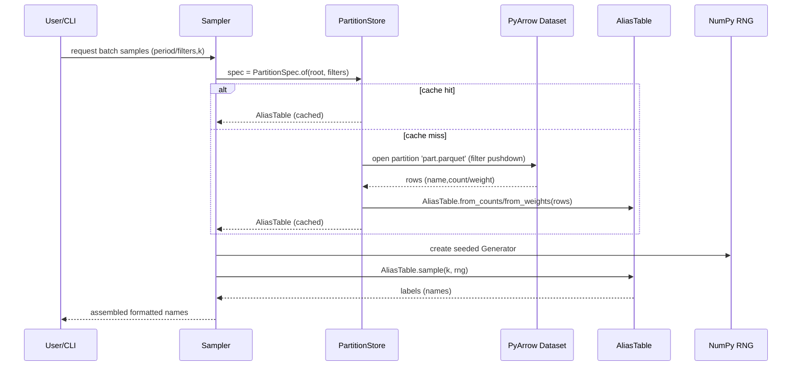

# PR Comments Export

> Exported from [https://github.com/arthrod/ptbr-sampler/pull/34](https://github.com/arthrod/ptbr-sampler/pull/34)  
> 52 of 52 comments selected  
> Generated by [Cicero](https://cicero.im) on 4/25/2026, 1:43:28 PM

---

### coderabbitai[bot] &mdash; 4/25/2026, 12:54:52 AM


<details>
<summary>♻️ Duplicate comments (1)</summary><blockquote>

<details>
<summary>tests/test_pr_additions.py (1)</summary><blockquote>

`461-477`: _⚠️ Potential issue_ | _🟡 Minor_

**Strengthen cache-hit assertion to avoid false positives.**

This still passes when both calls return `None`, so it can miss a table-construction regression.

 

<details>
<summary>Suggested patch</summary>

```diff
         t1 = sampler._middle_names_table()
         t2 = sampler._middle_names_table()
+        assert t1 is not None
         assert t1 is t2
```
</details>

<details>
<summary>🤖 Prompt for AI Agents</summary>

```
Verify each finding against the current code and only fix it if needed.

In `@tests/test_pr_additions.py` around lines 461 - 477, The test currently only
asserts identity (t1 is t2) which will pass if both are None; update the
test_middle_names_table_cached_on_second_call to first assert that the first
call actually constructed a table (e.g., assert t1 is not None and optionally
assert isinstance(t1, dict) or the expected Table type) and then assert t1 is t2
to verify caching; refer to the test's use of sampler._middle_names_table() and
variables t1/t2 when making the change.
```

</details>

</blockquote></details>

</blockquote></details>

<details>
<summary>🧹 Nitpick comments (2)</summary><blockquote>

<details>
<summary>ptbr_sampler/utils/cpf.py (1)</summary><blockquote>

`72-74`: **Optional readability tweak: unpack check digits directly.**

This avoids positional indexing and makes intent a bit clearer.

<details>
<summary>Refactor suggestion</summary>

```diff
-    digits = cpf_check_digits(stem)
-    check_digits = f'{digits[0]}{digits[1]}'
-    cpf = f'{stem}{check_digits}'
+    d1, d2 = cpf_check_digits(stem)
+    cpf = f'{stem}{d1}{d2}'
```
</details>

<details>
<summary>🤖 Prompt for AI Agents</summary>

```
Verify each finding against the current code and only fix it if needed.

In `@ptbr_sampler/utils/cpf.py` around lines 72 - 74, Unpack the tuple returned by
cpf_check_digits(stem) instead of indexing it: call cpf_check_digits(stem) into
two named variables (e.g., d1, d2) and then build check_digits or cpf from those
names (or directly format cpf as f'{stem}{d1}{d2}'); update the code around the
cpf_check_digits, digits, check_digits and cpf variables to use the unpacked
names for clearer intent.
```

</details>

</blockquote></details>
<details>
<summary>tests/test_pr_additions.py (1)</summary><blockquote>

`745-802`: **Optional: deduplicate repeated `python -m ptbr_sampler --help` subprocess setup.**

The same `subprocess.run(...)` block is repeated across multiple tests; a tiny helper/fixture would reduce maintenance and shave test runtime.

<details>
<summary>🤖 Prompt for AI Agents</summary>

```
Verify each finding against the current code and only fix it if needed.

In `@tests/test_pr_additions.py` around lines 745 - 802, Extract the repeated
subprocess.run([... '-m', 'ptbr_sampler', '--help'], capture_output=True,
text=True, timeout=15) call into a single helper or pytest fixture (e.g., a
top-level function run_help() or a fixture help_run) and call that from
test_main_module_runs_help and the three methods in TestCliPackagePaths instead
of duplicating the block; update those tests to assert against the returned
CompletedProcess (its returncode and stdout) and keep the unique assertions
('generate', 'sample', 'sources') unchanged so all tests reuse the common
subprocess invocation.
```

</details>

</blockquote></details>

</blockquote></details>

<details>
<summary>🤖 Prompt for all review comments with AI agents</summary>

```
Verify each finding against the current code and only fix it if needed.

Duplicate comments:
In `@tests/test_pr_additions.py`:
- Around line 461-477: The test currently only asserts identity (t1 is t2) which
will pass if both are None; update the
test_middle_names_table_cached_on_second_call to first assert that the first
call actually constructed a table (e.g., assert t1 is not None and optionally
assert isinstance(t1, dict) or the expected Table type) and then assert t1 is t2
to verify caching; refer to the test's use of sampler._middle_names_table() and
variables t1/t2 when making the change.

---

Nitpick comments:
In `@ptbr_sampler/utils/cpf.py`:
- Around line 72-74: Unpack the tuple returned by cpf_check_digits(stem) instead
of indexing it: call cpf_check_digits(stem) into two named variables (e.g., d1,
d2) and then build check_digits or cpf from those names (or directly format cpf
as f'{stem}{d1}{d2}'); update the code around the cpf_check_digits, digits,
check_digits and cpf variables to use the unpacked names for clearer intent.

In `@tests/test_pr_additions.py`:
- Around line 745-802: Extract the repeated subprocess.run([... '-m',
'ptbr_sampler', '--help'], capture_output=True, text=True, timeout=15) call into
a single helper or pytest fixture (e.g., a top-level function run_help() or a
fixture help_run) and call that from test_main_module_runs_help and the three
methods in TestCliPackagePaths instead of duplicating the block; update those
tests to assert against the returned CompletedProcess (its returncode and
stdout) and keep the unique assertions ('generate', 'sample', 'sources')
unchanged so all tests reuse the common subprocess invocation.
```

</details>

---

<details>
<summary>ℹ️ Review info</summary>

<details>
<summary>⚙️ Run configuration</summary>

**Configuration used**: Organization UI

**Review profile**: CHILL

**Plan**: Pro

**Run ID**: `9cb2d701-1158-4c4b-90d8-5d549b8decf1`

</details>

<details>
<summary>📥 Commits</summary>

Reviewing files that changed from the base of the PR and between 3dff341d80b051baaa2977af8e6ccac51852c82d and 93775d224b14842d2d1ccb75553b57e2a81e66ed.

</details>

<details>
<summary>📒 Files selected for processing (3)</summary>

* `ptbr_sampler/cli.py`
* `ptbr_sampler/utils/cpf.py`
* `tests/test_pr_additions.py`

</details>

</details>

<details>
<summary>📜 Review details</summary>

<details>
<summary>🧰 Additional context used</summary>

<details>
<summary>📓 Path-based instructions (1)</summary>

<details>
<summary>**/*.py</summary>


**📄 CodeRabbit inference engine (Custom checks)**

> `**/*.py`: Run `uv run pip-audit` or `uv run pip list --outdated` to audit Python dependencies. FAIL if any known CVE with severity HIGH or CRITICAL is found. WARN for moderate severity unless it affects production dependencies.
> For changed Python files: Run `uv run pytest --cov=<src_package> --cov-report=term-missing --cov-branch --cov-fail-under=80 -q`. FAIL if exit code != 0 or branch coverage < 70%.
> For changed Python files: Run `uv run ruff check . --diff`. FAIL if exit code != 0. List each violation.
> For changed Python files: Run `uv run ruff format --check --diff .`. FAIL if exit code != 0. List each unformatted file.
> Scan diffs for newly added Python suppression comments (# noqa, # type: ignore). Each suppression MUST have an inline justification comment. FAIL if any new suppression lacks justification. WARN if total new suppressions > 3 in a single PR.
> For Python import ordering and dead imports: Run `uv run ruff check --select I,F401 .`. FAIL if violations found (unused imports or misordered imports).
> For Python type checking: Run `uv run ty check`. FAIL if exit code != 0. If ty is not configured, check for mypy or pyright. FAIL with message 'No Python type checker configured' if none is found.
> Scan diffs for new bare `type: ignore` comments in Python (without an error code). WARN for each. FAIL if bare `type: ignore` count > 3.
> Scan diffs for new `cast()` calls in Python without a comment explaining why. WARN for each occurrence.

Files:
- `ptbr_sampler/utils/cpf.py`
- `ptbr_sampler/cli.py`
- `tests/test_pr_additions.py`

</details>

</details>

</details>

<details>
<summary>🔇 Additional comments (4)</summary><blockquote>

<details>
<summary>ptbr_sampler/utils/cpf.py (2)</summary><blockquote>

`33-38`: **Checksum validation path looks correct after the cleanup.**

The first and second check-digit validations remain correct, and the direct return for the second check improves readability.

---

`48-51`: **Check-digit tuple generation is consistent and clear.**

No correctness concerns in this segment; the function still returns both CPF check digits in the expected order.

</blockquote></details>
<details>
<summary>ptbr_sampler/cli.py (2)</summary><blockquote>

`494-531`: **Good fix for loop-capture in batch progress callback.**

Capturing `samples_completed/current_batch_size/batch_num` as keyword-only defaults prevents late-binding bugs across iterations and keeps per-batch progress/status stable.

---

`721-724`: **`sources` option typing is now aligned with runtime default.**

`kind: str | None = typer.Option(None, ...)` matches Typer’s `None` default cleanly and is type-checker friendly.

</blockquote></details>

</blockquote></details>

</details>

<!-- This is an auto-generated comment by CodeRabbit for review status -->

---

### coderabbitai[bot] &mdash; 4/25/2026, 12:44:02 AM


<details>
<summary>🧹 Nitpick comments (2)</summary><blockquote>

<details>
<summary>tests/test_pr_additions.py (1)</summary><blockquote>

`450-465`: **Consider adding a non-None assertion for cache test.**

Past review noted that `assert t1 is t2` can pass when both are `None`. While this test writes valid middle names JSON, adding `assert t1 is not None` would make the test more robust.


<details>
<summary>♻️ Proposed fix</summary>

```diff
         sampler = BrazilianNameSampler(data, middle_names_path=mp)
         t1 = sampler._middle_names_table()
         t2 = sampler._middle_names_table()
+        assert t1 is not None
         assert t1 is t2
```
</details>

<details>
<summary>🤖 Prompt for AI Agents</summary>

```
Verify each finding against the current code and only fix it if needed.

In `@tests/test_pr_additions.py` around lines 450 - 465, The test
test_middle_names_table_cached_on_second_call should assert the cached table is
not None before checking identity: after calling sampler._middle_names_table()
store it in t1 and add assert t1 is not None (or assert t1) prior to calling
sampler._middle_names_table() again and asserting t1 is t2; this ensures the
cache test fails if the loader returned None rather than a real table (reference
symbols: test_middle_names_table_cached_on_second_call,
sampler._middle_names_table, t1, t2, BrazilianNameSampler).
```

</details>

</blockquote></details>
<details>
<summary>tests/test_distribution_validation.py (1)</summary><blockquote>

`98-106`: **Remove unused variable `alias_idx`.**

Line 99 computes `alias_idx` but it is never used. This appears to be leftover code from development.


<details>
<summary>♻️ Proposed fix</summary>

```diff
         # Rank indices for KS — categorical → ordinal → continuous-ish.
-        alias_idx = np.where(np.isin(table.labels, table.labels))[0]
         # Map labels to fixed integer positions for KS input.
         pos = {lab: i for i, lab in enumerate(table.labels)}
```
</details>

<details>
<summary>🤖 Prompt for AI Agents</summary>

```
Verify each finding against the current code and only fix it if needed.

In `@tests/test_distribution_validation.py` around lines 98 - 106, The variable
alias_idx is computed but never used; remove the unused assignment to clean up
the code by deleting the line that defines alias_idx (the
np.where(np.isin(table.labels, table.labels))[0]) so only the necessary mapping
logic remains (the pos dict and alias_draws generation using table.sample and
table.labels).
```

</details>

</blockquote></details>

</blockquote></details>

<details>
<summary>🤖 Prompt for all review comments with AI agents</summary>

```
Verify each finding against the current code and only fix it if needed.

Nitpick comments:
In `@tests/test_distribution_validation.py`:
- Around line 98-106: The variable alias_idx is computed but never used; remove
the unused assignment to clean up the code by deleting the line that defines
alias_idx (the np.where(np.isin(table.labels, table.labels))[0]) so only the
necessary mapping logic remains (the pos dict and alias_draws generation using
table.sample and table.labels).

In `@tests/test_pr_additions.py`:
- Around line 450-465: The test test_middle_names_table_cached_on_second_call
should assert the cached table is not None before checking identity: after
calling sampler._middle_names_table() store it in t1 and add assert t1 is not
None (or assert t1) prior to calling sampler._middle_names_table() again and
asserting t1 is t2; this ensures the cache test fails if the loader returned
None rather than a real table (reference symbols:
test_middle_names_table_cached_on_second_call, sampler._middle_names_table, t1,
t2, BrazilianNameSampler).
```

</details>

---

<details>
<summary>ℹ️ Review info</summary>

<details>
<summary>⚙️ Run configuration</summary>

**Configuration used**: Organization UI

**Review profile**: CHILL

**Plan**: Pro

**Run ID**: `fbe7438a-d3ef-4c26-ad00-3c8705b753c7`

</details>

<details>
<summary>📥 Commits</summary>

Reviewing files that changed from the base of the PR and between 126f71485417fcd27f7484d0aa708988331cd571 and 3dff341d80b051baaa2977af8e6ccac51852c82d.

</details>

<details>
<summary>📒 Files selected for processing (6)</summary>

* `ptbr_sampler/br_name_class.py`
* `ptbr_sampler/cli.py`
* `ptbr_sampler/sampling/store.py`
* `ptbr_sampler/utils/cpf.py`
* `tests/test_distribution_validation.py`
* `tests/test_pr_additions.py`

</details>

<details>
<summary>🚧 Files skipped from review as they are similar to previous changes (1)</summary>

* ptbr_sampler/cli.py

</details>

</details>

<details>
<summary>📜 Review details</summary>

<details>
<summary>🧰 Additional context used</summary>

<details>
<summary>📓 Path-based instructions (1)</summary>

<details>
<summary>**/*.py</summary>


**📄 CodeRabbit inference engine (Custom checks)**

> `**/*.py`: Run `uv run pip-audit` or `uv run pip list --outdated` to audit Python dependencies. FAIL if any known CVE with severity HIGH or CRITICAL is found. WARN for moderate severity unless it affects production dependencies.
> For changed Python files: Run `uv run pytest --cov=<src_package> --cov-report=term-missing --cov-branch --cov-fail-under=80 -q`. FAIL if exit code != 0 or branch coverage < 70%.
> For changed Python files: Run `uv run ruff check . --diff`. FAIL if exit code != 0. List each violation.
> For changed Python files: Run `uv run ruff format --check --diff .`. FAIL if exit code != 0. List each unformatted file.
> Scan diffs for newly added Python suppression comments (# noqa, # type: ignore). Each suppression MUST have an inline justification comment. FAIL if any new suppression lacks justification. WARN if total new suppressions > 3 in a single PR.
> For Python import ordering and dead imports: Run `uv run ruff check --select I,F401 .`. FAIL if violations found (unused imports or misordered imports).
> For Python type checking: Run `uv run ty check`. FAIL if exit code != 0. If ty is not configured, check for mypy or pyright. FAIL with message 'No Python type checker configured' if none is found.
> Scan diffs for new bare `type: ignore` comments in Python (without an error code). WARN for each. FAIL if bare `type: ignore` count > 3.
> Scan diffs for new `cast()` calls in Python without a comment explaining why. WARN for each occurrence.

Files:
- `tests/test_distribution_validation.py`
- `ptbr_sampler/utils/cpf.py`
- `ptbr_sampler/sampling/store.py`
- `tests/test_pr_additions.py`
- `ptbr_sampler/br_name_class.py`

</details>

</details><details>
<summary>🪛 Ruff (0.15.11)</summary>

<details>
<summary>ptbr_sampler/br_name_class.py</summary>

[error] 325-325: Standard pseudo-random generators are not suitable for cryptographic purposes

(S311)

---

[error] 556-556: Standard pseudo-random generators are not suitable for cryptographic purposes

(S311)

---

[error] 561-561: Standard pseudo-random generators are not suitable for cryptographic purposes

(S311)

---

[error] 561-561: Standard pseudo-random generators are not suitable for cryptographic purposes

(S311)

---

[error] 566-566: Standard pseudo-random generators are not suitable for cryptographic purposes

(S311)

---

[error] 573-573: Standard pseudo-random generators are not suitable for cryptographic purposes

(S311)

---

[error] 575-575: Standard pseudo-random generators are not suitable for cryptographic purposes

(S311)

</details>

</details>

</details>

<details>
<summary>🔇 Additional comments (29)</summary><blockquote>

<details>
<summary>ptbr_sampler/utils/cpf.py (3)</summary><blockquote>

`72-73`: **Nice fix on CPF assembly in generation path.**

This construction is clearer and avoids the previous mixed-placeholder formatting pitfall in CPF generation.

---

`33-33`: **No compatibility concern: `zip(..., strict=False)` is supported.**

The project declares `requires-python = '>=3.12'` in `pyproject.toml`. The `strict` keyword for `zip()` has been available since Python 3.10 (PEP 618), so there is no runtime compatibility risk. The `strict=False` parameter is functionally redundant for same-length iterables (a no-op), but this is a valid stylistic choice and does not constitute an issue.


				> Likely an incorrect or invalid review comment.

---

`1-77`: **No changes detected for this file in the current diff.**

The file `ptbr_sampler/utils/cpf.py` shows no modifications (`git status` reports a clean working tree and `git diff` returns empty). Quality gate requirements for "changed Python files" (audit, coverage, lint, format, import checks, type checking, suppression scans) do not apply when the file has not been modified in this PR.

</blockquote></details>
<details>
<summary>ptbr_sampler/br_name_class.py (10)</summary><blockquote>

`325-325`: **S311 warning is intentional here.**

The Ruff S311 warnings about `random.random()` are false positives in this context. This is a name generator, not cryptography. Using stdlib `random` is intentional to maintain reproducibility when callers use `random.seed()`. No action needed.

---

`1-28`: **LGTM!**

Well-documented module with clear explanation of the public API, O(1) sampling, and reproducibility guarantees through NumPy Generator seeded from Python's random module.

---

`29-59`: **LGTM!**

`TimePeriod` as `StrEnum` allows direct string comparison with JSON keys, and `NameComponents` with `slots=True` is memory-efficient. The `_rng_from_python_random()` helper maintains backward compatibility with `random.seed()` users.

---

`62-78`: **LGTM!**

`SURNAME_PREFIXES` is now correctly annotated with `ClassVar` to indicate it's a class-level constant, addressing the RUF012 warning.

---

`80-115`: **LGTM!**

Clean factory method that wires up the bundled Parquet tree while maintaining backward-compatible dict attributes through JSON loading.

---

`117-189`: **LGTM!**

The constructor properly handles both JSON file paths and pre-loaded dicts, validates parquet_root existence before wiring the store, and initializes lazy alias-table caches.

---

`238-250`: **LGTM!**

The `_load_from_parquet` method now properly handles the `RuntimeError` from missing pyarrow (addressing the previously reported issue), while correctly re-raising unrelated `RuntimeError` exceptions.

---

`252-316`: **LGTM!**

Lazy alias-table builders consistently follow the Parquet-first, JSON-fallback pattern with proper caching. The `_middle_names_table` correctly handles `ValueError` from empty second_names.

---

`441-517`: **LGTM!**

The `_draw` method efficiently unifies batch and single-sample paths with vectorized alias lookups. `_draw_middle_names` optimizes by only sampling the exact number of middle names needed based on threshold flags.

---

`523-583`: **LGTM!**

Surname assembly logic correctly handles raw mode casing, Jr. suffix normalization, and probabilistic prefix decoration. The complexity reflects authentic Brazilian surname patterns.

</blockquote></details>
<details>
<summary>ptbr_sampler/sampling/store.py (5)</summary><blockquote>

`1-28`: **LGTM!**

Module docstring clearly documents the partition layout, LRU caching strategy, and expected schema. Imports are appropriate and minimal.

---

`31-57`: **LGTM!**

`PartitionSpec` is well-designed: immutable (`frozen=True`), memory-efficient (`slots=True`), with deterministic `path()` and `key()` methods for consistent cache behavior.

---

`59-108`: **LGTM!**

The LRU cache implementation using `OrderedDict` is correct. The `get()` method properly moves accessed entries to the end before eviction, and `register()` provides a clean test-seeding interface.

---

`113-138`: **LGTM!**

The `_load()` method has proper error handling (FileNotFoundError, RuntimeError for missing pyarrow, ValueError for invalid data), efficient column projection, and correct fallback from counts to weights.

---

`141-177`: **LGTM!**

The `alias_from_mapping` function correctly handles count-only entries (the previously reported issue has been addressed). The filtering logic at line 168 properly retains entries with positive counts even when percentage is absent.

</blockquote></details>
<details>
<summary>tests/test_distribution_validation.py (4)</summary><blockquote>

`1-32`: **LGTM!**

The module properly guards the scipy dependency with `pytest.importorskip`, and `_ensure_parquet` now correctly writes to `tmp_path` rather than the production data directory (addressing the previously reported issue).

---

`34-68`: **LGTM!**

The chi-square test methodology is sound: limiting to top-50 cells avoids the low-expected-count regime, and rescaling expected counts to match observed totals is the correct approach for `scipy.stats.chisquare`.

---

`70-81`: **LGTM!**

Simple but effective validation that the most common surname ("Silva") appears at the expected frequency within a reasonable tolerance band.

---

`120-153`: **LGTM!**

Solid validation that batch and single-draw sampling produce statistically equivalent results, both matching the theoretical weights.

</blockquote></details>
<details>
<summary>tests/test_pr_additions.py (7)</summary><blockquote>

`1-28`: **LGTM!**

Well-organized test module with clear docstring documenting coverage gaps being addressed. Imports are clean and appropriately organized.

---

`30-88`: **LGTM!**

Thorough edge-case testing for the alias module: empty draws, single-element tables, length verification, and weight normalization.

---

`97-196`: **LGTM!**

Comprehensive test coverage for `alias_from_mapping` including the critical `test_count_only_entries_are_kept` that validates the fix for the previously reported issue. The probabilistic test at line 189 has a sufficiently wide tolerance band (0.60-0.73 for expected ~0.67) to avoid flakiness.

---

`203-267`: **LGTM!**

Good coverage of `PartitionStore` constructor validation, cache-hit behavior, and LRU eviction ordering. The `test_lru_moves_to_end_on_hit` correctly verifies that accessed entries are protected from eviction.

---

`297-305`: **LGTM!**

The test now correctly compares `bit_generator.state` for deterministic verification (addressing the past review), with the additional integer comparison providing a secondary sanity check.

---

`734-791`: **LGTM!**

CLI subprocess tests now include `timeout=15` parameter (addressing the past review), preventing CI hangs from stuck processes.

---

`590-856`: **LGTM!**

Comprehensive coverage of `data_origins` module, package exports, and regression tests for `TimePeriod` and `NameComponents` dataclass semantics.

</blockquote></details>

</blockquote></details>

</details>

<!-- This is an auto-generated comment by CodeRabbit for review status -->

---

### Copilot &mdash; 4/25/2026, 12:29:49 AM


> @copilot+gpt-5.5 assess the comments carefully. Think about the issues they point out. Determine if the issues are limited to that particular instance. Then, if appropriate, fix these issues systemati...

Addressed the review feedback systematically in 93775d2, including sampler/store performance fixes, fallback and count-only handling, lint/type issues, safer tests, subprocess timeouts, and stale path documentation. Verified with `python -m ruff check .`, `python -m ruff format --check .`, and `python -m pytest -q` (403 passed).

---

### coderabbitai[bot] &mdash; 4/25/2026, 12:25:55 AM

> File: `ptbr_sampler/sampling/vocabulary.py`

<details><summary>Code context</summary>

```diff
@@ -0,0 +1,264 @@
+"""Given-name whitelist used to clean middle-name tokens.
+
+``ptbr_sampler/data/middle_names.json`` mixes second given names with surnames such as
+``Araújo``, ``Borges``, ``Bezerra``; administrative artifacts such as
+``Cancelado``; and a bare hyphen ``-``. No alias table fixes dirty tokens.
+This module builds a whitelist from the repository's first-name file and
+exposes :meth:`GivenNameVocabulary.filter` so ingestion and on-the-fly cleaning
+share the same filter.
+"""
+
+from __future__ import annotations
+
+import json
+import re
+import unicodedata
+from collections.abc import Iterable, Mapping
+from dataclasses import dataclass
+from pathlib import Path
+
+_ALLOWED_RE = re.compile('^[A-Za-zÀ-ÖØ-öø-ÿ\\u0027\\u2019\\- ]+$')
+
+
+def _fold(token: str) -> str:
+    """Case-fold and strip diacritics so ``'João'`` matches ``'joao'``."""
+    nfkd = unicodedata.normalize('NFKD', token)
+    without_marks = ''.join(c for c in nfkd if not unicodedata.combining(c))
+    return without_marks.casefold().strip()
+
+
+# Canonical Brazilian surnames drawn from the IBGE 2022 Census "Nomes no
+# Brasil" release and cross-checked against the sampler's own
+# ``surnames_data.json``. These folded tokens must never be accepted as
+# given names, even if a given-name file erroneously lists them (which the
+# deep-research audit documents for ``middle_names.json``).
+CANONICAL_SURNAMES: frozenset[str] = frozenset(
+    _fold(s)
+    for s in (
+        'Silva',
+        'Santos',
+        'Oliveira',
+        'Souza',
+        'Sousa',
+        'Lima',
+        'Pereira',
+        'Ferreira',
+        'Rodrigues',
+        'Alves',
+        'Costa',
+        'Ribeiro',
+        'Martins',
+        'Almeida',
+        'Carvalho',
+        'Gomes',
+        'Barbosa',
+        'Rocha',
+        'Araújo',
+        'Araujo',
+        'Dias',
+        'Nascimento',
+        'Lopes',
+        'Monteiro',
+        'Cardoso',
+        'Teixeira',
+        'Moreira',
+        'Correia',
+        'Mendes',
+        'Ramos',
+        'Vieira',
+        'Nunes',
+        'Marques',
+        'Machado',
+        'Freitas',
+        'Cavalcanti',
+        'Cavalcante',
+        'Cunha',
+        'Pinto',
+        'Moura',
+        'Castro',
+        'Campos',
+        'Cardozo',
+        'Melo',
+        'Mello',
+        'Borges',
+        'Bezerra',
+        'Batista',
+        'Duarte',
+        'Fonseca',
+        'Fernandes',
+        'Figueiredo',
+        'Franco',
+        'Freire',
+        'Gonçalves',
+        'Guimarães',
+        'Guimaraes',
+        'Leal',
+        'Leite',
+        'Macedo',
+        'Magalhães',
+        'Magalhaes',
+        'Maia',
+        'Medeiros',
+        'Miranda',
+        'Moraes',
+        'Neves',
+        'Novais',
+        'Pacheco',
+        'Paiva',
+        'Paula',
+        'Peixoto',
+        'Peres',
+        'Pimentel',
+        'Pinheiro',
+        'Pires',
+        'Prado',
+        'Queiroz',
+        'Reis',
+        'Rezende',
+        'Rosa',
+        'Sales',
+        'Salgado',
+        'Sampaio',
+        'Sarmento',
+        'Saraiva',
+        'Sequeira',
+        'Serra',
+        'Silveira',
+        'Simões',
+        'Simoes',
+        'Siqueira',
+        'Soares',
+        'Tavares',
+        'Torres',
+        'Valente',
+        'Vasconcelos',
+        'Ventura',
+        'Viana',
+        'Xavier',
+    )
+    if _fold(s)
+)
+
+
+@dataclass(slots=True)
+class GivenNameVocabulary:
+    """Accepted-given-names whitelist.
+
+    Tokens are stored folded (diacritics stripped, casefolded) so variants
+    like ``João`` / ``Joao`` / ``JOÃO`` all resolve to the same entry.
+
+    The optional ``surname_blocklist`` holds folded tokens that must **never**
+    be accepted as given names even if they also appear in the given-name
+    table. This is how the IBGE legacy first-name file is disambiguated from
+    its surname-contaminated neighbour: if a token appears in both tables
+    but shows up in the surname blocklist, it is rejected.
+    """
+
+    folded: frozenset[str]
+    surname_blocklist: frozenset[str] = frozenset()
+
+    @classmethod
+    def from_names_data(
+        cls,
+        names_data_path: str | Path,
+        surnames_data_path: str | Path | None = None,
+        surname_top_n: int = 1_000,
+    ) -> GivenNameVocabulary:
+        """Build a vocabulary from the repository's ``names_data.json``.
+
+        All period buckets contribute, so a name that ever appeared in any
+        IBGE decade is accepted. When ``surnames_data_path`` is given, the
+        top-``surname_top_n`` surnames are added to the blocklist so that
+        obvious surname leakage (``Araújo``, ``Borges``, ``Bezerra``) is
+        rejected even if the first-name file erroneously lists them.
+        """
+        with Path(names_data_path).open(encoding='utf-8') as f:
+            data = json.load(f)
+        periods = data.get('common_names_percentage', {})
+        folded: set[str] = set()
+        for period_payload in periods.values():
+            names = period_payload.get('names', {})
+            for name in names:
+                folded.add(_fold(str(name)))
+        folded.discard('')
+        if not folded:
+            raise ValueError('no given names found in names_data payload')
+
+        blocklist: frozenset[str] = frozenset()
+        if surnames_data_path is not None:
+            with Path(surnames_data_path).open(encoding='utf-8') as f:
+                surname_payload = json.load(f)
+            surnames = surname_payload.get('surnames', {})
+            ordered = sorted(
+                ((k, v) for k, v in surnames.items() if k != 'top_40' and isinstance(v, Mapping)),
+                key=lambda kv: float(kv[1].get('percentage', 0.0) or 0.0),
+                reverse=True,
+            )
+            blocked = {_fold(k) for k, _ in ordered[:surname_top_n]}
+            blocked.discard('')
+            blocklist = frozenset(blocked | CANONICAL_SURNAMES)
+        else:
+            blocklist = CANONICAL_SURNAMES
+
+        return cls(folded=frozenset(folded), surname_blocklist=blocklist)
+
+    @classmethod
+    def from_iterable(cls, names: Iterable[str], surnames: Iterable[str] | None = None) -> GivenNameVocabulary:
+        folded = frozenset(_fold(n) for n in names if _fold(n))
+        if not folded:
+            raise ValueError('GivenNameVocabulary requires at least one name')
+        block = frozenset()
+        if surnames is not None:
+            block = frozenset(_fold(s) for s in surnames if _fold(s))
+        return cls(folded=folded, surname_blocklist=block)
```
</details>

_⚠️ Potential issue_ | _🟠 Major_

**Apply canonical surname blocking in `from_iterable` by default.**

At Line 210–Line 213, `surname_blocklist` stays empty unless `surnames` is passed, so canonical surnames can be accepted via this constructor. That conflicts with the module guarantee that surname tokens must never be accepted as given names.


<details>
<summary>💡 Proposed fix</summary>

```diff
     `@classmethod`
     def from_iterable(cls, names: Iterable[str], surnames: Iterable[str] | None = None) -> GivenNameVocabulary:
         folded = frozenset(_fold(n) for n in names if _fold(n))
         if not folded:
             raise ValueError('GivenNameVocabulary requires at least one name')
-        block = frozenset()
+        block = set(CANONICAL_SURNAMES)
         if surnames is not None:
-            block = frozenset(_fold(s) for s in surnames if _fold(s))
-        return cls(folded=folded, surname_blocklist=block)
+            block.update(_fold(s) for s in surnames if _fold(s))
+        return cls(folded=folded, surname_blocklist=frozenset(block))
```
</details>

<details>
<summary>🤖 Prompt for AI Agents</summary>

```
Verify each finding against the current code and only fix it if needed.

In `@ptbr_sampler/sampling/vocabulary.py` around lines 206 - 213, The
from_iterable constructor currently leaves surname_blocklist empty when surnames
is None, allowing canonical surnames to be accepted; update
GivenNameVocabulary.from_iterable to always include the module's canonical
surname blocklist (the canonical surname tokens constant) folded via _fold and
merged with any provided surnames (i.e., compute block = frozenset(_fold(s) for
s in canonical_surnames) and then update/union with folded provided surnames if
surnames is not None) before returning cls(folded=folded,
surname_blocklist=block).
```

</details>

<!-- fingerprinting:phantom:poseidon:hawk:2349405d-23f6-4039-a50d-a3ccec870f02 -->

<!-- 4e71b3a2 -->

<!-- This is an auto-generated comment by CodeRabbit -->

---

### coderabbitai[bot] &mdash; 4/25/2026, 12:25:55 AM

> File: `tests/test_pr_additions.py`

<details><summary>Code context</summary>

```diff
@@ -0,0 +1,855 @@
+"""Additional tests for code added/changed in this PR.
+
+Covers gaps not addressed by the existing test suite:
+
+* ``alias.py`` — draw(k=0), AliasTable.__len__, build_alias single element
+* ``store.py`` — alias_from_mapping, PartitionStore(max_entries<1), cache-hit path
+* ``br_name_class.py`` — _rng_from_python_random, parquet_root paths,
+  _top_40_table empty fallback, _load_from_parquet(store=None),
+  _middle_names_table ValueError, from_bundled_parquet
+* ``data_origins.py`` — by_kind content, notes field, file_status tuples
+* ``__main__.py`` — entry point is importable and callable
+* ``__init__.py`` — __version__ format, re-export correctness
+"""
+
+from __future__ import annotations
+
+import json
+import random
+from pathlib import Path
+
+import numpy as np
+import pytest
+
+# ---------------------------------------------------------------------------
+# alias.py
+# ---------------------------------------------------------------------------
+from ptbr_sampler.sampling.alias import AliasTable, build_alias, draw
+
+
+class TestDrawEdgeCases:
+    def test_draw_k_zero_returns_empty(self):
+        prob, alias = build_alias(np.array([1.0, 2.0, 3.0]))
+        rng = np.random.default_rng(0)
+        out = draw(prob, alias, 0, rng)
+        assert out.shape == (0,)
+
+    def test_draw_k_one_returns_valid_index(self):
+        prob, alias = build_alias(np.array([1.0, 9.0]))
+        rng = np.random.default_rng(0)
+        out = draw(prob, alias, 1, rng)
+        assert out.shape == (1,)
+        assert out[0] in (0, 1)
+
+
+class TestBuildAliasSingleElement:
+    def test_single_element_prob_is_one(self):
+        prob, alias = build_alias(np.array([42.0]))
+        assert prob.shape == (1,)
+        assert prob[0] == pytest.approx(1.0)
+        assert alias[0] == 0
+
+    def test_single_element_draw_always_returns_zero(self):
+        prob, alias = build_alias(np.array([1.0]))
+        rng = np.random.default_rng(0)
+        out = draw(prob, alias, 100, rng)
+        assert np.all(out == 0)
+
+
+class TestAliasTableLen:
+    def test_len_from_counts(self):
+        t = AliasTable.from_counts(['a', 'b', 'c'], [1, 2, 3])
+        assert len(t) == 3
+
+    def test_len_from_weights(self):
+        t = AliasTable.from_weights(['x', 'y', 'z', 'w'], [0.1, 0.2, 0.3, 0.4])
+        assert len(t) == 4
+
+    def test_len_single(self):
+        t = AliasTable.from_counts(['only'], [10])
+        assert len(t) == 1
+
+    def test_sample_k_zero_empty(self):
+        t = AliasTable.from_counts(['a', 'b'], [1, 1])
+        rng = np.random.default_rng(0)
+        out = t.sample(0, rng)
+        assert len(out) == 0
+
+
+class TestAliasTableFromWeightsEdge:
+    def test_from_weights_empty_rejected(self):
+        with pytest.raises(ValueError):
+            AliasTable.from_weights([], [])
+
+    def test_from_weights_normalises(self):
+        """Weights don't need to sum to 1; they're normalised internally."""
+        t = AliasTable.from_weights(['a', 'b'], [3.0, 7.0])
+        assert t.weights.sum() == pytest.approx(1.0)
+
+
+# ---------------------------------------------------------------------------
+# store.py — alias_from_mapping
+# ---------------------------------------------------------------------------
+
+from ptbr_sampler.sampling.store import PartitionSpec, PartitionStore, alias_from_mapping
+
+
+class TestAliasFromMapping:
+    def test_basic_mapping_with_counts(self):
+        mapping = {
+            'Silva': {'count': 60, 'percentage': 60.0},
+            'Santos': {'count': 40, 'percentage': 40.0},
+        }
+        t = alias_from_mapping(mapping)
+        assert isinstance(t, AliasTable)
+        assert len(t) == 2
+        assert set(t.labels.tolist()) == {'Silva', 'Santos'}
+
+    def test_fallback_to_weights_when_no_counts(self):
+        """When all counts are missing, falls back to percentage weights."""
+        mapping = {
+            'Maria': {'percentage': 70.0},
+            'João': {'percentage': 30.0},
+        }
+        t = alias_from_mapping(mapping)
+        assert isinstance(t, AliasTable)
+        assert len(t) == 2
+
+    def test_count_only_entries_are_kept(self):
+        """Count-only fixtures should use counts rather than being discarded."""
+        mapping = {
+            'A': {'count': 3},
+            'B': {'count': 1},
+        }
+        t = alias_from_mapping(mapping)
+        labels = t.labels.tolist()
+        assert set(labels) == {'A', 'B'}
+        assert t.weights[labels.index('A')] == pytest.approx(0.75)
+
+    def test_skips_non_positive_entries(self):
+        """Entries with percentage ≤ 0 are silently filtered out."""
+        mapping = {
+            'Good': {'count': 10, 'percentage': 50.0},
+            'Zero': {'count': 0, 'percentage': 0.0},
+            'Negative': {'count': 5, 'percentage': -1.0},
+        }
+        t = alias_from_mapping(mapping)
+        assert len(t) == 1
+        assert t.labels[0] == 'Good'
+
+    def test_skips_non_mapping_values(self):
+        """Values that aren't dicts are ignored."""
+        mapping = {
+            'top_40': {'Silva': 1},  # nested non-conforming dict — no 'percentage'
+            'Valid': {'count': 5, 'percentage': 5.0},
+        }
+        t = alias_from_mapping(mapping)
+        assert len(t) == 1
+        assert t.labels[0] == 'Valid'
+
+    def test_empty_mapping_raises(self):
+        with pytest.raises(ValueError, match='no positive-weight entries'):
+            alias_from_mapping({})
+
+    def test_all_nonpositive_raises(self):
+        with pytest.raises(ValueError, match='no positive-weight entries'):
+            alias_from_mapping({'Zero': {'count': 0, 'percentage': 0.0}})
+
+    def test_invalid_percentage_treated_as_zero(self):
+        """Non-numeric percentage falls back to 0.0 and gets filtered."""
+        mapping = {
+            'Bad': {'count': 1, 'percentage': 'not-a-number'},
+            'Good': {'count': 2, 'percentage': 2.0},
+        }
+        t = alias_from_mapping(mapping)
+        assert len(t) == 1
+        assert t.labels[0] == 'Good'
+
+    def test_mixed_counts_some_missing(self):
+        """When any count is None, have_counts=False and weights path is used."""
+        mapping = {
+            'A': {'percentage': 60.0},  # no count
+            'B': {'count': 40, 'percentage': 40.0},
+        }
+        t = alias_from_mapping(mapping)
+        assert isinstance(t, AliasTable)
+        assert set(t.labels.tolist()) == {'A', 'B'}
+
+    def test_counts_take_priority_when_available(self):
+        """When counts are present, from_counts is used (not from_weights)."""
+        mapping = {
+            'X': {'count': 100, 'percentage': 33.3},
+            'Y': {'count': 200, 'percentage': 66.7},
+        }
+        t = alias_from_mapping(mapping)
+        # X has count 100, Y has 200 — Y should appear ~2x as often
+        rng = np.random.default_rng(42)
+        draws = t.sample(10_000, rng)
+        frac_y = (draws == 'Y').sum() / len(draws)
+        assert 0.60 < frac_y < 0.73
+
+    def test_string_label_coercion(self):
+        """Labels are coerced to str via str()."""
+        mapping = {'TestName': {'count': 1, 'percentage': 1.0}}
+        t = alias_from_mapping(mapping)
+        assert t.labels[0] == 'TestName'
+
+
+# ---------------------------------------------------------------------------
+# store.py — PartitionStore constructor validation and cache-hit path
+# ---------------------------------------------------------------------------
+
+
+class TestPartitionStoreConstructor:
+    def test_max_entries_zero_raises(self):
+        with pytest.raises(ValueError, match='max_entries must be >= 1'):
+            PartitionStore(max_entries=0)
+
+    def test_max_entries_negative_raises(self):
+        with pytest.raises(ValueError, match='max_entries must be >= 1'):
+            PartitionStore(max_entries=-5)
+
+    def test_default_max_entries_is_64(self):
+        """Default max is 64 — just check it doesn't raise and cache starts empty."""
+        store = PartitionStore()
+        assert len(store) == 0
+
+
+class TestPartitionStoreCacheHit:
+    def test_get_same_spec_twice_hits_cache(self):
+        """Second get() should return the same AliasTable object (cache hit)."""
+        store = PartitionStore(max_entries=4)
+        spec = PartitionSpec.of('x', scope='national')
+        t = AliasTable.from_counts(['a', 'b'], [1, 2])
+        store.register(spec, t)
+        # First get — should be a cache hit since we just registered it
+        retrieved1 = store.get(spec)
+        retrieved2 = store.get(spec)
+        assert retrieved1 is retrieved2
+
+    def test_lru_moves_to_end_on_hit(self):
+        """Accessing an older entry should save it from eviction."""
+        store = PartitionStore(max_entries=2)
+        spec_a = PartitionSpec.of('root', uf='SP')
+        spec_b = PartitionSpec.of('root', uf='RJ')
+        spec_c = PartitionSpec.of('root', uf='MG')
+        t = AliasTable.from_counts(['a'], [1])
+        store.register(spec_a, t)
+        store.register(spec_b, t)
+        # Access spec_a to move it to end
+        store.get(spec_a)
+        # Adding spec_c should evict spec_b (LRU), not spec_a
+        store.register(spec_c, t)
+        assert spec_a in store
+        assert spec_c in store
+        assert spec_b not in store
+
+    def test_contains_false_for_missing(self):
+        store = PartitionStore()
+        spec = PartitionSpec.of('nonexistent', uf='XX')
+        assert spec not in store
+
+
+class TestPartitionSpecNoFilters:
+    def test_empty_filters_path(self, tmp_path: Path):
+        """PartitionSpec with no filters produces root/part.parquet."""
+        spec = PartitionSpec(root=tmp_path / 'middle_names', filters=())
+        assert spec.path() == tmp_path / 'middle_names' / 'part.parquet'
+
+    def test_key_with_empty_filters(self, tmp_path: Path):
+        spec = PartitionSpec(root=tmp_path, filters=())
+        key = spec.key()
+        assert key[1] == ()
+
+    def test_key_different_roots_differ(self, tmp_path: Path):
+        a = PartitionSpec(root=tmp_path / 'a', filters=())
+        b = PartitionSpec(root=tmp_path / 'b', filters=())
+        assert a.key() != b.key()
+
+
+# ---------------------------------------------------------------------------
+# br_name_class.py — new code paths
+# ---------------------------------------------------------------------------
+
+from ptbr_sampler.br_name_class import (
+    BrazilianNameSampler,
+    NameComponents,
+    TimePeriod,
+    _rng_from_python_random,
+)
+
+
+class TestRngFromPythonRandom:
+    def test_returns_numpy_generator(self):
+        rng = _rng_from_python_random()
+        assert isinstance(rng, np.random.Generator)
+
+    def test_seeding_stdlib_gives_deterministic_rng(self):
+        """Seeding Python random makes _rng_from_python_random deterministic."""
+        random.seed(42)
+        rng1 = _rng_from_python_random()
+        val1 = rng1.integers(0, 1_000_000)
+        random.seed(42)
+        rng2 = _rng_from_python_random()
+        val2 = rng2.integers(0, 1_000_000)
+        assert val1 == val2
+
+    def test_different_seeds_different_rng(self):
+        random.seed(1)
+        rng1 = _rng_from_python_random()
+        state1 = rng1.bit_generator.state
+        random.seed(999_999)
+        rng2 = _rng_from_python_random()
+        state2 = rng2.bit_generator.state
+        assert state1 != state2
+
+
+def _minimal_name_data() -> dict:
+    """Re-usable minimal name data matching conftest.mock_name_data structure."""
+    return {
+        'common_names_percentage': {
+            period.value: {
+                'names': {
+                    'Maria': {'percentage': 0.5},
+                    'João': {'percentage': 0.5},
+                },
+                'total': 100,
+            }
+            for period in TimePeriod
+        },
+        'surnames': {
+            'Silva': {'percentage': 0.6},
+            'Santos': {'percentage': 0.4},
+            'top_40': {
+                'Silva': {'percentage': 0.5},
+                'Santos': {'percentage': 0.5},
+            },
+        },
+    }
+
+
+class TestBrazilianNameSamplerParquetRoot:
+    def test_nonexistent_parquet_root_silently_ignored(self, tmp_path: Path):
+        """When parquet_root doesn't exist, sampler falls back to JSON only."""
+        data = _minimal_name_data()
+        sampler = BrazilianNameSampler(data, parquet_root=tmp_path / 'does_not_exist')
+        # parquet_root should be None (not set) since dir doesn't exist
+        assert sampler.parquet_root is None
+        assert sampler._partition_store is None
+
+    def test_existing_parquet_root_wires_store(self, tmp_path: Path):
+        """When parquet_root exists, the store is created."""
+        data = _minimal_name_data()
+        # Create the directory so it exists
+        parquet_dir = tmp_path / 'parquet'
+        parquet_dir.mkdir()
+        sampler = BrazilianNameSampler(data, parquet_root=parquet_dir)
+        assert sampler.parquet_root == parquet_dir
+        assert sampler._partition_store is not None
+
+    def test_parquet_root_none_disables_store(self):
+        """Explicitly passing parquet_root=None disables Parquet entirely."""
+        data = _minimal_name_data()
+        sampler = BrazilianNameSampler(data, parquet_root=None)
+        assert sampler.parquet_root is None
+        assert sampler._partition_store is None
+
+    def test_sampler_works_without_parquet(self):
+        """A sampler with no Parquet root still generates valid names."""
+        data = _minimal_name_data()
+        sampler = BrazilianNameSampler(data, parquet_root=None)
+        random.seed(0)
+        name = sampler.get_random_name()
+        assert isinstance(name, str)
+        assert len(name) > 0
+
+
+class TestLoadFromParquetStorePath:
+    def test_load_from_parquet_no_store_returns_none(self):
+        """_load_from_parquet with no store returns None without raising."""
+        data = _minimal_name_data()
+        sampler = BrazilianNameSampler(data, parquet_root=None)
+        # _partition_store is None, so _load_from_parquet should return None
+        spec = PartitionSpec.of('x', period='ate2010')
+        result = sampler._load_from_parquet(spec)
+        assert result is None
+
+    def test_load_from_parquet_missing_partition_returns_none(self, tmp_path: Path):
+        """If store exists but partition file is missing, returns None."""
+        data = _minimal_name_data()
+        parquet_dir = tmp_path / 'parquet'
+        parquet_dir.mkdir()
+        sampler = BrazilianNameSampler(data, parquet_root=parquet_dir)
+        spec = PartitionSpec.of(parquet_dir / 'first_names', period='ate1930')
+        result = sampler._load_from_parquet(spec)
+        assert result is None
+
+    def test_load_from_parquet_missing_pyarrow_falls_back(self):
+        class MissingPyarrowStore:
+            def get(self, spec: PartitionSpec) -> AliasTable:
+                raise RuntimeError('pyarrow is required to load partitions; install pyarrow')
+
+        data = _minimal_name_data()
+        sampler = BrazilianNameSampler(data, parquet_root=None)
+        sampler._partition_store = MissingPyarrowStore()
+        assert sampler._load_from_parquet(PartitionSpec.of('x', period='ate2010')) is None
+
+    def test_load_from_parquet_reraises_unrelated_runtime_error(self):
+        class BrokenStore:
+            def get(self, spec: PartitionSpec) -> AliasTable:
+                raise RuntimeError('boom')
+
+        data = _minimal_name_data()
+        sampler = BrazilianNameSampler(data, parquet_root=None)
+        sampler._partition_store = BrokenStore()
+        with pytest.raises(RuntimeError, match='boom'):
+            sampler._load_from_parquet(PartitionSpec.of('x', period='ate2010'))
+
+
+class TestTop40FallbackToSurnames:
+    def test_empty_top_40_falls_back_to_full_surnames(self):
+        """When top_40_surnames is empty, _top_40_table returns full surname table."""
+        data = _minimal_name_data()
+        data['surnames']['top_40'] = {}  # empty top_40
+        sampler = BrazilianNameSampler(data)
+        table = sampler._top_40_table()
+        # Should be the full surnames table, not an empty table
+        assert len(table) >= 2
+
+    def test_top_40_with_entries_uses_top_40(self):
+        """When top_40 has entries, _top_40_table uses those entries."""
+        data = _minimal_name_data()
+        sampler = BrazilianNameSampler(data)
+        table = sampler._top_40_table()
+        # mock data top_40 has Silva and Santos
+        labels = set(table.labels.tolist())
+        assert labels == {'Silva', 'Santos'}
+
+
+class TestMiddleNamesTableEdge:
+    def test_middle_names_table_returns_none_when_no_data(self):
+        """Without middle_names_data, _middle_names_table returns None."""
+        data = _minimal_name_data()
+        sampler = BrazilianNameSampler(data)
+        assert sampler._middle_names_table() is None
+
+    def test_middle_names_table_returns_none_on_empty_second_names(self):
+        """If second_names has no positive-weight entries, returns None."""
+        data = _minimal_name_data()
+        sampler = BrazilianNameSampler(data)
+        sampler.middle_names_data = {
+            'percentage_with_second': 50.0,
+            'second_names': {
+                'Zero': {'count': 0, 'percentage': 0.0},
+            },
+        }
+        result = sampler._middle_names_table()
+        assert result is None
+
+    def test_middle_names_table_cached_on_second_call(self, tmp_path: Path):
+        """The table is cached — second call returns the same object."""
+        payload = {
+            'percentage_with_second': 100.0,
+            'second_names': {
+                'Augusto': {'count': 10, 'percentage': 60.0},
+                'Henrique': {'count': 5, 'percentage': 40.0},
+            },
+        }
+        mp = tmp_path / 'middles.json'
+        mp.write_text(json.dumps(payload), encoding='utf-8')
+        data = _minimal_name_data()
+        sampler = BrazilianNameSampler(data, middle_names_path=mp)
+        t1 = sampler._middle_names_table()
+        t2 = sampler._middle_names_table()
+        assert t1 is t2
+
```
</details>

_⚠️ Potential issue_ | _🟡 Minor_

**Prevent false-positive cache success when table construction fails.**

At Line 464, `assert t1 is t2` also passes when both are `None`. Add a non-`None` assertion so this test validates caching of an actual table instance.  


<details>
<summary>Proposed fix</summary>

```diff
     def test_middle_names_table_cached_on_second_call(self, tmp_path: Path):
         """The table is cached — second call returns the same object."""
@@
         sampler = BrazilianNameSampler(data, middle_names_path=mp)
         t1 = sampler._middle_names_table()
         t2 = sampler._middle_names_table()
+        assert t1 is not None
         assert t1 is t2
```
</details>

<details>
<summary>🤖 Prompt for AI Agents</summary>

```
Verify each finding against the current code and only fix it if needed.

In `@tests/test_pr_additions.py` around lines 449 - 465, The test
test_middle_names_table_cached_on_second_call currently only asserts identity
(assert t1 is t2) which can pass if both are None; update the test to also
assert that the returned value is not None so it verifies a real cached table:
after calling sampler._middle_names_table() twice (t1 and t2), add an assertion
like assert t1 is not None (or assert t1 != None) before the identity check to
ensure BrazilianNameSampler._middle_names_table() actually constructed a table
instance rather than returning None.
```

</details>

<!-- fingerprinting:phantom:poseidon:hawk:2c4ae6fd-6efb-41e4-a280-3e463e8f8fba -->

<!-- 4e71b3a2 -->

<!-- This is an auto-generated comment by CodeRabbit -->

---

### coderabbitai[bot] &mdash; 4/25/2026, 12:25:55 AM

**Actionable comments posted: 2**

<details>
<summary>🧹 Nitpick comments (2)</summary><blockquote>

<details>
<summary>tests/test_pr_additions.py (2)</summary><blockquote>

`191-195`: **Make the label-coercion test exercise non-string keys.**

Line 193 currently uses a string key, so it doesn't verify `str(label)` coercion behavior.  


<details>
<summary>Proposed fix</summary>

```diff
     def test_string_label_coercion(self):
         """Labels are coerced to str via str()."""
-        mapping = {'TestName': {'count': 1, 'percentage': 1.0}}
+        mapping = {123: {'count': 1, 'percentage': 1.0}}
         t = alias_from_mapping(mapping)
-        assert t.labels[0] == 'TestName'
+        assert t.labels[0] == '123'
```
</details>

<details>
<summary>🤖 Prompt for AI Agents</summary>

```
Verify each finding against the current code and only fix it if needed.

In `@tests/test_pr_additions.py` around lines 191 - 195, The test
test_string_label_coercion currently uses a string key so it doesn't exercise
coercion; update the mapping passed to alias_from_mapping to use a non-string
key (for example an int or other non-str, e.g., 123) and adjust the assertion to
expect the stringified label (e.g., assert t.labels[0] == '123') so the test
verifies that alias_from_mapping coerces labels via str().
```

</details>

---

`212-216`: **Align the assertion with the stated “default max is 64” intent.**

Lines 213-215 only confirm an empty cache, not the default capacity behavior described by the test.  


<details>
<summary>Proposed fix</summary>

```diff
     def test_default_max_entries_is_64(self):
-        """Default max is 64 — just check it doesn't raise and cache starts empty."""
+        """Default max is 64."""
         store = PartitionStore()
-        assert len(store) == 0
+        t = AliasTable.from_counts(["a"], [1])
+        for i in range(65):
+            store.register(PartitionSpec.of("root", slot=str(i)), t)
+        assert len(store) == 64
```
</details>

<details>
<summary>🤖 Prompt for AI Agents</summary>

```
Verify each finding against the current code and only fix it if needed.

In `@tests/test_pr_additions.py` around lines 212 - 216, The test
test_default_max_entries_is_64 currently only asserts the store is empty; update
it to also assert the default capacity is 64 by checking the PartitionStore
instance's capacity attribute (e.g., max_entries or maxlen) — e.g., create store
= PartitionStore(), assert len(store) == 0, and assert store.max_entries == 64
(or store.maxlen == 64 if that is the actual attribute name used by
PartitionStore) so the test reflects the stated intent.
```

</details>

</blockquote></details>

</blockquote></details>

<details>
<summary>🤖 Prompt for all review comments with AI agents</summary>

```
Verify each finding against the current code and only fix it if needed.

Inline comments:
In `@ptbr_sampler/sampling/vocabulary.py`:
- Around line 206-213: The from_iterable constructor currently leaves
surname_blocklist empty when surnames is None, allowing canonical surnames to be
accepted; update GivenNameVocabulary.from_iterable to always include the
module's canonical surname blocklist (the canonical surname tokens constant)
folded via _fold and merged with any provided surnames (i.e., compute block =
frozenset(_fold(s) for s in canonical_surnames) and then update/union with
folded provided surnames if surnames is not None) before returning
cls(folded=folded, surname_blocklist=block).

In `@tests/test_pr_additions.py`:
- Around line 449-465: The test test_middle_names_table_cached_on_second_call
currently only asserts identity (assert t1 is t2) which can pass if both are
None; update the test to also assert that the returned value is not None so it
verifies a real cached table: after calling sampler._middle_names_table() twice
(t1 and t2), add an assertion like assert t1 is not None (or assert t1 != None)
before the identity check to ensure BrazilianNameSampler._middle_names_table()
actually constructed a table instance rather than returning None.

---

Nitpick comments:
In `@tests/test_pr_additions.py`:
- Around line 191-195: The test test_string_label_coercion currently uses a
string key so it doesn't exercise coercion; update the mapping passed to
alias_from_mapping to use a non-string key (for example an int or other non-str,
e.g., 123) and adjust the assertion to expect the stringified label (e.g.,
assert t.labels[0] == '123') so the test verifies that alias_from_mapping
coerces labels via str().
- Around line 212-216: The test test_default_max_entries_is_64 currently only
asserts the store is empty; update it to also assert the default capacity is 64
by checking the PartitionStore instance's capacity attribute (e.g., max_entries
or maxlen) — e.g., create store = PartitionStore(), assert len(store) == 0, and
assert store.max_entries == 64 (or store.maxlen == 64 if that is the actual
attribute name used by PartitionStore) so the test reflects the stated intent.
```

</details>

<details>
<summary>🪄 Autofix (Beta)</summary>

Fix all unresolved CodeRabbit comments on this PR:

- [ ] <!-- {"checkboxId": "4b0d0e0a-96d7-4f10-b296-3a18ea78f0b9"} --> Push a commit to this branch (recommended)
- [ ] <!-- {"checkboxId": "ff5b1114-7d8c-49e6-8ac1-43f82af23a33"} --> Create a new PR with the fixes

</details>

---

<details>
<summary>ℹ️ Review info</summary>

<details>
<summary>⚙️ Run configuration</summary>

**Configuration used**: Organization UI

**Review profile**: CHILL

**Plan**: Pro

**Run ID**: `2e6bea59-c6fd-4b68-b0c2-0a43c361d175`

</details>

<details>
<summary>📥 Commits</summary>

Reviewing files that changed from the base of the PR and between 349fac87ded529be8e6111deb953313d90ce5ad0 and 126f71485417fcd27f7484d0aa708988331cd571.

</details>

<details>
<summary>📒 Files selected for processing (3)</summary>

* `ptbr_sampler/sampling/vocabulary.py`
* `tests/test_document_utils.py`
* `tests/test_pr_additions.py`

</details>

</details>

<details>
<summary>📜 Review details</summary>

<details>
<summary>🧰 Additional context used</summary>

<details>
<summary>📓 Path-based instructions (1)</summary>

<details>
<summary>**/*.py</summary>


**📄 CodeRabbit inference engine (Custom checks)**

> `**/*.py`: Run `uv run pip-audit` or `uv run pip list --outdated` to audit Python dependencies. FAIL if any known CVE with severity HIGH or CRITICAL is found. WARN for moderate severity unless it affects production dependencies.
> For changed Python files: Run `uv run pytest --cov=<src_package> --cov-report=term-missing --cov-branch --cov-fail-under=80 -q`. FAIL if exit code != 0 or branch coverage < 70%.
> For changed Python files: Run `uv run ruff check . --diff`. FAIL if exit code != 0. List each violation.
> For changed Python files: Run `uv run ruff format --check --diff .`. FAIL if exit code != 0. List each unformatted file.
> Scan diffs for newly added Python suppression comments (# noqa, # type: ignore). Each suppression MUST have an inline justification comment. FAIL if any new suppression lacks justification. WARN if total new suppressions > 3 in a single PR.
> For Python import ordering and dead imports: Run `uv run ruff check --select I,F401 .`. FAIL if violations found (unused imports or misordered imports).
> For Python type checking: Run `uv run ty check`. FAIL if exit code != 0. If ty is not configured, check for mypy or pyright. FAIL with message 'No Python type checker configured' if none is found.
> Scan diffs for new bare `type: ignore` comments in Python (without an error code). WARN for each. FAIL if bare `type: ignore` count > 3.
> Scan diffs for new `cast()` calls in Python without a comment explaining why. WARN for each occurrence.

Files:
- `tests/test_document_utils.py`
- `ptbr_sampler/sampling/vocabulary.py`
- `tests/test_pr_additions.py`

</details>

</details>

</details>

<details>
<summary>🔇 Additional comments (4)</summary><blockquote>

<details>
<summary>tests/test_document_utils.py (4)</summary><blockquote>

`1-10`: **Please attach required Python quality-gate outputs for this changed file.**

I can’t verify from the diff alone that the mandated dependency audit, lint/format/import checks, type check, and coverage gates were executed and passing.


As per coding guidelines, "For changed Python files: Run `uv run pytest --cov=<src_package> --cov-report=term-missing --cov-branch --cov-fail-under=80 -q`… Run `uv run ruff check . --diff`… Run `uv run ruff format --check --diff .`… Run `uv run ruff check --select I,F401 .`… Run `uv run ty check`… and `uv run pip-audit` or `uv run pip list --outdated`."

---

`5-10`: **Namespace migration in tests looks correct.**

Switching test imports to `ptbr_sampler.utils.*` correctly aligns test coverage with the new package layout.

---

`39-40`: **Good strengthening of unformatted CPF assertions.**

Adding both explicit length and validity checks makes this test more robust and behavior-focused.

---

`42-46`: **Deterministic zero-check-digit CPF case is a solid edge-case test.**

This is a valuable regression guard for preserving check-digit formatting behavior.

</blockquote></details>

</blockquote></details>

</details>

<!-- This is an auto-generated comment by CodeRabbit for review status -->

---

### coderabbitai[bot] &mdash; 4/25/2026, 12:19:24 AM

**Actionable comments posted: 2**

> [!CAUTION]
> Some comments are outside the diff and can’t be posted inline due to platform limitations.
> 
> 
> 
> <details>
> <summary>⚠️ Outside diff range comments (1)</summary><blockquote>
> 
> <details>
> <summary>ptbr_sampler/utils/pis.py (1)</summary><blockquote>
> 
> `15-75`: _⚠️ Potential issue_ | _🟠 Major_
> 
> **Provide evidence that mandated Python quality/security checks were run** before merge.
> 
> The codebase has comprehensive test coverage for `ptbr_sampler/utils/pis.py` (TestPIS in `tests/test_document_utils.py` covers all public functions), and `pyproject.toml` is properly configured with pytest, coverage, mypy, and ruff. However, there is no visible evidence in this review that the following checks were actually executed and passed:
> 
> - `pip-audit` / `pip list --outdated` (dependency security audit)
> - `pytest --cov=ptbr_sampler --cov-report=term-missing --cov-branch --cov-fail-under=80 -q` (test coverage ≥80% with ≥70% branch coverage)
> - `ruff check . --diff` (linting)
> - `ruff format --check --diff .` (formatting)
> - `ruff check --select I,F401 .` (import ordering and dead imports)
> - `mypy ptbr_sampler/utils/pis.py` (type checking)
> 
> Include results or logs from running these checks in the review.
> 
> </blockquote></details>
> 
> </blockquote></details>

<details>
<summary>🤖 Prompt for all review comments with AI agents</summary>

```
Verify each finding against the current code and only fix it if needed.

Inline comments:
In `@ptbr_sampler/br_location_class.py`:
- Around line 47-50: The callers that load locations data need to also catch
TypeError from update_cities() and update_states(): in the exception handlers in
sampler.py and sample1.py that currently catch FileNotFoundError,
json.JSONDecodeError, and KeyError, add TypeError to the tuple of exceptions so
the except becomes (FileNotFoundError, json.JSONDecodeError, KeyError,
TypeError) and continues to log a warning and fall back to defaults; this
ensures non-dict cities/states values don’t propagate uncaught from
update_cities()/update_states().

In `@ptbr_sampler/utils/cnpj.py`:
- Around line 52-57: The current cnpj_check_digits logic uses the mutable digits
list derived from cnpj[:13] and non-strict zip which allows extra input digits
to affect the second-check computation; change the implementation to extract
exactly the 12 base digits (e.g., base_digits = digits[:12] or build from
cnpj[:12]) when computing the first check digit with CNPJ_FIRST_WEIGHTS, append
the computed first check digit to those base_digits (not to the original longer
list), and then compute the second check digit using CNPJ_SECOND_WEIGHTS against
that 13-length list so only the intended 12 base digits + computed first check
digit influence the second calculation (update references to digits in
cnpj_check_digits, and keep weights names CNPJ_FIRST_WEIGHTS and
CNPJ_SECOND_WEIGHTS).
```

</details>

<details>
<summary>🪄 Autofix (Beta)</summary>

Fix all unresolved CodeRabbit comments on this PR:

- [ ] <!-- {"checkboxId": "4b0d0e0a-96d7-4f10-b296-3a18ea78f0b9"} --> Push a commit to this branch (recommended)
- [ ] <!-- {"checkboxId": "ff5b1114-7d8c-49e6-8ac1-43f82af23a33"} --> Create a new PR with the fixes

</details>

---

<details>
<summary>ℹ️ Review info</summary>

<details>
<summary>⚙️ Run configuration</summary>

**Configuration used**: Organization UI

**Review profile**: CHILL

**Plan**: Pro

**Run ID**: `000bab46-9eea-46c8-850f-549c3924adb2`

</details>

<details>
<summary>📥 Commits</summary>

Reviewing files that changed from the base of the PR and between 78fa0ad54d6e651cd02775991350137f3467ec56 and 349fac87ded529be8e6111deb953313d90ce5ad0.

</details>

<details>
<summary>⛔ Files ignored due to path filters (2)</summary>

* `README.en.md` is excluded by `!*.md`
* `README.md` is excluded by `!*.md`

</details>

<details>
<summary>📒 Files selected for processing (19)</summary>

* `ptbr_sampler/br_location_class.py`
* `ptbr_sampler/br_name_class.py`
* `ptbr_sampler/cli.py`
* `ptbr_sampler/data_origins.py`
* `ptbr_sampler/sampler.py`
* `ptbr_sampler/sampling/store.py`
* `ptbr_sampler/sampling/vocabulary.py`
* `ptbr_sampler/utils/cei.py`
* `ptbr_sampler/utils/cnpj.py`
* `ptbr_sampler/utils/cpf.py`
* `ptbr_sampler/utils/pis.py`
* `pyproject.toml`
* `scripts/ingest_to_parquet.py`
* `tests/test_coverage_gaps.py`
* `tests/test_distribution_validation.py`
* `tests/test_document_utils.py`
* `tests/test_location_sampler.py`
* `tests/test_partition_store.py`
* `tests/test_pr_additions.py`

</details>

<details>
<summary>✅ Files skipped from review due to trivial changes (1)</summary>

* tests/test_document_utils.py

</details>

<details>
<summary>🚧 Files skipped from review as they are similar to previous changes (6)</summary>

* tests/test_location_sampler.py
* ptbr_sampler/utils/cpf.py
* tests/test_distribution_validation.py
* pyproject.toml
* ptbr_sampler/sampler.py
* ptbr_sampler/cli.py

</details>

</details>

<details>
<summary>📜 Review details</summary>

<details>
<summary>🧰 Additional context used</summary>

<details>
<summary>📓 Path-based instructions (1)</summary>

<details>
<summary>**/*.py</summary>


**📄 CodeRabbit inference engine (Custom checks)**

> `**/*.py`: Run `uv run pip-audit` or `uv run pip list --outdated` to audit Python dependencies. FAIL if any known CVE with severity HIGH or CRITICAL is found. WARN for moderate severity unless it affects production dependencies.
> For changed Python files: Run `uv run pytest --cov=<src_package> --cov-report=term-missing --cov-branch --cov-fail-under=80 -q`. FAIL if exit code != 0 or branch coverage < 70%.
> For changed Python files: Run `uv run ruff check . --diff`. FAIL if exit code != 0. List each violation.
> For changed Python files: Run `uv run ruff format --check --diff .`. FAIL if exit code != 0. List each unformatted file.
> Scan diffs for newly added Python suppression comments (# noqa, # type: ignore). Each suppression MUST have an inline justification comment. FAIL if any new suppression lacks justification. WARN if total new suppressions > 3 in a single PR.
> For Python import ordering and dead imports: Run `uv run ruff check --select I,F401 .`. FAIL if violations found (unused imports or misordered imports).
> For Python type checking: Run `uv run ty check`. FAIL if exit code != 0. If ty is not configured, check for mypy or pyright. FAIL with message 'No Python type checker configured' if none is found.
> Scan diffs for new bare `type: ignore` comments in Python (without an error code). WARN for each. FAIL if bare `type: ignore` count > 3.
> Scan diffs for new `cast()` calls in Python without a comment explaining why. WARN for each occurrence.

Files:
- `ptbr_sampler/utils/cei.py`
- `ptbr_sampler/utils/pis.py`
- `ptbr_sampler/br_location_class.py`
- `ptbr_sampler/utils/cnpj.py`
- `ptbr_sampler/data_origins.py`
- `tests/test_coverage_gaps.py`
- `scripts/ingest_to_parquet.py`
- `tests/test_partition_store.py`
- `ptbr_sampler/sampling/vocabulary.py`
- `ptbr_sampler/sampling/store.py`
- `tests/test_pr_additions.py`
- `ptbr_sampler/br_name_class.py`

</details>

</details><details>
<summary>🪛 Ruff (0.15.11)</summary>

<details>
<summary>ptbr_sampler/br_name_class.py</summary>

[error] 325-325: Standard pseudo-random generators are not suitable for cryptographic purposes

(S311)

---

[error] 556-556: Standard pseudo-random generators are not suitable for cryptographic purposes

(S311)

---

[error] 561-561: Standard pseudo-random generators are not suitable for cryptographic purposes

(S311)

---

[error] 561-561: Standard pseudo-random generators are not suitable for cryptographic purposes

(S311)

---

[error] 566-566: Standard pseudo-random generators are not suitable for cryptographic purposes

(S311)

---

[error] 573-573: Standard pseudo-random generators are not suitable for cryptographic purposes

(S311)

---

[error] 575-575: Standard pseudo-random generators are not suitable for cryptographic purposes

(S311)

</details>

</details>

</details>

<details>
<summary>🔇 Additional comments (22)</summary><blockquote>

<details>
<summary>ptbr_sampler/br_name_class.py (4)</summary><blockquote>

`325-326`: **S311 warnings are false positives for this use case.**

The static analysis flagged `random.random()` usage as unsuitable for cryptographic purposes. This is a false positive—name generation for test data doesn't require cryptographic randomness. The use of `random` module is intentional to maintain reproducibility with `random.seed()`.

---

`64-78`: **ClassVar annotation correctly applied.**

`SURNAME_PREFIXES` now has the proper `ClassVar[dict[str, list[tuple[str, float]]]]` annotation, resolving the RUF012 warning about mutable class attributes.

---

`238-250`: **RuntimeError handling for missing pyarrow now present.**

The `_load_from_parquet` method now catches `RuntimeError` and checks for the specific pyarrow-related message before returning `None`. This enables graceful fallback to JSON when pyarrow is not installed.

---

`229-232`: **Strict validation for JSON-loaded middle names.**

The validation requires both `count` and `percentage` fields for middle name entries loaded from JSON files. This is intentional—the ingestion script always writes both fields to Parquet, and mutated test fixtures (which bypass this validation) can use count-only structures.

</blockquote></details>
<details>
<summary>tests/test_coverage_gaps.py (1)</summary><blockquote>

`28-35`: **Test logic is sound and aligns with count-only mapping support.**

The updated test correctly validates that count-only alias mappings (without `percentage`) are now usable in `alias_from_mapping`, which was flagged in a past review. The deterministic assertion `== 'X'` is appropriate since there's only one entry with a positive count.

</blockquote></details>
<details>
<summary>ptbr_sampler/data_origins.py (1)</summary><blockquote>

`17-29`: **Clean dataclass design with appropriate immutability.**

The frozen dataclass with slots is a good choice for a read-only registry. The `file_status()` method provides a useful diagnostic for CLI consumers.

</blockquote></details>
<details>
<summary>scripts/ingest_to_parquet.py (2)</summary><blockquote>

`57-62`: **Iterator materialization issue resolved.**

The `_normalise` function now correctly materializes the input to a list before iterating, addressing the past review concern about exhausting generators.

---

`174-178`: **Module-relative defaults now correctly implemented.**

The `--data-dir` and `--out` defaults are now resolved from `__file__`, making the script work correctly regardless of the current working directory.

</blockquote></details>
<details>
<summary>tests/test_partition_store.py (2)</summary><blockquote>

`85-101`: **Module defaults verification is clever but fragile.**

The test monkeypatches `parse_args` to verify defaults are absolute paths and then substitutes test paths. This works but couples tightly to the argparse internals.

---

`181-191`: **Sampling distribution test is well-designed.**

The test draws 10k samples and validates Silva fraction is in the expected range (0.55-0.65 for 60% weight). The tolerance accounts for sampling variance while catching gross errors.

</blockquote></details>
<details>
<summary>tests/test_pr_additions.py (3)</summary><blockquote>

`296-304`: **RNG determinism test now uses state comparison.**

The test now compares `bit_generator.state` dictionaries instead of sampled values, eliminating the (rare) collision risk that could cause flaky tests.

---

`475-484`: **Identity assertion added for different-period cache test.**

The test now includes `assert t1 is not t2`, validating that different time periods produce distinct cached objects as intended.

---

`733-738`: **Subprocess timeout added.**

All subprocess-based CLI tests now include `timeout=15`, preventing CI hangs if the CLI gets stuck.

</blockquote></details>
<details>
<summary>ptbr_sampler/sampling/vocabulary.py (2)</summary><blockquote>

`20-20`: **Unicode escape resolves lint warning.**

The regex now uses `\\u2019` instead of the literal curly apostrophe, satisfying RUF001.

---

`215-215`: **Type ignore justification now present.**

The `type: ignore[override]` suppression now includes inline justification explaining the narrowed parameter type.

</blockquote></details>
<details>
<summary>ptbr_sampler/sampling/store.py (2)</summary><blockquote>

`163-171`: **Count-only entry handling is now correct.**

The updated logic at line 167 correctly keeps entries that have only a positive `count` without a `percentage`. The condition `(pct is not None or cnt_i <= 0)` ensures that count-only entries (where `pct is None` and `cnt_i > 0`) bypass the skip.

---

`117-120`: **Lazy pyarrow import with justification.**

The `# noqa: PLC0415` suppression includes inline justification explaining the deferred import strategy, keeping pyarrow optional until partitions are actually loaded.

</blockquote></details>
<details>
<summary>ptbr_sampler/br_location_class.py (2)</summary><blockquote>

`100-100`: **Good cleanup: iterating city values directly is clearer.**

Switching from `.items()` to `.values()` removes an unused key and keeps behavior intact.

---

`47-72`: **Please provide required Python quality-gate outputs for this change.**

I can’t verify from the PR context that mandatory checks passed for changed Python files (dependency audit, pytest coverage thresholds, ruff checks/format/import/F401, and `ty` type checking). Please attach the command outputs/artifacts.


As per coding guidelines, “For changed Python files: Run `uv run pytest --cov=<src_package> --cov-report=term-missing --cov-branch --cov-fail-under=80 -q`…”, “Run `uv run ruff check . --diff`…”, “Run `uv run ruff format --check --diff .`…”, “Run `uv run ruff check --select I,F401 .`…”, “Run `uv run ty check`…”, and for `**/*.py` also “Run `uv run pip-audit` or `uv run pip list --outdated`…”.

</blockquote></details>
<details>
<summary>ptbr_sampler/utils/cei.py (1)</summary><blockquote>

`71-71`: **Duplicate concern: verify `zip(..., strict=False)` is compatible with supported Python versions.**

Line 71 has the same runtime-compatibility risk already flagged for `ptbr_sampler/utils/pis.py` Line 75.

</blockquote></details>
<details>
<summary>ptbr_sampler/utils/cnpj.py (1)</summary><blockquote>

`35-42`: **Good simplification in second check-digit return path.**

Line 42 directly returning `cs == int(cnpj[13])` is clearer with no behavior loss.

</blockquote></details>
<details>
<summary>ptbr_sampler/utils/pis.py (1)</summary><blockquote>

`75-75`: No action needed. The project declares `requires-python = '>=3.12'` in `pyproject.toml`, and the `zip(..., strict=False)` syntax is supported from Python 3.10 onwards. The code is compatible with all supported runtimes.


				> Likely an incorrect or invalid review comment.

</blockquote></details>

</blockquote></details>

</details>

<!-- This is an auto-generated comment by CodeRabbit for review status -->

---

### coderabbitai[bot] &mdash; 4/25/2026, 12:19:23 AM

> File: `ptbr_sampler/br_location_class.py`

<details><summary>Code context</summary>

```diff
@@ -44,10 +44,10 @@ def update_cities(self, cities_data: dict) -> None:
             cities_data: Dictionary containing city data to update or add
 
         Raises:
-            ValueError: If cities_data is not a valid dictionary
+            TypeError: If cities_data is not a valid dictionary
         """
         if not isinstance(cities_data, dict):
-            raise ValueError('cities_data must be a dictionary')
+            raise TypeError('cities_data must be a dictionary')
```
</details>

_⚠️ Potential issue_ | _🟠 Major_

<details>
<summary>🧩 Analysis chain</summary>

🏁 Script executed:

```shell
#!/bin/bash
set -euo pipefail

echo "== Calls to update_cities/update_states in known loaders =="
rg -n -C3 '\bupdate_(cities|states)\s*\(' ptbr_sampler/sampler.py ptbr_sampler/sample1.py

echo
echo "== Current except clauses in those loaders =="
rg -n -C2 'except\s+\(' ptbr_sampler/sampler.py ptbr_sampler/sample1.py
```

Repository: arthrod/ptbr-sampler

Length of output: 2781

---

🏁 Script executed:

```shell
#!/bin/bash
# Examine the actual changes in br_location_class.py
echo "=== File: ptbr_sampler/br_location_class.py (lines 40-110) ==="
cat -n ptbr_sampler/br_location_class.py | sed -n '40,110p'
```

Repository: arthrod/ptbr-sampler

Length of output: 3268

---

🏁 Script executed:

```shell
#!/bin/bash
# Check for new suppression comments, type: ignore, or cast() calls in the changed file
echo "=== Check for suppressions/type: ignore/cast in br_location_class.py ==="
rg -n '# noqa|# type: ignore|cast\(' ptbr_sampler/br_location_class.py
```

Repository: arthrod/ptbr-sampler

Length of output: 137

---

🏁 Script executed:

```shell
#!/bin/bash
# Run coding guideline checks
set -euo pipefail
cd /tmp/repo || exit 1

echo "=== Python dependency audit ==="
if command -v uv &> /dev/null; then
  uv run pip-audit 2>&1 || true
  echo "Exit code: $?"
else
  echo "uv not available, checking pip list --outdated"
  pip list --outdated 2>&1 || true
fi
```

Repository: arthrod/ptbr-sampler

Length of output: 124

---

🏁 Script executed:

```shell
#!/bin/bash
# Check ruff formatting and linting
cd /tmp/repo || exit 1

echo "=== Ruff format check ==="
if command -v uv &> /dev/null; then
  uv run ruff format --check --diff ptbr_sampler/br_location_class.py 2>&1 || echo "Exit code: $?"
else
  echo "uv not available"
fi

echo
echo "=== Ruff check (all rules) ==="
if command -v uv &> /dev/null; then
  uv run ruff check ptbr_sampler/br_location_class.py --diff 2>&1 || echo "Exit code: $?"
else
  echo "uv not available"
fi
```

Repository: arthrod/ptbr-sampler

Length of output: 124

---

🏁 Script executed:

```shell
#!/bin/bash
# Check import ordering and unused imports
cd /tmp/repo || exit 1

echo "=== Ruff check for imports (I) and unused imports (F401) ==="
if command -v uv &> /dev/null; then
  uv run ruff check --select I,F401 ptbr_sampler/br_location_class.py 2>&1 || echo "Exit code: $?"
else
  echo "uv not available"
fi
```

Repository: arthrod/ptbr-sampler

Length of output: 124

---

🏁 Script executed:

```shell
#!/bin/bash
set -euo pipefail

echo "=== Current directory and repo structure ==="
pwd
ls -la | head -20

echo
echo "=== Python dependency audit ==="
if command -v uv &> /dev/null; then
  uv run pip-audit 2>&1 || true
else
  echo "uv not available"
fi
```

Repository: arthrod/ptbr-sampler

Length of output: 1455

---

🏁 Script executed:

```shell
#!/bin/bash
echo "=== Ruff format check on br_location_class.py ==="
if command -v uv &> /dev/null; then
  uv run ruff format --check --diff ptbr_sampler/br_location_class.py 2>&1 || echo "Exit code: $?"
else
  echo "uv not available"
fi

echo
echo "=== Ruff check (all rules) on br_location_class.py ==="
if command -v uv &> /dev/null; then
  uv run ruff check ptbr_sampler/br_location_class.py --diff 2>&1 || echo "Exit code: $?"
else
  echo "uv not available"
fi
```

Repository: arthrod/ptbr-sampler

Length of output: 204

---

🏁 Script executed:

```shell
#!/bin/bash
echo "=== Ruff import checks (I,F401) on br_location_class.py ==="
if command -v uv &> /dev/null; then
  uv run ruff check --select I,F401 ptbr_sampler/br_location_class.py 2>&1 || echo "Exit code: $?"
else
  echo "uv not available"
fi

echo
echo "=== Check for type checker configuration ==="
if [ -f pyproject.toml ]; then
  echo "Found pyproject.toml, checking for [tool.mypy], [tool.pyright], or [tool.ty]"
  grep -E '\[tool\.(mypy|pyright|ty)\]' pyproject.toml || echo "No type checker config found"
fi
```

Repository: arthrod/ptbr-sampler

Length of output: 276

---

🏁 Script executed:

```shell
#!/bin/bash
echo "=== Check available tools ==="
which ruff python3 mypy pip-audit 2>/dev/null || echo "Checking via python modules..."

echo
echo "=== Try standard Python tools ==="
python3 -m ruff --version 2>&1 || echo "ruff module not available"
python3 -m mypy --version 2>&1 || echo "mypy module not available"  
python3 -m pip_audit --version 2>&1 || echo "pip_audit module not available"

echo
echo "=== List installed packages ==="
python3 -m pip list | grep -E 'ruff|mypy|pytest' || echo "Core tools not installed"
```

Repository: arthrod/ptbr-sampler

Length of output: 442

---

🏁 Script executed:

```shell
#!/bin/bash
echo "=== Verify exception flow: Check if TypeError could propagate ==="
echo "Location where update_cities is called in sampler.py:"
rg -n -B5 -A10 'update_cities\(' ptbr_sampler/sampler.py | head -30

echo
echo "Location where update_cities is called in sample1.py:"
rg -n -B5 -A10 'update_cities\(' ptbr_sampler/sample1.py | head -30
```

Repository: arthrod/ptbr-sampler

Length of output: 1983

---

🏁 Script executed:

```shell
#!/bin/bash
echo "=== Confirm: Can TypeError be raised before except catches it? ==="
echo "In update_cities/update_states, TypeError is raised at:"
rg -n 'raise TypeError' ptbr_sampler/br_location_class.py

echo
echo "These methods are called from try blocks that catch:"
rg -n -A1 'except \(' ptbr_sampler/sampler.py
rg -n -A1 'except \(' ptbr_sampler/sample1.py
```

Repository: arthrod/ptbr-sampler

Length of output: 651

---


</details>

**Add `TypeError` to exception handlers in locations-path loaders to prevent uncaught exceptions.**

The `update_cities()` and `update_states()` methods now raise `TypeError` for non-dict inputs, but the callers in `ptbr_sampler/sampler.py` (lines 377–379) and `ptbr_sampler/sample1.py` (lines 192–194) only catch `FileNotFoundError`, `json.JSONDecodeError`, and `KeyError`. If the loaded locations data has a non-dict value for `cities` or `states` keys, the exception will propagate uncaught, breaking the intended graceful fallback behavior.

Update the except clauses in both files:

```python
except (FileNotFoundError, json.JSONDecodeError, KeyError, TypeError) as e:
    # Log but continue with default data
    print(f'Warning: Could not use locations_path data: {e}')
```

<details>
<summary>🤖 Prompt for AI Agents</summary>

```
Verify each finding against the current code and only fix it if needed.

In `@ptbr_sampler/br_location_class.py` around lines 47 - 50, The callers that
load locations data need to also catch TypeError from update_cities() and
update_states(): in the exception handlers in sampler.py and sample1.py that
currently catch FileNotFoundError, json.JSONDecodeError, and KeyError, add
TypeError to the tuple of exceptions so the except becomes (FileNotFoundError,
json.JSONDecodeError, KeyError, TypeError) and continues to log a warning and
fall back to defaults; this ensures non-dict cities/states values don’t
propagate uncaught from update_cities()/update_states().
```

</details>

<!-- fingerprinting:phantom:poseidon:hawk:d8720642-b845-49f5-85e5-8277e27f42b8 -->

<!-- 4e71b3a2 -->

<!-- This is an auto-generated comment by CodeRabbit -->

---

### coderabbitai[bot] &mdash; 4/25/2026, 12:19:23 AM

> File: `ptbr_sampler/utils/cnpj.py`

<details><summary>Code context</summary>

```diff
@@ -55,11 +49,11 @@ def cnpj_check_digits(cnpj):
         raise ValueError(f'CNPJ must have at least 12 digits: {cnpj}')
     digits = [int(k) for k in cnpj[:13]]
     # find the first check digit
-    cs = sum(w * k for w, k in zip(CNPJ_FIRST_WEIGHTS, digits)) % 11
+    cs = sum(w * k for w, k in zip(CNPJ_FIRST_WEIGHTS, digits, strict=False)) % 11
     check = 0 if cs < 2 else 11 - cs
     # find the second check digit
     digits.append(check)
-    cs = sum(w * k for w, k in zip(CNPJ_SECOND_WEIGHTS, digits)) % 11
+    cs = sum(w * k for w, k in zip(CNPJ_SECOND_WEIGHTS, digits, strict=False)) % 11
     if cs < 2:
```
</details>

_⚠️ Potential issue_ | _🟡 Minor_

**Normalize `cnpj_check_digits` to 12 base digits to avoid edge-case ambiguity.**

Lines 52 and 56 use non-strict zips over `digits` derived from `cnpj[:13]`. For 13+ digit inputs, extra provided digits can affect second-check computation unexpectedly. Use only the first 12 base digits, then append computed first check digit.

<details>
<summary>Suggested deterministic rewrite</summary>

```diff
 def cnpj_check_digits(cnpj):
     """Find two check digits needed to make a CNPJ valid."""
     cnpj = clean_id(cnpj)
     if len(cnpj) < 12:
         raise ValueError(f'CNPJ must have at least 12 digits: {cnpj}')
-    digits = [int(k) for k in cnpj[:13]]
+    digits = [int(k) for k in cnpj[:12]]
     # find the first check digit
-    cs = sum(w * k for w, k in zip(CNPJ_FIRST_WEIGHTS, digits, strict=False)) % 11
+    cs = sum(w * k for w, k in zip(CNPJ_FIRST_WEIGHTS, digits)) % 11
     check = 0 if cs < 2 else 11 - cs
     # find the second check digit
     digits.append(check)
-    cs = sum(w * k for w, k in zip(CNPJ_SECOND_WEIGHTS, digits, strict=False)) % 11
+    cs = sum(w * k for w, k in zip(CNPJ_SECOND_WEIGHTS, digits)) % 11
```
</details>

<details>
<summary>🤖 Prompt for AI Agents</summary>

```
Verify each finding against the current code and only fix it if needed.

In `@ptbr_sampler/utils/cnpj.py` around lines 52 - 57, The current
cnpj_check_digits logic uses the mutable digits list derived from cnpj[:13] and
non-strict zip which allows extra input digits to affect the second-check
computation; change the implementation to extract exactly the 12 base digits
(e.g., base_digits = digits[:12] or build from cnpj[:12]) when computing the
first check digit with CNPJ_FIRST_WEIGHTS, append the computed first check digit
to those base_digits (not to the original longer list), and then compute the
second check digit using CNPJ_SECOND_WEIGHTS against that 13-length list so only
the intended 12 base digits + computed first check digit influence the second
calculation (update references to digits in cnpj_check_digits, and keep weights
names CNPJ_FIRST_WEIGHTS and CNPJ_SECOND_WEIGHTS).
```

</details>

<!-- fingerprinting:phantom:poseidon:hawk:08f0f8e9-8daf-4d88-8298-6185a4d7f8ca -->

<!-- 4e71b3a2 -->

<!-- This is an auto-generated comment by CodeRabbit -->

---

### arthrod &mdash; 4/24/2026, 11:46:28 PM

@copilot+gpt-5.5 assess the comments carefully. Think about the issues they point out. Determine if the issues are limited to that particular instance. Then, if appropriate, fix these issues systematically and throughout the repo. Ensure coverage is 100% and test. Then fix all issues. Including the ones you didn't create. Then push.

---

### coderabbitai[bot] &mdash; 4/24/2026, 11:40:40 PM

**Actionable comments posted: 10**

> [!CAUTION]
> Some comments are outside the diff and can’t be posted inline due to platform limitations.
> 
> 
> 
> <details>
> <summary>⚠️ Outside diff range comments (2)</summary><blockquote>
> 
> <details>
> <summary>tests/test_location_sampler.py (1)</summary><blockquote>
> 
> `197-210`: _⚠️ Potential issue_ | _🟡 Minor_
> 
> **This warning-path test can still flake due probabilistic sampling.**
> 
> Even with Amazonas at `100.0`, it’s still only a weighted draw, so there’s a small chance no `'Unknown'` entry appears in 10 samples. Prefer forcing deterministic state selection in this test.
> 
> 
> <details>
> <summary>Proposed deterministic patch</summary>
> 
> ```diff
> -    def test_batch_logs_warning_when_state_has_no_cities(self, mock_location_data, caplog):
> +    def test_batch_logs_warning_when_state_has_no_cities(self, mock_location_data, caplog, monkeypatch):
> @@
>          sampler = BrazilianLocationSampler(mock_location_data)
> -        random.seed(123)
> +        monkeypatch.setattr(sampler, 'get_state', lambda: ('Amazonas', 'AM'))
>          with caplog.at_level(logging.WARNING, logger='ptbr_sampler.br_location_class'):
>              results = sampler.batch_sample_locations(10)
> ```
> </details>
> 
> <details>
> <summary>🤖 Prompt for AI Agents</summary>
> 
> ```
> Verify each finding against the current code and only fix it if needed.
> 
> In `@tests/test_location_sampler.py` around lines 197 - 210, The test is flakey
> because weighted sampling can still avoid Amazonas; make state selection
> deterministic by ensuring Amazonas is the only selectable state: modify
> mock_location_data so all other entries in mock_location_data['states'] have
> 'population_percentage': 0 (leave Amazonas at 100.0) or replace the sampler's
> state distribution with one that only contains Amazonas before calling
> batch_sample_locations; target symbols:
> test_batch_logs_warning_when_state_has_no_cities, mock_location_data,
> BrazilianLocationSampler, and batch_sample_locations.
> ```
> 
> </details>
> 
> </blockquote></details>
> <details>
> <summary>ptbr_sampler/cli.py (1)</summary><blockquote>
> 
> `495-524`: _⚠️ Potential issue_ | _🟠 Major_
> 
> **Bind loop variables when defining `progress_callback` to prevent capturing stale values.**
> 
> The function defined at line 495 closes over `samples_completed`, `current_batch_size`, and `batch_num`, which are reassigned on each iteration of the `while` loop (lines 479-480). Ruff flags this as 9 B023 violations. When `progress_callback` is invoked at line 566, it will reference whatever the loop variables were last assigned to, not their values at the time the callback was created.
> 
> The suggested fix binds these variables as default parameters:
> 
> <details>
> <summary>Suggested fix</summary>
> 
> ```diff
> -                    def progress_callback(completed: int, stage: str | None = None) -> None:
> +                    def progress_callback(
> +                        completed: int,
> +                        stage: str | None = None,
> +                        batch_num: int = batch_num,
> +                        current_batch_size: int = current_batch_size,
> +                        batch_offset: int = samples_completed,
> +                    ) -> None:
>                          # Calculate total progress
> -                        total_completed = min(samples_completed + completed, qty)
> +                        total_completed = min(batch_offset + completed, qty)
> ```
> </details>
> 
> <details>
> <summary>🤖 Prompt for AI Agents</summary>
> 
> ```
> Verify each finding against the current code and only fix it if needed.
> 
> In `@ptbr_sampler/cli.py` around lines 495 - 524, The progress_callback closure
> captures loop-mutated variables (samples_completed, current_batch_size,
> batch_num), causing B023 stale-value bugs; fix by binding those loop variables
> as defaults on the function signature (e.g. add parameters
> samples_completed=samples_completed, current_batch_size=current_batch_size,
> batch_num=batch_num to progress_callback) and keep the existing body and call
> sites unchanged so each callback retains the values from the iteration when it
> was created.
> ```
> 
> </details>
> 
> </blockquote></details>
> 
> </blockquote></details>

<details>
<summary>🤖 Prompt for all review comments with AI agents</summary>

```
Verify each finding against the current code and only fix it if needed.

Inline comments:
In `@ptbr_sampler/br_name_class.py`:
- Around line 248-256: The _load_from_parquet method currently only catches
FileNotFoundError and ValueError, so a RuntimeError raised by PartitionStore.get
(when pyarrow is missing) bubbles up and prevents the JSON fallback; update the
except clause in _load_from_parquet to also catch RuntimeError (or add a
separate except RuntimeError) and return None so the code falls back to the JSON
path—refer to _load_from_parquet and self._partition_store.get to locate the
change.
- Around line 63-78: Annotate the SURNAME_PREFIXES mapping as a class-level
constant by typing it as ClassVar[dict[str, list[tuple[str, float]]]] on the
class where SURNAME_PREFIXES is defined (e.g., change its annotation to use
ClassVar and the precise nested types), and add the necessary import from typing
(ClassVar) at the top of the module so Ruff no longer treats the mutable dict as
instance state; keep the same name SURNAME_PREFIXES and contents, only update
its type annotation to ClassVar[dict[str, list[tuple[str, float]]]].

In `@ptbr_sampler/cli.py`:
- Around line 14-18: Move the module-level assignment of _PACKAGE_DATA so all
imports are grouped together: relocate the line "_PACKAGE_DATA =
Path(__file__).resolve().parent / 'data'" to after the import block (ensure Path
is imported before use and that the existing import lines such as "from
rich.progress import BarColumn, Progress, SpinnerColumn, TaskProgressColumn,
TextColumn" remain at the top). After moving, run the ruff check (uv run ruff
check --select E402 ptbr_sampler/cli.py or uv run ruff check . --diff) to verify
the E402 import-after-code violation is resolved.
- Around line 715-717: The function parameter annotation for sources(kind) is
inconsistent with its default None; update the type of the kind parameter in the
sources function signature from str to a nullable type (e.g., str | None or
Optional[str]) so the annotation matches the runtime default provided by
typer.Option(None), ensuring callers and type checkers accept None for kind.

In `@ptbr_sampler/sampling/store.py`:
- Around line 152-172: alias_from_mapping currently skips entries when
percentage is absent or <=0, which drops valid count-only entries; change the
logic in alias_from_mapping so that an entry is included if either percentage >
0 OR count is provided (and >0 if you want to ignore zero-counts): compute pct_f
as you do, but instead of "if pct_f <= 0.0: continue", check "if pct_f <= 0.0
and (cnt is None or int(cnt) <= 0): continue", and when appending use
labels.append(str(label)), counts.append(int(cnt) if cnt is not None else 0),
weights.append(pct_f) (allow zero weights) so that the later branch can choose
AliasTable.from_counts(labels, counts) when have_counts is true.

In `@ptbr_sampler/sampling/vocabulary.py`:
- Line 20: Replace the literal curly apostrophe in the _ALLOWED_RE regex with a
Unicode escape to satisfy the linter: update the pattern in _ALLOWED_RE (the
compiled regex variable) to use the escape sequence for the right single
quotation mark (e.g. \u2019) instead of the literal character so the regex
behavior is preserved; after the change run the ruff check command (uv run ruff
check . --diff) to ensure no RUF001 remains.

In `@ptbr_sampler/utils/cpf.py`:
- Line 78: The CPF generation mixes automatic and manual format placeholders
causing a ValueError; update the string construction for the variable cpf to use
consistent formatting (e.g., explicit indexes or an f-string) when inserting the
two digits returned by cpf_check_digits(stem). Locate the assignment that builds
cpf (the line using cpf_check_digits(stem)) in the random_cpf / cpf generation
flow and change the format call to use consistent placeholders (for example use
'{0}{1}'.format(*cpf_check_digits(stem)) or f'{stem}{d1}{d2}') so it no longer
mixes automatic and manual field numbering.

In `@scripts/ingest_to_parquet.py`:
- Around line 12-15: The docstring contains a Unicode multiplication sign in the
fragment "(uf × decade × sex)"; replace the `×` characters with plain ASCII `x`
so it reads "(uf x decade x sex)" to avoid the RUF002 lint; update the
module-level docstring in scripts/ingest_to_parquet.py (the docstring that
mentions IBGE 2022 and partitions) and then run the project's lint step `uv run
ruff check . --diff` to ensure no other violations remain.
- Around line 175-178: The defaults for --data-dir and --out in main() are
CWD-relative; change them to be module-relative by resolving
Path(__file__).resolve().parent (e.g., module_dir =
Path(__file__).resolve().parent) and use module_dir / 'ptbr_sampler/data' and
module_dir / 'ptbr_sampler/data/parquet' as the default values passed into
parser.add_argument for the data-dir and out arguments so the script behaves the
same regardless of the current working directory.
- Around line 57-61: The _normalise function currently accepts Iterable[float]
but iterates pcts multiple times which will break for generators; fix by
materializing the input at the start (e.g., assign pcts = list(pcts)) or change
the type to Sequence[float] in the signature so callers must pass a re-iterable;
update the function _normalise accordingly and ensure downstream callers still
work with the new contract.

---

Outside diff comments:
In `@ptbr_sampler/cli.py`:
- Around line 495-524: The progress_callback closure captures loop-mutated
variables (samples_completed, current_batch_size, batch_num), causing B023
stale-value bugs; fix by binding those loop variables as defaults on the
function signature (e.g. add parameters samples_completed=samples_completed,
current_batch_size=current_batch_size, batch_num=batch_num to progress_callback)
and keep the existing body and call sites unchanged so each callback retains the
values from the iteration when it was created.

In `@tests/test_location_sampler.py`:
- Around line 197-210: The test is flakey because weighted sampling can still
avoid Amazonas; make state selection deterministic by ensuring Amazonas is the
only selectable state: modify mock_location_data so all other entries in
mock_location_data['states'] have 'population_percentage': 0 (leave Amazonas at
100.0) or replace the sampler's state distribution with one that only contains
Amazonas before calling batch_sample_locations; target symbols:
test_batch_logs_warning_when_state_has_no_cities, mock_location_data,
BrazilianLocationSampler, and batch_sample_locations.
```

</details>

<details>
<summary>🪄 Autofix (Beta)</summary>

Fix all unresolved CodeRabbit comments on this PR:

- [ ] <!-- {"checkboxId": "4b0d0e0a-96d7-4f10-b296-3a18ea78f0b9"} --> Push a commit to this branch (recommended)
- [ ] <!-- {"checkboxId": "ff5b1114-7d8c-49e6-8ac1-43f82af23a33"} --> Create a new PR with the fixes

</details>

---

<details>
<summary>ℹ️ Review info</summary>

<details>
<summary>⚙️ Run configuration</summary>

**Configuration used**: Organization UI

**Review profile**: CHILL

**Plan**: Pro

**Run ID**: `856afa11-9b3d-456d-abe4-f21900d4e839`

</details>

<details>
<summary>📥 Commits</summary>

Reviewing files that changed from the base of the PR and between 15c18a53cd97e7aa34151e87bb7e96fd59b362da and 78fa0ad54d6e651cd02775991350137f3467ec56.

</details>

<details>
<summary>⛔ Files ignored due to path filters (1)</summary>

* `uv.lock` is excluded by `!**/*.lock`

</details>

<details>
<summary>📒 Files selected for processing (18)</summary>

* `docs/architecture.md`
* `docs/sources/bibliography.md`
* `docs/sources/ibge-estimativas-populacao-2024.md`
* `docs/sources/ibge-nomes-no-brasil-2022.md`
* `ptbr_sampler/br_location_class.py`
* `ptbr_sampler/br_name_class.py`
* `ptbr_sampler/cli.py`
* `ptbr_sampler/examine_data.py`
* `ptbr_sampler/merge_city_data.py`
* `ptbr_sampler/sampler.py`
* `ptbr_sampler/sampling/__init__.py`
* `ptbr_sampler/sampling/alias.py`
* `ptbr_sampler/sampling/store.py`
* `ptbr_sampler/sampling/vocabulary.py`
* `ptbr_sampler/utils/address_for_offline.py`
* `ptbr_sampler/utils/cpf.py`
* `scripts/ingest_to_parquet.py`
* `tests/test_location_sampler.py`

</details>

<details>
<summary>✅ Files skipped from review due to trivial changes (8)</summary>

* ptbr_sampler/br_location_class.py
* ptbr_sampler/sampling/__init__.py
* ptbr_sampler/examine_data.py
* docs/architecture.md
* docs/sources/ibge-estimativas-populacao-2024.md
* docs/sources/ibge-nomes-no-brasil-2022.md
* docs/sources/bibliography.md
* ptbr_sampler/sampling/alias.py

</details>

<details>
<summary>🚧 Files skipped from review as they are similar to previous changes (2)</summary>

* ptbr_sampler/merge_city_data.py
* ptbr_sampler/sampler.py

</details>

</details>

<details>
<summary>📜 Review details</summary>

<details>
<summary>🧰 Additional context used</summary>

<details>
<summary>📓 Path-based instructions (1)</summary>

<details>
<summary>**/*.py</summary>


**📄 CodeRabbit inference engine (Custom checks)**

> `**/*.py`: Run `uv run pip-audit` or `uv run pip list --outdated` to audit Python dependencies. FAIL if any known CVE with severity HIGH or CRITICAL is found. WARN for moderate severity unless it affects production dependencies.
> For changed Python files: Run `uv run pytest --cov=<src_package> --cov-report=term-missing --cov-branch --cov-fail-under=80 -q`. FAIL if exit code != 0 or branch coverage < 70%.
> For changed Python files: Run `uv run ruff check . --diff`. FAIL if exit code != 0. List each violation.
> For changed Python files: Run `uv run ruff format --check --diff .`. FAIL if exit code != 0. List each unformatted file.
> Scan diffs for newly added Python suppression comments (# noqa, # type: ignore). Each suppression MUST have an inline justification comment. FAIL if any new suppression lacks justification. WARN if total new suppressions > 3 in a single PR.
> For Python import ordering and dead imports: Run `uv run ruff check --select I,F401 .`. FAIL if violations found (unused imports or misordered imports).
> For Python type checking: Run `uv run ty check`. FAIL if exit code != 0. If ty is not configured, check for mypy or pyright. FAIL with message 'No Python type checker configured' if none is found.
> Scan diffs for new bare `type: ignore` comments in Python (without an error code). WARN for each. FAIL if bare `type: ignore` count > 3.
> Scan diffs for new `cast()` calls in Python without a comment explaining why. WARN for each occurrence.

Files:
- `ptbr_sampler/utils/cpf.py`
- `tests/test_location_sampler.py`
- `ptbr_sampler/utils/address_for_offline.py`
- `ptbr_sampler/sampling/vocabulary.py`
- `ptbr_sampler/br_name_class.py`
- `ptbr_sampler/sampling/store.py`
- `ptbr_sampler/cli.py`
- `scripts/ingest_to_parquet.py`

</details>

</details><details>
<summary>🪛 Ruff (0.15.11)</summary>

<details>
<summary>ptbr_sampler/utils/cpf.py</summary>

[error] 78-78: `.format` string mixes automatic and manual numbering

(F525)

</details>
<details>
<summary>ptbr_sampler/sampling/vocabulary.py</summary>

[warning] 20-20: String contains ambiguous `’` (RIGHT SINGLE QUOTATION MARK). Did you mean ``` (GRAVE ACCENT)?

(RUF001)

</details>
<details>
<summary>ptbr_sampler/br_name_class.py</summary>

[warning] 64-78: Mutable default value for class attribute

(RUF012)

---

[error] 331-331: Standard pseudo-random generators are not suitable for cryptographic purposes

(S311)

---

[error] 523-523: Standard pseudo-random generators are not suitable for cryptographic purposes

(S311)

---

[error] 573-573: Standard pseudo-random generators are not suitable for cryptographic purposes

(S311)

---

[error] 579-579: Standard pseudo-random generators are not suitable for cryptographic purposes

(S311)

---

[error] 581-581: Standard pseudo-random generators are not suitable for cryptographic purposes

(S311)

---

[error] 587-587: Standard pseudo-random generators are not suitable for cryptographic purposes

(S311)

---

[error] 594-594: Standard pseudo-random generators are not suitable for cryptographic purposes

(S311)

---

[error] 603-603: Standard pseudo-random generators are not suitable for cryptographic purposes

(S311)

</details>
<details>
<summary>ptbr_sampler/cli.py</summary>

[warning] 517-517: Function definition does not bind loop variable `batch_num`

(B023)

---

[warning] 520-520: Function definition does not bind loop variable `batch_num`

(B023)

---

[warning] 523-523: Function definition does not bind loop variable `batch_num`

(B023)

</details>
<details>
<summary>scripts/ingest_to_parquet.py</summary>

[warning] 15-15: Docstring contains ambiguous `×` (MULTIPLICATION SIGN). Did you mean `x` (LATIN SMALL LETTER X)?

(RUF002)

---

[warning] 15-15: Docstring contains ambiguous `×` (MULTIPLICATION SIGN). Did you mean `x` (LATIN SMALL LETTER X)?

(RUF002)

</details>

</details>

</details>

<details>
<summary>🔇 Additional comments (3)</summary><blockquote>

<details>
<summary>tests/test_location_sampler.py (2)</summary><blockquote>

`9-9`: **Import migration looks correct.**

`BrazilianLocationSampler` now imports from `ptbr_sampler.br_location_class`, which is consistent with the package move.

---

`1-289`: **Please attach the required Python quality-gate outputs for this change.**

I can’t verify from the diff whether the mandatory checks were run and passed (`pip-audit`/outdated, pytest coverage thresholds, ruff check/format/import-order, and `ty` type checks).


As per coding guidelines, “For changed Python files: Run `uv run pytest --cov=<src_package> --cov-report=term-missing --cov-branch --cov-fail-under=80 -q`...”, “Run `uv run ruff check . --diff`...”, and “For Python type checking: Run `uv run ty check`...”.

</blockquote></details>
<details>
<summary>ptbr_sampler/utils/address_for_offline.py (1)</summary><blockquote>

`685-700`: **Good fix for bundled-data resolution.**

Using a module-relative default here removes the old CWD dependency and makes installed-package usage much more reliable.

</blockquote></details>

</blockquote></details>

</details>

<!-- This is an auto-generated comment by CodeRabbit for review status -->

---

### coderabbitai[bot] &mdash; 4/24/2026, 11:40:38 PM

> File: `ptbr_sampler/br_name_class.py`

<details><summary>Code context</summary>

```diff
@@ -0,0 +1,612 @@
+"""Brazilian name sampler backed by Walker/Vose alias tables.
+
+The public API (``get_random_name``, ``get_random_surname``,
+``batch_sample_names``) is unchanged. Internally, draws that previously
+routed through ``random.choices`` now go through :class:`AliasTable`, giving
+O(1) per-draw cost regardless of support size. The batch and single-sample
+paths share one draw implementation — the only difference is ``k``.
+
+Reproducibility: the alias tables draw from a NumPy ``Generator`` seeded
+from Python's ``random`` module on each call, so callers that rely on
+``random.seed(...)`` continue to get deterministic output.
+"""
+
+import json
+import random
+from dataclasses import dataclass
+from enum import StrEnum
+from pathlib import Path
+from typing import Any
+
+import numpy as np
+
+from ptbr_sampler.sampling.alias import AliasTable
+from ptbr_sampler.sampling.store import PartitionSpec, PartitionStore, alias_from_mapping
+
+_DEFAULT_PARQUET_ROOT = Path(__file__).resolve().parent / 'data' / 'parquet'
+
+
+class TimePeriod(StrEnum):
+    """Time periods available in the dataset."""
+
+    UNTIL_1930 = 'ate1930'
+    UNTIL_1940 = 'ate1940'
+    UNTIL_1950 = 'ate1950'
+    UNTIL_1960 = 'ate1960'
+    UNTIL_1970 = 'ate1970'
+    UNTIL_1980 = 'ate1980'
+    UNTIL_1990 = 'ate1990'
+    UNTIL_2000 = 'ate2000'
+    UNTIL_2010 = 'ate2010'
+
+
+@dataclass(slots=True)
+class NameComponents:
+    """Structure to hold the components of a Brazilian name."""
+
+    first_name: str
+    middle_name: str | None
+    surname: str
+
+
+def _rng_from_python_random() -> np.random.Generator:
+    """Return a NumPy ``Generator`` seeded from Python's ``random`` state.
+
+    Tying NumPy reproducibility to the stdlib ``random`` module keeps
+    existing tests that do ``random.seed(n)`` deterministic, while letting
+    the alias tables operate on vectorised NumPy arrays.
+    """
+    return np.random.default_rng(random.getrandbits(64))
+
+
+class BrazilianNameSampler:
+    # Dictionary mapping surnames to their prefixes and weights.
+    SURNAME_PREFIXES = {
+        'SANTOS': [('dos', 0.85), ('de', 0.05)],
+        'SILVA': [('da', 0.85), ('e', 0.05)],
+        'NASCIMENTO': [('do', 0.9)],
+        'COSTA': [('da', 0.9)],
+        'SOUZA': [('de', 0.8)],
+        'SOUSA': [('de', 0.8)],
+        'OLIVEIRA': [('de', 0.8)],
+        'JESUS': [('de', 0.8)],
+        'PEREIRA': [('da', 0.6)],
+        'FERREIRA': [('da', 0.6)],
+        'LIMA': [('de', 0.6)],
+        'CARVALHO': [('de', 0.6)],
+        'RIBEIRO': [('do', 0.6)],
+    }
```
</details>

_⚠️ Potential issue_ | _🟡 Minor_

<details>
<summary>🧩 Analysis chain</summary>

🏁 Script executed:

```shell
#!/bin/bash
uv run ruff check --select RUF012 ptbr_sampler/br_name_class.py
```

Repository: arthrod/ptbr-sampler

Length of output: 107

---

🏁 Script executed:

```shell
git ls-files | head -20
```

Repository: arthrod/ptbr-sampler

Length of output: 531

---

🏁 Script executed:

```shell
cat -n ptbr_sampler/br_name_class.py | head -100
```

Repository: arthrod/ptbr-sampler

Length of output: 4289

---

🏁 Script executed:

```shell
which ruff
```

Repository: arthrod/ptbr-sampler

Length of output: 110

---

🏁 Script executed:

```shell
ruff --version 2>&1 || echo "ruff not installed"
```

Repository: arthrod/ptbr-sampler

Length of output: 77

---

🏁 Script executed:

```shell
ruff check --select RUF012 ptbr_sampler/br_name_class.py
```

Repository: arthrod/ptbr-sampler

Length of output: 1603

---


</details>

**Annotate `SURNAME_PREFIXES` as a class-level constant using `ClassVar`.**

Ruff flags this mutable dict as RUF012 (mutable default value for class attribute). Use `ClassVar[dict[str, list[tuple[str, float]]]]` to explicitly mark it as a class-level constant rather than instance state.

<details>
<summary>Suggested fix</summary>

```diff
-from typing import Any
+from typing import Any, ClassVar
@@
-    SURNAME_PREFIXES = {
+    SURNAME_PREFIXES: ClassVar[dict[str, list[tuple[str, float]]]] = {
```
</details>

<!-- suggestion_start -->

<details>
<summary>📝 Committable suggestion</summary>

> ‼️ **IMPORTANT**
> Carefully review the code before committing. Ensure that it accurately replaces the highlighted code, contains no missing lines, and has no issues with indentation. Thoroughly test & benchmark the code to ensure it meets the requirements.

```suggestion
    # Dictionary mapping surnames to their prefixes and weights.
    SURNAME_PREFIXES: ClassVar[dict[str, list[tuple[str, float]]]] = {
        'SANTOS': [('dos', 0.85), ('de', 0.05)],
        'SILVA': [('da', 0.85), ('e', 0.05)],
        'NASCIMENTO': [('do', 0.9)],
        'COSTA': [('da', 0.9)],
        'SOUZA': [('de', 0.8)],
        'SOUSA': [('de', 0.8)],
        'OLIVEIRA': [('de', 0.8)],
        'JESUS': [('de', 0.8)],
        'PEREIRA': [('da', 0.6)],
        'FERREIRA': [('da', 0.6)],
        'LIMA': [('de', 0.6)],
        'CARVALHO': [('de', 0.6)],
        'RIBEIRO': [('do', 0.6)],
    }
```

</details>

<!-- suggestion_end -->

<details>
<summary>🧰 Tools</summary>

<details>
<summary>🪛 Ruff (0.15.11)</summary>

[warning] 64-78: Mutable default value for class attribute

(RUF012)

</details>

</details>

<details>
<summary>🤖 Prompt for AI Agents</summary>

```
Verify each finding against the current code and only fix it if needed.

In `@ptbr_sampler/br_name_class.py` around lines 63 - 78, Annotate the
SURNAME_PREFIXES mapping as a class-level constant by typing it as
ClassVar[dict[str, list[tuple[str, float]]]] on the class where SURNAME_PREFIXES
is defined (e.g., change its annotation to use ClassVar and the precise nested
types), and add the necessary import from typing (ClassVar) at the top of the
module so Ruff no longer treats the mutable dict as instance state; keep the
same name SURNAME_PREFIXES and contents, only update its type annotation to
ClassVar[dict[str, list[tuple[str, float]]]].
```

</details>

<!-- fingerprinting:phantom:medusa:grasshopper:89ce4e08-2de2-471f-b70d-c5a88507adef -->

<!-- This is an auto-generated comment by CodeRabbit -->

✅ Addressed in commit 349fac8

---

### coderabbitai[bot] &mdash; 4/24/2026, 11:40:38 PM

> File: `ptbr_sampler/br_name_class.py`

<details><summary>Code context</summary>

```diff
@@ -0,0 +1,612 @@
+"""Brazilian name sampler backed by Walker/Vose alias tables.
+
+The public API (``get_random_name``, ``get_random_surname``,
+``batch_sample_names``) is unchanged. Internally, draws that previously
+routed through ``random.choices`` now go through :class:`AliasTable`, giving
+O(1) per-draw cost regardless of support size. The batch and single-sample
+paths share one draw implementation — the only difference is ``k``.
+
+Reproducibility: the alias tables draw from a NumPy ``Generator`` seeded
+from Python's ``random`` module on each call, so callers that rely on
+``random.seed(...)`` continue to get deterministic output.
+"""
+
+import json
+import random
+from dataclasses import dataclass
+from enum import StrEnum
+from pathlib import Path
+from typing import Any
+
+import numpy as np
+
+from ptbr_sampler.sampling.alias import AliasTable
+from ptbr_sampler.sampling.store import PartitionSpec, PartitionStore, alias_from_mapping
+
+_DEFAULT_PARQUET_ROOT = Path(__file__).resolve().parent / 'data' / 'parquet'
+
+
+class TimePeriod(StrEnum):
+    """Time periods available in the dataset."""
+
+    UNTIL_1930 = 'ate1930'
+    UNTIL_1940 = 'ate1940'
+    UNTIL_1950 = 'ate1950'
+    UNTIL_1960 = 'ate1960'
+    UNTIL_1970 = 'ate1970'
+    UNTIL_1980 = 'ate1980'
+    UNTIL_1990 = 'ate1990'
+    UNTIL_2000 = 'ate2000'
+    UNTIL_2010 = 'ate2010'
+
+
+@dataclass(slots=True)
+class NameComponents:
+    """Structure to hold the components of a Brazilian name."""
+
+    first_name: str
+    middle_name: str | None
+    surname: str
+
+
+def _rng_from_python_random() -> np.random.Generator:
+    """Return a NumPy ``Generator`` seeded from Python's ``random`` state.
+
+    Tying NumPy reproducibility to the stdlib ``random`` module keeps
+    existing tests that do ``random.seed(n)`` deterministic, while letting
+    the alias tables operate on vectorised NumPy arrays.
+    """
+    return np.random.default_rng(random.getrandbits(64))
+
+
+class BrazilianNameSampler:
+    # Dictionary mapping surnames to their prefixes and weights.
+    SURNAME_PREFIXES = {
+        'SANTOS': [('dos', 0.85), ('de', 0.05)],
+        'SILVA': [('da', 0.85), ('e', 0.05)],
+        'NASCIMENTO': [('do', 0.9)],
+        'COSTA': [('da', 0.9)],
+        'SOUZA': [('de', 0.8)],
+        'SOUSA': [('de', 0.8)],
+        'OLIVEIRA': [('de', 0.8)],
+        'JESUS': [('de', 0.8)],
+        'PEREIRA': [('da', 0.6)],
+        'FERREIRA': [('da', 0.6)],
+        'LIMA': [('de', 0.6)],
+        'CARVALHO': [('de', 0.6)],
+        'RIBEIRO': [('do', 0.6)],
+    }
+
+    @classmethod
+    def from_bundled_parquet(
+        cls,
+        middle_names_path: str | Path | None = None,
+        surnames_path: str | Path | None = None,
+        names_path: str | Path | None = None,
+        lru_size: int = 32,
+    ) -> 'BrazilianNameSampler':
+        """Construct a sampler wired to the bundled partitioned Parquet tree.
+
+        The JSON files are still used to seed ``surname_data`` /
+        ``name_data`` / ``middle_names_data`` dicts (the public attributes
+        a couple of tests introspect), but every alias table comes from
+        Parquet via :class:`PartitionStore`. This is what
+        :func:`ptbr_sampler.sampler.sample` uses by default.
+        """
+        data_dir = Path(__file__).resolve().parent / 'data'
+        surnames_file = Path(surnames_path) if surnames_path else data_dir / 'surnames_data.json'
+        names_file = Path(names_path) if names_path else data_dir / 'names_data.json'
+        middle_file = Path(middle_names_path) if middle_names_path else data_dir / 'middle_names.json'
+
+        with surnames_file.open(encoding='utf-8') as f:
+            surnames_payload = json.load(f)
+        with names_file.open(encoding='utf-8') as f:
+            names_payload = json.load(f)
+
+        combined = {'surnames': surnames_payload['surnames']}
+        combined.update(names_payload)
+
+        return cls(
+            combined,
+            middle_names_path=middle_file if middle_file.exists() else None,
+            names_path=None,
+            parquet_root=_DEFAULT_PARQUET_ROOT,
+            lru_size=lru_size,
+        )
+
+    def __init__(
+        self,
+        json_file_path: str | Path | dict,
+        middle_names_path: str | Path | None = None,
+        names_path: str | Path | None = None,
+        parquet_root: str | Path | None = None,
+        lru_size: int = 32,
+    ):
+        """Initialize the name sampler with population data.
+
+        The alias tables can be served from **either**:
+
+        * the partitioned Parquet layout under ``parquet_root`` (preferred
+          for production — see :meth:`from_bundled_parquet` and
+          ``docs/architecture.md``), or
+        * the legacy in-memory dicts (used by unit tests that pass bespoke
+          mock data and by callers that haven't migrated).
+
+        When ``parquet_root`` is given and the partition file for a
+        requested condition exists, it takes precedence. Otherwise the JSON
+        dict is consulted. This keeps every ``mock_name_data`` test working
+        without forcing Parquet on callers that didn't ask for it.
+
+        Args:
+            json_file_path: Path to JSON file or pre-loaded data dictionary
+                with surname data.
+            middle_names_path: Path to middle names JSON file.
+            names_path: Path to first names JSON file.
+            parquet_root: Root of the partitioned Parquet layout. ``None``
+                disables Parquet entirely and forces the JSON path.
+            lru_size: Upper bound on how many Parquet partitions are kept
+                resident in the alias-table cache.
+        """
+        if isinstance(json_file_path, (str, Path)):
+            with Path(json_file_path).open(encoding='utf-8') as file:
+                data = json.load(file)
+        else:
+            data = json_file_path
+
+        if names_path:
+            with Path(names_path).open(encoding='utf-8') as file:
+                names_data = json.load(file)
+                self.name_data = names_data['common_names_percentage']
+        else:
+            self.name_data = data['common_names_percentage']
+
+        if 'surnames' not in data:
+            raise ValueError("Missing 'surnames' data")
+
+        self.surname_data = data['surnames']
+        self.top_40_surnames = data['surnames'].get('top_40', {})
+
+        self.middle_names_data = (
+            self._load_middle_names(middle_names_path) if middle_names_path else None
+        )
+        self._validate_data()
+
+        # Alias-table caches. Built lazily on first use so construction
+        # cost (~a few ms per period) is paid only if the period is drawn.
+        self._first_name_alias: dict[str, AliasTable | None] = {}
+        self._surname_alias: AliasTable | None = None
+        self._top_40_alias: AliasTable | None = None
+        self._middle_name_alias: AliasTable | None = None
+
+        # Wire the partitioned Parquet store. The store is consulted before
+        # the legacy JSON path — this is the change that actually puts the
+        # Parquet layout on the critical path of every draw. Opt-in: pass
+        # ``parquet_root`` explicitly (or use :meth:`from_bundled_parquet`).
+        self.parquet_root: Path | None = None
+        self._partition_store: PartitionStore | None = None
+        if parquet_root is not None:
+            candidate_root = Path(parquet_root)
+            if candidate_root.exists():
+                self.parquet_root = candidate_root
+                self._partition_store = PartitionStore(max_entries=lru_size)
+
+    # ------------------------------------------------------------------
+    # Data loading / validation
+    # ------------------------------------------------------------------
+
+    def _load_middle_names(self, path: str | Path) -> dict[str, Any]:
+        with Path(path).open(encoding='utf-8') as file:
+            data = json.load(file)
+            if 'second_names' not in data or 'percentage_with_second' not in data:
+                raise ValueError('Missing required fields in middle names file')
+            return data
+
+    def _validate_data(self) -> None:
+        for period in TimePeriod:
+            if period.value not in self.name_data:
+                raise ValueError(f'Missing data for time period: {period.value}')
+
+            period_data = self.name_data[period.value]
+            if 'names' not in period_data:
+                raise ValueError(f'Missing names data for time period: {period.value}')
+
+            if not isinstance(period_data['names'], dict):
+                raise TypeError(
+                    f'Invalid names data format for time period: {period.value}'
+                )
+
+        if not isinstance(self.surname_data, dict):
+            raise TypeError('Invalid surname data format')
+
+        if self.middle_names_data:
+            required_keys = {'second_names', 'percentage_with_second'}
+            if not required_keys.issubset(self.middle_names_data.keys()):
+                raise ValueError(
+                    'Invalid middle names data structure. Missing required keys.'
+                )
+
+            second_names = self.middle_names_data['second_names']
+            if not isinstance(second_names, dict):
+                raise TypeError(
+                    "Invalid middle names data structure. 'second_names' must be a dictionary"
+                )
+
+            if not second_names:
+                raise ValueError("Middle names data contains no entries in 'second_names'")
+
+            for name, data in second_names.items():
+                required_keys = {'count', 'percentage'}
+                if not required_keys.issubset(data.keys()):
+                    raise ValueError(
+                        f'Invalid middle name entry structure for {name}. Missing required keys.'
+                    )
+
+    # ------------------------------------------------------------------
+    # Lazy alias-table builders
+    # ------------------------------------------------------------------
+
+    def _load_from_parquet(self, spec: PartitionSpec) -> AliasTable | None:
+        """Load an alias table from a Parquet partition if the store is live."""
+        if self._partition_store is None:
+            return None
+        try:
+            return self._partition_store.get(spec)
+        except (FileNotFoundError, ValueError):
+            # Partition missing from disk — fall back to the JSON path.
+            return None
```
</details>

_⚠️ Potential issue_ | _🟠 Major_

<details>
<summary>🧩 Analysis chain</summary>

🏁 Script executed:

```shell
# First, let's find the PartitionStore class definition
fd -t f '\.py$' | head -20
```

Repository: arthrod/ptbr-sampler

Length of output: 641

---

🏁 Script executed:

```shell
# Search for PartitionStore class
rg 'class PartitionStore' -A 10
```

Repository: arthrod/ptbr-sampler

Length of output: 851

---

🏁 Script executed:

```shell
# Also search for get method in PartitionStore context
rg 'def get\(' -B 2 -A 10 | grep -A 10 -B 2 'PartitionStore'
```

Repository: arthrod/ptbr-sampler

Length of output: 46

---

🏁 Script executed:

```shell
# Search for RuntimeError related to pyarrow
rg 'RuntimeError.*pyarrow|pyarrow.*RuntimeError' -B 2 -A 2
```

Repository: arthrod/ptbr-sampler

Length of output: 559

---

🏁 Script executed:

```shell
# Get the full PartitionStore.get() method
rg 'def get\(' -A 30 ptbr_sampler/sampling/store.py
```

Repository: arthrod/ptbr-sampler

Length of output: 1101

---

🏁 Script executed:

```shell
# Also check the exact line in br_name_class.py around 248-256
sed -n '245,260p' ptbr_sampler/br_name_class.py
```

Repository: arthrod/ptbr-sampler

Length of output: 756

---

🏁 Script executed:

```shell
# Find the _load method in PartitionStore
rg 'def _load\(' -A 30 ptbr_sampler/sampling/store.py
```

Repository: arthrod/ptbr-sampler

Length of output: 1591

---


</details>

**Add RuntimeError handling for missing pyarrow dependency.**

`PartitionStore._load()` raises `RuntimeError('pyarrow is required to load partitions; install pyarrow')` when pyarrow is not installed. Currently, this exception bubbles up and prevents the intended fallback to the JSON path. The code should catch this error and gracefully return `None` to trigger the JSON-based fallback.

<details>
<summary>Suggested fix</summary>

```diff
     def _load_from_parquet(self, spec: PartitionSpec) -> AliasTable | None:
         """Load an alias table from a Parquet partition if the store is live."""
         if self._partition_store is None:
             return None
         try:
             return self._partition_store.get(spec)
         except (FileNotFoundError, ValueError):
             # Partition missing from disk — fall back to the JSON path.
             return None
+        except RuntimeError as err:
+            if 'pyarrow is required to load partitions' not in str(err):
+                raise
+            return None
```
</details>

<!-- suggestion_start -->

<details>
<summary>📝 Committable suggestion</summary>

> ‼️ **IMPORTANT**
> Carefully review the code before committing. Ensure that it accurately replaces the highlighted code, contains no missing lines, and has no issues with indentation. Thoroughly test & benchmark the code to ensure it meets the requirements.

```suggestion
def _load_from_parquet(self, spec: PartitionSpec) -> AliasTable | None:
    """Load an alias table from a Parquet partition if the store is live."""
    if self._partition_store is None:
        return None
    try:
        return self._partition_store.get(spec)
    except (FileNotFoundError, ValueError):
        # Partition missing from disk — fall back to the JSON path.
        return None
    except RuntimeError as err:
        if 'pyarrow is required to load partitions' not in str(err):
            raise
        return None
```

</details>

<!-- suggestion_end -->

<details>
<summary>🤖 Prompt for AI Agents</summary>

```
Verify each finding against the current code and only fix it if needed.

In `@ptbr_sampler/br_name_class.py` around lines 248 - 256, The _load_from_parquet
method currently only catches FileNotFoundError and ValueError, so a
RuntimeError raised by PartitionStore.get (when pyarrow is missing) bubbles up
and prevents the JSON fallback; update the except clause in _load_from_parquet
to also catch RuntimeError (or add a separate except RuntimeError) and return
None so the code falls back to the JSON path—refer to _load_from_parquet and
self._partition_store.get to locate the change.
```

</details>

<!-- fingerprinting:phantom:medusa:grasshopper:89ce4e08-2de2-471f-b70d-c5a88507adef -->

<!-- This is an auto-generated comment by CodeRabbit -->

✅ Addressed in commit 349fac8

---

### coderabbitai[bot] &mdash; 4/24/2026, 11:40:38 PM

> File: `ptbr_sampler/cli.py`

<details><summary>Code context</summary>

```diff
@@ -6,9 +6,15 @@
 
 import typer
 from loguru import logger
-from ptbr_sampler.name_generator import NameComponents, TimePeriod
-from ptbr_sampler.sampler import sample as sampler_sample
 from rich.console import Console
+
+from ptbr_sampler.br_name_class import NameComponents, TimePeriod
+from ptbr_sampler.sampler import sample as sampler_sample
+
+# Default data files ship inside the installed package. Resolve them relative
+# to ``__file__`` so ``ptbr generate`` works regardless of the current working
+# directory.
+_PACKAGE_DATA = Path(__file__).resolve().parent / 'data'
 from rich.progress import BarColumn, Progress, SpinnerColumn, TaskProgressColumn, TextColumn
```
</details>

_⚠️ Potential issue_ | _🟠 Major_

**Move `_PACKAGE_DATA` below the import block.**

Line 18 is a module import after executable code, so Ruff will flag this as `E402`. Keep all imports together, then assign `_PACKAGE_DATA`.

 

<details>
<summary>Suggested fix</summary>

```diff
 from rich.console import Console
-
-from ptbr_sampler.br_name_class import NameComponents, TimePeriod
-from ptbr_sampler.sampler import sample as sampler_sample
-
-# Default data files ship inside the installed package. Resolve them relative
-# to ``__file__`` so ``ptbr generate`` works regardless of the current working
-# directory.
-_PACKAGE_DATA = Path(__file__).resolve().parent / 'data'
 from rich.progress import BarColumn, Progress, SpinnerColumn, TaskProgressColumn, TextColumn
 from rich.table import Table
+from ptbr_sampler.br_name_class import NameComponents, TimePeriod
+from ptbr_sampler.sampler import sample as sampler_sample
+
+# Default data files ship inside the installed package. Resolve them relative
+# to ``__file__`` so ``ptbr generate`` works regardless of the current working
+# directory.
+_PACKAGE_DATA = Path(__file__).resolve().parent / 'data'
```
</details>

```shell
#!/bin/bash
uv run ruff check --select E402 ptbr_sampler/cli.py
```

As per coding guidelines, "For changed Python files: Run `uv run ruff check . --diff`. FAIL if exit code != 0. List each violation."

<details>
<summary>🤖 Prompt for AI Agents</summary>

```
Verify each finding against the current code and only fix it if needed.

In `@ptbr_sampler/cli.py` around lines 14 - 18, Move the module-level assignment
of _PACKAGE_DATA so all imports are grouped together: relocate the line
"_PACKAGE_DATA = Path(__file__).resolve().parent / 'data'" to after the import
block (ensure Path is imported before use and that the existing import lines
such as "from rich.progress import BarColumn, Progress, SpinnerColumn,
TaskProgressColumn, TextColumn" remain at the top). After moving, run the ruff
check (uv run ruff check --select E402 ptbr_sampler/cli.py or uv run ruff check
. --diff) to verify the E402 import-after-code violation is resolved.
```

</details>

<!-- fingerprinting:phantom:medusa:grasshopper:89ce4e08-2de2-471f-b70d-c5a88507adef -->

<!-- This is an auto-generated comment by CodeRabbit -->

✅ Addressed in commit 349fac8

---

### coderabbitai[bot] &mdash; 4/24/2026, 11:40:38 PM

> File: `ptbr_sampler/cli.py`

<details><summary>Code context</summary>

```diff
@@ -694,6 +706,45 @@ def progress_callback(completed: int, stage: str = None) -> None:
         raise typer.Exit(code=1) from e
 
 
+# Expose the same command under the friendlier ``generate`` name so that
+# ``ptbr generate`` and ``ptbr sample`` both work.
+app.command(name='generate', help='Alias for ``sample``: generate Brazilian profiles.')(sample)
+
+
+@app.command(name='sources', help='Show the origin of each bundled dataset.')
+def sources(
+    kind: str = typer.Option(None, '--kind', '-k', help='Filter by data kind (substring match).'),
+) -> None:
```
</details>

_⚠️ Potential issue_ | _🟠 Major_

<details>
<summary>🧩 Analysis chain</summary>

🏁 Script executed:

```shell
#!/bin/bash
uv run ty check
```

Repository: arthrod/ptbr-sampler

Length of output: 107

---

🏁 Script executed:

```shell
git ls-files | head -20
```

Repository: arthrod/ptbr-sampler

Length of output: 531

---

🏁 Script executed:

```shell
find . -name "ptbr_sampler" -type d
```

Repository: arthrod/ptbr-sampler

Length of output: 79

---

🏁 Script executed:

```shell
cat -n ptbr_sampler/cli.py | sed -n '710,720p'
```

Repository: arthrod/ptbr-sampler

Length of output: 648

---

🏁 Script executed:

```shell
# Check for type checker configuration and available tools
ls -la | grep -E "pyproject|setup|requirements"
find . -maxdepth 2 -type f \( -name "pyproject.toml" -o -name "setup.py" -o -name "setup.cfg" \)
```

Repository: arthrod/ptbr-sampler

Length of output: 147

---

🏁 Script executed:

```shell
# Check if mypy or pyright is available
which mypy && mypy --version || echo "mypy not found"
which pyright && pyright --version || echo "pyright not found"
```

Repository: arthrod/ptbr-sampler

Length of output: 203

---

🏁 Script executed:

```shell
cat -n pyproject.toml | head -50
```

Repository: arthrod/ptbr-sampler

Length of output: 1478

---

🏁 Script executed:

```shell
cat -n ptbr_sampler/cli.py | sed -n '1,30p'
```

Repository: arthrod/ptbr-sampler

Length of output: 1298

---

🏁 Script executed:

```shell
# Check for typer usage and imports
grep -n "import typer" ptbr_sampler/cli.py | head -5
```

Repository: arthrod/ptbr-sampler

Length of output: 79

---


</details>

**Make `kind` parameter explicitly optional in the type annotation.**

Line 716 pairs `typer.Option(None, ...)` with `kind: str`, but a `str`-typed parameter cannot accept `None`. Change the annotation to `str | None` to match the runtime behavior.

<details>
<summary>Suggested fix</summary>

```diff
 def sources(
-    kind: str = typer.Option(None, '--kind', '-k', help='Filter by data kind (substring match).'),
+    kind: str | None = typer.Option(None, '--kind', '-k', help='Filter by data kind (substring match).'),
 ) -> None:
```
</details>

<!-- suggestion_start -->

<details>
<summary>📝 Committable suggestion</summary>

> ‼️ **IMPORTANT**
> Carefully review the code before committing. Ensure that it accurately replaces the highlighted code, contains no missing lines, and has no issues with indentation. Thoroughly test & benchmark the code to ensure it meets the requirements.

```suggestion
def sources(
    kind: str | None = typer.Option(None, '--kind', '-k', help='Filter by data kind (substring match).'),
) -> None:
```

</details>

<!-- suggestion_end -->

<details>
<summary>🤖 Prompt for AI Agents</summary>

```
Verify each finding against the current code and only fix it if needed.

In `@ptbr_sampler/cli.py` around lines 715 - 717, The function parameter
annotation for sources(kind) is inconsistent with its default None; update the
type of the kind parameter in the sources function signature from str to a
nullable type (e.g., str | None or Optional[str]) so the annotation matches the
runtime default provided by typer.Option(None), ensuring callers and type
checkers accept None for kind.
```

</details>

<!-- fingerprinting:phantom:medusa:grasshopper:89ce4e08-2de2-471f-b70d-c5a88507adef -->

<!-- This is an auto-generated comment by CodeRabbit -->

✅ Addressed in commit 349fac8

---

### coderabbitai[bot] &mdash; 4/24/2026, 11:40:38 PM

> File: `ptbr_sampler/sampling/store.py`

<details><summary>Code context</summary>

```diff
@@ -0,0 +1,172 @@
+"""Partitioned Parquet store with bounded-LRU alias-table cache.
+
+Population is concentrated — SP/MG/RJ alone cover ~40% of state draws — so
+most ``(uf, period, sex)`` tuples are rarely hit. This module wraps partition
+loading in a bounded LRU keyed on the conditioning tuple. Hot conditions stay
+resident; cold ones page from disk and build their alias tables on first
+touch.
+
+A partition on disk is a directory such as::
+
+    first_names/uf=SP/decade=1990/sex=F/part.parquet
+
+with columns ``name`` (dictionary-encoded string), ``count`` (uint32) and,
+optionally, ``weight`` (float32). If ``weight`` is absent it is derived from
+``count`` at ingestion time.
+"""
+
+from __future__ import annotations
+
+from collections import OrderedDict
+from collections.abc import Mapping
+from dataclasses import dataclass
+from pathlib import Path
+from typing import Any
+
+import numpy as np
+
+from .alias import AliasTable
+
+
+@dataclass(slots=True, frozen=True)
+class PartitionSpec:
+    """A conditioning tuple identifying a single partition on disk.
+
+    ``root`` is the root of the partitioned dataset (for example
+    ``ptbr_sampler/data/parquet/first_names``). ``filters`` is the ordered mapping of
+    partition keys to their values (``{'uf': 'SP', 'decade': '1990',
+    'sex': 'F'}``). The on-disk path is ``root/<k1>=<v1>/<k2>=<v2>/.../part.parquet``.
+    """
+
+    root: Path
+    filters: tuple[tuple[str, str], ...]
+
+    @classmethod
+    def of(cls, root: str | Path, **filters: str) -> PartitionSpec:
+        items = tuple((str(k), str(v)) for k, v in filters.items())
+        return cls(root=Path(root), filters=items)
+
+    def path(self) -> Path:
+        parts: list[str] = []
+        for k, v in self.filters:
+            parts.append(f'{k}={v}')
+        return Path(self.root, *parts, 'part.parquet')
+
+    def key(self) -> tuple[str, tuple[tuple[str, str], ...]]:
+        return (str(self.root), self.filters)
+
+
+class PartitionStore:
+    """Bounded-LRU cache of :class:`AliasTable` instances keyed by partition.
+
+    The store is deliberately small and synchronous; it exists to make the
+    cost structure of sampling explicit rather than to be a general-purpose
+    data frame layer. For ad-hoc analytics, query the same Parquet files
+    through DuckDB directly.
+    """
+
+    def __init__(self, max_entries: int = 64) -> None:
+        if max_entries < 1:
+            raise ValueError('max_entries must be >= 1')
+        self._max = max_entries
+        self._cache: OrderedDict[tuple, AliasTable] = OrderedDict()
+
+    # ------------------------------------------------------------------
+    # Public API
+    # ------------------------------------------------------------------
+
+    def get(self, spec: PartitionSpec) -> AliasTable:
+        """Return the alias table for ``spec``, loading on miss."""
+        key = spec.key()
+        hit = self._cache.get(key)
+        if hit is not None:
+            self._cache.move_to_end(key)
+            return hit
+        table = self._load(spec)
+        self._cache[key] = table
+        self._cache.move_to_end(key)
+        while len(self._cache) > self._max:
+            self._cache.popitem(last=False)
+        return table
+
+    def register(self, spec: PartitionSpec, table: AliasTable) -> None:
+        """Pre-seed the cache with an in-memory table (used by tests)."""
+        key = spec.key()
+        self._cache[key] = table
+        self._cache.move_to_end(key)
+        while len(self._cache) > self._max:
+            self._cache.popitem(last=False)
+
+    def clear(self) -> None:
+        self._cache.clear()
+
+    def __contains__(self, spec: PartitionSpec) -> bool:
+        return spec.key() in self._cache
+
+    def __len__(self) -> int:
+        return len(self._cache)
+
+    # ------------------------------------------------------------------
+    # I/O
+    # ------------------------------------------------------------------
+
+    def _load(self, spec: PartitionSpec) -> AliasTable:
+        path = spec.path()
+        if not path.exists():
+            raise FileNotFoundError(f'partition missing: {path}')
+        try:
+            import pyarrow.dataset as ds  # Imported lazily so pyarrow is optional at import time.
+        except ImportError as err:  # pragma: no cover - exercised only without pyarrow
+            raise RuntimeError('pyarrow is required to load partitions; install pyarrow') from err
+
+        dataset = ds.dataset(path, format='parquet')
+        columns = [f.name for f in dataset.schema]
+        want = ['name'] + [c for c in ('count', 'weight') if c in columns]
+        table = dataset.to_table(columns=want)
+        names = table.column('name').to_pylist()
+        counts = (
+            np.asarray(table.column('count').to_pylist(), dtype=np.int64)
+            if 'count' in columns
+            else np.zeros(len(names), dtype=np.int64)
+        )
+        if int(counts.sum()) > 0:
+            return AliasTable.from_counts(names, counts)
+        # Fall back to stored weights when the source only carries percentages.
+        if 'weight' not in columns:
+            raise ValueError(f'partition at {path} has neither positive counts nor weight column')
+        weights = np.asarray(table.column('weight').to_pylist(), dtype=np.float64)
+        return AliasTable.from_weights(names, weights)
+
+
+def alias_from_mapping(mapping: Mapping[str, Any]) -> AliasTable:
+    """Build an alias table from the legacy nested-dict JSON format.
+
+    Accepts mappings of the form ``{label: {'count': int, 'percentage': float}}``
+    as used by ``names_data.json``, ``surnames_data.json``, and
+    ``middle_names.json``. Missing counts fall back to ``percentage``.
+    """
+    labels: list[str] = []
+    counts: list[int] = []
+    weights: list[float] = []
+    have_counts = True
+    for label, info in mapping.items():
+        if not isinstance(info, Mapping):
+            continue
+        pct = info.get('percentage')
+        cnt = info.get('count')
+        if cnt is None:
+            have_counts = False
+        try:
+            pct_f = float(pct) if pct is not None else 0.0
+        except (TypeError, ValueError):
+            pct_f = 0.0
+        if pct_f <= 0.0:
+            continue
+        labels.append(str(label))
+        weights.append(pct_f)
+        counts.append(int(cnt) if cnt is not None else 0)
+    if not labels:
+        raise ValueError('mapping contains no positive-weight entries')
+    if have_counts and any(c > 0 for c in counts):
+        return AliasTable.from_counts(labels, counts)
+    return AliasTable.from_weights(labels, weights)
```
</details>

_⚠️ Potential issue_ | _🟠 Major_

**Don’t drop entries that only provide `count`.**

`alias_from_mapping` filters on `percentage` before it decides whether counts are usable. That makes the JSON fallback reject valid count-only mock data, even though `AliasTable.from_counts(...)` can sample it directly.


<details>
<summary>Suggested fix</summary>

```diff
     for label, info in mapping.items():
         if not isinstance(info, Mapping):
             continue
         pct = info.get('percentage')
         cnt = info.get('count')
         if cnt is None:
             have_counts = False
         try:
             pct_f = float(pct) if pct is not None else 0.0
         except (TypeError, ValueError):
             pct_f = 0.0
-        if pct_f <= 0.0:
+        try:
+            cnt_i = int(cnt) if cnt is not None else 0
+        except (TypeError, ValueError):
+            cnt_i = 0
+        if pct_f <= 0.0 and cnt_i <= 0:
             continue
         labels.append(str(label))
-        weights.append(pct_f)
-        counts.append(int(cnt) if cnt is not None else 0)
+        weights.append(pct_f if pct_f > 0.0 else float(cnt_i))
+        counts.append(cnt_i)
```
</details>

<!-- suggestion_start -->

<details>
<summary>📝 Committable suggestion</summary>

> ‼️ **IMPORTANT**
> Carefully review the code before committing. Ensure that it accurately replaces the highlighted code, contains no missing lines, and has no issues with indentation. Thoroughly test & benchmark the code to ensure it meets the requirements.

```suggestion
    for label, info in mapping.items():
        if not isinstance(info, Mapping):
            continue
        pct = info.get('percentage')
        cnt = info.get('count')
        if cnt is None:
            have_counts = False
        try:
            pct_f = float(pct) if pct is not None else 0.0
        except (TypeError, ValueError):
            pct_f = 0.0
        try:
            cnt_i = int(cnt) if cnt is not None else 0
        except (TypeError, ValueError):
            cnt_i = 0
        if pct_f <= 0.0 and cnt_i <= 0:
            continue
        labels.append(str(label))
        weights.append(pct_f if pct_f > 0.0 else float(cnt_i))
        counts.append(cnt_i)
    if not labels:
        raise ValueError('mapping contains no positive-weight entries')
    if have_counts and any(c > 0 for c in counts):
        return AliasTable.from_counts(labels, counts)
    return AliasTable.from_weights(labels, weights)
```

</details>

<!-- suggestion_end -->

<details>
<summary>🤖 Prompt for AI Agents</summary>

```
Verify each finding against the current code and only fix it if needed.

In `@ptbr_sampler/sampling/store.py` around lines 152 - 172, alias_from_mapping
currently skips entries when percentage is absent or <=0, which drops valid
count-only entries; change the logic in alias_from_mapping so that an entry is
included if either percentage > 0 OR count is provided (and >0 if you want to
ignore zero-counts): compute pct_f as you do, but instead of "if pct_f <= 0.0:
continue", check "if pct_f <= 0.0 and (cnt is None or int(cnt) <= 0): continue",
and when appending use labels.append(str(label)), counts.append(int(cnt) if cnt
is not None else 0), weights.append(pct_f) (allow zero weights) so that the
later branch can choose AliasTable.from_counts(labels, counts) when have_counts
is true.
```

</details>

<!-- fingerprinting:phantom:medusa:grasshopper:89ce4e08-2de2-471f-b70d-c5a88507adef -->

<!-- This is an auto-generated comment by CodeRabbit -->

✅ Addressed in commit 349fac8

---

### coderabbitai[bot] &mdash; 4/24/2026, 11:40:38 PM

> File: `ptbr_sampler/sampling/vocabulary.py`

<details><summary>Code context</summary>

```diff
@@ -0,0 +1,181 @@
+"""Given-name whitelist used to clean middle-name tokens.
+
+``ptbr_sampler/data/middle_names.json`` mixes second given names with surnames such as
+``Araújo``, ``Borges``, ``Bezerra``; administrative artifacts such as
+``Cancelado``; and a bare hyphen ``-``. No alias table fixes dirty tokens.
+This module builds a whitelist from the repository's first-name file and
+exposes :meth:`GivenNameVocabulary.filter` so ingestion and on-the-fly cleaning
+share the same filter.
+"""
+
+from __future__ import annotations
+
+import json
+import re
+import unicodedata
+from collections.abc import Iterable, Mapping
+from dataclasses import dataclass
+from pathlib import Path
+
+_ALLOWED_RE = re.compile(r"^[A-Za-zÀ-ÖØ-öø-ÿ'’\- ]+$")
```
</details>

_⚠️ Potential issue_ | _🟡 Minor_

**Avoid the raw curly apostrophe in `_ALLOWED_RE`.**

Ruff flags the literal `’` as ambiguous Unicode (`RUF001`). Represent it with an escape sequence so the regex keeps matching the same characters without failing lint.


<details>
<summary>Suggested fix</summary>

```diff
-_ALLOWED_RE = re.compile(r"^[A-Za-zÀ-ÖØ-öø-ÿ'’\- ]+$")
+_ALLOWED_RE = re.compile("^[A-Za-zÀ-ÖØ-öø-ÿ'\\u2019\\- ]+$")
```
</details>

As per coding guidelines, "For changed Python files: Run `uv run ruff check . --diff`. FAIL if exit code != 0. List each violation."

<details>
<summary>🧰 Tools</summary>

<details>
<summary>🪛 Ruff (0.15.11)</summary>

[warning] 20-20: String contains ambiguous `’` (RIGHT SINGLE QUOTATION MARK). Did you mean ``` (GRAVE ACCENT)?

(RUF001)

</details>

</details>

<details>
<summary>🤖 Prompt for AI Agents</summary>

```
Verify each finding against the current code and only fix it if needed.

In `@ptbr_sampler/sampling/vocabulary.py` at line 20, Replace the literal curly
apostrophe in the _ALLOWED_RE regex with a Unicode escape to satisfy the linter:
update the pattern in _ALLOWED_RE (the compiled regex variable) to use the
escape sequence for the right single quotation mark (e.g. \u2019) instead of the
literal character so the regex behavior is preserved; after the change run the
ruff check command (uv run ruff check . --diff) to ensure no RUF001 remains.
```

</details>

<!-- fingerprinting:phantom:medusa:grasshopper:89ce4e08-2de2-471f-b70d-c5a88507adef -->

<!-- This is an auto-generated comment by CodeRabbit -->

✅ Addressed in commit 349fac8

---

### coderabbitai[bot] &mdash; 4/24/2026, 11:40:38 PM

> File: `ptbr_sampler/utils/cpf.py`

<details><summary>Code context</summary>

```diff
@@ -75,7 +75,7 @@ def pad_cpf(cpf, validate=False):
 def random_cpf(formatted=True):
     """Create a random, valid CPF identifier."""
     stem = random.randint(100000000, 999999999)
-    cpf = str(stem) + '{0}{1}'.format(*cpf_check_digits(stem))
+    cpf = str(stem) + '{}{1}'.format(*cpf_check_digits(stem))
```
</details>

_⚠️ Potential issue_ | _🔴 Critical_

<details>
<summary>🧩 Analysis chain</summary>

🏁 Script executed:

```shell
#!/bin/bash
set -euo pipefail

# Verify the exact lint violation is gone.
uv run ruff check ptbr_sampler/utils/cpf.py --select F525

# Optional quick scan for similar mixed-placeholder patterns.
rg -nP "\{\}\{[0-9]+\}|\{[0-9]+\}\{\}" ptbr_sampler/utils/cpf.py
```

Repository: arthrod/ptbr-sampler

Length of output: 107

---

🏁 Script executed:

```shell
# First, let's read the file to see the actual code at line 78
cat -n ptbr_sampler/utils/cpf.py | head -90 | tail -20
```

Repository: arthrod/ptbr-sampler

Length of output: 790

---

🏁 Script executed:

```shell
# Check the cpf_check_digits function to understand what it returns
grep -n "def cpf_check_digits" ptbr_sampler/utils/cpf.py
```

Repository: arthrod/ptbr-sampler

Length of output: 94

---

🏁 Script executed:

```shell
# Look at the test file mentioned in the scratchpad
cat -n tests/test_document_utils.py | sed -n '30,45p'
```

Repository: arthrod/ptbr-sampler

Length of output: 705

---

🏁 Script executed:

```shell
# Read the cpf_check_digits function
sed -n '47,60p' ptbr_sampler/utils/cpf.py
```

Repository: arthrod/ptbr-sampler

Length of output: 564

---

🏁 Script executed:

```shell
# Test if the format string actually raises ValueError at runtime
python3 << 'EOF'
# Simulate what cpf_check_digits might return (two digits)
test_digits = (1, 2)

# Try the problematic format string
try:
    result = '{}{1}'.format(*test_digits)
    print(f"Format succeeded: {result}")
except ValueError as e:
    print(f"Format failed with ValueError: {e}")
EOF
```

Repository: arthrod/ptbr-sampler

Length of output: 170

---

🏁 Script executed:

```shell
# Check if ruff is available directly (without uv)
ruff check --version 2>/dev/null || echo "ruff not found"
```

Repository: arthrod/ptbr-sampler

Length of output: 79

---


</details>

**Fix mixed format placeholders causing runtime `ValueError` in CPF generation.**

Line 78 mixes automatic (`{}`) and manual (`{1}`) placeholders. This will raise `ValueError: cannot switch from automatic field numbering to manual field specification` when `random_cpf()` is called, breaking CPF generation entirely.

<details>
<summary>Proposed fix</summary>

```diff
-    cpf = str(stem) + '{}{1}'.format(*cpf_check_digits(stem))
+    d1, d2 = cpf_check_digits(stem)
+    cpf = f"{stem}{d1}{d2}"
```
</details>

<!-- suggestion_start -->

<details>
<summary>📝 Committable suggestion</summary>

> ‼️ **IMPORTANT**
> Carefully review the code before committing. Ensure that it accurately replaces the highlighted code, contains no missing lines, and has no issues with indentation. Thoroughly test & benchmark the code to ensure it meets the requirements.

```suggestion
    d1, d2 = cpf_check_digits(stem)
    cpf = f"{stem}{d1}{d2}"
```

</details>

<!-- suggestion_end -->

<details>
<summary>🧰 Tools</summary>

<details>
<summary>🪛 Ruff (0.15.11)</summary>

[error] 78-78: `.format` string mixes automatic and manual numbering

(F525)

</details>

</details>

<details>
<summary>🤖 Prompt for AI Agents</summary>

```
Verify each finding against the current code and only fix it if needed.

In `@ptbr_sampler/utils/cpf.py` at line 78, The CPF generation mixes automatic and
manual format placeholders causing a ValueError; update the string construction
for the variable cpf to use consistent formatting (e.g., explicit indexes or an
f-string) when inserting the two digits returned by cpf_check_digits(stem).
Locate the assignment that builds cpf (the line using cpf_check_digits(stem)) in
the random_cpf / cpf generation flow and change the format call to use
consistent placeholders (for example use
'{0}{1}'.format(*cpf_check_digits(stem)) or f'{stem}{d1}{d2}') so it no longer
mixes automatic and manual field numbering.
```

</details>

<!-- fingerprinting:phantom:poseidon:hawk:eb32ac13-bc94-4e4e-b804-112ba0f2f9e4 -->

<!-- This is an auto-generated comment by CodeRabbit -->

✅ Addressed in commit 349fac8

---

### coderabbitai[bot] &mdash; 4/24/2026, 11:40:38 PM

> File: `scripts/ingest_to_parquet.py`

<details><summary>Code context</summary>

```diff
@@ -0,0 +1,219 @@
+"""Convert the legacy JSON data files under ``ptbr_sampler/data/`` into the
+partitioned Parquet layout described in ``docs/architecture.md``.
+
+Running the script writes::
+
+    ptbr_sampler/data/parquet/
+    ├── first_names/period=<period>/part.parquet
+    ├── surnames/scope=national/part.parquet
+    ├── middle_names/part.parquet
+    └── states/part.parquet
+
+The layout intentionally carries partition keys even when the current JSON
+files only supply a single slice (e.g. national surnames and sex-mixed first
+names). This makes it trivial to drop-in IBGE 2022 data conditioned on
+``(uf × decade × sex)`` without changing the code reading the partitions.
```
</details>

_⚠️ Potential issue_ | _🟡 Minor_

**Replace the multiplication sign in the docstring.**

Ruff flags the `×` here as ambiguous Unicode (`RUF002`). Use plain `x` so the lint pass stays green.


As per coding guidelines, "For changed Python files: Run `uv run ruff check . --diff`. FAIL if exit code != 0. List each violation."

<details>
<summary>🧰 Tools</summary>

<details>
<summary>🪛 Ruff (0.15.11)</summary>

[warning] 15-15: Docstring contains ambiguous `×` (MULTIPLICATION SIGN). Did you mean `x` (LATIN SMALL LETTER X)?

(RUF002)

---

[warning] 15-15: Docstring contains ambiguous `×` (MULTIPLICATION SIGN). Did you mean `x` (LATIN SMALL LETTER X)?

(RUF002)

</details>

</details>

<details>
<summary>🤖 Prompt for AI Agents</summary>

```
Verify each finding against the current code and only fix it if needed.

In `@scripts/ingest_to_parquet.py` around lines 12 - 15, The docstring contains a
Unicode multiplication sign in the fragment "(uf × decade × sex)"; replace the
`×` characters with plain ASCII `x` so it reads "(uf x decade x sex)" to avoid
the RUF002 lint; update the module-level docstring in
scripts/ingest_to_parquet.py (the docstring that mentions IBGE 2022 and
partitions) and then run the project's lint step `uv run ruff check . --diff` to
ensure no other violations remain.
```

</details>

<!-- fingerprinting:phantom:medusa:grasshopper:89ce4e08-2de2-471f-b70d-c5a88507adef -->

<!-- This is an auto-generated comment by CodeRabbit -->

✅ Addressed in commit 349fac8

---

### coderabbitai[bot] &mdash; 4/24/2026, 11:40:38 PM

> File: `scripts/ingest_to_parquet.py`

<details><summary>Code context</summary>

```diff
@@ -0,0 +1,219 @@
+"""Convert the legacy JSON data files under ``ptbr_sampler/data/`` into the
+partitioned Parquet layout described in ``docs/architecture.md``.
+
+Running the script writes::
+
+    ptbr_sampler/data/parquet/
+    ├── first_names/period=<period>/part.parquet
+    ├── surnames/scope=national/part.parquet
+    ├── middle_names/part.parquet
+    └── states/part.parquet
+
+The layout intentionally carries partition keys even when the current JSON
+files only supply a single slice (e.g. national surnames and sex-mixed first
+names). This makes it trivial to drop-in IBGE 2022 data conditioned on
+``(uf × decade × sex)`` without changing the code reading the partitions.
+
+Usage::
+
+    python -m scripts.ingest_to_parquet --out ptbr_sampler/data/parquet
+"""
+
+from __future__ import annotations
+
+import argparse
+import json
+import sys
+from collections.abc import Iterable
+from pathlib import Path
+
+import pyarrow as pa
+import pyarrow.parquet as pq
+
+from ptbr_sampler.sampling.vocabulary import GivenNameVocabulary
+
+_SCHEMA = pa.schema(
+    [
+        pa.field('name', pa.dictionary(pa.int32(), pa.large_string())),
+        pa.field('count', pa.uint64()),
+        pa.field('weight', pa.float32()),
+    ]
+)
+
+
+def _write_partition(out_dir: Path, names: list[str], counts: list[int], weights: list[float]) -> None:
+    out_dir.mkdir(parents=True, exist_ok=True)
+    table = pa.table(
+        {
+            'name': pa.array(names).dictionary_encode(),
+            'count': pa.array(counts, type=pa.uint64()),
+            'weight': pa.array(weights, type=pa.float32()),
+        },
+        schema=_SCHEMA,
+    )
+    pq.write_table(table, out_dir / 'part.parquet', compression='zstd')
+
+
+def _normalise(pcts: Iterable[float]) -> list[float]:
+    total = sum(p for p in pcts if p > 0)
+    if total <= 0:
+        return [0.0 for _ in pcts]
+    return [float(p) / total for p in pcts]
```
</details>

_⚠️ Potential issue_ | _🟡 Minor_

<details>
<summary>🧩 Analysis chain</summary>

🏁 Script executed:

```shell
#!/bin/bash
python - <<'PY'
def _normalise(pcts):
    total = sum(p for p in pcts if p > 0)
    if total <= 0:
        return [0.0 for _ in pcts]
    return [float(p) / total for p in pcts]

print(_normalise(iter([1.0, 2.0, 3.0])))
PY
```

Repository: arthrod/ptbr-sampler

Length of output: 67

---

🏁 Script executed:

```shell
git ls-files "scripts/ingest_to_parquet.py"
```

Repository: arthrod/ptbr-sampler

Length of output: 93

---

🏁 Script executed:

```shell
cat -n scripts/ingest_to_parquet.py | head -100
```

Repository: arthrod/ptbr-sampler

Length of output: 3915

---

🏁 Script executed:

```shell
# Run type checking
cd scripts && python -m pip list 2>&1 | head -20
```

Repository: arthrod/ptbr-sampler

Length of output: 1018

---

🏁 Script executed:

```shell
# Check how _normalise is called in the file
rg "_normalise" scripts/ingest_to_parquet.py -B 2 -A 2
```

Repository: arthrod/ptbr-sampler

Length of output: 1091

---

🏁 Script executed:

```shell
# Run ruff checks on the file
cd scripts && python -m ruff check ingest_to_parquet.py --diff
```

Repository: arthrod/ptbr-sampler

Length of output: 46

---

🏁 Script executed:

```shell
# Run ruff format check
cd scripts && python -m ruff format --check --diff ingest_to_parquet.py
```

Repository: arthrod/ptbr-sampler

Length of output: 10728

---

🏁 Script executed:

```shell
# Check for type checking setup
fd -i "pyproject.toml|setup.cfg|mypy.ini|pyrightconfig.json" . | head -5
```

Repository: arthrod/ptbr-sampler

Length of output: 81

---

🏁 Script executed:

```shell
# Look for type checker configuration
cat pyproject.toml 2>/dev/null | grep -A 10 "\[tool.mypy\]\|\[tool.pyright\]" || echo "No type checker config found in pyproject.toml"
```

Repository: arthrod/ptbr-sampler

Length of output: 261

---

🏁 Script executed:

```shell
# Verify all actual calls to _normalise and their argument types
rg "_normalise\(" scripts/ingest_to_parquet.py -B 5 | grep -E "(pcts|kept_pcts|append|_normalise)"
```

Repository: arthrod/ptbr-sampler

Length of output: 731

---

🏁 Script executed:

```shell
# Run type checking with mypy to see if there are type violations
python -m mypy scripts/ingest_to_parquet.py --strict
```

Repository: arthrod/ptbr-sampler

Length of output: 102

---


</details>

**Materialize `pcts` before iterating multiple times.**

The function signature accepts `Iterable[float]`, but iterates over `pcts` three times (lines 58, 60, 61). Generators and iterators exhaust after the first pass, returning an empty result. While all current callers pass `list` objects (safe), the type annotation promises support for any `Iterable`. Narrow the type to `Sequence[float]` or materialize `pcts` to a list first.

<details>
<summary>Suggested fix</summary>

```diff
 def _normalise(pcts: Iterable[float]) -> list[float]:
-    total = sum(p for p in pcts if p > 0)
+    values = [float(p) for p in pcts]
+    total = sum(p for p in values if p > 0)
     if total <= 0:
-        return [0.0 for _ in pcts]
-    return [float(p) / total for p in pcts]
+        return [0.0 for _ in values]
+    return [p / total for p in values]
```
</details>

<details>
<summary>🤖 Prompt for AI Agents</summary>

```
Verify each finding against the current code and only fix it if needed.

In `@scripts/ingest_to_parquet.py` around lines 57 - 61, The _normalise function
currently accepts Iterable[float] but iterates pcts multiple times which will
break for generators; fix by materializing the input at the start (e.g., assign
pcts = list(pcts)) or change the type to Sequence[float] in the signature so
callers must pass a re-iterable; update the function _normalise accordingly and
ensure downstream callers still work with the new contract.
```

</details>

<!-- fingerprinting:phantom:medusa:grasshopper:89ce4e08-2de2-471f-b70d-c5a88507adef -->

<!-- This is an auto-generated comment by CodeRabbit -->

✅ Addressed in commit 349fac8

---

### coderabbitai[bot] &mdash; 4/24/2026, 11:40:38 PM

> File: `scripts/ingest_to_parquet.py`

<details><summary>Code context</summary>

```diff
@@ -0,0 +1,219 @@
+"""Convert the legacy JSON data files under ``ptbr_sampler/data/`` into the
+partitioned Parquet layout described in ``docs/architecture.md``.
+
+Running the script writes::
+
+    ptbr_sampler/data/parquet/
+    ├── first_names/period=<period>/part.parquet
+    ├── surnames/scope=national/part.parquet
+    ├── middle_names/part.parquet
+    └── states/part.parquet
+
+The layout intentionally carries partition keys even when the current JSON
+files only supply a single slice (e.g. national surnames and sex-mixed first
+names). This makes it trivial to drop-in IBGE 2022 data conditioned on
+``(uf × decade × sex)`` without changing the code reading the partitions.
+
+Usage::
+
+    python -m scripts.ingest_to_parquet --out ptbr_sampler/data/parquet
+"""
+
+from __future__ import annotations
+
+import argparse
+import json
+import sys
+from collections.abc import Iterable
+from pathlib import Path
+
+import pyarrow as pa
+import pyarrow.parquet as pq
+
+from ptbr_sampler.sampling.vocabulary import GivenNameVocabulary
+
+_SCHEMA = pa.schema(
+    [
+        pa.field('name', pa.dictionary(pa.int32(), pa.large_string())),
+        pa.field('count', pa.uint64()),
+        pa.field('weight', pa.float32()),
+    ]
+)
+
+
+def _write_partition(out_dir: Path, names: list[str], counts: list[int], weights: list[float]) -> None:
+    out_dir.mkdir(parents=True, exist_ok=True)
+    table = pa.table(
+        {
+            'name': pa.array(names).dictionary_encode(),
+            'count': pa.array(counts, type=pa.uint64()),
+            'weight': pa.array(weights, type=pa.float32()),
+        },
+        schema=_SCHEMA,
+    )
+    pq.write_table(table, out_dir / 'part.parquet', compression='zstd')
+
+
+def _normalise(pcts: Iterable[float]) -> list[float]:
+    total = sum(p for p in pcts if p > 0)
+    if total <= 0:
+        return [0.0 for _ in pcts]
+    return [float(p) / total for p in pcts]
+
+
+def ingest_first_names(src: Path, out_root: Path) -> dict[str, int]:
+    """Write one partition per period under ``first_names/period=<period>``.
+
+    Returns a dict ``{period: row_count}`` so callers can print a summary.
+    """
+    with src.open(encoding='utf-8') as f:
+        data = json.load(f)
+    periods = data.get('common_names_percentage', {})
+    stats: dict[str, int] = {}
+    for period, payload in periods.items():
+        names_map = payload.get('names', {})
+        labels = []
+        counts = []
+        pcts = []
+        for name, info in names_map.items():
+            pct = float(info.get('percentage', 0.0) or 0.0)
+            if pct <= 0.0:
+                continue
+            labels.append(str(name))
+            pcts.append(pct)
+            counts.append(int(info.get('count', 0) or 0))
+        if not labels:
+            continue
+        weights = _normalise(pcts)
+        partition_dir = out_root / 'first_names' / f'period={period}'
+        _write_partition(partition_dir, labels, counts, weights)
+        stats[period] = len(labels)
+    return stats
+
+
+def ingest_surnames(src: Path, out_root: Path) -> int:
+    with src.open(encoding='utf-8') as f:
+        data = json.load(f)
+    surnames = data.get('surnames', {})
+    labels = []
+    counts = []
+    pcts = []
+    for name, info in surnames.items():
+        if name == 'top_40':
+            continue
+        if not isinstance(info, dict):
+            continue
+        pct = float(info.get('percentage', 0.0) or 0.0)
+        if pct <= 0.0:
+            continue
+        labels.append(str(name))
+        pcts.append(pct)
+        counts.append(int(info.get('count', 0) or 0))
+    weights = _normalise(pcts)
+    partition_dir = out_root / 'surnames' / 'scope=national'
+    _write_partition(partition_dir, labels, counts, weights)
+    return len(labels)
+
+
+def ingest_middle_names(
+    src: Path, out_root: Path, vocabulary: GivenNameVocabulary | None
+) -> tuple[int, int]:
+    """Write the cleaned second-names table.
+
+    Returns ``(kept_rows, dropped_rows)``.
+    """
+    with src.open(encoding='utf-8') as f:
+        data = json.load(f)
+    raw = data.get('second_names', {})
+    kept_names: list[str] = []
+    kept_counts: list[int] = []
+    kept_pcts: list[float] = []
+    dropped = 0
+    for name, info in raw.items():
+        if not isinstance(info, dict):
+            dropped += 1
+            continue
+        if vocabulary is not None and not vocabulary.is_given_name(name):
+            dropped += 1
+            continue
+        pct = float(info.get('percentage', 0.0) or 0.0)
+        if pct <= 0.0:
+            dropped += 1
+            continue
+        kept_names.append(str(name))
+        kept_counts.append(int(info.get('count', 0) or 0))
+        kept_pcts.append(pct)
+    weights = _normalise(kept_pcts)
+    partition_dir = out_root / 'middle_names'
+    _write_partition(partition_dir, kept_names, kept_counts, weights)
+    return len(kept_names), dropped
+
+
+def ingest_states(src: Path, out_root: Path) -> int:
+    with src.open(encoding='utf-8') as f:
+        data = json.load(f)
+    states = data.get('states', {})
+    labels = []
+    counts = []
+    pcts = []
+    for state_name, info in states.items():
+        if not isinstance(info, dict):
+            continue
+        pop = int(info.get('state_population', 0) or 0)
+        pct = float(info.get('population_percentage', 0.0) or 0.0)
+        if pct <= 0.0 and pop <= 0:
+            continue
+        labels.append(str(state_name))
+        counts.append(pop)
+        pcts.append(pct if pct > 0 else float(pop))
+    weights = _normalise(pcts)
+    partition_dir = out_root / 'states'
+    _write_partition(partition_dir, labels, counts, weights)
+    return len(labels)
+
+
+def main(argv: list[str] | None = None) -> int:
+    parser = argparse.ArgumentParser(description=__doc__)
+    parser.add_argument('--data-dir', default='ptbr_sampler/data', type=Path)
+    parser.add_argument('--out', default='ptbr_sampler/data/parquet', type=Path)
```
</details>

_⚠️ Potential issue_ | _🟠 Major_

**Use module-relative defaults for `--data-dir` and `--out`.**

These defaults are still CWD-relative, so `python -m scripts.ingest_to_parquet` only works from the repo root. Resolve them from `__file__` instead so the ingestion step is reproducible from any working directory.


<details>
<summary>Suggested fix</summary>

```diff
 def main(argv: list[str] | None = None) -> int:
     parser = argparse.ArgumentParser(description=__doc__)
-    parser.add_argument('--data-dir', default='ptbr_sampler/data', type=Path)
-    parser.add_argument('--out', default='ptbr_sampler/data/parquet', type=Path)
+    default_data_dir = Path(__file__).resolve().parents[1] / 'ptbr_sampler' / 'data'
+    default_out = default_data_dir / 'parquet'
+    parser.add_argument('--data-dir', default=default_data_dir, type=Path)
+    parser.add_argument('--out', default=default_out, type=Path)
```
</details>

<details>
<summary>🤖 Prompt for AI Agents</summary>

```
Verify each finding against the current code and only fix it if needed.

In `@scripts/ingest_to_parquet.py` around lines 175 - 178, The defaults for
--data-dir and --out in main() are CWD-relative; change them to be
module-relative by resolving Path(__file__).resolve().parent (e.g., module_dir =
Path(__file__).resolve().parent) and use module_dir / 'ptbr_sampler/data' and
module_dir / 'ptbr_sampler/data/parquet' as the default values passed into
parser.add_argument for the data-dir and out arguments so the script behaves the
same regardless of the current working directory.
```

</details>

<!-- fingerprinting:phantom:medusa:grasshopper:89ce4e08-2de2-471f-b70d-c5a88507adef -->

<!-- This is an auto-generated comment by CodeRabbit -->

✅ Addressed in commit 349fac8

---

### coderabbitai[bot] &mdash; 4/24/2026, 11:24:58 PM

<!-- This is an auto-generated comment: autofix status by CodeRabbit -->
> [!NOTE]
> Autofix is a beta feature. Expect some limitations and changes as we gather feedback and continue to improve it.

⚠️ **Branch updated during autofix.**

The branch was updated while autofix was in progress. Please try again.
<!-- autofix-run-id: bd648780-eb27-465b-b8f0-23ca7f2f677b -->

---

### coderabbitai[bot] &mdash; 4/24/2026, 11:24:45 PM

<!-- This is an auto-generated comment: autofix status by CodeRabbit -->
> [!NOTE]
> Autofix is a beta feature. Expect some limitations and changes as we gather feedback and continue to improve it.

## Fixes Applied Successfully

Fixed 19 file(s) based on 12 unresolved review comments.


**Files modified:**
- `docs/architecture.md`
- `docs/sources/bibliography.md`
- `docs/sources/ibge-estimativas-populacao-2024.md`
- `docs/sources/ibge-nomes-no-brasil-2022.md`
- `ptbr_sampler/br_location_class.py`
- `ptbr_sampler/br_name_class.py`
- `ptbr_sampler/cli.py`
- `ptbr_sampler/examine_data.py`
- `ptbr_sampler/merge_city_data.py`
- `ptbr_sampler/sampler.py`
- `ptbr_sampler/sampling/__init__.py`
- `ptbr_sampler/sampling/alias.py`
- `ptbr_sampler/sampling/store.py`
- `ptbr_sampler/sampling/vocabulary.py`
- `ptbr_sampler/utils/address_for_offline.py`
- `ptbr_sampler/utils/cpf.py`
- `scripts/ingest_to_parquet.py`
- `tests/test_location_sampler.py`
- `uv.lock`

**Commit:** `78fa0ad54d6e651cd02775991350137f3467ec56`

The changes have been pushed to the `claude/import-docs-add-citations-HELvv` branch.

**Time taken:** `5m 19s`
<!-- autofix-run-id: 5b186d93-cb0e-45fc-ae05-33a71d7c3a7c -->

---

### coderabbitai[bot] &mdash; 4/24/2026, 10:08:53 PM

**Actionable comments posted: 5**

<details>
<summary>🤖 Prompt for all review comments with AI agents</summary>

```
Verify each finding against the current code and only fix it if needed.

Inline comments:
In `@tests/test_pr_additions.py`:
- Around line 696-700: The subprocess.run calls in tests/test_pr_additions.py
(the assignments to run that invoke subprocess.run([...], capture_output=True,
text=True)) lack timeouts; update each occurrence (the blocks around lines
696-700, 713-717, 724-728, 735-739) to include a short timeout argument (e.g.,
timeout=5 or timeout=10) so the test fails fast on a hung CLI; leave other
parameters (capture_output, text) unchanged and keep the variable name run the
same.
- Around line 502-507: The test test_from_bundled_parquet_has_parquet_root is
vacuous because it allows sampler.parquet_root to be None; change it to assert
the attribute is not None and then assert the path exists: call
BrazilianNameSampler.from_bundled_parquet(), assert sampler.parquet_root is not
None (using assert rather than an if), then assert sampler.parquet_root.exists()
so the test fails if parquet_root is missing.
- Around line 445-454: The test
test_first_names_table_different_periods_different_objects currently only
asserts types but intends to verify different cached objects; update the test to
assert identity by adding an assertion that t1 is not t2 after obtaining them
from sampler._first_names_table(TimePeriod.UNTIL_1930) and
sampler._first_names_table(TimePeriod.UNTIL_2010) so the test validates that
different TimePeriod keys produce different cached AliasTable instances.
- Around line 286-295: The test_different_seeds_different_rng uses probabilistic
inequality by comparing sampled integers which can rarely collide; instead, call
_rng_from_python_random twice with different random.seed values to produce rng1
and rng2 and assert their internal states differ (e.g., compare
rng1.bit_generator.state vs rng2.bit_generator.state or equivalent state
representation) so the test deterministically verifies the RNG construction
without relying on chance.
- Around line 15-23: The test file tests/test_pr_additions.py has quote-style
formatting violations (single quotes vs. project double-quote policy) that break
ruff format checks; run `ruff format tests/test_pr_additions.py` to reformat so
all string literals in the module (e.g., the import lines and any test strings)
use double quotes, then re-run `ruff format --check --diff .`; finally perform
type and coverage checks in a Python 3.12+ environment by running `python -m
mypy tests/test_pr_additions.py` and `python -m pytest --cov=ptbr_sampler
--cov-fail-under=80 -q`, and if CI uses an older interpreter update the
environment to Python >=3.12 so those checks can complete.
```

</details>

<details>
<summary>🪄 Autofix (Beta)</summary>

❌ Autofix failed (check again to retry)

Fix all unresolved CodeRabbit comments on this PR:

- [ ] <!-- {"checkboxId": "4b0d0e0a-96d7-4f10-b296-3a18ea78f0b9"} --> Push a commit to this branch (recommended)
- [ ] <!-- {"checkboxId": "ff5b1114-7d8c-49e6-8ac1-43f82af23a33"} --> Create a new PR with the fixes

</details>

---

<details>
<summary>ℹ️ Review info</summary>

<details>
<summary>⚙️ Run configuration</summary>

**Configuration used**: Organization UI

**Review profile**: CHILL

**Plan**: Pro

**Run ID**: `05768c5e-f332-48bc-978c-94b2c6ce77e4`

</details>

<details>
<summary>📥 Commits</summary>

Reviewing files that changed from the base of the PR and between 2ac36f0d3c7f6b43030740c19c5be3146a8b8046 and 15c18a53cd97e7aa34151e87bb7e96fd59b362da.

</details>

<details>
<summary>📒 Files selected for processing (1)</summary>

* `tests/test_pr_additions.py`

</details>

</details>

<details>
<summary>📜 Review details</summary>

<details>
<summary>🧰 Additional context used</summary>

<details>
<summary>📓 Path-based instructions (1)</summary>

<details>
<summary>**/*.py</summary>


**📄 CodeRabbit inference engine (Custom checks)**

> `**/*.py`: Run `uv run pip-audit` or `uv run pip list --outdated` to audit Python dependencies. FAIL if any known CVE with severity HIGH or CRITICAL is found. WARN for moderate severity unless it affects production dependencies.
> For changed Python files: Run `uv run pytest --cov=<src_package> --cov-report=term-missing --cov-branch --cov-fail-under=80 -q`. FAIL if exit code != 0 or branch coverage < 70%.
> For changed Python files: Run `uv run ruff check . --diff`. FAIL if exit code != 0. List each violation.
> For changed Python files: Run `uv run ruff format --check --diff .`. FAIL if exit code != 0. List each unformatted file.
> Scan diffs for newly added Python suppression comments (# noqa, # type: ignore). Each suppression MUST have an inline justification comment. FAIL if any new suppression lacks justification. WARN if total new suppressions > 3 in a single PR.
> For Python import ordering and dead imports: Run `uv run ruff check --select I,F401 .`. FAIL if violations found (unused imports or misordered imports).
> For Python type checking: Run `uv run ty check`. FAIL if exit code != 0. If ty is not configured, check for mypy or pyright. FAIL with message 'No Python type checker configured' if none is found.
> Scan diffs for new bare `type: ignore` comments in Python (without an error code). WARN for each. FAIL if bare `type: ignore` count > 3.
> Scan diffs for new `cast()` calls in Python without a comment explaining why. WARN for each occurrence.

Files:
- `tests/test_pr_additions.py`

</details>

</details>

</details>

</details>

<!-- This is an auto-generated comment by CodeRabbit for review status -->

---

### coderabbitai[bot] &mdash; 4/24/2026, 10:08:52 PM

> File: `tests/test_pr_additions.py`

<details><summary>Code context</summary>

```diff
@@ -0,0 +1,794 @@
+"""Additional tests for code added/changed in this PR.
+
+Covers gaps not addressed by the existing test suite:
+
+* ``alias.py`` — draw(k=0), AliasTable.__len__, build_alias single element
+* ``store.py`` — alias_from_mapping, PartitionStore(max_entries<1), cache-hit path
+* ``br_name_class.py`` — _rng_from_python_random, parquet_root paths,
+  _top_40_table empty fallback, _load_from_parquet(store=None),
+  _middle_names_table ValueError, from_bundled_parquet
+* ``data_origins.py`` — by_kind content, notes field, file_status tuples
+* ``__main__.py`` — entry point is importable and callable
+* ``__init__.py`` — __version__ format, re-export correctness
+"""
+
+from __future__ import annotations
+
+import json
+import random
+from pathlib import Path
+
+import numpy as np
+import pytest
+
```
</details>

_⚠️ Potential issue_ | _🟠 Major_

<details>
<summary>🧩 Analysis chain</summary>

🏁 Script executed:

```shell
# First, find changed Python files and check if tests/test_pr_additions.py exists
find . -name "test_pr_additions.py" -type f 2>/dev/null | head -20
```

Repository: arthrod/ptbr-sampler

Length of output: 93

---

🏁 Script executed:

```shell
# List Python files in tests directory
ls -la tests/*.py 2>/dev/null | head -20
```

Repository: arthrod/ptbr-sampler

Length of output: 1514

---

🏁 Script executed:

```shell
# Get repository root and list Python files
git ls-files '**/*.py' 2>/dev/null | grep -E '(test_pr_additions|tests/)' | head -20
```

Repository: arthrod/ptbr-sampler

Length of output: 642

---

🏁 Script executed:

```shell
# Check the file size in lines
wc -l tests/test_pr_additions.py
```

Repository: arthrod/ptbr-sampler

Length of output: 95

---

🏁 Script executed:

```shell
# Check the first 30 lines to verify the imports section (lines 15-23)
head -30 tests/test_pr_additions.py
```

Repository: arthrod/ptbr-sampler

Length of output: 1083

---

🏁 Script executed:

```shell
# Check if uv is available and what version
which uv && uv --version
```

Repository: arthrod/ptbr-sampler

Length of output: 110

---

🏁 Script executed:

```shell
# Check Python version and available tools
python --version && python -m pip list | grep -E "(pytest|ruff|mypy|pyright|coverage)"
```

Repository: arthrod/ptbr-sampler

Length of output: 174

---

🏁 Script executed:

```shell
# Check if there's a pyproject.toml or setup.py to understand project structure
ls -la | grep -E "(pyproject|setup|uv\.lock)"
```

Repository: arthrod/ptbr-sampler

Length of output: 189

---

🏁 Script executed:

```shell
# Check pyproject.toml for test configuration and dependencies
cat pyproject.toml
```

Repository: arthrod/ptbr-sampler

Length of output: 3607

---

🏁 Script executed:

```shell
# Run ruff check (lint) on the entire project with diff
ruff check . --diff 2>&1 | head -100
```

Repository: arthrod/ptbr-sampler

Length of output: 133

---

🏁 Script executed:

```shell
# Run ruff format check with diff
ruff format --check --diff . 2>&1 | head -100
```

Repository: arthrod/ptbr-sampler

Length of output: 5661

---

🏁 Script executed:

```shell
# Run ruff check on tests/test_pr_additions.py specifically (lint)
ruff check tests/test_pr_additions.py --diff 2>&1
```

Repository: arthrod/ptbr-sampler

Length of output: 46

---

🏁 Script executed:

```shell
# Run ruff format check on tests/test_pr_additions.py specifically
ruff format --check --diff tests/test_pr_additions.py 2>&1
```

Repository: arthrod/ptbr-sampler

Length of output: 33698

---

🏁 Script executed:

```shell
# Check for unused imports (F401) and import ordering (I)
ruff check --select I,F401 tests/test_pr_additions.py --diff 2>&1
```

Repository: arthrod/ptbr-sampler

Length of output: 1212

---

🏁 Script executed:

```shell
# Run pytest with coverage requirements
python -m pytest tests/test_pr_additions.py --cov=ptbr_sampler --cov-report=term-missing --cov-branch --cov-fail-under=80 -q 2>&1 | tail -100
```

Repository: arthrod/ptbr-sampler

Length of output: 411

---

🏁 Script executed:

```shell
# Check for type checking configuration
ls -la | grep -E "(mypy|pyright|py\.typed)"
```

Repository: arthrod/ptbr-sampler

Length of output: 46

---

🏁 Script executed:

```shell
# Try to run type checking if available
python -m mypy tests/test_pr_additions.py 2>&1 | head -50
```

Repository: arthrod/ptbr-sampler

Length of output: 102

---

🏁 Script executed:

```shell
# Check for new suppression comments in the file
grep -n "# noqa\|# type: ignore\|cast(" tests/test_pr_additions.py | head -20
```

Repository: arthrod/ptbr-sampler

Length of output: 46

---

🏁 Script executed:

```shell
# Install dependencies to allow pytest to run
pip install -q tqdm typer python-dotenv loguru rich richer aiofiles numpy pyarrow 2>&1
```

Repository: arthrod/ptbr-sampler

Length of output: 536

---

🏁 Script executed:

```shell
# Now try pytest coverage again
python -m pytest tests/test_pr_additions.py --cov=ptbr_sampler --cov-report=term-missing --cov-branch --cov-fail-under=80 -q 2>&1 | tail -80
```

Repository: arthrod/ptbr-sampler

Length of output: 411

---

🏁 Script executed:

```shell
# Install test dependencies explicitly
pip install -q pytest pytest-asyncio pytest-cov pytest-mock pytest-timeout pytest-xdist coverage scipy 2>&1
```

Repository: arthrod/ptbr-sampler

Length of output: 308

---

🏁 Script executed:

```shell
# Install the package and its dependencies
pip install -e . 2>&1 | tail -20
```

Repository: arthrod/ptbr-sampler

Length of output: 1928

---

🏁 Script executed:

```shell
# Now run pytest with coverage
python -m pytest tests/test_pr_additions.py --cov=ptbr_sampler --cov-report=term-missing --cov-branch --cov-fail-under=80 -q 2>&1
```

Repository: arthrod/ptbr-sampler

Length of output: 351

---

🏁 Script executed:

```shell
# Check Python version constraints in pyproject.toml
grep "requires-python" pyproject.toml
```

Repository: arthrod/ptbr-sampler

Length of output: 91

---

🏁 Script executed:

```shell
# Run ruff check one more time with verbose output to confirm status
ruff check tests/test_pr_additions.py 2>&1
echo "Exit code: $?"
```

Repository: arthrod/ptbr-sampler

Length of output: 96

---

🏁 Script executed:

```shell
# Run ruff format check with verbose output
ruff format --check tests/test_pr_additions.py 2>&1
echo "Exit code: $?"
```

Repository: arthrod/ptbr-sampler

Length of output: 156

---

🏁 Script executed:

```shell
# Count the number of quote-style violations in the format diff
ruff format --check --diff tests/test_pr_additions.py 2>&1 | grep -c "^[+-]"
```

Repository: arthrod/ptbr-sampler

Length of output: 66

---

🏁 Script executed:

```shell
# Get the exact quote violations from the format diff
ruff format --check --diff tests/test_pr_additions.py 2>&1 | grep -E "^[\+\-].*['\"]" | head -20
```

Repository: arthrod/ptbr-sampler

Length of output: 46

---

🏁 Script executed:

```shell
# Get specific lines from the format diff that show violations
ruff format --check --diff tests/test_pr_additions.py 2>&1 | head -80
```

Repository: arthrod/ptbr-sampler

Length of output: 3694

---


</details>

**Fix formatting violations and verify type/coverage checks in Python 3.12+ environment.**

Ruff format check fails with quote-style violations throughout the file (single quotes should be double quotes per project config). Additionally, type checking and coverage verification cannot be completed in this environment due to Python 3.11.2 vs. project requirement of Python >=3.12.

Run `ruff format tests/test_pr_additions.py` to auto-fix formatting, then verify in a Python 3.12+ environment:
- `ruff check . --diff` (currently passing)
- `ruff format --check --diff .` (currently failing)
- `python -m mypy tests/test_pr_additions.py` (type checking)
- `python -m pytest --cov=ptbr_sampler --cov-fail-under=80 -q` (coverage thresholds)

<details>
<summary>🤖 Prompt for AI Agents</summary>

```
Verify each finding against the current code and only fix it if needed.

In `@tests/test_pr_additions.py` around lines 15 - 23, The test file
tests/test_pr_additions.py has quote-style formatting violations (single quotes
vs. project double-quote policy) that break ruff format checks; run `ruff format
tests/test_pr_additions.py` to reformat so all string literals in the module
(e.g., the import lines and any test strings) use double quotes, then re-run
`ruff format --check --diff .`; finally perform type and coverage checks in a
Python 3.12+ environment by running `python -m mypy tests/test_pr_additions.py`
and `python -m pytest --cov=ptbr_sampler --cov-fail-under=80 -q`, and if CI uses
an older interpreter update the environment to Python >=3.12 so those checks can
complete.
```

</details>

<!-- fingerprinting:phantom:poseidon:hawk:74e5b200-c5fa-4e4c-8127-f9cfd4b9c396 -->

<!-- This is an auto-generated comment by CodeRabbit -->

---

### coderabbitai[bot] &mdash; 4/24/2026, 10:08:52 PM

> File: `tests/test_pr_additions.py`

<details><summary>Code context</summary>

```diff
@@ -0,0 +1,794 @@
+"""Additional tests for code added/changed in this PR.
+
+Covers gaps not addressed by the existing test suite:
+
+* ``alias.py`` — draw(k=0), AliasTable.__len__, build_alias single element
+* ``store.py`` — alias_from_mapping, PartitionStore(max_entries<1), cache-hit path
+* ``br_name_class.py`` — _rng_from_python_random, parquet_root paths,
+  _top_40_table empty fallback, _load_from_parquet(store=None),
+  _middle_names_table ValueError, from_bundled_parquet
+* ``data_origins.py`` — by_kind content, notes field, file_status tuples
+* ``__main__.py`` — entry point is importable and callable
+* ``__init__.py`` — __version__ format, re-export correctness
+"""
+
+from __future__ import annotations
+
+import json
+import random
+from pathlib import Path
+
+import numpy as np
+import pytest
+
+# ---------------------------------------------------------------------------
+# alias.py
+# ---------------------------------------------------------------------------
+
+from ptbr_sampler.sampling.alias import AliasTable, build_alias, draw
+
+
+class TestDrawEdgeCases:
+    def test_draw_k_zero_returns_empty(self):
+        prob, alias = build_alias(np.array([1.0, 2.0, 3.0]))
+        rng = np.random.default_rng(0)
+        out = draw(prob, alias, 0, rng)
+        assert out.shape == (0,)
+
+    def test_draw_k_one_returns_valid_index(self):
+        prob, alias = build_alias(np.array([1.0, 9.0]))
+        rng = np.random.default_rng(0)
+        out = draw(prob, alias, 1, rng)
+        assert out.shape == (1,)
+        assert out[0] in (0, 1)
+
+
+class TestBuildAliasSingleElement:
+    def test_single_element_prob_is_one(self):
+        prob, alias = build_alias(np.array([42.0]))
+        assert prob.shape == (1,)
+        assert prob[0] == pytest.approx(1.0)
+        assert alias[0] == 0
+
+    def test_single_element_draw_always_returns_zero(self):
+        prob, alias = build_alias(np.array([1.0]))
+        rng = np.random.default_rng(0)
+        out = draw(prob, alias, 100, rng)
+        assert np.all(out == 0)
+
+
+class TestAliasTableLen:
+    def test_len_from_counts(self):
+        t = AliasTable.from_counts(['a', 'b', 'c'], [1, 2, 3])
+        assert len(t) == 3
+
+    def test_len_from_weights(self):
+        t = AliasTable.from_weights(['x', 'y', 'z', 'w'], [0.1, 0.2, 0.3, 0.4])
+        assert len(t) == 4
+
+    def test_len_single(self):
+        t = AliasTable.from_counts(['only'], [10])
+        assert len(t) == 1
+
+    def test_sample_k_zero_empty(self):
+        t = AliasTable.from_counts(['a', 'b'], [1, 1])
+        rng = np.random.default_rng(0)
+        out = t.sample(0, rng)
+        assert len(out) == 0
+
+
+class TestAliasTableFromWeightsEdge:
+    def test_from_weights_empty_rejected(self):
+        with pytest.raises(ValueError):
+            AliasTable.from_weights([], [])
+
+    def test_from_weights_normalises(self):
+        """Weights don't need to sum to 1; they're normalised internally."""
+        t = AliasTable.from_weights(['a', 'b'], [3.0, 7.0])
+        assert t.weights.sum() == pytest.approx(1.0)
+
+
+# ---------------------------------------------------------------------------
+# store.py — alias_from_mapping
+# ---------------------------------------------------------------------------
+
+from ptbr_sampler.sampling.store import PartitionSpec, PartitionStore, alias_from_mapping
+
+
+class TestAliasFromMapping:
+    def test_basic_mapping_with_counts(self):
+        mapping = {
+            'Silva': {'count': 60, 'percentage': 60.0},
+            'Santos': {'count': 40, 'percentage': 40.0},
+        }
+        t = alias_from_mapping(mapping)
+        assert isinstance(t, AliasTable)
+        assert len(t) == 2
+        assert set(t.labels.tolist()) == {'Silva', 'Santos'}
+
+    def test_fallback_to_weights_when_no_counts(self):
+        """When all counts are missing, falls back to percentage weights."""
+        mapping = {
+            'Maria': {'percentage': 70.0},
+            'João': {'percentage': 30.0},
+        }
+        t = alias_from_mapping(mapping)
+        assert isinstance(t, AliasTable)
+        assert len(t) == 2
+
+    def test_skips_non_positive_entries(self):
+        """Entries with percentage ≤ 0 are silently filtered out."""
+        mapping = {
+            'Good': {'count': 10, 'percentage': 50.0},
+            'Zero': {'count': 0, 'percentage': 0.0},
+            'Negative': {'count': 5, 'percentage': -1.0},
+        }
+        t = alias_from_mapping(mapping)
+        assert len(t) == 1
+        assert t.labels[0] == 'Good'
+
+    def test_skips_non_mapping_values(self):
+        """Values that aren't dicts are ignored."""
+        mapping = {
+            'top_40': {'Silva': 1},  # nested non-conforming dict — no 'percentage'
+            'Valid': {'count': 5, 'percentage': 5.0},
+        }
+        t = alias_from_mapping(mapping)
+        assert len(t) == 1
+        assert t.labels[0] == 'Valid'
+
+    def test_empty_mapping_raises(self):
+        with pytest.raises(ValueError, match='no positive-weight entries'):
+            alias_from_mapping({})
+
+    def test_all_nonpositive_raises(self):
+        with pytest.raises(ValueError, match='no positive-weight entries'):
+            alias_from_mapping({'Zero': {'count': 0, 'percentage': 0.0}})
+
+    def test_invalid_percentage_treated_as_zero(self):
+        """Non-numeric percentage falls back to 0.0 and gets filtered."""
+        mapping = {
+            'Bad': {'count': 1, 'percentage': 'not-a-number'},
+            'Good': {'count': 2, 'percentage': 2.0},
+        }
+        t = alias_from_mapping(mapping)
+        assert len(t) == 1
+        assert t.labels[0] == 'Good'
+
+    def test_mixed_counts_some_missing(self):
+        """When any count is None, have_counts=False and weights path is used."""
+        mapping = {
+            'A': {'percentage': 60.0},         # no count
+            'B': {'count': 40, 'percentage': 40.0},
+        }
+        t = alias_from_mapping(mapping)
+        assert isinstance(t, AliasTable)
+        assert set(t.labels.tolist()) == {'A', 'B'}
+
+    def test_counts_take_priority_when_available(self):
+        """When counts are present, from_counts is used (not from_weights)."""
+        mapping = {
+            'X': {'count': 100, 'percentage': 33.3},
+            'Y': {'count': 200, 'percentage': 66.7},
+        }
+        t = alias_from_mapping(mapping)
+        # X has count 100, Y has 200 — Y should appear ~2x as often
+        rng = np.random.default_rng(42)
+        draws = t.sample(10_000, rng)
+        frac_y = (draws == 'Y').sum() / len(draws)
+        assert 0.60 < frac_y < 0.73
+
+    def test_string_label_coercion(self):
+        """Labels are coerced to str via str()."""
+        mapping = {'TestName': {'count': 1, 'percentage': 1.0}}
+        t = alias_from_mapping(mapping)
+        assert t.labels[0] == 'TestName'
+
+
+# ---------------------------------------------------------------------------
+# store.py — PartitionStore constructor validation and cache-hit path
+# ---------------------------------------------------------------------------
+
+class TestPartitionStoreConstructor:
+    def test_max_entries_zero_raises(self):
+        with pytest.raises(ValueError, match='max_entries must be >= 1'):
+            PartitionStore(max_entries=0)
+
+    def test_max_entries_negative_raises(self):
+        with pytest.raises(ValueError, match='max_entries must be >= 1'):
+            PartitionStore(max_entries=-5)
+
+    def test_default_max_entries_is_64(self):
+        """Default max is 64 — just check it doesn't raise and cache starts empty."""
+        store = PartitionStore()
+        assert len(store) == 0
+
+
+class TestPartitionStoreCacheHit:
+    def test_get_same_spec_twice_hits_cache(self):
+        """Second get() should return the same AliasTable object (cache hit)."""
+        store = PartitionStore(max_entries=4)
+        spec = PartitionSpec.of('x', scope='national')
+        t = AliasTable.from_counts(['a', 'b'], [1, 2])
+        store.register(spec, t)
+        # First get — should be a cache hit since we just registered it
+        retrieved1 = store.get(spec)
+        retrieved2 = store.get(spec)
+        assert retrieved1 is retrieved2
+
+    def test_lru_moves_to_end_on_hit(self):
+        """Accessing an older entry should save it from eviction."""
+        store = PartitionStore(max_entries=2)
+        spec_a = PartitionSpec.of('root', uf='SP')
+        spec_b = PartitionSpec.of('root', uf='RJ')
+        spec_c = PartitionSpec.of('root', uf='MG')
+        t = AliasTable.from_counts(['a'], [1])
+        store.register(spec_a, t)
+        store.register(spec_b, t)
+        # Access spec_a to move it to end
+        store.get(spec_a)
+        # Adding spec_c should evict spec_b (LRU), not spec_a
+        store.register(spec_c, t)
+        assert spec_a in store
+        assert spec_c in store
+        assert spec_b not in store
+
+    def test_contains_false_for_missing(self):
+        store = PartitionStore()
+        spec = PartitionSpec.of('nonexistent', uf='XX')
+        assert spec not in store
+
+
+class TestPartitionSpecNoFilters:
+    def test_empty_filters_path(self, tmp_path: Path):
+        """PartitionSpec with no filters produces root/part.parquet."""
+        spec = PartitionSpec(root=tmp_path / 'middle_names', filters=())
+        assert spec.path() == tmp_path / 'middle_names' / 'part.parquet'
+
+    def test_key_with_empty_filters(self, tmp_path: Path):
+        spec = PartitionSpec(root=tmp_path, filters=())
+        key = spec.key()
+        assert key[1] == ()
+
+    def test_key_different_roots_differ(self, tmp_path: Path):
+        a = PartitionSpec(root=tmp_path / 'a', filters=())
+        b = PartitionSpec(root=tmp_path / 'b', filters=())
+        assert a.key() != b.key()
+
+
+# ---------------------------------------------------------------------------
+# br_name_class.py — new code paths
+# ---------------------------------------------------------------------------
+
+from ptbr_sampler.br_name_class import (
+    BrazilianNameSampler,
+    NameComponents,
+    TimePeriod,
+    _rng_from_python_random,
+)
+
+
+class TestRngFromPythonRandom:
+    def test_returns_numpy_generator(self):
+        rng = _rng_from_python_random()
+        assert isinstance(rng, np.random.Generator)
+
+    def test_seeding_stdlib_gives_deterministic_rng(self):
+        """Seeding Python random makes _rng_from_python_random deterministic."""
+        random.seed(42)
+        rng1 = _rng_from_python_random()
+        val1 = rng1.integers(0, 1_000_000)
+        random.seed(42)
+        rng2 = _rng_from_python_random()
+        val2 = rng2.integers(0, 1_000_000)
+        assert val1 == val2
+
+    def test_different_seeds_different_rng(self):
+        random.seed(1)
+        rng1 = _rng_from_python_random()
+        val1 = rng1.integers(0, 1_000_000_000)
+        random.seed(999_999)
+        rng2 = _rng_from_python_random()
+        val2 = rng2.integers(0, 1_000_000_000)
+        # Astronomically unlikely to collide
+        assert val1 != val2
+
```
</details>

_⚠️ Potential issue_ | _🟡 Minor_

**Avoid collision-prone probabilistic inequality in RNG test.**

Asserting one sampled integer is different across seeds can (rarely) collide and flake. Assert generator state difference instead to keep this deterministic.  

<details>
<summary>Proposed fix</summary>

```diff
     def test_different_seeds_different_rng(self):
         random.seed(1)
         rng1 = _rng_from_python_random()
-        val1 = rng1.integers(0, 1_000_000_000)
+        state1 = rng1.bit_generator.state
         random.seed(999_999)
         rng2 = _rng_from_python_random()
-        val2 = rng2.integers(0, 1_000_000_000)
-        # Astronomically unlikely to collide
-        assert val1 != val2
+        state2 = rng2.bit_generator.state
+        assert state1 != state2
```
</details>

<details>
<summary>🤖 Prompt for AI Agents</summary>

```
Verify each finding against the current code and only fix it if needed.

In `@tests/test_pr_additions.py` around lines 286 - 295, The
test_different_seeds_different_rng uses probabilistic inequality by comparing
sampled integers which can rarely collide; instead, call _rng_from_python_random
twice with different random.seed values to produce rng1 and rng2 and assert
their internal states differ (e.g., compare rng1.bit_generator.state vs
rng2.bit_generator.state or equivalent state representation) so the test
deterministically verifies the RNG construction without relying on chance.
```

</details>

<!-- fingerprinting:phantom:poseidon:hawk:74e5b200-c5fa-4e4c-8127-f9cfd4b9c396 -->

<!-- This is an auto-generated comment by CodeRabbit -->

✅ Addressed in commit 349fac8

---

### coderabbitai[bot] &mdash; 4/24/2026, 10:08:52 PM

> File: `tests/test_pr_additions.py`

<details><summary>Code context</summary>

```diff
@@ -0,0 +1,794 @@
+"""Additional tests for code added/changed in this PR.
+
+Covers gaps not addressed by the existing test suite:
+
+* ``alias.py`` — draw(k=0), AliasTable.__len__, build_alias single element
+* ``store.py`` — alias_from_mapping, PartitionStore(max_entries<1), cache-hit path
+* ``br_name_class.py`` — _rng_from_python_random, parquet_root paths,
+  _top_40_table empty fallback, _load_from_parquet(store=None),
+  _middle_names_table ValueError, from_bundled_parquet
+* ``data_origins.py`` — by_kind content, notes field, file_status tuples
+* ``__main__.py`` — entry point is importable and callable
+* ``__init__.py`` — __version__ format, re-export correctness
+"""
+
+from __future__ import annotations
+
+import json
+import random
+from pathlib import Path
+
+import numpy as np
+import pytest
+
+# ---------------------------------------------------------------------------
+# alias.py
+# ---------------------------------------------------------------------------
+
+from ptbr_sampler.sampling.alias import AliasTable, build_alias, draw
+
+
+class TestDrawEdgeCases:
+    def test_draw_k_zero_returns_empty(self):
+        prob, alias = build_alias(np.array([1.0, 2.0, 3.0]))
+        rng = np.random.default_rng(0)
+        out = draw(prob, alias, 0, rng)
+        assert out.shape == (0,)
+
+    def test_draw_k_one_returns_valid_index(self):
+        prob, alias = build_alias(np.array([1.0, 9.0]))
+        rng = np.random.default_rng(0)
+        out = draw(prob, alias, 1, rng)
+        assert out.shape == (1,)
+        assert out[0] in (0, 1)
+
+
+class TestBuildAliasSingleElement:
+    def test_single_element_prob_is_one(self):
+        prob, alias = build_alias(np.array([42.0]))
+        assert prob.shape == (1,)
+        assert prob[0] == pytest.approx(1.0)
+        assert alias[0] == 0
+
+    def test_single_element_draw_always_returns_zero(self):
+        prob, alias = build_alias(np.array([1.0]))
+        rng = np.random.default_rng(0)
+        out = draw(prob, alias, 100, rng)
+        assert np.all(out == 0)
+
+
+class TestAliasTableLen:
+    def test_len_from_counts(self):
+        t = AliasTable.from_counts(['a', 'b', 'c'], [1, 2, 3])
+        assert len(t) == 3
+
+    def test_len_from_weights(self):
+        t = AliasTable.from_weights(['x', 'y', 'z', 'w'], [0.1, 0.2, 0.3, 0.4])
+        assert len(t) == 4
+
+    def test_len_single(self):
+        t = AliasTable.from_counts(['only'], [10])
+        assert len(t) == 1
+
+    def test_sample_k_zero_empty(self):
+        t = AliasTable.from_counts(['a', 'b'], [1, 1])
+        rng = np.random.default_rng(0)
+        out = t.sample(0, rng)
+        assert len(out) == 0
+
+
+class TestAliasTableFromWeightsEdge:
+    def test_from_weights_empty_rejected(self):
+        with pytest.raises(ValueError):
+            AliasTable.from_weights([], [])
+
+    def test_from_weights_normalises(self):
+        """Weights don't need to sum to 1; they're normalised internally."""
+        t = AliasTable.from_weights(['a', 'b'], [3.0, 7.0])
+        assert t.weights.sum() == pytest.approx(1.0)
+
+
+# ---------------------------------------------------------------------------
+# store.py — alias_from_mapping
+# ---------------------------------------------------------------------------
+
+from ptbr_sampler.sampling.store import PartitionSpec, PartitionStore, alias_from_mapping
+
+
+class TestAliasFromMapping:
+    def test_basic_mapping_with_counts(self):
+        mapping = {
+            'Silva': {'count': 60, 'percentage': 60.0},
+            'Santos': {'count': 40, 'percentage': 40.0},
+        }
+        t = alias_from_mapping(mapping)
+        assert isinstance(t, AliasTable)
+        assert len(t) == 2
+        assert set(t.labels.tolist()) == {'Silva', 'Santos'}
+
+    def test_fallback_to_weights_when_no_counts(self):
+        """When all counts are missing, falls back to percentage weights."""
+        mapping = {
+            'Maria': {'percentage': 70.0},
+            'João': {'percentage': 30.0},
+        }
+        t = alias_from_mapping(mapping)
+        assert isinstance(t, AliasTable)
+        assert len(t) == 2
+
+    def test_skips_non_positive_entries(self):
+        """Entries with percentage ≤ 0 are silently filtered out."""
+        mapping = {
+            'Good': {'count': 10, 'percentage': 50.0},
+            'Zero': {'count': 0, 'percentage': 0.0},
+            'Negative': {'count': 5, 'percentage': -1.0},
+        }
+        t = alias_from_mapping(mapping)
+        assert len(t) == 1
+        assert t.labels[0] == 'Good'
+
+    def test_skips_non_mapping_values(self):
+        """Values that aren't dicts are ignored."""
+        mapping = {
+            'top_40': {'Silva': 1},  # nested non-conforming dict — no 'percentage'
+            'Valid': {'count': 5, 'percentage': 5.0},
+        }
+        t = alias_from_mapping(mapping)
+        assert len(t) == 1
+        assert t.labels[0] == 'Valid'
+
+    def test_empty_mapping_raises(self):
+        with pytest.raises(ValueError, match='no positive-weight entries'):
+            alias_from_mapping({})
+
+    def test_all_nonpositive_raises(self):
+        with pytest.raises(ValueError, match='no positive-weight entries'):
+            alias_from_mapping({'Zero': {'count': 0, 'percentage': 0.0}})
+
+    def test_invalid_percentage_treated_as_zero(self):
+        """Non-numeric percentage falls back to 0.0 and gets filtered."""
+        mapping = {
+            'Bad': {'count': 1, 'percentage': 'not-a-number'},
+            'Good': {'count': 2, 'percentage': 2.0},
+        }
+        t = alias_from_mapping(mapping)
+        assert len(t) == 1
+        assert t.labels[0] == 'Good'
+
+    def test_mixed_counts_some_missing(self):
+        """When any count is None, have_counts=False and weights path is used."""
+        mapping = {
+            'A': {'percentage': 60.0},         # no count
+            'B': {'count': 40, 'percentage': 40.0},
+        }
+        t = alias_from_mapping(mapping)
+        assert isinstance(t, AliasTable)
+        assert set(t.labels.tolist()) == {'A', 'B'}
+
+    def test_counts_take_priority_when_available(self):
+        """When counts are present, from_counts is used (not from_weights)."""
+        mapping = {
+            'X': {'count': 100, 'percentage': 33.3},
+            'Y': {'count': 200, 'percentage': 66.7},
+        }
+        t = alias_from_mapping(mapping)
+        # X has count 100, Y has 200 — Y should appear ~2x as often
+        rng = np.random.default_rng(42)
+        draws = t.sample(10_000, rng)
+        frac_y = (draws == 'Y').sum() / len(draws)
+        assert 0.60 < frac_y < 0.73
+
+    def test_string_label_coercion(self):
+        """Labels are coerced to str via str()."""
+        mapping = {'TestName': {'count': 1, 'percentage': 1.0}}
+        t = alias_from_mapping(mapping)
+        assert t.labels[0] == 'TestName'
+
+
+# ---------------------------------------------------------------------------
+# store.py — PartitionStore constructor validation and cache-hit path
+# ---------------------------------------------------------------------------
+
+class TestPartitionStoreConstructor:
+    def test_max_entries_zero_raises(self):
+        with pytest.raises(ValueError, match='max_entries must be >= 1'):
+            PartitionStore(max_entries=0)
+
+    def test_max_entries_negative_raises(self):
+        with pytest.raises(ValueError, match='max_entries must be >= 1'):
+            PartitionStore(max_entries=-5)
+
+    def test_default_max_entries_is_64(self):
+        """Default max is 64 — just check it doesn't raise and cache starts empty."""
+        store = PartitionStore()
+        assert len(store) == 0
+
+
+class TestPartitionStoreCacheHit:
+    def test_get_same_spec_twice_hits_cache(self):
+        """Second get() should return the same AliasTable object (cache hit)."""
+        store = PartitionStore(max_entries=4)
+        spec = PartitionSpec.of('x', scope='national')
+        t = AliasTable.from_counts(['a', 'b'], [1, 2])
+        store.register(spec, t)
+        # First get — should be a cache hit since we just registered it
+        retrieved1 = store.get(spec)
+        retrieved2 = store.get(spec)
+        assert retrieved1 is retrieved2
+
+    def test_lru_moves_to_end_on_hit(self):
+        """Accessing an older entry should save it from eviction."""
+        store = PartitionStore(max_entries=2)
+        spec_a = PartitionSpec.of('root', uf='SP')
+        spec_b = PartitionSpec.of('root', uf='RJ')
+        spec_c = PartitionSpec.of('root', uf='MG')
+        t = AliasTable.from_counts(['a'], [1])
+        store.register(spec_a, t)
+        store.register(spec_b, t)
+        # Access spec_a to move it to end
+        store.get(spec_a)
+        # Adding spec_c should evict spec_b (LRU), not spec_a
+        store.register(spec_c, t)
+        assert spec_a in store
+        assert spec_c in store
+        assert spec_b not in store
+
+    def test_contains_false_for_missing(self):
+        store = PartitionStore()
+        spec = PartitionSpec.of('nonexistent', uf='XX')
+        assert spec not in store
+
+
+class TestPartitionSpecNoFilters:
+    def test_empty_filters_path(self, tmp_path: Path):
+        """PartitionSpec with no filters produces root/part.parquet."""
+        spec = PartitionSpec(root=tmp_path / 'middle_names', filters=())
+        assert spec.path() == tmp_path / 'middle_names' / 'part.parquet'
+
+    def test_key_with_empty_filters(self, tmp_path: Path):
+        spec = PartitionSpec(root=tmp_path, filters=())
+        key = spec.key()
+        assert key[1] == ()
+
+    def test_key_different_roots_differ(self, tmp_path: Path):
+        a = PartitionSpec(root=tmp_path / 'a', filters=())
+        b = PartitionSpec(root=tmp_path / 'b', filters=())
+        assert a.key() != b.key()
+
+
+# ---------------------------------------------------------------------------
+# br_name_class.py — new code paths
+# ---------------------------------------------------------------------------
+
+from ptbr_sampler.br_name_class import (
+    BrazilianNameSampler,
+    NameComponents,
+    TimePeriod,
+    _rng_from_python_random,
+)
+
+
+class TestRngFromPythonRandom:
+    def test_returns_numpy_generator(self):
+        rng = _rng_from_python_random()
+        assert isinstance(rng, np.random.Generator)
+
+    def test_seeding_stdlib_gives_deterministic_rng(self):
+        """Seeding Python random makes _rng_from_python_random deterministic."""
+        random.seed(42)
+        rng1 = _rng_from_python_random()
+        val1 = rng1.integers(0, 1_000_000)
+        random.seed(42)
+        rng2 = _rng_from_python_random()
+        val2 = rng2.integers(0, 1_000_000)
+        assert val1 == val2
+
+    def test_different_seeds_different_rng(self):
+        random.seed(1)
+        rng1 = _rng_from_python_random()
+        val1 = rng1.integers(0, 1_000_000_000)
+        random.seed(999_999)
+        rng2 = _rng_from_python_random()
+        val2 = rng2.integers(0, 1_000_000_000)
+        # Astronomically unlikely to collide
+        assert val1 != val2
+
+
+def _minimal_name_data() -> dict:
+    """Re-usable minimal name data matching conftest.mock_name_data structure."""
+    return {
+        'common_names_percentage': {
+            period.value: {
+                'names': {
+                    'Maria': {'percentage': 0.5},
+                    'João': {'percentage': 0.5},
+                },
+                'total': 100,
+            }
+            for period in TimePeriod
+        },
+        'surnames': {
+            'Silva': {'percentage': 0.6},
+            'Santos': {'percentage': 0.4},
+            'top_40': {
+                'Silva': {'percentage': 0.5},
+                'Santos': {'percentage': 0.5},
+            },
+        },
+    }
+
+
+class TestBrazilianNameSamplerParquetRoot:
+    def test_nonexistent_parquet_root_silently_ignored(self, tmp_path: Path):
+        """When parquet_root doesn't exist, sampler falls back to JSON only."""
+        data = _minimal_name_data()
+        sampler = BrazilianNameSampler(data, parquet_root=tmp_path / 'does_not_exist')
+        # parquet_root should be None (not set) since dir doesn't exist
+        assert sampler.parquet_root is None
+        assert sampler._partition_store is None
+
+    def test_existing_parquet_root_wires_store(self, tmp_path: Path):
+        """When parquet_root exists, the store is created."""
+        data = _minimal_name_data()
+        # Create the directory so it exists
+        parquet_dir = tmp_path / 'parquet'
+        parquet_dir.mkdir()
+        sampler = BrazilianNameSampler(data, parquet_root=parquet_dir)
+        assert sampler.parquet_root == parquet_dir
+        assert sampler._partition_store is not None
+
+    def test_parquet_root_none_disables_store(self):
+        """Explicitly passing parquet_root=None disables Parquet entirely."""
+        data = _minimal_name_data()
+        sampler = BrazilianNameSampler(data, parquet_root=None)
+        assert sampler.parquet_root is None
+        assert sampler._partition_store is None
+
+    def test_sampler_works_without_parquet(self):
+        """A sampler with no Parquet root still generates valid names."""
+        data = _minimal_name_data()
+        sampler = BrazilianNameSampler(data, parquet_root=None)
+        random.seed(0)
+        name = sampler.get_random_name()
+        assert isinstance(name, str)
+        assert len(name) > 0
+
+
+class TestLoadFromParquetStorePath:
+    def test_load_from_parquet_no_store_returns_none(self):
+        """_load_from_parquet with no store returns None without raising."""
+        data = _minimal_name_data()
+        sampler = BrazilianNameSampler(data, parquet_root=None)
+        # _partition_store is None, so _load_from_parquet should return None
+        spec = PartitionSpec.of('x', period='ate2010')
+        result = sampler._load_from_parquet(spec)
+        assert result is None
+
+    def test_load_from_parquet_missing_partition_returns_none(self, tmp_path: Path):
+        """If store exists but partition file is missing, returns None."""
+        data = _minimal_name_data()
+        parquet_dir = tmp_path / 'parquet'
+        parquet_dir.mkdir()
+        sampler = BrazilianNameSampler(data, parquet_root=parquet_dir)
+        spec = PartitionSpec.of(parquet_dir / 'first_names', period='ate1930')
+        result = sampler._load_from_parquet(spec)
+        assert result is None
+
+
+class TestTop40FallbackToSurnames:
+    def test_empty_top_40_falls_back_to_full_surnames(self):
+        """When top_40_surnames is empty, _top_40_table returns full surname table."""
+        data = _minimal_name_data()
+        data['surnames']['top_40'] = {}  # empty top_40
+        sampler = BrazilianNameSampler(data)
+        table = sampler._top_40_table()
+        # Should be the full surnames table, not an empty table
+        assert len(table) >= 2
+
+    def test_top_40_with_entries_uses_top_40(self):
+        """When top_40 has entries, _top_40_table uses those entries."""
+        data = _minimal_name_data()
+        sampler = BrazilianNameSampler(data)
+        table = sampler._top_40_table()
+        # mock data top_40 has Silva and Santos
+        labels = set(table.labels.tolist())
+        assert labels == {'Silva', 'Santos'}
+
+
+class TestMiddleNamesTableEdge:
+    def test_middle_names_table_returns_none_when_no_data(self):
+        """Without middle_names_data, _middle_names_table returns None."""
+        data = _minimal_name_data()
+        sampler = BrazilianNameSampler(data)
+        assert sampler._middle_names_table() is None
+
+    def test_middle_names_table_returns_none_on_empty_second_names(self):
+        """If second_names has no positive-weight entries, returns None."""
+        data = _minimal_name_data()
+        sampler = BrazilianNameSampler(data)
+        sampler.middle_names_data = {
+            'percentage_with_second': 50.0,
+            'second_names': {
+                'Zero': {'count': 0, 'percentage': 0.0},
+            },
+        }
+        result = sampler._middle_names_table()
+        assert result is None
+
+    def test_middle_names_table_cached_on_second_call(self, tmp_path: Path):
+        """The table is cached — second call returns the same object."""
+        payload = {
+            'percentage_with_second': 100.0,
+            'second_names': {
+                'Augusto': {'count': 10, 'percentage': 60.0},
+                'Henrique': {'count': 5, 'percentage': 40.0},
+            },
+        }
+        mp = tmp_path / 'middles.json'
+        mp.write_text(json.dumps(payload), encoding='utf-8')
+        data = _minimal_name_data()
+        sampler = BrazilianNameSampler(data, middle_names_path=mp)
+        t1 = sampler._middle_names_table()
+        t2 = sampler._middle_names_table()
+        assert t1 is t2
+
+
+class TestFirstNamesTableLazy:
+    def test_first_names_table_cached(self):
+        """Building the alias table twice for the same period returns same object."""
+        data = _minimal_name_data()
+        sampler = BrazilianNameSampler(data)
+        t1 = sampler._first_names_table(TimePeriod.UNTIL_2010)
+        t2 = sampler._first_names_table(TimePeriod.UNTIL_2010)
+        assert t1 is t2
+
+    def test_first_names_table_different_periods_different_objects(self):
+        """Different periods produce independently cached tables."""
+        data = _minimal_name_data()
+        sampler = BrazilianNameSampler(data)
+        t1 = sampler._first_names_table(TimePeriod.UNTIL_1930)
+        t2 = sampler._first_names_table(TimePeriod.UNTIL_2010)
+        # Both are AliasTable instances but different objects (different cache keys)
+        assert isinstance(t1, AliasTable)
+        assert isinstance(t2, AliasTable)
+
```
</details>

_⚠️ Potential issue_ | _🟡 Minor_

**Test intent and assertion are inconsistent.**

The test says different periods should yield different cached objects, but it only checks types. Add an identity assertion so this branch is actually validated.  

<details>
<summary>Proposed fix</summary>

```diff
     def test_first_names_table_different_periods_different_objects(self):
         """Different periods produce independently cached tables."""
         data = _minimal_name_data()
         sampler = BrazilianNameSampler(data)
         t1 = sampler._first_names_table(TimePeriod.UNTIL_1930)
         t2 = sampler._first_names_table(TimePeriod.UNTIL_2010)
         # Both are AliasTable instances but different objects (different cache keys)
         assert isinstance(t1, AliasTable)
         assert isinstance(t2, AliasTable)
+        assert t1 is not t2
```
</details>

<details>
<summary>🤖 Prompt for AI Agents</summary>

```
Verify each finding against the current code and only fix it if needed.

In `@tests/test_pr_additions.py` around lines 445 - 454, The test
test_first_names_table_different_periods_different_objects currently only
asserts types but intends to verify different cached objects; update the test to
assert identity by adding an assertion that t1 is not t2 after obtaining them
from sampler._first_names_table(TimePeriod.UNTIL_1930) and
sampler._first_names_table(TimePeriod.UNTIL_2010) so the test validates that
different TimePeriod keys produce different cached AliasTable instances.
```

</details>

<!-- fingerprinting:phantom:poseidon:hawk:74e5b200-c5fa-4e4c-8127-f9cfd4b9c396 -->

<!-- This is an auto-generated comment by CodeRabbit -->

✅ Addressed in commit 349fac8

---

### coderabbitai[bot] &mdash; 4/24/2026, 10:08:52 PM

> File: `tests/test_pr_additions.py`

<details><summary>Code context</summary>

```diff
@@ -0,0 +1,794 @@
+"""Additional tests for code added/changed in this PR.
+
+Covers gaps not addressed by the existing test suite:
+
+* ``alias.py`` — draw(k=0), AliasTable.__len__, build_alias single element
+* ``store.py`` — alias_from_mapping, PartitionStore(max_entries<1), cache-hit path
+* ``br_name_class.py`` — _rng_from_python_random, parquet_root paths,
+  _top_40_table empty fallback, _load_from_parquet(store=None),
+  _middle_names_table ValueError, from_bundled_parquet
+* ``data_origins.py`` — by_kind content, notes field, file_status tuples
+* ``__main__.py`` — entry point is importable and callable
+* ``__init__.py`` — __version__ format, re-export correctness
+"""
+
+from __future__ import annotations
+
+import json
+import random
+from pathlib import Path
+
+import numpy as np
+import pytest
+
+# ---------------------------------------------------------------------------
+# alias.py
+# ---------------------------------------------------------------------------
+
+from ptbr_sampler.sampling.alias import AliasTable, build_alias, draw
+
+
+class TestDrawEdgeCases:
+    def test_draw_k_zero_returns_empty(self):
+        prob, alias = build_alias(np.array([1.0, 2.0, 3.0]))
+        rng = np.random.default_rng(0)
+        out = draw(prob, alias, 0, rng)
+        assert out.shape == (0,)
+
+    def test_draw_k_one_returns_valid_index(self):
+        prob, alias = build_alias(np.array([1.0, 9.0]))
+        rng = np.random.default_rng(0)
+        out = draw(prob, alias, 1, rng)
+        assert out.shape == (1,)
+        assert out[0] in (0, 1)
+
+
+class TestBuildAliasSingleElement:
+    def test_single_element_prob_is_one(self):
+        prob, alias = build_alias(np.array([42.0]))
+        assert prob.shape == (1,)
+        assert prob[0] == pytest.approx(1.0)
+        assert alias[0] == 0
+
+    def test_single_element_draw_always_returns_zero(self):
+        prob, alias = build_alias(np.array([1.0]))
+        rng = np.random.default_rng(0)
+        out = draw(prob, alias, 100, rng)
+        assert np.all(out == 0)
+
+
+class TestAliasTableLen:
+    def test_len_from_counts(self):
+        t = AliasTable.from_counts(['a', 'b', 'c'], [1, 2, 3])
+        assert len(t) == 3
+
+    def test_len_from_weights(self):
+        t = AliasTable.from_weights(['x', 'y', 'z', 'w'], [0.1, 0.2, 0.3, 0.4])
+        assert len(t) == 4
+
+    def test_len_single(self):
+        t = AliasTable.from_counts(['only'], [10])
+        assert len(t) == 1
+
+    def test_sample_k_zero_empty(self):
+        t = AliasTable.from_counts(['a', 'b'], [1, 1])
+        rng = np.random.default_rng(0)
+        out = t.sample(0, rng)
+        assert len(out) == 0
+
+
+class TestAliasTableFromWeightsEdge:
+    def test_from_weights_empty_rejected(self):
+        with pytest.raises(ValueError):
+            AliasTable.from_weights([], [])
+
+    def test_from_weights_normalises(self):
+        """Weights don't need to sum to 1; they're normalised internally."""
+        t = AliasTable.from_weights(['a', 'b'], [3.0, 7.0])
+        assert t.weights.sum() == pytest.approx(1.0)
+
+
+# ---------------------------------------------------------------------------
+# store.py — alias_from_mapping
+# ---------------------------------------------------------------------------
+
+from ptbr_sampler.sampling.store import PartitionSpec, PartitionStore, alias_from_mapping
+
+
+class TestAliasFromMapping:
+    def test_basic_mapping_with_counts(self):
+        mapping = {
+            'Silva': {'count': 60, 'percentage': 60.0},
+            'Santos': {'count': 40, 'percentage': 40.0},
+        }
+        t = alias_from_mapping(mapping)
+        assert isinstance(t, AliasTable)
+        assert len(t) == 2
+        assert set(t.labels.tolist()) == {'Silva', 'Santos'}
+
+    def test_fallback_to_weights_when_no_counts(self):
+        """When all counts are missing, falls back to percentage weights."""
+        mapping = {
+            'Maria': {'percentage': 70.0},
+            'João': {'percentage': 30.0},
+        }
+        t = alias_from_mapping(mapping)
+        assert isinstance(t, AliasTable)
+        assert len(t) == 2
+
+    def test_skips_non_positive_entries(self):
+        """Entries with percentage ≤ 0 are silently filtered out."""
+        mapping = {
+            'Good': {'count': 10, 'percentage': 50.0},
+            'Zero': {'count': 0, 'percentage': 0.0},
+            'Negative': {'count': 5, 'percentage': -1.0},
+        }
+        t = alias_from_mapping(mapping)
+        assert len(t) == 1
+        assert t.labels[0] == 'Good'
+
+    def test_skips_non_mapping_values(self):
+        """Values that aren't dicts are ignored."""
+        mapping = {
+            'top_40': {'Silva': 1},  # nested non-conforming dict — no 'percentage'
+            'Valid': {'count': 5, 'percentage': 5.0},
+        }
+        t = alias_from_mapping(mapping)
+        assert len(t) == 1
+        assert t.labels[0] == 'Valid'
+
+    def test_empty_mapping_raises(self):
+        with pytest.raises(ValueError, match='no positive-weight entries'):
+            alias_from_mapping({})
+
+    def test_all_nonpositive_raises(self):
+        with pytest.raises(ValueError, match='no positive-weight entries'):
+            alias_from_mapping({'Zero': {'count': 0, 'percentage': 0.0}})
+
+    def test_invalid_percentage_treated_as_zero(self):
+        """Non-numeric percentage falls back to 0.0 and gets filtered."""
+        mapping = {
+            'Bad': {'count': 1, 'percentage': 'not-a-number'},
+            'Good': {'count': 2, 'percentage': 2.0},
+        }
+        t = alias_from_mapping(mapping)
+        assert len(t) == 1
+        assert t.labels[0] == 'Good'
+
+    def test_mixed_counts_some_missing(self):
+        """When any count is None, have_counts=False and weights path is used."""
+        mapping = {
+            'A': {'percentage': 60.0},         # no count
+            'B': {'count': 40, 'percentage': 40.0},
+        }
+        t = alias_from_mapping(mapping)
+        assert isinstance(t, AliasTable)
+        assert set(t.labels.tolist()) == {'A', 'B'}
+
+    def test_counts_take_priority_when_available(self):
+        """When counts are present, from_counts is used (not from_weights)."""
+        mapping = {
+            'X': {'count': 100, 'percentage': 33.3},
+            'Y': {'count': 200, 'percentage': 66.7},
+        }
+        t = alias_from_mapping(mapping)
+        # X has count 100, Y has 200 — Y should appear ~2x as often
+        rng = np.random.default_rng(42)
+        draws = t.sample(10_000, rng)
+        frac_y = (draws == 'Y').sum() / len(draws)
+        assert 0.60 < frac_y < 0.73
+
+    def test_string_label_coercion(self):
+        """Labels are coerced to str via str()."""
+        mapping = {'TestName': {'count': 1, 'percentage': 1.0}}
+        t = alias_from_mapping(mapping)
+        assert t.labels[0] == 'TestName'
+
+
+# ---------------------------------------------------------------------------
+# store.py — PartitionStore constructor validation and cache-hit path
+# ---------------------------------------------------------------------------
+
+class TestPartitionStoreConstructor:
+    def test_max_entries_zero_raises(self):
+        with pytest.raises(ValueError, match='max_entries must be >= 1'):
+            PartitionStore(max_entries=0)
+
+    def test_max_entries_negative_raises(self):
+        with pytest.raises(ValueError, match='max_entries must be >= 1'):
+            PartitionStore(max_entries=-5)
+
+    def test_default_max_entries_is_64(self):
+        """Default max is 64 — just check it doesn't raise and cache starts empty."""
+        store = PartitionStore()
+        assert len(store) == 0
+
+
+class TestPartitionStoreCacheHit:
+    def test_get_same_spec_twice_hits_cache(self):
+        """Second get() should return the same AliasTable object (cache hit)."""
+        store = PartitionStore(max_entries=4)
+        spec = PartitionSpec.of('x', scope='national')
+        t = AliasTable.from_counts(['a', 'b'], [1, 2])
+        store.register(spec, t)
+        # First get — should be a cache hit since we just registered it
+        retrieved1 = store.get(spec)
+        retrieved2 = store.get(spec)
+        assert retrieved1 is retrieved2
+
+    def test_lru_moves_to_end_on_hit(self):
+        """Accessing an older entry should save it from eviction."""
+        store = PartitionStore(max_entries=2)
+        spec_a = PartitionSpec.of('root', uf='SP')
+        spec_b = PartitionSpec.of('root', uf='RJ')
+        spec_c = PartitionSpec.of('root', uf='MG')
+        t = AliasTable.from_counts(['a'], [1])
+        store.register(spec_a, t)
+        store.register(spec_b, t)
+        # Access spec_a to move it to end
+        store.get(spec_a)
+        # Adding spec_c should evict spec_b (LRU), not spec_a
+        store.register(spec_c, t)
+        assert spec_a in store
+        assert spec_c in store
+        assert spec_b not in store
+
+    def test_contains_false_for_missing(self):
+        store = PartitionStore()
+        spec = PartitionSpec.of('nonexistent', uf='XX')
+        assert spec not in store
+
+
+class TestPartitionSpecNoFilters:
+    def test_empty_filters_path(self, tmp_path: Path):
+        """PartitionSpec with no filters produces root/part.parquet."""
+        spec = PartitionSpec(root=tmp_path / 'middle_names', filters=())
+        assert spec.path() == tmp_path / 'middle_names' / 'part.parquet'
+
+    def test_key_with_empty_filters(self, tmp_path: Path):
+        spec = PartitionSpec(root=tmp_path, filters=())
+        key = spec.key()
+        assert key[1] == ()
+
+    def test_key_different_roots_differ(self, tmp_path: Path):
+        a = PartitionSpec(root=tmp_path / 'a', filters=())
+        b = PartitionSpec(root=tmp_path / 'b', filters=())
+        assert a.key() != b.key()
+
+
+# ---------------------------------------------------------------------------
+# br_name_class.py — new code paths
+# ---------------------------------------------------------------------------
+
+from ptbr_sampler.br_name_class import (
+    BrazilianNameSampler,
+    NameComponents,
+    TimePeriod,
+    _rng_from_python_random,
+)
+
+
+class TestRngFromPythonRandom:
+    def test_returns_numpy_generator(self):
+        rng = _rng_from_python_random()
+        assert isinstance(rng, np.random.Generator)
+
+    def test_seeding_stdlib_gives_deterministic_rng(self):
+        """Seeding Python random makes _rng_from_python_random deterministic."""
+        random.seed(42)
+        rng1 = _rng_from_python_random()
+        val1 = rng1.integers(0, 1_000_000)
+        random.seed(42)
+        rng2 = _rng_from_python_random()
+        val2 = rng2.integers(0, 1_000_000)
+        assert val1 == val2
+
+    def test_different_seeds_different_rng(self):
+        random.seed(1)
+        rng1 = _rng_from_python_random()
+        val1 = rng1.integers(0, 1_000_000_000)
+        random.seed(999_999)
+        rng2 = _rng_from_python_random()
+        val2 = rng2.integers(0, 1_000_000_000)
+        # Astronomically unlikely to collide
+        assert val1 != val2
+
+
+def _minimal_name_data() -> dict:
+    """Re-usable minimal name data matching conftest.mock_name_data structure."""
+    return {
+        'common_names_percentage': {
+            period.value: {
+                'names': {
+                    'Maria': {'percentage': 0.5},
+                    'João': {'percentage': 0.5},
+                },
+                'total': 100,
+            }
+            for period in TimePeriod
+        },
+        'surnames': {
+            'Silva': {'percentage': 0.6},
+            'Santos': {'percentage': 0.4},
+            'top_40': {
+                'Silva': {'percentage': 0.5},
+                'Santos': {'percentage': 0.5},
+            },
+        },
+    }
+
+
+class TestBrazilianNameSamplerParquetRoot:
+    def test_nonexistent_parquet_root_silently_ignored(self, tmp_path: Path):
+        """When parquet_root doesn't exist, sampler falls back to JSON only."""
+        data = _minimal_name_data()
+        sampler = BrazilianNameSampler(data, parquet_root=tmp_path / 'does_not_exist')
+        # parquet_root should be None (not set) since dir doesn't exist
+        assert sampler.parquet_root is None
+        assert sampler._partition_store is None
+
+    def test_existing_parquet_root_wires_store(self, tmp_path: Path):
+        """When parquet_root exists, the store is created."""
+        data = _minimal_name_data()
+        # Create the directory so it exists
+        parquet_dir = tmp_path / 'parquet'
+        parquet_dir.mkdir()
+        sampler = BrazilianNameSampler(data, parquet_root=parquet_dir)
+        assert sampler.parquet_root == parquet_dir
+        assert sampler._partition_store is not None
+
+    def test_parquet_root_none_disables_store(self):
+        """Explicitly passing parquet_root=None disables Parquet entirely."""
+        data = _minimal_name_data()
+        sampler = BrazilianNameSampler(data, parquet_root=None)
+        assert sampler.parquet_root is None
+        assert sampler._partition_store is None
+
+    def test_sampler_works_without_parquet(self):
+        """A sampler with no Parquet root still generates valid names."""
+        data = _minimal_name_data()
+        sampler = BrazilianNameSampler(data, parquet_root=None)
+        random.seed(0)
+        name = sampler.get_random_name()
+        assert isinstance(name, str)
+        assert len(name) > 0
+
+
+class TestLoadFromParquetStorePath:
+    def test_load_from_parquet_no_store_returns_none(self):
+        """_load_from_parquet with no store returns None without raising."""
+        data = _minimal_name_data()
+        sampler = BrazilianNameSampler(data, parquet_root=None)
+        # _partition_store is None, so _load_from_parquet should return None
+        spec = PartitionSpec.of('x', period='ate2010')
+        result = sampler._load_from_parquet(spec)
+        assert result is None
+
+    def test_load_from_parquet_missing_partition_returns_none(self, tmp_path: Path):
+        """If store exists but partition file is missing, returns None."""
+        data = _minimal_name_data()
+        parquet_dir = tmp_path / 'parquet'
+        parquet_dir.mkdir()
+        sampler = BrazilianNameSampler(data, parquet_root=parquet_dir)
+        spec = PartitionSpec.of(parquet_dir / 'first_names', period='ate1930')
+        result = sampler._load_from_parquet(spec)
+        assert result is None
+
+
+class TestTop40FallbackToSurnames:
+    def test_empty_top_40_falls_back_to_full_surnames(self):
+        """When top_40_surnames is empty, _top_40_table returns full surname table."""
+        data = _minimal_name_data()
+        data['surnames']['top_40'] = {}  # empty top_40
+        sampler = BrazilianNameSampler(data)
+        table = sampler._top_40_table()
+        # Should be the full surnames table, not an empty table
+        assert len(table) >= 2
+
+    def test_top_40_with_entries_uses_top_40(self):
+        """When top_40 has entries, _top_40_table uses those entries."""
+        data = _minimal_name_data()
+        sampler = BrazilianNameSampler(data)
+        table = sampler._top_40_table()
+        # mock data top_40 has Silva and Santos
+        labels = set(table.labels.tolist())
+        assert labels == {'Silva', 'Santos'}
+
+
+class TestMiddleNamesTableEdge:
+    def test_middle_names_table_returns_none_when_no_data(self):
+        """Without middle_names_data, _middle_names_table returns None."""
+        data = _minimal_name_data()
+        sampler = BrazilianNameSampler(data)
+        assert sampler._middle_names_table() is None
+
+    def test_middle_names_table_returns_none_on_empty_second_names(self):
+        """If second_names has no positive-weight entries, returns None."""
+        data = _minimal_name_data()
+        sampler = BrazilianNameSampler(data)
+        sampler.middle_names_data = {
+            'percentage_with_second': 50.0,
+            'second_names': {
+                'Zero': {'count': 0, 'percentage': 0.0},
+            },
+        }
+        result = sampler._middle_names_table()
+        assert result is None
+
+    def test_middle_names_table_cached_on_second_call(self, tmp_path: Path):
+        """The table is cached — second call returns the same object."""
+        payload = {
+            'percentage_with_second': 100.0,
+            'second_names': {
+                'Augusto': {'count': 10, 'percentage': 60.0},
+                'Henrique': {'count': 5, 'percentage': 40.0},
+            },
+        }
+        mp = tmp_path / 'middles.json'
+        mp.write_text(json.dumps(payload), encoding='utf-8')
+        data = _minimal_name_data()
+        sampler = BrazilianNameSampler(data, middle_names_path=mp)
+        t1 = sampler._middle_names_table()
+        t2 = sampler._middle_names_table()
+        assert t1 is t2
+
+
+class TestFirstNamesTableLazy:
+    def test_first_names_table_cached(self):
+        """Building the alias table twice for the same period returns same object."""
+        data = _minimal_name_data()
+        sampler = BrazilianNameSampler(data)
+        t1 = sampler._first_names_table(TimePeriod.UNTIL_2010)
+        t2 = sampler._first_names_table(TimePeriod.UNTIL_2010)
+        assert t1 is t2
+
+    def test_first_names_table_different_periods_different_objects(self):
+        """Different periods produce independently cached tables."""
+        data = _minimal_name_data()
+        sampler = BrazilianNameSampler(data)
+        t1 = sampler._first_names_table(TimePeriod.UNTIL_1930)
+        t2 = sampler._first_names_table(TimePeriod.UNTIL_2010)
+        # Both are AliasTable instances but different objects (different cache keys)
+        assert isinstance(t1, AliasTable)
+        assert isinstance(t2, AliasTable)
+
+    def test_surnames_table_cached(self):
+        """_surnames_table returns the same object on repeated calls."""
+        data = _minimal_name_data()
+        sampler = BrazilianNameSampler(data)
+        t1 = sampler._surnames_table()
+        t2 = sampler._surnames_table()
+        assert t1 is t2
+
+
+class TestDrawMiddleNamesNoTable:
+    def test_no_middle_names_data_all_none(self):
+        """_draw_middle_names with no data returns all Nones."""
+        data = _minimal_name_data()
+        sampler = BrazilianNameSampler(data)
+        rng = np.random.default_rng(0)
+        result = sampler._draw_middle_names(5, raw=False, always_middle=False, rng=rng)
+        assert result == [None] * 5
+
+    def test_middle_table_none_all_none(self):
+        """When the table can't be built (empty second_names), all slots are None."""
+        data = _minimal_name_data()
+        sampler = BrazilianNameSampler(data)
+        sampler.middle_names_data = {
+            'percentage_with_second': 100.0,
+            'second_names': {},  # triggers ValueError in alias_from_mapping
+        }
+        rng = np.random.default_rng(0)
+        result = sampler._draw_middle_names(5, raw=False, always_middle=True, rng=rng)
+        assert result == [None] * 5
+
+
+class TestFromBundledParquet:
+    def test_from_bundled_parquet_returns_sampler(self):
+        """from_bundled_parquet should produce a working BrazilianNameSampler."""
+        sampler = BrazilianNameSampler.from_bundled_parquet()
+        assert isinstance(sampler, BrazilianNameSampler)
+        assert sampler.surname_data is not None
+        assert sampler.name_data is not None
+
+    def test_from_bundled_parquet_generates_names(self):
+        """A sampler built via from_bundled_parquet can generate names."""
+        sampler = BrazilianNameSampler.from_bundled_parquet()
+        random.seed(0)
+        name = sampler.get_random_name()
+        assert isinstance(name, str)
+        assert len(name) > 0
+
+    def test_from_bundled_parquet_has_parquet_root(self):
+        """The bundled Parquet data tree exists, so parquet_root should be set."""
+        sampler = BrazilianNameSampler.from_bundled_parquet()
+        # The bundled Parquet partitions ship with the package
+        if sampler.parquet_root is not None:
+            assert sampler.parquet_root.exists()
```
</details>

_⚠️ Potential issue_ | _🟡 Minor_

**`parquet_root` test is currently vacuous.**

The `if sampler.parquet_root is not None` guard allows pass even when `parquet_root` is unexpectedly `None`, which defeats the test’s stated contract.  

<details>
<summary>Proposed fix</summary>

```diff
     def test_from_bundled_parquet_has_parquet_root(self):
         """The bundled Parquet data tree exists, so parquet_root should be set."""
         sampler = BrazilianNameSampler.from_bundled_parquet()
-        # The bundled Parquet partitions ship with the package
-        if sampler.parquet_root is not None:
-            assert sampler.parquet_root.exists()
+        assert sampler.parquet_root is not None
+        assert sampler.parquet_root.exists()
```
</details>

<details>
<summary>🤖 Prompt for AI Agents</summary>

```
Verify each finding against the current code and only fix it if needed.

In `@tests/test_pr_additions.py` around lines 502 - 507, The test
test_from_bundled_parquet_has_parquet_root is vacuous because it allows
sampler.parquet_root to be None; change it to assert the attribute is not None
and then assert the path exists: call
BrazilianNameSampler.from_bundled_parquet(), assert sampler.parquet_root is not
None (using assert rather than an if), then assert sampler.parquet_root.exists()
so the test fails if parquet_root is missing.
```

</details>

<!-- fingerprinting:phantom:poseidon:hawk:74e5b200-c5fa-4e4c-8127-f9cfd4b9c396 -->

<!-- This is an auto-generated comment by CodeRabbit -->

✅ Addressed in commit 349fac8

---

### coderabbitai[bot] &mdash; 4/24/2026, 10:08:52 PM

> File: `tests/test_pr_additions.py`

<details><summary>Code context</summary>

```diff
@@ -0,0 +1,794 @@
+"""Additional tests for code added/changed in this PR.
+
+Covers gaps not addressed by the existing test suite:
+
+* ``alias.py`` — draw(k=0), AliasTable.__len__, build_alias single element
+* ``store.py`` — alias_from_mapping, PartitionStore(max_entries<1), cache-hit path
+* ``br_name_class.py`` — _rng_from_python_random, parquet_root paths,
+  _top_40_table empty fallback, _load_from_parquet(store=None),
+  _middle_names_table ValueError, from_bundled_parquet
+* ``data_origins.py`` — by_kind content, notes field, file_status tuples
+* ``__main__.py`` — entry point is importable and callable
+* ``__init__.py`` — __version__ format, re-export correctness
+"""
+
+from __future__ import annotations
+
+import json
+import random
+from pathlib import Path
+
+import numpy as np
+import pytest
+
+# ---------------------------------------------------------------------------
+# alias.py
+# ---------------------------------------------------------------------------
+
+from ptbr_sampler.sampling.alias import AliasTable, build_alias, draw
+
+
+class TestDrawEdgeCases:
+    def test_draw_k_zero_returns_empty(self):
+        prob, alias = build_alias(np.array([1.0, 2.0, 3.0]))
+        rng = np.random.default_rng(0)
+        out = draw(prob, alias, 0, rng)
+        assert out.shape == (0,)
+
+    def test_draw_k_one_returns_valid_index(self):
+        prob, alias = build_alias(np.array([1.0, 9.0]))
+        rng = np.random.default_rng(0)
+        out = draw(prob, alias, 1, rng)
+        assert out.shape == (1,)
+        assert out[0] in (0, 1)
+
+
+class TestBuildAliasSingleElement:
+    def test_single_element_prob_is_one(self):
+        prob, alias = build_alias(np.array([42.0]))
+        assert prob.shape == (1,)
+        assert prob[0] == pytest.approx(1.0)
+        assert alias[0] == 0
+
+    def test_single_element_draw_always_returns_zero(self):
+        prob, alias = build_alias(np.array([1.0]))
+        rng = np.random.default_rng(0)
+        out = draw(prob, alias, 100, rng)
+        assert np.all(out == 0)
+
+
+class TestAliasTableLen:
+    def test_len_from_counts(self):
+        t = AliasTable.from_counts(['a', 'b', 'c'], [1, 2, 3])
+        assert len(t) == 3
+
+    def test_len_from_weights(self):
+        t = AliasTable.from_weights(['x', 'y', 'z', 'w'], [0.1, 0.2, 0.3, 0.4])
+        assert len(t) == 4
+
+    def test_len_single(self):
+        t = AliasTable.from_counts(['only'], [10])
+        assert len(t) == 1
+
+    def test_sample_k_zero_empty(self):
+        t = AliasTable.from_counts(['a', 'b'], [1, 1])
+        rng = np.random.default_rng(0)
+        out = t.sample(0, rng)
+        assert len(out) == 0
+
+
+class TestAliasTableFromWeightsEdge:
+    def test_from_weights_empty_rejected(self):
+        with pytest.raises(ValueError):
+            AliasTable.from_weights([], [])
+
+    def test_from_weights_normalises(self):
+        """Weights don't need to sum to 1; they're normalised internally."""
+        t = AliasTable.from_weights(['a', 'b'], [3.0, 7.0])
+        assert t.weights.sum() == pytest.approx(1.0)
+
+
+# ---------------------------------------------------------------------------
+# store.py — alias_from_mapping
+# ---------------------------------------------------------------------------
+
+from ptbr_sampler.sampling.store import PartitionSpec, PartitionStore, alias_from_mapping
+
+
+class TestAliasFromMapping:
+    def test_basic_mapping_with_counts(self):
+        mapping = {
+            'Silva': {'count': 60, 'percentage': 60.0},
+            'Santos': {'count': 40, 'percentage': 40.0},
+        }
+        t = alias_from_mapping(mapping)
+        assert isinstance(t, AliasTable)
+        assert len(t) == 2
+        assert set(t.labels.tolist()) == {'Silva', 'Santos'}
+
+    def test_fallback_to_weights_when_no_counts(self):
+        """When all counts are missing, falls back to percentage weights."""
+        mapping = {
+            'Maria': {'percentage': 70.0},
+            'João': {'percentage': 30.0},
+        }
+        t = alias_from_mapping(mapping)
+        assert isinstance(t, AliasTable)
+        assert len(t) == 2
+
+    def test_skips_non_positive_entries(self):
+        """Entries with percentage ≤ 0 are silently filtered out."""
+        mapping = {
+            'Good': {'count': 10, 'percentage': 50.0},
+            'Zero': {'count': 0, 'percentage': 0.0},
+            'Negative': {'count': 5, 'percentage': -1.0},
+        }
+        t = alias_from_mapping(mapping)
+        assert len(t) == 1
+        assert t.labels[0] == 'Good'
+
+    def test_skips_non_mapping_values(self):
+        """Values that aren't dicts are ignored."""
+        mapping = {
+            'top_40': {'Silva': 1},  # nested non-conforming dict — no 'percentage'
+            'Valid': {'count': 5, 'percentage': 5.0},
+        }
+        t = alias_from_mapping(mapping)
+        assert len(t) == 1
+        assert t.labels[0] == 'Valid'
+
+    def test_empty_mapping_raises(self):
+        with pytest.raises(ValueError, match='no positive-weight entries'):
+            alias_from_mapping({})
+
+    def test_all_nonpositive_raises(self):
+        with pytest.raises(ValueError, match='no positive-weight entries'):
+            alias_from_mapping({'Zero': {'count': 0, 'percentage': 0.0}})
+
+    def test_invalid_percentage_treated_as_zero(self):
+        """Non-numeric percentage falls back to 0.0 and gets filtered."""
+        mapping = {
+            'Bad': {'count': 1, 'percentage': 'not-a-number'},
+            'Good': {'count': 2, 'percentage': 2.0},
+        }
+        t = alias_from_mapping(mapping)
+        assert len(t) == 1
+        assert t.labels[0] == 'Good'
+
+    def test_mixed_counts_some_missing(self):
+        """When any count is None, have_counts=False and weights path is used."""
+        mapping = {
+            'A': {'percentage': 60.0},         # no count
+            'B': {'count': 40, 'percentage': 40.0},
+        }
+        t = alias_from_mapping(mapping)
+        assert isinstance(t, AliasTable)
+        assert set(t.labels.tolist()) == {'A', 'B'}
+
+    def test_counts_take_priority_when_available(self):
+        """When counts are present, from_counts is used (not from_weights)."""
+        mapping = {
+            'X': {'count': 100, 'percentage': 33.3},
+            'Y': {'count': 200, 'percentage': 66.7},
+        }
+        t = alias_from_mapping(mapping)
+        # X has count 100, Y has 200 — Y should appear ~2x as often
+        rng = np.random.default_rng(42)
+        draws = t.sample(10_000, rng)
+        frac_y = (draws == 'Y').sum() / len(draws)
+        assert 0.60 < frac_y < 0.73
+
+    def test_string_label_coercion(self):
+        """Labels are coerced to str via str()."""
+        mapping = {'TestName': {'count': 1, 'percentage': 1.0}}
+        t = alias_from_mapping(mapping)
+        assert t.labels[0] == 'TestName'
+
+
+# ---------------------------------------------------------------------------
+# store.py — PartitionStore constructor validation and cache-hit path
+# ---------------------------------------------------------------------------
+
+class TestPartitionStoreConstructor:
+    def test_max_entries_zero_raises(self):
+        with pytest.raises(ValueError, match='max_entries must be >= 1'):
+            PartitionStore(max_entries=0)
+
+    def test_max_entries_negative_raises(self):
+        with pytest.raises(ValueError, match='max_entries must be >= 1'):
+            PartitionStore(max_entries=-5)
+
+    def test_default_max_entries_is_64(self):
+        """Default max is 64 — just check it doesn't raise and cache starts empty."""
+        store = PartitionStore()
+        assert len(store) == 0
+
+
+class TestPartitionStoreCacheHit:
+    def test_get_same_spec_twice_hits_cache(self):
+        """Second get() should return the same AliasTable object (cache hit)."""
+        store = PartitionStore(max_entries=4)
+        spec = PartitionSpec.of('x', scope='national')
+        t = AliasTable.from_counts(['a', 'b'], [1, 2])
+        store.register(spec, t)
+        # First get — should be a cache hit since we just registered it
+        retrieved1 = store.get(spec)
+        retrieved2 = store.get(spec)
+        assert retrieved1 is retrieved2
+
+    def test_lru_moves_to_end_on_hit(self):
+        """Accessing an older entry should save it from eviction."""
+        store = PartitionStore(max_entries=2)
+        spec_a = PartitionSpec.of('root', uf='SP')
+        spec_b = PartitionSpec.of('root', uf='RJ')
+        spec_c = PartitionSpec.of('root', uf='MG')
+        t = AliasTable.from_counts(['a'], [1])
+        store.register(spec_a, t)
+        store.register(spec_b, t)
+        # Access spec_a to move it to end
+        store.get(spec_a)
+        # Adding spec_c should evict spec_b (LRU), not spec_a
+        store.register(spec_c, t)
+        assert spec_a in store
+        assert spec_c in store
+        assert spec_b not in store
+
+    def test_contains_false_for_missing(self):
+        store = PartitionStore()
+        spec = PartitionSpec.of('nonexistent', uf='XX')
+        assert spec not in store
+
+
+class TestPartitionSpecNoFilters:
+    def test_empty_filters_path(self, tmp_path: Path):
+        """PartitionSpec with no filters produces root/part.parquet."""
+        spec = PartitionSpec(root=tmp_path / 'middle_names', filters=())
+        assert spec.path() == tmp_path / 'middle_names' / 'part.parquet'
+
+    def test_key_with_empty_filters(self, tmp_path: Path):
+        spec = PartitionSpec(root=tmp_path, filters=())
+        key = spec.key()
+        assert key[1] == ()
+
+    def test_key_different_roots_differ(self, tmp_path: Path):
+        a = PartitionSpec(root=tmp_path / 'a', filters=())
+        b = PartitionSpec(root=tmp_path / 'b', filters=())
+        assert a.key() != b.key()
+
+
+# ---------------------------------------------------------------------------
+# br_name_class.py — new code paths
+# ---------------------------------------------------------------------------
+
+from ptbr_sampler.br_name_class import (
+    BrazilianNameSampler,
+    NameComponents,
+    TimePeriod,
+    _rng_from_python_random,
+)
+
+
+class TestRngFromPythonRandom:
+    def test_returns_numpy_generator(self):
+        rng = _rng_from_python_random()
+        assert isinstance(rng, np.random.Generator)
+
+    def test_seeding_stdlib_gives_deterministic_rng(self):
+        """Seeding Python random makes _rng_from_python_random deterministic."""
+        random.seed(42)
+        rng1 = _rng_from_python_random()
+        val1 = rng1.integers(0, 1_000_000)
+        random.seed(42)
+        rng2 = _rng_from_python_random()
+        val2 = rng2.integers(0, 1_000_000)
+        assert val1 == val2
+
+    def test_different_seeds_different_rng(self):
+        random.seed(1)
+        rng1 = _rng_from_python_random()
+        val1 = rng1.integers(0, 1_000_000_000)
+        random.seed(999_999)
+        rng2 = _rng_from_python_random()
+        val2 = rng2.integers(0, 1_000_000_000)
+        # Astronomically unlikely to collide
+        assert val1 != val2
+
+
+def _minimal_name_data() -> dict:
+    """Re-usable minimal name data matching conftest.mock_name_data structure."""
+    return {
+        'common_names_percentage': {
+            period.value: {
+                'names': {
+                    'Maria': {'percentage': 0.5},
+                    'João': {'percentage': 0.5},
+                },
+                'total': 100,
+            }
+            for period in TimePeriod
+        },
+        'surnames': {
+            'Silva': {'percentage': 0.6},
+            'Santos': {'percentage': 0.4},
+            'top_40': {
+                'Silva': {'percentage': 0.5},
+                'Santos': {'percentage': 0.5},
+            },
+        },
+    }
+
+
+class TestBrazilianNameSamplerParquetRoot:
+    def test_nonexistent_parquet_root_silently_ignored(self, tmp_path: Path):
+        """When parquet_root doesn't exist, sampler falls back to JSON only."""
+        data = _minimal_name_data()
+        sampler = BrazilianNameSampler(data, parquet_root=tmp_path / 'does_not_exist')
+        # parquet_root should be None (not set) since dir doesn't exist
+        assert sampler.parquet_root is None
+        assert sampler._partition_store is None
+
+    def test_existing_parquet_root_wires_store(self, tmp_path: Path):
+        """When parquet_root exists, the store is created."""
+        data = _minimal_name_data()
+        # Create the directory so it exists
+        parquet_dir = tmp_path / 'parquet'
+        parquet_dir.mkdir()
+        sampler = BrazilianNameSampler(data, parquet_root=parquet_dir)
+        assert sampler.parquet_root == parquet_dir
+        assert sampler._partition_store is not None
+
+    def test_parquet_root_none_disables_store(self):
+        """Explicitly passing parquet_root=None disables Parquet entirely."""
+        data = _minimal_name_data()
+        sampler = BrazilianNameSampler(data, parquet_root=None)
+        assert sampler.parquet_root is None
+        assert sampler._partition_store is None
+
+    def test_sampler_works_without_parquet(self):
+        """A sampler with no Parquet root still generates valid names."""
+        data = _minimal_name_data()
+        sampler = BrazilianNameSampler(data, parquet_root=None)
+        random.seed(0)
+        name = sampler.get_random_name()
+        assert isinstance(name, str)
+        assert len(name) > 0
+
+
+class TestLoadFromParquetStorePath:
+    def test_load_from_parquet_no_store_returns_none(self):
+        """_load_from_parquet with no store returns None without raising."""
+        data = _minimal_name_data()
+        sampler = BrazilianNameSampler(data, parquet_root=None)
+        # _partition_store is None, so _load_from_parquet should return None
+        spec = PartitionSpec.of('x', period='ate2010')
+        result = sampler._load_from_parquet(spec)
+        assert result is None
+
+    def test_load_from_parquet_missing_partition_returns_none(self, tmp_path: Path):
+        """If store exists but partition file is missing, returns None."""
+        data = _minimal_name_data()
+        parquet_dir = tmp_path / 'parquet'
+        parquet_dir.mkdir()
+        sampler = BrazilianNameSampler(data, parquet_root=parquet_dir)
+        spec = PartitionSpec.of(parquet_dir / 'first_names', period='ate1930')
+        result = sampler._load_from_parquet(spec)
+        assert result is None
+
+
+class TestTop40FallbackToSurnames:
+    def test_empty_top_40_falls_back_to_full_surnames(self):
+        """When top_40_surnames is empty, _top_40_table returns full surname table."""
+        data = _minimal_name_data()
+        data['surnames']['top_40'] = {}  # empty top_40
+        sampler = BrazilianNameSampler(data)
+        table = sampler._top_40_table()
+        # Should be the full surnames table, not an empty table
+        assert len(table) >= 2
+
+    def test_top_40_with_entries_uses_top_40(self):
+        """When top_40 has entries, _top_40_table uses those entries."""
+        data = _minimal_name_data()
+        sampler = BrazilianNameSampler(data)
+        table = sampler._top_40_table()
+        # mock data top_40 has Silva and Santos
+        labels = set(table.labels.tolist())
+        assert labels == {'Silva', 'Santos'}
+
+
+class TestMiddleNamesTableEdge:
+    def test_middle_names_table_returns_none_when_no_data(self):
+        """Without middle_names_data, _middle_names_table returns None."""
+        data = _minimal_name_data()
+        sampler = BrazilianNameSampler(data)
+        assert sampler._middle_names_table() is None
+
+    def test_middle_names_table_returns_none_on_empty_second_names(self):
+        """If second_names has no positive-weight entries, returns None."""
+        data = _minimal_name_data()
+        sampler = BrazilianNameSampler(data)
+        sampler.middle_names_data = {
+            'percentage_with_second': 50.0,
+            'second_names': {
+                'Zero': {'count': 0, 'percentage': 0.0},
+            },
+        }
+        result = sampler._middle_names_table()
+        assert result is None
+
+    def test_middle_names_table_cached_on_second_call(self, tmp_path: Path):
+        """The table is cached — second call returns the same object."""
+        payload = {
+            'percentage_with_second': 100.0,
+            'second_names': {
+                'Augusto': {'count': 10, 'percentage': 60.0},
+                'Henrique': {'count': 5, 'percentage': 40.0},
+            },
+        }
+        mp = tmp_path / 'middles.json'
+        mp.write_text(json.dumps(payload), encoding='utf-8')
+        data = _minimal_name_data()
+        sampler = BrazilianNameSampler(data, middle_names_path=mp)
+        t1 = sampler._middle_names_table()
+        t2 = sampler._middle_names_table()
+        assert t1 is t2
+
+
+class TestFirstNamesTableLazy:
+    def test_first_names_table_cached(self):
+        """Building the alias table twice for the same period returns same object."""
+        data = _minimal_name_data()
+        sampler = BrazilianNameSampler(data)
+        t1 = sampler._first_names_table(TimePeriod.UNTIL_2010)
+        t2 = sampler._first_names_table(TimePeriod.UNTIL_2010)
+        assert t1 is t2
+
+    def test_first_names_table_different_periods_different_objects(self):
+        """Different periods produce independently cached tables."""
+        data = _minimal_name_data()
+        sampler = BrazilianNameSampler(data)
+        t1 = sampler._first_names_table(TimePeriod.UNTIL_1930)
+        t2 = sampler._first_names_table(TimePeriod.UNTIL_2010)
+        # Both are AliasTable instances but different objects (different cache keys)
+        assert isinstance(t1, AliasTable)
+        assert isinstance(t2, AliasTable)
+
+    def test_surnames_table_cached(self):
+        """_surnames_table returns the same object on repeated calls."""
+        data = _minimal_name_data()
+        sampler = BrazilianNameSampler(data)
+        t1 = sampler._surnames_table()
+        t2 = sampler._surnames_table()
+        assert t1 is t2
+
+
+class TestDrawMiddleNamesNoTable:
+    def test_no_middle_names_data_all_none(self):
+        """_draw_middle_names with no data returns all Nones."""
+        data = _minimal_name_data()
+        sampler = BrazilianNameSampler(data)
+        rng = np.random.default_rng(0)
+        result = sampler._draw_middle_names(5, raw=False, always_middle=False, rng=rng)
+        assert result == [None] * 5
+
+    def test_middle_table_none_all_none(self):
+        """When the table can't be built (empty second_names), all slots are None."""
+        data = _minimal_name_data()
+        sampler = BrazilianNameSampler(data)
+        sampler.middle_names_data = {
+            'percentage_with_second': 100.0,
+            'second_names': {},  # triggers ValueError in alias_from_mapping
+        }
+        rng = np.random.default_rng(0)
+        result = sampler._draw_middle_names(5, raw=False, always_middle=True, rng=rng)
+        assert result == [None] * 5
+
+
+class TestFromBundledParquet:
+    def test_from_bundled_parquet_returns_sampler(self):
+        """from_bundled_parquet should produce a working BrazilianNameSampler."""
+        sampler = BrazilianNameSampler.from_bundled_parquet()
+        assert isinstance(sampler, BrazilianNameSampler)
+        assert sampler.surname_data is not None
+        assert sampler.name_data is not None
+
+    def test_from_bundled_parquet_generates_names(self):
+        """A sampler built via from_bundled_parquet can generate names."""
+        sampler = BrazilianNameSampler.from_bundled_parquet()
+        random.seed(0)
+        name = sampler.get_random_name()
+        assert isinstance(name, str)
+        assert len(name) > 0
+
+    def test_from_bundled_parquet_has_parquet_root(self):
+        """The bundled Parquet data tree exists, so parquet_root should be set."""
+        sampler = BrazilianNameSampler.from_bundled_parquet()
+        # The bundled Parquet partitions ship with the package
+        if sampler.parquet_root is not None:
+            assert sampler.parquet_root.exists()
+
+
+class TestAssembleSurname:
+    def test_jr_raw_becomes_JR(self):
+        data = _minimal_name_data()
+        sampler = BrazilianNameSampler(data)
+        result = sampler._assemble_surname('Silva', 'JUNIOR', raw=True, with_only_one_surname=False)
+        assert result.endswith('JR')
+
+    def test_jr_lower_becomes_Jr(self):
+        data = _minimal_name_data()
+        sampler = BrazilianNameSampler(data)
+        result = sampler._assemble_surname('Silva', 'Jr', raw=False, with_only_one_surname=False)
+        assert result.endswith('Jr.')
+
+    def test_single_surname_ignores_second(self):
+        data = _minimal_name_data()
+        sampler = BrazilianNameSampler(data)
+        result = sampler._assemble_surname('Silva', 'Santos', raw=False, with_only_one_surname=True)
+        # Should only contain the first surname (plus optional prefix)
+        assert 'Santos' not in result
+
+
+class TestApplyPrefixRawMode:
+    def test_raw_uppercase_unknown_surname_unchanged(self):
+        data = _minimal_name_data()
+        sampler = BrazilianNameSampler(data)
+        assert sampler._apply_prefix('UNKNOWN') == 'UNKNOWN'
+
+    def test_raw_santos_gets_uppercase_prefix(self):
+        """In raw mode, prefixes should be uppercase."""
+        data = _minimal_name_data()
+        sampler = BrazilianNameSampler(data)
+        seen_prefixed = False
+        for seed in range(300):
+            random.seed(seed)
+            result = sampler._apply_prefix('SANTOS')
+            # When prefixed, the prefix token should be upper-case
+            parts = result.split()
+            if len(parts) > 1:
+                assert parts[0].isupper() or parts[0] in ('DOS', 'DE', 'DA', 'DO', 'E', "D'"), (
+                    f'Unexpected prefix case in {result!r}'
+                )
+                seen_prefixed = True
+        assert seen_prefixed, 'Expected to see at least one prefixed result'
+
+
+# ---------------------------------------------------------------------------
+# data_origins.py — additional coverage
+# ---------------------------------------------------------------------------
+
+from ptbr_sampler.data_origins import DATA_ORIGINS, DataOrigin, by_kind
+
+
+class TestByKindContent:
+    def test_by_kind_has_first_names_key(self):
+        d = by_kind()
+        assert 'First names' in d
+        assert isinstance(d['First names'], DataOrigin)
+
+    def test_by_kind_has_cities_key(self):
+        d = by_kind()
+        assert 'Cities' in d
+
+    def test_by_kind_values_are_data_origins(self):
+        for origin in by_kind().values():
+            assert isinstance(origin, DataOrigin)
+
+    def test_by_kind_kind_matches_key(self):
+        for kind, origin in by_kind().items():
+            assert origin.kind == kind
+
+
+class TestDataOriginNotes:
+    def test_states_has_notes(self):
+        d = by_kind()
+        assert d['States (UFs)'].notes  # Notes should be non-empty for states
+
+    def test_middle_names_has_notes(self):
+        d = by_kind()
+        assert d['Middle names'].notes
+
+    def test_first_names_has_notes(self):
+        d = by_kind()
+        assert d['First names'].notes
+
+
+class TestDataOriginFileStatus:
+    def test_file_status_returns_list_of_tuples(self):
+        origin = DATA_ORIGINS[0]
+        status = origin.file_status()
+        assert isinstance(status, list)
+        for entry in status:
+            assert len(entry) == 2
+            path, exists = entry
+            assert isinstance(path, Path)
+            assert isinstance(exists, bool)
+
+    def test_file_status_nonexistent_returns_false(self, tmp_path: Path):
+        origin = DataOrigin(
+            kind='Test',
+            summary='Test summary',
+            files=(tmp_path / 'does_not_exist.json',),
+        )
+        status = origin.file_status()
+        assert len(status) == 1
+        _, exists = status[0]
+        assert exists is False
+
+    def test_file_status_existing_returns_true(self, tmp_path: Path):
+        f = tmp_path / 'exists.json'
+        f.write_text('{}', encoding='utf-8')
+        origin = DataOrigin(
+            kind='Test',
+            summary='Test summary',
+            files=(f,),
+        )
+        status = origin.file_status()
+        _, exists = status[0]
+        assert exists is True
+
+    def test_file_status_empty_files_returns_empty(self):
+        origin = DataOrigin(kind='Test', summary='Test', files=())
+        assert origin.file_status() == []
+
+
+class TestDataOriginDimensions:
+    def test_first_names_has_period_dimension(self):
+        d = by_kind()
+        assert 'period' in d['First names'].dimensions
+
+    def test_cities_has_cep_dimension(self):
+        d = by_kind()
+        dims = ' '.join(d['Cities'].dimensions)
+        assert 'cep' in dims.lower()
+
+    def test_states_has_population_percentage(self):
+        d = by_kind()
+        dims = ' '.join(d['States (UFs)'].dimensions)
+        assert 'population_percentage' in dims
+
+
+# ---------------------------------------------------------------------------
+# __init__.py — additional edge cases
+# ---------------------------------------------------------------------------
+
+class TestPackageInit:
+    def test_version_is_string(self):
+        import ptbr_sampler
+        assert isinstance(ptbr_sampler.__version__, str)
+
+    def test_version_contains_dots(self):
+        import ptbr_sampler
+        # Minimal semver-like check
+        parts = ptbr_sampler.__version__.split('.')
+        assert len(parts) >= 2
+
+    def test_time_period_accessible_from_package(self):
+        from ptbr_sampler import TimePeriod
+        assert TimePeriod.UNTIL_2010.value == 'ate2010'
+
+    def test_name_components_accessible_from_package(self):
+        from ptbr_sampler import NameComponents
+        nc = NameComponents('João', None, 'Silva')
+        assert nc.first_name == 'João'
+        assert nc.middle_name is None
+        assert nc.surname == 'Silva'
+
+
+# ---------------------------------------------------------------------------
+# __main__.py — importable and wired to cli.main
+# ---------------------------------------------------------------------------
+
+class TestMainModule:
+    def test_main_module_importable(self):
+        """python -m ptbr_sampler should be importable without raising."""
+        import importlib
+        import ptbr_sampler.__main__ as m
+        assert hasattr(m, 'main')
+
+    def test_main_is_callable(self):
+        from ptbr_sampler.__main__ import main
+        assert callable(main)
+
+    def test_main_module_runs_help(self):
+        """Running python -m ptbr_sampler --help should exit cleanly."""
+        import subprocess
+        import sys
+        run = subprocess.run(
+            [sys.executable, '-m', 'ptbr_sampler', '--help'],
+            capture_output=True,
+            text=True,
+        )
```
</details>

_⚠️ Potential issue_ | _🟠 Major_

**Add timeouts to subprocess-based CLI tests.**

These subprocess calls have no timeout; a CLI hang would stall CI until global job timeout. Add a short timeout to fail fast.  

<details>
<summary>Proposed fix</summary>

```diff
         run = subprocess.run(
             [sys.executable, '-m', 'ptbr_sampler', '--help'],
             capture_output=True,
             text=True,
+            timeout=15,
         )
```
</details>


Also applies to: 713-717, 724-728, 735-739

<details>
<summary>🤖 Prompt for AI Agents</summary>

```
Verify each finding against the current code and only fix it if needed.

In `@tests/test_pr_additions.py` around lines 696 - 700, The subprocess.run calls
in tests/test_pr_additions.py (the assignments to run that invoke
subprocess.run([...], capture_output=True, text=True)) lack timeouts; update
each occurrence (the blocks around lines 696-700, 713-717, 724-728, 735-739) to
include a short timeout argument (e.g., timeout=5 or timeout=10) so the test
fails fast on a hung CLI; leave other parameters (capture_output, text)
unchanged and keep the variable name run the same.
```

</details>

<!-- fingerprinting:phantom:poseidon:hawk:74e5b200-c5fa-4e4c-8127-f9cfd4b9c396 -->

<!-- This is an auto-generated comment by CodeRabbit -->

✅ Addressed in commit 349fac8

---

### coderabbitai[bot] &mdash; 4/24/2026, 9:52:14 PM

**Actionable comments posted: 12**

<details>
<summary>🧹 Nitpick comments (13)</summary><blockquote>

<details>
<summary>ptbr_sampler/merge_city_data.py (1)</summary><blockquote>

`4-6`: **Make data paths file-relative for portability.**

Line 4–Line 6 are CWD-dependent; this can break when the script is invoked from a different directory.


<details>
<summary>Suggested fix</summary>

```diff
 import json
+from pathlib import Path
 
 # Define file paths
-normalized_file = 'ptbr_sampler/data/locations_data.json'
-ceps_file = 'ptbr_sampler/data/cities_with_ceps.json'
-output_file = 'ptbr_sampler/data/cities_merged.json'
+DATA_DIR = Path(__file__).resolve().parent / 'data'
+normalized_file = DATA_DIR / 'locations_data.json'
+ceps_file = DATA_DIR / 'cities_with_ceps.json'
+output_file = DATA_DIR / 'cities_merged.json'
```
</details>

<details>
<summary>🤖 Prompt for AI Agents</summary>

```
Verify each finding against the current code and only fix it if needed.

In `@ptbr_sampler/merge_city_data.py` around lines 4 - 6, The hard-coded data
paths (normalized_file, ceps_file, output_file) are CWD-dependent; change them
to be file-relative by resolving the script directory and joining the data
filenames to it (use __file__ to get the module path and pathlib.Path or
os.path.dirname/os.path.join to build paths). Update the variables
normalized_file, ceps_file, and output_file to use that resolved directory so
the script reliably finds ptbr_sampler/data/*.json regardless of the current
working directory.
```

</details>

</blockquote></details>
<details>
<summary>ptbr_sampler/examine_data.py (1)</summary><blockquote>

`4-8`: **Use file-relative paths to avoid CWD-dependent failures.**

Line 4 and Line 7 rely on current working directory. Running this script from another directory can raise `FileNotFoundError`.


<details>
<summary>Suggested fix</summary>

```diff
 import json
+from pathlib import Path
 
 # Load the files
-with open('ptbr_sampler/data/locations_data_normalized.json', encoding='utf-8') as f:
+DATA_DIR = Path(__file__).resolve().parent / 'data'
+
+with open(DATA_DIR / 'locations_data_normalized.json', encoding='utf-8') as f:
     normalized_data = json.load(f)
 
-with open('ptbr_sampler/data/cities_with_ceps.json', encoding='utf-8') as f:
+with open(DATA_DIR / 'cities_with_ceps.json', encoding='utf-8') as f:
     ceps_data = json.load(f)
```
</details>

<details>
<summary>🤖 Prompt for AI Agents</summary>

```
Verify each finding against the current code and only fix it if needed.

In `@ptbr_sampler/examine_data.py` around lines 4 - 8, The file reads data using
CWD-dependent relative paths; update the file-open calls in examine_data.py to
build file-relative paths using the script's directory (e.g.,
Path(__file__).resolve().parent) and join the 'data' directory with the
filenames ('locations_data_normalized.json' and 'cities_with_ceps.json'), then
open those resolved paths (preserving encoding='utf-8'); add the necessary
import for pathlib.Path if missing so the reads no longer fail when the current
working directory differs.
```

</details>

</blockquote></details>
<details>
<summary>ptbr_sampler/add_city_name.py (1)</summary><blockquote>

`4-5`: **Avoid CWD-coupled paths in this script.**

Line 4 and Line 5 depend on execution from repository root. Use `__file__`-relative paths for reliability.


<details>
<summary>Suggested fix</summary>

```diff
 import json
+from pathlib import Path
 
 # Define file paths
-input_file = 'ptbr_sampler/data/locations_data_normalized.json'
-output_file = 'ptbr_sampler/data/locations_data_updated.json'
+DATA_DIR = Path(__file__).resolve().parent / 'data'
+input_file = DATA_DIR / 'locations_data_normalized.json'
+output_file = DATA_DIR / 'locations_data_updated.json'
```
</details>

<details>
<summary>🤖 Prompt for AI Agents</summary>

```
Verify each finding against the current code and only fix it if needed.

In `@ptbr_sampler/add_city_name.py` around lines 4 - 5, The input_file and
output_file variables are using CWD-dependent strings; change them to be
__file__-relative so the script works regardless of current working directory.
In add_city_name.py, compute the script directory using
os.path.dirname(__file__) or pathlib.Path(__file__).parent and build input_file
and output_file by joining that directory with
'data/locations_data_normalized.json' and 'data/locations_data_updated.json'
respectively (update the variables input_file and output_file).
```

</details>

</blockquote></details>
<details>
<summary>tests/test_smoke.py (1)</summary><blockquote>

`14-18`: **Add a timeout to the CLI subprocess smoke test.**

Without a timeout, a hung CLI invocation can block CI indefinitely.


<details>
<summary>Suggested patch</summary>

```diff
     run = subprocess.run(
         [sys.executable, '-m', 'ptbr_sampler', '--help'],
         capture_output=True,
         text=True,
+        timeout=10,
     )
```
</details>

<details>
<summary>🤖 Prompt for AI Agents</summary>

```
Verify each finding against the current code and only fix it if needed.

In `@tests/test_smoke.py` around lines 14 - 18, Add a timeout to the CLI
subprocess call in tests/test_smoke.py to prevent CI hanging: modify the
subprocess.run invocation (the call to subprocess.run([...],
capture_output=True, text=True)) to include a reasonable timeout (e.g.,
timeout=10) and optionally wrap the call in a try/except catching
subprocess.TimeoutExpired to fail the test with a clear message if the command
times out.
```

</details>

</blockquote></details>
<details>
<summary>tests/test_package_init.py (1)</summary><blockquote>

`42-46`: **Bound the help-process execution time in tests.**

Please add a timeout here as well, for the same CI reliability reason as other subprocess smoke tests.


<details>
<summary>Suggested patch</summary>

```diff
     run = subprocess.run(
         [sys.executable, '-m', 'ptbr_sampler', '--help'],
         capture_output=True,
         text=True,
+        timeout=10,
     )
```
</details>

<details>
<summary>🤖 Prompt for AI Agents</summary>

```
Verify each finding against the current code and only fix it if needed.

In `@tests/test_package_init.py` around lines 42 - 46, The subprocess.run call
that launches the help command in tests/test_package_init.py (the run =
subprocess.run([...], capture_output=True, text=True)) needs a bounded execution
time: add a timeout argument (e.g., timeout=5 or an appropriate small number) to
that subprocess.run invocation to prevent CI hangs; ensure any TimeoutExpired
exceptions are either allowed to fail the test or are handled similarly to other
tests that set timeouts.
```

</details>

</blockquote></details>
<details>
<summary>tests/test_alias.py (2)</summary><blockquote>

`99-118`: **Timing test may be flaky on resource-constrained CI runners.**

The 5x envelope plus 0.5s buffer is generous, but CI runners with variable load could still cause occasional failures. Consider marking this test with `@pytest.mark.slow` if it causes issues, or adjusting the envelope further.

<details>
<summary>🤖 Prompt for AI Agents</summary>

```
Verify each finding against the current code and only fix it if needed.

In `@tests/test_alias.py` around lines 99 - 118, The timing assertion in
test_cost_is_independent_of_support_size (which builds AliasTable.from_counts
and calls sample) can be flaky on CI; either mark the test with
`@pytest.mark.slow` (or another CI-skipped marker) so it’s excluded from fast
runs, or relax the envelope further (e.g. increase the multiplier or additive
slack) to reduce false failures—update the test decorator or adjust the final
assert comparison accordingly.
```

</details>

---

`18-21`: **Consider prefixing unused `alias` with underscore.**

The test only validates `prob` for the skewed distribution case. Static analysis flags `alias` as unused.

<details>
<summary>🔧 Suggested fix</summary>

```diff
     def test_skewed(self):
-        prob, alias = build_alias(np.array([1.0, 9.0]))
+        prob, _alias = build_alias(np.array([1.0, 9.0]))
         assert prob.shape == (2,)
         assert prob[0] == pytest.approx(0.2)
```
</details>

<details>
<summary>🤖 Prompt for AI Agents</summary>

```
Verify each finding against the current code and only fix it if needed.

In `@tests/test_alias.py` around lines 18 - 21, The test_skewed function calls
build_alias and ignores the second return value but assigns it to alias; rename
or prefix that unused variable with an underscore (e.g., use prob, _ =
build_alias(...) or prob, _alias = build_alias(...)) so static analysis no
longer flags alias as unused while leaving the prob assertions unchanged; update
the test_skewed function accordingly.
```

</details>

</blockquote></details>
<details>
<summary>ptbr_sampler/cli.py (1)</summary><blockquote>

`12-17`: **Import statement placement is unconventional.**

Line 17 has an import statement (`from rich.progress import ...`) placed after the `_PACKAGE_DATA` variable definition. While functional, this violates the convention of grouping all imports at the top. Consider moving the variable definition after all imports.

<details>
<summary>♻️ Suggested reordering</summary>

```diff
 from rich.console import Console
+from rich.progress import BarColumn, Progress, SpinnerColumn, TaskProgressColumn, TextColumn
+from rich.table import Table

 # Default data files ship inside the installed package. Resolve them relative
 # to ``__file__`` so ``ptbr generate`` works regardless of the current working
 # directory.
 _PACKAGE_DATA = Path(__file__).resolve().parent / 'data'
-from rich.progress import BarColumn, Progress, SpinnerColumn, TaskProgressColumn, TextColumn
-from rich.table import Table
```
</details>

<details>
<summary>🤖 Prompt for AI Agents</summary>

```
Verify each finding against the current code and only fix it if needed.

In `@ptbr_sampler/cli.py` around lines 12 - 17, The top-level import from
rich.progress is placed after the module-level constant _PACKAGE_DATA; move the
import so all imports are grouped at the top and keep the _PACKAGE_DATA
assignment after them. Specifically, relocate the line "from rich.progress
import BarColumn, Progress, SpinnerColumn, TaskProgressColumn, TextColumn" up
into the module import block and ensure the _PACKAGE_DATA =
Path(__file__).resolve().parent / 'data' line remains below the imports to
follow standard import ordering and module layout.
```

</details>

</blockquote></details>
<details>
<summary>tests/test_data_origins.py (1)</summary><blockquote>

`48-56`: **Consider adding timeout to subprocess calls.**

Subprocess tests without timeout could hang indefinitely if the CLI gets stuck. A reasonable timeout (e.g., 30 seconds) would prevent CI from hanging.

<details>
<summary>🛡️ Suggested fix</summary>

```diff
     def test_sources_lists_all_kinds(self):
         run = subprocess.run(
             [sys.executable, '-m', 'ptbr_sampler', 'sources'],
             capture_output=True,
             text=True,
+            timeout=30,
         )
```
</details>

<details>
<summary>🤖 Prompt for AI Agents</summary>

```
Verify each finding against the current code and only fix it if needed.

In `@tests/test_data_origins.py` around lines 48 - 56, The subprocess.run call in
test_sources_lists_all_kinds may hang indefinitely; add a timeout (e.g.,
timeout=30) to the subprocess.run invocation and handle
subprocess.TimeoutExpired by failing the test with an informative message.
Update the call in test_sources_lists_all_kinds (where subprocess.run is invoked
for the 'ptbr_sampler sources' command) to include timeout=30 and add an except
block for subprocess.TimeoutExpired that asserts/fails using the test framework
(or raises with a clear message referencing
DATA_ORIGINS/test_sources_lists_all_kinds).
```

</details>

</blockquote></details>
<details>
<summary>scripts/ingest_to_parquet.py (1)</summary><blockquote>

`58-62`: **Potential issue if `pcts` is a generator.**

The `_normalise` function iterates over `pcts` twice: once in `sum()` and once in the list comprehension. If `pcts` were a generator, the second iteration would be empty. Current callers pass lists, so this works, but adding a type hint or consuming once would be safer.

<details>
<summary>♻️ Safer implementation</summary>

```diff
-def _normalise(pcts: Iterable[float]) -> list[float]:
-    total = sum(p for p in pcts if p > 0)
-    if total <= 0:
-        return [0.0 for _ in pcts]
-    return [float(p) / total for p in pcts]
+def _normalise(pcts: Iterable[float]) -> list[float]:
+    pcts_list = list(pcts)
+    total = sum(p for p in pcts_list if p > 0)
+    if total <= 0:
+        return [0.0] * len(pcts_list)
+    return [float(p) / total for p in pcts_list]
```
</details>

<details>
<summary>🤖 Prompt for AI Agents</summary>

```
Verify each finding against the current code and only fix it if needed.

In `@scripts/ingest_to_parquet.py` around lines 58 - 62, The _normalise function
currently iterates pcts twice which breaks if pcts is a generator; to fix it,
make _normalise consume pcts into a concrete sequence (e.g., list(pcts) or
tuple(pcts)) at the start or rewrite it to a single-pass accumulation
calculating total and normalised values in one loop, then use that concrete
sequence for the list comprehension/normalisation in the _normalise function.
```

</details>

</blockquote></details>
<details>
<summary>tests/test_distribution_validation.py (1)</summary><blockquote>

`100-108`: **Remove unused variable `alias_idx`.**

The variable `alias_idx` on line 101 is computed but never used. This appears to be dead code left over from development.

<details>
<summary>♻️ Proposed fix</summary>

```diff
-        # Rank indices for KS — categorical → ordinal → continuous-ish.
-        alias_idx = np.where(np.isin(table.labels, table.labels))[0]
         # Map labels to fixed integer positions for KS input.
         pos = {lab: i for i, lab in enumerate(table.labels)}
```
</details>

<details>
<summary>🤖 Prompt for AI Agents</summary>

```
Verify each finding against the current code and only fix it if needed.

In `@tests/test_distribution_validation.py` around lines 100 - 108, The variable
alias_idx is computed but never used; remove the dead declaration "alias_idx =
np.where(np.isin(table.labels, table.labels))[0]" and its associated comment if
it only pertains to that line, keeping the subsequent mapping and sampling logic
(pos = {lab: i for i, lab in enumerate(table.labels)} and alias_draws =
np.fromiter(... table.sample(20_000, rng) ...)) intact so functionality around
table.labels, pos, and table.sample is unchanged.
```

</details>

</blockquote></details>
<details>
<summary>ptbr_sampler/br_name_class.py (1)</summary><blockquote>

`63-80`: **Consider making `SURNAME_PREFIXES` immutable.**

The `SURNAME_PREFIXES` class attribute is flagged by Ruff (RUF012) as a mutable default. While it's used as read-only configuration, making it a module-level constant or using a frozen mapping would prevent accidental mutation.

This is a minor style concern and can be deferred.

<details>
<summary>🤖 Prompt for AI Agents</summary>

```
Verify each finding against the current code and only fix it if needed.

In `@ptbr_sampler/br_name_class.py` around lines 63 - 80, SURNAME_PREFIXES is a
mutable class attribute flagged by Ruff; make it immutable by moving the mapping
out of BrazilianNameSampler to a module-level constant (e.g., SURNAME_PREFIXES)
and wrap the dict in an immutable view like types.MappingProxyType(...) (or use
tuples/frozensets for nested structures) and update BrazilianNameSampler to
reference the module-level SURNAME_PREFIXES; ensure you import
types.MappingProxyType if used and keep the same keys/values so behavior doesn't
change.
```

</details>

</blockquote></details>
<details>
<summary>ptbr_sampler/sampling/store.py (1)</summary><blockquote>

`140-172`: **Potential inconsistency when entries have mixed count availability.**

The `have_counts` flag is set to `False` when any entry has `count=None`, but the final decision at line 169 requires `have_counts and any(c > 0 for c in counts)`. If some entries have valid counts and others don't, the function falls back to weights even when partial count data exists.

This is likely the intended "all-or-nothing" behavior, but consider adding a comment to clarify the design decision.

<details>
<summary>📝 Suggested documentation</summary>

```diff
     have_counts = True
     for label, info in mapping.items():
         if not isinstance(info, Mapping):
             continue
         pct = info.get('percentage')
         cnt = info.get('count')
         if cnt is None:
-            have_counts = False
+            have_counts = False  # All-or-nothing: any missing count disqualifies count-based weighting
```
</details>

<details>
<summary>🤖 Prompt for AI Agents</summary>

```
Verify each finding against the current code and only fix it if needed.

In `@ptbr_sampler/sampling/store.py` around lines 140 - 172, The function
alias_from_mapping currently sets have_counts=False when any entry lacks a
'count' and later uses the condition "if have_counts and any(c > 0 for c in
counts)" to choose between AliasTable.from_counts and AliasTable.from_weights;
clarify this all-or-nothing design by adding a concise comment next to the
have_counts flag (and/or the final conditional) stating that partial count data
will be ignored and the function will fall back to weights when any entry is
missing count, so readers of alias_from_mapping, counts, have_counts, and
AliasTable.from_counts/from_weights understand the intended behavior (optionally
rename have_counts to counts_complete for clarity).
```

</details>

</blockquote></details>

</blockquote></details>

<details>
<summary>🤖 Prompt for all review comments with AI agents</summary>

```
Verify each finding against the current code and only fix it if needed.

Inline comments:
In `@docs/architecture.md`:
- Around line 24-25: The docs say the partition column `count` is `u32` but the
implemented Parquet schema and migration notes use `uint64`; update the "Columns
in each partition" line to state `count (u64)` or `count (uint64)` so the
documentation matches the actual Parquet schema and migration notes referencing
the `count` column.
- Line 16: Update all stale package path references by replacing occurrences of
the string "src/" with "ptbr_sampler/" in this document; specifically change
"src/data/parquet/" and the other instances noted (lines showing "src/..." at
the mentioned locations) so every reference uses "ptbr_sampler/..." consistently
across the file (search for "src/" and perform a find-and-replace to
"ptbr_sampler/").

In `@docs/sources/bibliography.md`:
- Line 58: Update all stale source path strings that start with "src/" to use
the new package name "ptbr_sampler/"—for example replace occurrences like
"src/data/names_data.json" with "ptbr_sampler/data/names_data.json" (also update
the other occurrences noted around the same section). Search for the literal
"src/" references in the bibliography source text and perform the replace so all
source references point to the renamed package.

In `@docs/sources/ibge-estimativas-populacao-2024.md`:
- Line 6: The documentation references the old data path
`src/data/locations_data.json`; update that reference in
docs/sources/ibge-estimativas-populacao-2024.md (and any mentions of the
`states` / `cities` partitions nearby) to the current package path
`ptbr_sampler/data/locations_data.json` so the data-origin matches the current
layout.

In `@docs/sources/ibge-nomes-no-brasil-2022.md`:
- Line 44: Update the stale Parquet layout path by replacing occurrences of the
string literal "src/data/parquet/" with the current "ptbr_sampler/data/parquet/"
in the documentation; locate the example showing the Parquet layout (the line
containing `src/data/parquet/`) and change it to `ptbr_sampler/data/parquet/` so
the example matches the current repository layout.
- Around line 55-57: The period tokens in the doc (e.g., ate_1930, ate_1940,
ate_1950, ate_1960, ate_1970, ate_1980, ate_1990, ate_2000, ate_2010, pos_2010)
must be changed to match runtime/public identifiers without underscores
(ate1930, ate1940, ate1950, ate1960, ate1970, ate1980, ate1990, ate2000,
ate2010, pos2010); update every occurrence of the underscored tokens (like
ate_1930 and pos_2010) to the canonical non-underscored form so the
documentation matches the actual keys used at runtime.

In `@ptbr_sampler/sampling/alias.py`:
- Around line 55-64: The loop in alias table construction uses ambiguous
single-letter variables s and l which trigger Ruff E741; rename s to small_idx
and l to large_idx within the while small and large: loop and update all
references in that block (the small.pop(), large.pop(), prob[s], alias[s], q[l]
= q[l] + q[s] - 1.0, q[l] < 1.0 checks and the small.append/large.append calls)
to use small_idx and large_idx so linting passes and names are clearer.

In `@ptbr_sampler/sampling/vocabulary.py`:
- Around line 133-137: Add an inline justification to the suppression on the
__contains__ method: replace the bare "# type: ignore[override]" with a short
explanation such as "# type: ignore[override] - Accepts str instead of object to
match internal folded-key usage" so reviewers understand the override is
intentional; update the __contains__ declaration (method name __contains__)
accordingly and keep the existing logic unchanged.

In `@ptbr_sampler/utils/address_for_offline.py`:
- Line 685: The default names_path in non_weighted_random_name should be
module-relative rather than a CWD-relative string; change the signature to
accept names_path: Optional[str] = None and when names_path is None resolve the
data file relative to this module (e.g., using importlib.resources or
Path(__file__).parent.joinpath('data','names_data.json')) before opening it;
update the logic in non_weighted_random_name to use that resolved path so
installed packages find the bundled ptbr_sampler/data/names_data.json reliably.

In `@pyproject.toml`:
- Around line 16-19: pyarrow (the 'pyarrow>=17.0' entry in pyproject.toml) is
missing from uv.lock; regenerate the lockfile by running the unversioned package
manager lock command (run `uv lock`) to sync uv.lock with pyproject.toml, verify
that pyarrow@>=17.0 appears in uv.lock, and commit the updated uv.lock so the
dependency is properly recorded alongside the existing numpy entry.

In `@tests/test_distribution_validation.py`:
- Around line 27-34: The test currently writes to the production data directory
because _ensure_parquet() uses module-level DATA_DIR and PARQUET_DIR and calls
ingest_to_parquet.main which may create files; change the test to accept a
tmp_path fixture and use a test-local data/output path instead: replace uses of
PARQUET_DIR in _ensure_parquet (or remove the helper) so the test copies any
necessary seed data from DATA_DIR into tmp_path / 'parquet' and then calls
ingest_to_parquet.main(['--data-dir', str(tmp_path / 'data'), '--out',
str(tmp_path / 'parquet')]) or else make the test fail with a clear message if
pre-generated Parquet files are required; reference the _ensure_parquet function
and ingest_to_parquet.main when making the change to ensure no writes go to the
original PARQUET_DIR.

In `@tests/test_location_sampler.py`:
- Line 9: The caplog context is still targeting the old logger namespace
"src.br_location_class" after moving the module to ptbr_sampler; update any
caplog.set_level or caplog.at_level/with_logger strings in
tests/test_location_sampler.py to use the new module path
"ptbr_sampler.br_location_class" (look for usages around the
BrazilianLocationSampler tests and any caplog context managers) so logger-level
configuration applies to the migrated module.

---

Nitpick comments:
In `@ptbr_sampler/add_city_name.py`:
- Around line 4-5: The input_file and output_file variables are using
CWD-dependent strings; change them to be __file__-relative so the script works
regardless of current working directory. In add_city_name.py, compute the script
directory using os.path.dirname(__file__) or pathlib.Path(__file__).parent and
build input_file and output_file by joining that directory with
'data/locations_data_normalized.json' and 'data/locations_data_updated.json'
respectively (update the variables input_file and output_file).

In `@ptbr_sampler/br_name_class.py`:
- Around line 63-80: SURNAME_PREFIXES is a mutable class attribute flagged by
Ruff; make it immutable by moving the mapping out of BrazilianNameSampler to a
module-level constant (e.g., SURNAME_PREFIXES) and wrap the dict in an immutable
view like types.MappingProxyType(...) (or use tuples/frozensets for nested
structures) and update BrazilianNameSampler to reference the module-level
SURNAME_PREFIXES; ensure you import types.MappingProxyType if used and keep the
same keys/values so behavior doesn't change.

In `@ptbr_sampler/cli.py`:
- Around line 12-17: The top-level import from rich.progress is placed after the
module-level constant _PACKAGE_DATA; move the import so all imports are grouped
at the top and keep the _PACKAGE_DATA assignment after them. Specifically,
relocate the line "from rich.progress import BarColumn, Progress, SpinnerColumn,
TaskProgressColumn, TextColumn" up into the module import block and ensure the
_PACKAGE_DATA = Path(__file__).resolve().parent / 'data' line remains below the
imports to follow standard import ordering and module layout.

In `@ptbr_sampler/examine_data.py`:
- Around line 4-8: The file reads data using CWD-dependent relative paths;
update the file-open calls in examine_data.py to build file-relative paths using
the script's directory (e.g., Path(__file__).resolve().parent) and join the
'data' directory with the filenames ('locations_data_normalized.json' and
'cities_with_ceps.json'), then open those resolved paths (preserving
encoding='utf-8'); add the necessary import for pathlib.Path if missing so the
reads no longer fail when the current working directory differs.

In `@ptbr_sampler/merge_city_data.py`:
- Around line 4-6: The hard-coded data paths (normalized_file, ceps_file,
output_file) are CWD-dependent; change them to be file-relative by resolving the
script directory and joining the data filenames to it (use __file__ to get the
module path and pathlib.Path or os.path.dirname/os.path.join to build paths).
Update the variables normalized_file, ceps_file, and output_file to use that
resolved directory so the script reliably finds ptbr_sampler/data/*.json
regardless of the current working directory.

In `@ptbr_sampler/sampling/store.py`:
- Around line 140-172: The function alias_from_mapping currently sets
have_counts=False when any entry lacks a 'count' and later uses the condition
"if have_counts and any(c > 0 for c in counts)" to choose between
AliasTable.from_counts and AliasTable.from_weights; clarify this all-or-nothing
design by adding a concise comment next to the have_counts flag (and/or the
final conditional) stating that partial count data will be ignored and the
function will fall back to weights when any entry is missing count, so readers
of alias_from_mapping, counts, have_counts, and
AliasTable.from_counts/from_weights understand the intended behavior (optionally
rename have_counts to counts_complete for clarity).

In `@scripts/ingest_to_parquet.py`:
- Around line 58-62: The _normalise function currently iterates pcts twice which
breaks if pcts is a generator; to fix it, make _normalise consume pcts into a
concrete sequence (e.g., list(pcts) or tuple(pcts)) at the start or rewrite it
to a single-pass accumulation calculating total and normalised values in one
loop, then use that concrete sequence for the list comprehension/normalisation
in the _normalise function.

In `@tests/test_alias.py`:
- Around line 99-118: The timing assertion in
test_cost_is_independent_of_support_size (which builds AliasTable.from_counts
and calls sample) can be flaky on CI; either mark the test with
`@pytest.mark.slow` (or another CI-skipped marker) so it’s excluded from fast
runs, or relax the envelope further (e.g. increase the multiplier or additive
slack) to reduce false failures—update the test decorator or adjust the final
assert comparison accordingly.
- Around line 18-21: The test_skewed function calls build_alias and ignores the
second return value but assigns it to alias; rename or prefix that unused
variable with an underscore (e.g., use prob, _ = build_alias(...) or prob,
_alias = build_alias(...)) so static analysis no longer flags alias as unused
while leaving the prob assertions unchanged; update the test_skewed function
accordingly.

In `@tests/test_data_origins.py`:
- Around line 48-56: The subprocess.run call in test_sources_lists_all_kinds may
hang indefinitely; add a timeout (e.g., timeout=30) to the subprocess.run
invocation and handle subprocess.TimeoutExpired by failing the test with an
informative message. Update the call in test_sources_lists_all_kinds (where
subprocess.run is invoked for the 'ptbr_sampler sources' command) to include
timeout=30 and add an except block for subprocess.TimeoutExpired that
asserts/fails using the test framework (or raises with a clear message
referencing DATA_ORIGINS/test_sources_lists_all_kinds).

In `@tests/test_distribution_validation.py`:
- Around line 100-108: The variable alias_idx is computed but never used; remove
the dead declaration "alias_idx = np.where(np.isin(table.labels,
table.labels))[0]" and its associated comment if it only pertains to that line,
keeping the subsequent mapping and sampling logic (pos = {lab: i for i, lab in
enumerate(table.labels)} and alias_draws = np.fromiter(... table.sample(20_000,
rng) ...)) intact so functionality around table.labels, pos, and table.sample is
unchanged.

In `@tests/test_package_init.py`:
- Around line 42-46: The subprocess.run call that launches the help command in
tests/test_package_init.py (the run = subprocess.run([...], capture_output=True,
text=True)) needs a bounded execution time: add a timeout argument (e.g.,
timeout=5 or an appropriate small number) to that subprocess.run invocation to
prevent CI hangs; ensure any TimeoutExpired exceptions are either allowed to
fail the test or are handled similarly to other tests that set timeouts.

In `@tests/test_smoke.py`:
- Around line 14-18: Add a timeout to the CLI subprocess call in
tests/test_smoke.py to prevent CI hanging: modify the subprocess.run invocation
(the call to subprocess.run([...], capture_output=True, text=True)) to include a
reasonable timeout (e.g., timeout=10) and optionally wrap the call in a
try/except catching subprocess.TimeoutExpired to fail the test with a clear
message if the command times out.
```

</details>

<details>
<summary>🪄 Autofix (Beta)</summary>

✅ Autofix completed

</details>

---

<details>
<summary>ℹ️ Review info</summary>

<details>
<summary>⚙️ Run configuration</summary>

**Configuration used**: Organization UI

**Review profile**: CHILL

**Plan**: Pro

**Run ID**: `dbbf128f-a155-4590-9903-aecfc41da3d4`

</details>

<details>
<summary>📥 Commits</summary>

Reviewing files that changed from the base of the PR and between 91f0cef69df79800693dd555366e2e55dbee1530 and 2ac36f0d3c7f6b43030740c19c5be3146a8b8046.

</details>

<details>
<summary>⛔ Files ignored due to path filters (14)</summary>

* `README.en.md` is excluded by `!*.md`
* `README.md` is excluded by `!*.md`
* `ptbr_sampler/data/parquet/first_names/period=ate1930/part.parquet` is excluded by `!**/*.parquet`
* `ptbr_sampler/data/parquet/first_names/period=ate1940/part.parquet` is excluded by `!**/*.parquet`
* `ptbr_sampler/data/parquet/first_names/period=ate1950/part.parquet` is excluded by `!**/*.parquet`
* `ptbr_sampler/data/parquet/first_names/period=ate1960/part.parquet` is excluded by `!**/*.parquet`
* `ptbr_sampler/data/parquet/first_names/period=ate1970/part.parquet` is excluded by `!**/*.parquet`
* `ptbr_sampler/data/parquet/first_names/period=ate1980/part.parquet` is excluded by `!**/*.parquet`
* `ptbr_sampler/data/parquet/first_names/period=ate1990/part.parquet` is excluded by `!**/*.parquet`
* `ptbr_sampler/data/parquet/first_names/period=ate2000/part.parquet` is excluded by `!**/*.parquet`
* `ptbr_sampler/data/parquet/first_names/period=ate2010/part.parquet` is excluded by `!**/*.parquet`
* `ptbr_sampler/data/parquet/middle_names/part.parquet` is excluded by `!**/*.parquet`
* `ptbr_sampler/data/parquet/states/part.parquet` is excluded by `!**/*.parquet`
* `ptbr_sampler/data/parquet/surnames/scope=national/part.parquet` is excluded by `!**/*.parquet`

</details>

<details>
<summary>📒 Files selected for processing (76)</summary>

* `docs/architecture.md`
* `docs/data-origins.md`
* `docs/sources/arpen-2024-rankings.md`
* `docs/sources/bibliography.md`
* `docs/sources/ibge-estimativas-populacao-2024.md`
* `docs/sources/ibge-nomes-no-brasil-2022.md`
* `ptbr_sampler/__init__.py`
* `ptbr_sampler/__main__.py`
* `ptbr_sampler/add_city_name.py`
* `ptbr_sampler/br_location_class.py`
* `ptbr_sampler/br_name_class.py`
* `ptbr_sampler/br_rg_class.py`
* `ptbr_sampler/cli.py`
* `ptbr_sampler/data/cities_with_ceps.json`
* `ptbr_sampler/data/locations_data.bak2.json`
* `ptbr_sampler/data/locations_data.json`
* `ptbr_sampler/data/locations_data.json.bak`
* `ptbr_sampler/data/locations_data_normalized.json`
* `ptbr_sampler/data/locations_data_old.bak.json`
* `ptbr_sampler/data/middle_names.json`
* `ptbr_sampler/data/names_data.json`
* `ptbr_sampler/data/surnames_data.json`
* `ptbr_sampler/data_origins.py`
* `ptbr_sampler/document_sampler.py`
* `ptbr_sampler/examine_data.py`
* `ptbr_sampler/merge_city_data.py`
* `ptbr_sampler/sample1.py`
* `ptbr_sampler/sample2.py`
* `ptbr_sampler/sampler.py`
* `ptbr_sampler/sampling/__init__.py`
* `ptbr_sampler/sampling/alias.py`
* `ptbr_sampler/sampling/store.py`
* `ptbr_sampler/sampling/vocabulary.py`
* `ptbr_sampler/teste.py`
* `ptbr_sampler/tests/__init__.py`
* `ptbr_sampler/tests/cli_text.py`
* `ptbr_sampler/tests/conftest.py`
* `ptbr_sampler/tests/test_location_sampler.py`
* `ptbr_sampler/tests/test_name_sampler.py`
* `ptbr_sampler/utils/__init__.py`
* `ptbr_sampler/utils/address_for_offline.py`
* `ptbr_sampler/utils/cei.py`
* `ptbr_sampler/utils/cep-promise-node/LICENSE`
* `ptbr_sampler/utils/cep-promise-node/README.md`
* `ptbr_sampler/utils/cep-promise-node/index.d.ts`
* `ptbr_sampler/utils/cep-promise-node/package.json`
* `ptbr_sampler/utils/cep_service.js`
* `ptbr_sampler/utils/cep_wrapper.py`
* `ptbr_sampler/utils/cnpj.py`
* `ptbr_sampler/utils/cpf.py`
* `ptbr_sampler/utils/phone.py`
* `ptbr_sampler/utils/pis.py`
* `ptbr_sampler/utils/util.py`
* `pyproject.toml`
* `sample.py`
* `scripts/__init__.py`
* `scripts/ingest_to_parquet.py`
* `src/__init__.py`
* `src/br_name_class.py`
* `tests/conftest.py`
* `tests/test_alias.py`
* `tests/test_batch_parity.py`
* `tests/test_coverage_gaps.py`
* `tests/test_data_origins.py`
* `tests/test_distribution_validation.py`
* `tests/test_document_utils.py`
* `tests/test_location_sampler.py`
* `tests/test_name_sampler.py`
* `tests/test_package_init.py`
* `tests/test_partition_store.py`
* `tests/test_rg_and_address.py`
* `tests/test_sample_api.py`
* `tests/test_sampler.py`
* `tests/test_sampler_internals.py`
* `tests/test_smoke.py`
* `tests/test_vocabulary.py`

</details>

<details>
<summary>💤 Files with no reviewable changes (2)</summary>

* src/__init__.py
* src/br_name_class.py

</details>

</details>

<details>
<summary>📜 Review details</summary>

<details>
<summary>🧰 Additional context used</summary>

<details>
<summary>📓 Path-based instructions (3)</summary>

<details>
<summary>**/*.py</summary>


**📄 CodeRabbit inference engine (Custom checks)**

> `**/*.py`: Run `uv run pip-audit` or `uv run pip list --outdated` to audit Python dependencies. FAIL if any known CVE with severity HIGH or CRITICAL is found. WARN for moderate severity unless it affects production dependencies.
> For changed Python files: Run `uv run pytest --cov=<src_package> --cov-report=term-missing --cov-branch --cov-fail-under=80 -q`. FAIL if exit code != 0 or branch coverage < 70%.
> For changed Python files: Run `uv run ruff check . --diff`. FAIL if exit code != 0. List each violation.
> For changed Python files: Run `uv run ruff format --check --diff .`. FAIL if exit code != 0. List each unformatted file.
> Scan diffs for newly added Python suppression comments (# noqa, # type: ignore). Each suppression MUST have an inline justification comment. FAIL if any new suppression lacks justification. WARN if total new suppressions > 3 in a single PR.
> For Python import ordering and dead imports: Run `uv run ruff check --select I,F401 .`. FAIL if violations found (unused imports or misordered imports).
> For Python type checking: Run `uv run ty check`. FAIL if exit code != 0. If ty is not configured, check for mypy or pyright. FAIL with message 'No Python type checker configured' if none is found.
> Scan diffs for new bare `type: ignore` comments in Python (without an error code). WARN for each. FAIL if bare `type: ignore` count > 3.
> Scan diffs for new `cast()` calls in Python without a comment explaining why. WARN for each occurrence.

Files:
- `ptbr_sampler/tests/cli_text.py`
- `ptbr_sampler/tests/conftest.py`
- `ptbr_sampler/merge_city_data.py`
- `ptbr_sampler/tests/test_name_sampler.py`
- `ptbr_sampler/tests/test_location_sampler.py`
- `tests/test_location_sampler.py`
- `ptbr_sampler/teste.py`
- `tests/test_batch_parity.py`
- `ptbr_sampler/__main__.py`
- `tests/test_rg_and_address.py`
- `tests/test_name_sampler.py`
- `tests/test_sample_api.py`
- `ptbr_sampler/sampling/__init__.py`
- `tests/test_document_utils.py`
- `ptbr_sampler/add_city_name.py`
- `ptbr_sampler/utils/address_for_offline.py`
- `ptbr_sampler/examine_data.py`
- `tests/test_alias.py`
- `tests/test_sampler.py`
- `tests/test_coverage_gaps.py`
- `ptbr_sampler/__init__.py`
- `tests/test_package_init.py`
- `tests/conftest.py`
- `ptbr_sampler/document_sampler.py`
- `sample.py`
- `tests/test_sampler_internals.py`
- `tests/test_data_origins.py`
- `tests/test_vocabulary.py`
- `tests/test_distribution_validation.py`
- `ptbr_sampler/sampling/vocabulary.py`
- `ptbr_sampler/sampling/alias.py`
- `tests/test_smoke.py`
- `tests/test_partition_store.py`
- `ptbr_sampler/data_origins.py`
- `ptbr_sampler/cli.py`
- `ptbr_sampler/sampler.py`
- `scripts/ingest_to_parquet.py`
- `ptbr_sampler/br_name_class.py`
- `ptbr_sampler/sampling/store.py`

</details>
<details>
<summary>{**/index.ts,**/__init__.py}</summary>


**📄 CodeRabbit inference engine (Custom checks)**

> For changed files that are public module entry points (index.ts, __init__.py, or files listed in package.json exports / pyproject.toml [tool.setuptools.packages]): Verify all exported symbols have explicit type annotations. Python functions must have return type annotation and all parameters annotated. TypeScript functions must have explicit return type. FAIL if any new public export lacks explicit types.

Files:
- `ptbr_sampler/sampling/__init__.py`
- `ptbr_sampler/__init__.py`

</details>
<details>
<summary>pyproject.toml</summary>


**📄 CodeRabbit inference engine (Custom checks)**

> `pyproject.toml`: Run `uv lock --check` to verify Python lockfile consistency with pyproject.toml. FAIL if lockfile is out of sync.
> Run `uv build` for Python package builds. FAIL if exit code != 0. Verify dist/ output contains expected wheel/sdist.

Files:
- `pyproject.toml`

</details>

</details><details>
<summary>🪛 Ruff (0.15.11)</summary>

<details>
<summary>tests/test_alias.py</summary>

[warning] 19-19: Unpacked variable `alias` is never used

Prefix it with an underscore or any other dummy variable pattern

(RUF059)

</details>
<details>
<summary>ptbr_sampler/sampling/vocabulary.py</summary>

[warning] 21-21: String contains ambiguous `’` (RIGHT SINGLE QUOTATION MARK). Did you mean ``` (GRAVE ACCENT)?

(RUF001)

</details>
<details>
<summary>ptbr_sampler/sampling/alias.py</summary>

[error] 57-57: Ambiguous variable name: `l`

(E741)

</details>
<details>
<summary>ptbr_sampler/data_origins.py</summary>

[warning] 53-53: String contains ambiguous `×` (MULTIPLICATION SIGN). Did you mean `x` (LATIN SMALL LETTER X)?

(RUF001)

</details>
<details>
<summary>scripts/ingest_to_parquet.py</summary>

[warning] 15-15: Docstring contains ambiguous `×` (MULTIPLICATION SIGN). Did you mean `x` (LATIN SMALL LETTER X)?

(RUF002)

---

[warning] 15-15: Docstring contains ambiguous `×` (MULTIPLICATION SIGN). Did you mean `x` (LATIN SMALL LETTER X)?

(RUF002)

</details>
<details>
<summary>ptbr_sampler/br_name_class.py</summary>

[warning] 65-79: Mutable default value for class attribute

(RUF012)

---

[error] 332-332: Standard pseudo-random generators are not suitable for cryptographic purposes

(S311)

---

[error] 524-524: Standard pseudo-random generators are not suitable for cryptographic purposes

(S311)

---

[error] 574-574: Standard pseudo-random generators are not suitable for cryptographic purposes

(S311)

---

[error] 580-580: Standard pseudo-random generators are not suitable for cryptographic purposes

(S311)

---

[error] 582-582: Standard pseudo-random generators are not suitable for cryptographic purposes

(S311)

---

[error] 588-588: Standard pseudo-random generators are not suitable for cryptographic purposes

(S311)

---

[error] 595-595: Standard pseudo-random generators are not suitable for cryptographic purposes

(S311)

---

[error] 604-604: Standard pseudo-random generators are not suitable for cryptographic purposes

(S311)

</details>

</details>

</details>

<details>
<summary>🔇 Additional comments (73)</summary><blockquote>

<details>
<summary>tests/test_rg_and_address.py (1)</summary><blockquote>

`9-10`: **Import-path migration is correct.**

The updated test imports are consistent with the `src` → `ptbr_sampler` namespace move.

</blockquote></details>
<details>
<summary>tests/test_document_utils.py (1)</summary><blockquote>

`7-12`: **Namespace updates look good.**

These test imports correctly target the relocated `ptbr_sampler.utils` modules.

</blockquote></details>
<details>
<summary>ptbr_sampler/document_sampler.py (1)</summary><blockquote>

`3-7`: **Import rewiring is consistent and clean.**

`DocumentSampler` now points to the correct `ptbr_sampler` module locations.

</blockquote></details>
<details>
<summary>tests/test_coverage_gaps.py (1)</summary><blockquote>

`7-14`: **Path updates are consistent across this test module.**

The migrated imports and related comment now match the `ptbr_sampler` layout.


Also applies to: 112-112, 116-116

</blockquote></details>
<details>
<summary>ptbr_sampler/sampling/alias.py (1)</summary><blockquote>

`23-142`: **Alias-method implementation is solid.**

Good structure, input validation, and vectorized draw path. This aligns well with the O(1) sampling objective.

</blockquote></details>
<details>
<summary>ptbr_sampler/tests/conftest.py (1)</summary><blockquote>

`9-9`: **Import migration is correct here as well.**

`TimePeriod` now resolves from the new package namespace as expected.

</blockquote></details>
<details>
<summary>ptbr_sampler/tests/cli_text.py (1)</summary><blockquote>

`4-4`: **CLI import update looks good.**

The test now targets the relocated CLI module correctly.

</blockquote></details>
<details>
<summary>ptbr_sampler/teste.py (1)</summary><blockquote>

`8-10`: **Import statements are syntactically valid but full verification requires running mandatory Python quality gates in a proper environment.**

The imports at lines 8-10 correctly reference existing modules (`br_location_class`, `br_name_class`, `document_sampler`) and follow proper import ordering. However, the following required checks cannot be completed in this sandbox:

- `pytest --cov=ptbr_sampler` (test coverage)
- `ruff check` (linting)
- `ruff format --check` (code formatting)
- `mypy` or `pyright` (type checking)
- `pip-audit` (dependency security)

Please run these checks locally or in your CI environment before merging.

</blockquote></details>
<details>
<summary>tests/test_sample_api.py (2)</summary><blockquote>

`1-13`: **Please attach results for the required Python quality/security gates before merge.**

I can’t validate from the diff alone whether the mandatory checks passed. Please provide outputs for:
`uv run pip-audit` (or `uv run pip list --outdated`),  
`uv run pytest --cov=ptbr_sampler --cov-report=term-missing --cov-branch --cov-fail-under=80 -q`,  
`uv run ruff check . --diff`,  
`uv run ruff format --check --diff .`,  
`uv run ruff check --select I,F401 .`,  
and `uv run ty check` (or configured mypy/pyright equivalent).  


As per coding guidelines `**/*.py`: Run `uv run pip-audit` or `uv run pip list --outdated`..., for changed Python files run pytest coverage/ruff/ruff format/import checks/type checking.

---

`13-13`: **Path migration in fixture looks correct.**

Line 13 correctly points test data lookup to `ptbr_sampler/data`, aligned with the package move.

</blockquote></details>
<details>
<summary>ptbr_sampler/tests/test_location_sampler.py (1)</summary><blockquote>

`5-6`: **Import migration is clean.**

Line 5 and Line 6 correctly use the new `ptbr_sampler` namespace.

</blockquote></details>
<details>
<summary>ptbr_sampler/tests/test_name_sampler.py (1)</summary><blockquote>

`5-6`: **Namespace update looks good.**

Line 5 and Line 6 align this test module with the `ptbr_sampler` package structure.

</blockquote></details>
<details>
<summary>tests/test_batch_parity.py (1)</summary><blockquote>

`103-103`: **This import update is fine.**

Line 103 correctly references the post-migration package path.

</blockquote></details>
<details>
<summary>tests/test_name_sampler.py (1)</summary><blockquote>

`9-9`: **Import path migration looks correct.**

Line 9 is aligned with the renamed package namespace.

</blockquote></details>
<details>
<summary>ptbr_sampler/__main__.py (1)</summary><blockquote>

`3-6`: **CLI module entrypoint wiring looks correct.**

`python -m ptbr_sampler` correctly delegates to `ptbr_sampler.cli.main()`.

</blockquote></details>
<details>
<summary>tests/conftest.py (1)</summary><blockquote>

`8-10`: **Fixture import/data-path migration is consistent.**

These updates align test fixtures with the `ptbr_sampler` package move and keep dataset resolution coherent.


Also applies to: 26-27, 37-38

</blockquote></details>
<details>
<summary>tests/test_sampler.py (1)</summary><blockquote>

`7-10`: **Namespace/data-path migration looks good here.**

Imports and fixture data root consistently point to `ptbr_sampler`.

</blockquote></details>
<details>
<summary>ptbr_sampler/sampling/__init__.py (1)</summary><blockquote>

`11-22`: **Public sampling re-exports are well organized.**

The initializer provides a clean, explicit export surface through `__all__`.

</blockquote></details>
<details>
<summary>docs/sources/arpen-2024-rankings.md (1)</summary><blockquote>

`1-70`: **Great addition to source provenance docs.**

The document is clear, scoped, and includes both methodological context and direct source links.

</blockquote></details>
<details>
<summary>tests/test_sampler_internals.py (1)</summary><blockquote>

`10-14`: **Internal test migration to `ptbr_sampler` paths is consistent.**

Updated imports, data paths, and mock patch targets all align with the new package namespace.


Also applies to: 200-201, 258-260, 390-392

</blockquote></details>
<details>
<summary>ptbr_sampler/__init__.py (1)</summary><blockquote>

`16-29`: **Public package surface looks consistent and well-defined.**

`__all__` and `__version__` are clear and match the updated namespace/export expectations.

</blockquote></details>
<details>
<summary>docs/data-origins.md (1)</summary><blockquote>

`1-155`: **Great provenance coverage and structure.**

This is clear, actionable, and well aligned with runtime/source-catalog concepts.

</blockquote></details>
<details>
<summary>tests/test_smoke.py (1)</summary><blockquote>

`1-120`: **Fix ruff format violations and add timeout to subprocess.run().**

The file fails ruff format check (exit code 1, would reformat 1 file). Review the quote style changes required by the configured `quote-style = 'single'` setting.

Additionally:
- `subprocess.run()` in `test_cli_help()` (line 14) lacks a timeout parameter, which can cause test hangs in CI. Consider adding `timeout=30` (or similar) to match the pytest-timeout fixture available in test dependencies.
- All `# noqa: F401` suppressions (lines 24–28) correctly include inline justifications.
- Note: Type checking cannot be verified—mypy is configured in pyproject.toml but not installed in the environment. Ensure dev dependencies are properly installed before merge.

</blockquote></details>
<details>
<summary>ptbr_sampler/data_origins.py (3)</summary><blockquote>

`49-63`: **Unicode multiplication sign is appropriate here.**

The static analysis warning about `×` (MULTIPLICATION SIGN) on line 53 is a false positive. Using the Unicode character in descriptive text ("UF × period conditioning") is intentional and improves readability in documentation strings.

---

`17-29`: **LGTM!**

The frozen dataclass with slots provides appropriate immutability guarantees and memory efficiency for the catalogue entries. The `file_status()` method enables runtime verification of bundled file existence.

---

`156-158`: **LGTM!**

The `by_kind()` helper provides a convenient name-indexed view for CLI filtering operations.

</blockquote></details>
<details>
<summary>sample.py (3)</summary><blockquote>

`2-6`: **Docstring accurately describes wrapper behavior.**

The documentation correctly reflects that `q == 1` returns an unwrapped dict, which aligns with the implementation in `ptbr_sampler/sampler.py` at line 671: `return parsed_results[0] if actual_qty == 1 else parsed_results`.

---

`14-16`: **LGTM!**

The path construction correctly resolves to `ptbr_sampler/data` relative to the repository root where `sample.py` resides.

---

`111-120`: **LGTM!**

The parameter merging and passthrough logic is clean and correctly delegates quantity resolution to the underlying sampler.

</blockquote></details>
<details>
<summary>ptbr_sampler/sampler.py (4)</summary><blockquote>

`14-15`: **LGTM!**

Import paths correctly updated to reflect the package rename from `src` to `ptbr_sampler`.

---

`388-399`: **LGTM!**

The Parquet root detection with graceful JSON fallback is well-designed. The `_parquet_root.exists()` check correctly enables the new storage backend only when available, maintaining backward compatibility.

---

`524-539`: **LGTM!**

The unconditional batch path simplifies the code and ensures consistent vectorized alias-table lookups regardless of sample count. The comment clearly explains that `--batch` now only controls flush-to-disk cadence, not sampling strategy.

---

`544-545`: **LGTM!**

The batch result indexing correctly extracts location components from the batch-sampled dictionaries.

</blockquote></details>
<details>
<summary>tests/test_alias.py (1)</summary><blockquote>

`56-65`: **LGTM!**

The empirical distribution test with 200k samples and 1.5% tolerance is well-calibrated for statistical validation of the alias-method correctness.

</blockquote></details>
<details>
<summary>tests/test_data_origins.py (1)</summary><blockquote>

`41-44`: **LGTM!**

The immutability test correctly expects either `AttributeError` or `TypeError` (depending on Python implementation details for frozen dataclasses), and the `type: ignore[misc]` is justified by the intentional invalid assignment.

</blockquote></details>
<details>
<summary>pyproject.toml (3)</summary><blockquote>

`22-23`: **LGTM!**

The console script entry point correctly references `ptbr_sampler.cli:main`, which is verified to exist in the context snippets.

---

`51-56`: **LGTM!**

Ruff include paths correctly updated to target the renamed `ptbr_sampler` package directory.

---

`43-49`: **Configuration is correct.** The `module-root = ''` setting accurately positions the `ptbr_sampler` package at the repository root. The uv.lock file is properly formatted and consistent with pyproject.toml, and the build-system configuration with `uv_build>=0.5` is valid.

</blockquote></details>
<details>
<summary>ptbr_sampler/cli.py (3)</summary><blockquote>

`306-307`: **LGTM!**

Explicitly naming the command as `sample` clarifies the CLI interface and enables the `generate` alias pattern.

---

`710-712`: **LGTM!**

The command aliasing pattern cleanly exposes the same functionality under both `ptbr sample` and `ptbr generate`, improving discoverability.

---

`715-746`: **LGTM!**

The `sources` command implementation is clean:
- Lazy import avoids potential circular dependencies
- Case-insensitive substring matching via `casefold()` is robust
- Rich console formatting provides good user experience
- Includes helpful footer pointing to documentation

</blockquote></details>
<details>
<summary>tests/test_vocabulary.py (4)</summary><blockquote>

`13-16`: **LGTM!**

The `_write` helper is a clean utility for creating temporary JSON test fixtures.

---

`56-80`: **LGTM!**

The surname blocklist extension test thoroughly validates that leaked surnames (like 'Banana' appearing in both names and surnames data) are correctly filtered out during vocabulary construction.

---

`99-113`: **LGTM!**

Comprehensive validation tests for `is_given_name` covering edge cases: empty strings, placeholder tokens, disallowed words, length constraints, and digit rejection.

---

`130-134`: **LGTM!**

The test correctly validates graceful handling of non-dict values in the mapping. The `type: ignore[arg-type]` is appropriate since the test intentionally passes invalid input to verify error handling.

</blockquote></details>
<details>
<summary>tests/test_partition_store.py (4)</summary><blockquote>

`1-14`: **LGTM!**

The module imports and test data fixtures are well-structured. The test data (`_TINY_NAMES`, `_TINY_SURNAMES`, `_TINY_MIDDLES`, `_TINY_LOCATIONS`) provide comprehensive coverage for the ingestion scenarios.

---

`79-94`: **LGTM!**

The `TestPartitionSpec` class correctly validates path composition for single-key and multi-key partitioning, and ensures key stability for equivalent specs. This aligns well with the `PartitionSpec` implementation in `store.py`.

---

`96-148`: **LGTM!**

The `TestIngestion` class thoroughly validates the round-trip ingestion pipeline, including middle-name filtering behavior with and without the `--skip-middle-names-filter` flag. The local `pyarrow.parquet` imports within methods are acceptable for test isolation.

---

`150-198`: **LGTM!**

The `TestPartitionStore` class comprehensively covers the caching layer including LRU eviction, error handling for missing partitions, sampling correctness, and the `register`/`clear`/`__contains__` API. The statistical validation at lines 185-187 appropriately checks that sampling produces the expected weight distribution.

</blockquote></details>
<details>
<summary>tests/test_distribution_validation.py (2)</summary><blockquote>

`36-70`: **LGTM!**

The chi-square test implementation correctly handles the top-50 cells to avoid low-expected-count issues, and properly rescales expected counts to match observed sums as required by `scipy.stats.chisquare`.

---

`122-156`: **LGTM!**

The batch equivalence test validates that single-draw loops and batch draws produce statistically equivalent results, which is an important correctness check for the alias method implementation.

</blockquote></details>
<details>
<summary>scripts/ingest_to_parquet.py (7)</summary><blockquote>

`1-20`: **LGTM!**

The module docstring clearly documents the output layout and usage. The `×` characters (multiplication signs) flagged by Ruff are appropriate for documentation clarity and don't affect functionality.

---

`36-56`: **LGTM!**

The Parquet schema definition and `_write_partition` function correctly implement dictionary encoding for names and zstd compression, which is appropriate for this use case with repeated string values.

---

`65-92`: **LGTM!**

The `ingest_first_names` function correctly partitions by period, filters out non-positive percentages, and normalizes weights. The return type providing per-period row counts is useful for summary output.

---

`95-117`: **LGTM!**

The `ingest_surnames` function correctly skips the `top_40` entry and validates that info entries are dictionaries before processing.

---

`119-151`: **LGTM!**

The `ingest_middle_names` function properly integrates with `GivenNameVocabulary` for filtering contaminated tokens, and returns both kept and dropped counts for transparency.

---

`153-174`: **LGTM!**

The `ingest_states` function correctly handles the fallback case where percentage is missing but population is available, using population as the weight basis.

---

`176-221`: **LGTM!**

The `main` function correctly orchestrates the ingestion pipeline with clear progress output and proper argument handling for the `--skip-middle-names-filter` flag.

</blockquote></details>
<details>
<summary>ptbr_sampler/sampling/store.py (3)</summary><blockquote>

`30-56`: **LGTM!**

The `PartitionSpec` implementation correctly handles path composition with ordered partition keys, and the frozen dataclass ensures immutability for safe use as cache keys.

---

`58-107`: **LGTM!**

The `PartitionStore` LRU cache implementation is correct. The `OrderedDict` with `move_to_end` and `popitem(last=False)` properly implements LRU eviction semantics. The `register` method for test seeding is a clean addition.

---

`112-138`: **LGTM!**

The `_load` method correctly handles both count-based and weight-based alias table construction with appropriate fallback logic. The lazy pyarrow import keeps the module usable even when pyarrow isn't installed.

</blockquote></details>
<details>
<summary>ptbr_sampler/br_name_class.py (8)</summary><blockquote>

`30-42`: **LGTM!**

The `TimePeriod` enum correctly defines all IBGE period buckets with their string values matching the partition keys used in Parquet storage.

---

`44-61`: **LGTM!**

The `NameComponents` dataclass and `_rng_from_python_random()` helper are well-designed. Seeding NumPy from Python's random state maintains backward compatibility for tests using `random.seed()`.

---

`81-117`: **LGTM!**

The `from_bundled_parquet` factory method correctly wires the sampler to the bundled Parquet tree while maintaining JSON loading for the public `surname_data`/`name_data` attributes that tests introspect.

---

`118-193`: **LGTM!**

The `__init__` method correctly implements the hybrid Parquet/JSON loading strategy with graceful fallback. The validation logic ensures all required data structures are present.

---

`245-324`: **LGTM!**

The lazy alias-table builders (`_first_names_table`, `_surnames_table`, `_top_40_table`, `_middle_names_table`) correctly implement the Parquet-first, JSON-fallback pattern with proper caching.

---

`360-429`: **LGTM!**

The `get_random_name` and `batch_sample_names` public API methods correctly delegate to the unified `_draw` implementation, maintaining API backward compatibility while enabling vectorized batch operations.

---

`453-536`: **LGTM!**

The `_draw` and `_draw_middle_names` methods correctly implement vectorized sampling with the dual-RNG strategy (NumPy for alias draws, Python random for middle-name inclusion decisions to preserve `random.seed()` reproducibility).

The `random.random()` usage flagged by S311 is appropriate here—this is name sampling, not cryptographic use.

---

`541-614`: **LGTM!**

The surname assembly logic with prefix handling correctly implements the complex Brazilian naming conventions with probabilistic prefix application.

</blockquote></details>
<details>
<summary>ptbr_sampler/sampling/vocabulary.py (4)</summary><blockquote>

`1-29`: **LGTM!**

The module docstring and helper function `_fold` are well-designed. The `_ALLOWED_RE` pattern correctly includes both apostrophe variants (`'` and `'`) to handle typographic variations in names like "O'Brien"—the Ruff RUF001 warning is a false positive for this intentional inclusion.

---

`31-59`: **LGTM!**

The `CANONICAL_SURNAMES` frozenset provides a comprehensive blocklist of common Brazilian surnames, correctly including both accented and unaccented variants (e.g., `Araújo`/`Araujo`). The folding at construction time ensures efficient lookup.

---

`61-131`: **LGTM!**

The `GivenNameVocabulary` class correctly implements the whitelist pattern with surname blocklist priority. The `from_names_data` and `from_iterable` factory methods provide flexible construction options.

---

`139-183`: **LGTM!**

The filtering helpers (`_looks_clean`, `is_given_name`, `filter`, `filter_mapping`) provide a clean API for both token-level and mapping-level filtering with proper documentation of the non-renormalization behavior.

</blockquote></details>

</blockquote></details>

</details>

<!-- This is an auto-generated comment by CodeRabbit for review status -->

---

### coderabbitai[bot] &mdash; 4/24/2026, 9:52:13 PM

> File: `pyproject.toml`

<details><summary>Code context</summary>

```diff
@@ -13,8 +13,15 @@ dependencies = [
     'rich>=14.0.0',
     'richer>=0.1.6',
     'aiofiles>=24.1.0',
+    # Vectorised sampling primitives (see docs/architecture.md).
+    'numpy>=2.0',
+    # Partitioned Parquet store under ptbr_sampler/data/parquet.
+    'pyarrow>=17.0',
```
</details>

_⚠️ Potential issue_ | _🔴 Critical_

<details>
<summary>🧩 Analysis chain</summary>

🌐 Web query:

`numpy 2.0 breaking changes python`

💡 Result:

NumPy 2.0 introduces several breaking changes in both Python and C APIs, primarily to improve consistency, performance, and long-term maintainability. Key changes include: ABI Break: Binaries built against NumPy 1.x using the C API are incompatible with 2.0, causing ImportError on import. Downstream packages must rebuild against 2.0 for compatibility. Binaries built with 2.0 can work with both 1.x and 2.0 using compatibility modes. Type Promotion: Changed per NEP 50, altering dtype promotion rules for mixed-type operations, potentially leading to different output dtypes or precision. Default Integer Type: Now np.int64 (equivalent to np.intp) on 64-bit systems, previously C long (int32 on Windows). Namespace Changes: np.core renamed to private np._core; np.lib simplified; ~100 members removed/moved from main np namespace (e.g., np.cast, np.find_common_type, np.in1d deprecated in favor of np.isin). numpy.char updated to use string ufuncs. Python API Removals: np.geterrobj, np.seterrobj, extobj= in ufuncs (use np.errstate context); np.deprecate* (use DeprecationWarning); array_prepare removed; np.trapz (use np.trapz from scipy.integrate). C API Changes: PyArray_Descr more opaque; complex types use C99 types (no direct field access); max dimensions increased to 64 (NPY_MAXDIMS); changes for custom dtypes via PyArray_RegisterDataType; removals like npy_interrupt.h. Other: Maximum array dimensions 64; string dtype improvements; f2py CLI changes. For migration, consult the official NumPy 2.0 migration guide, use ruff plugin for fixes, and environment variable NPY_ALLOW_NUMPY_2_API=0 for partial 1.x compatibility during transition. Most changes provide clear error messages.

Citations:

- 1: https://numpy.org/devdocs/numpy_2_0_migration_guide.html
- 2: https://numpy.org/doc/2.0/release/2.0.0-notes.html
- 3: https://github.com/numpy/numpy/releases/tag/v2.0.0rc2
- 4: https://numpy.org/devdocs/release/2.0.0-notes.html
- 5: https://github.com/numpy/numpy/releases/tag/v2.0.0

---

🏁 Script executed:

```shell
# First, explore the repository structure to understand the codebase
git ls-files | head -20
```

Repository: arthrod/ptbr-sampler

Length of output: 531

---

🏁 Script executed:

```shell
# Search for numpy and pyarrow usage in the codebase
rg "import numpy|from numpy|import pyarrow|from pyarrow" -t py --max-count 20
```

Repository: arthrod/ptbr-sampler

Length of output: 867

---

🏁 Script executed:

```shell
# Check if uv.lock exists and examine pyproject.toml
ls -la | grep -E "(pyproject|uv\.lock)"
cat -n pyproject.toml | head -50
```

Repository: arthrod/ptbr-sampler

Length of output: 1603

---

🏁 Script executed:

```shell
# Run uv lock --check per coding guidelines
cd /repo && uv lock --check
echo "Exit code: $?"
```

Repository: arthrod/ptbr-sampler

Length of output: 151

---

🏁 Script executed:

```shell
# Inspect numpy usage patterns in key files
echo "=== numpy usage in alias.py ==="
cat -n /repo/ptbr_sampler/sampling/alias.py | head -40
```

Repository: arthrod/ptbr-sampler

Length of output: 183

---

🏁 Script executed:

```shell
# Check numpy usage in store.py
echo "=== numpy usage in store.py ==="
cat -n /repo/ptbr_sampler/sampling/store.py | head -60
```

Repository: arthrod/ptbr-sampler

Length of output: 183

---

🏁 Script executed:

```shell
# Check PyArrow usage
echo "=== PyArrow usage in ingest_to_parquet.py ==="
cat -n /repo/scripts/ingest_to_parquet.py | head -50
```

Repository: arthrod/ptbr-sampler

Length of output: 195

---

🏁 Script executed:

```shell
# Check uv.lock to see what versions are actually locked
echo "=== Locked versions ==="
grep -A 5 'name = "numpy"' /repo/uv.lock | head -10
grep -A 5 'name = "pyarrow"' /repo/uv.lock | head -10
```

Repository: arthrod/ptbr-sampler

Length of output: 200

---

🏁 Script executed:

```shell
# Check current directory
pwd
ls -la pyproject.toml
```

Repository: arthrod/ptbr-sampler

Length of output: 147

---

🏁 Script executed:

```shell
# Run uv lock --check
uv lock --check
echo "uv lock --check exit code: $?"
```

Repository: arthrod/ptbr-sampler

Length of output: 154

---

🏁 Script executed:

```shell
# Check locked versions in uv.lock
grep -A 5 'name = "numpy"' uv.lock
echo "---"
grep -A 5 'name = "pyarrow"' uv.lock
```

Repository: arthrod/ptbr-sampler

Length of output: 1715

---

🏁 Script executed:

```shell
# Inspect numpy usage patterns in key files
echo "=== numpy usage in alias.py ==="
cat -n ptbr_sampler/sampling/alias.py | grep -A 20 "import numpy"
```

Repository: arthrod/ptbr-sampler

Length of output: 985

---

🏁 Script executed:

```shell
# Check store.py for numpy/pyarrow usage
echo "=== numpy/pyarrow usage in store.py ==="
cat -n ptbr_sampler/sampling/store.py | grep -A 5 "import numpy\|import pyarrow"
```

Repository: arthrod/ptbr-sampler

Length of output: 670

---

🏁 Script executed:

```shell
# Run uv build per coding guidelines
uv build
echo "uv build exit code: $?"
ls -la dist/ 2>/dev/null || echo "dist/ not found"
```

Repository: arthrod/ptbr-sampler

Length of output: 163

---

🏁 Script executed:

```shell
# Extract pyarrow version from uv.lock
grep -A 2 'name = "pyarrow"' uv.lock | head -15
```

Repository: arthrod/ptbr-sampler

Length of output: 46

---

🏁 Script executed:

```shell
# Search for all numpy API usage to check for breaking changes
rg "np\." ptbr_sampler/ tests/ --max-count 50
```

Repository: arthrod/ptbr-sampler

Length of output: 4921

---

🏁 Script executed:

```shell
# Check for deprecated numpy calls (np.core, deprecated functions, etc)
rg "np\.core|np\.geterrobj|np\.seterrobj|np\.trapz|np\.deprecate" ptbr_sampler/ tests/ scripts/
```

Repository: arthrod/ptbr-sampler

Length of output: 46

---

🏁 Script executed:

```shell
# Verify PyArrow API usage compatibility
rg "pa\." scripts/ ptbr_sampler/ tests/ --max-count 30
```

Repository: arthrod/ptbr-sampler

Length of output: 667

---

🏁 Script executed:

```shell
# Check if there are any NumPy 1.x compatibility imports or flags
rg "NPY_ALLOW|numpy_2|numpy 1" . --type py
```

Repository: arthrod/ptbr-sampler

Length of output: 46

---

🏁 Script executed:

```shell
# Search more carefully for pyarrow version in uv.lock
cat uv.lock | grep -A 3 'name = "pyarrow"' | head -20
```

Repository: arthrod/ptbr-sampler

Length of output: 46

---

🏁 Script executed:

```shell
# Verify the full pyarrow entry
python3 << 'EOF'
import re
with open('uv.lock', 'r') as f:
    content = f.read()
    # Find pyarrow entry
    match = re.search(r'\[\[package\]\]\nname = "pyarrow"\nversion = "([^"]+)"', content)
    if match:
        print(f"PyArrow version: {match.group(1)}")
    else:
        # Try alternative format
        match = re.search(r'name = "pyarrow"\s+version = "([^"]+)"', content)
        if match:
            print(f"PyArrow version: {match.group(1)}")
        else:
            print("PyArrow version not found in standard format")
EOF
```

Repository: arthrod/ptbr-sampler

Length of output: 109

---

🏁 Script executed:

```shell
# Double-check numpy usage for NumPy 2.0 specific patterns
rg "random\.(rand|randn|seed|RandomState)" ptbr_sampler/ tests/
```

Repository: arthrod/ptbr-sampler

Length of output: 3024

---

🏁 Script executed:

```shell
# Verify no old-style numpy imports that would fail with 2.0
rg "from numpy import|import numpy\.core|import numpy\.lib\b" ptbr_sampler/ tests/ scripts/
```

Repository: arthrod/ptbr-sampler

Length of output: 46

---

🏁 Script executed:

```shell
# Try a different approach to find pyarrow version in uv.lock
grep "^version = " uv.lock | grep -B 10 "pyarrow" | head -5
```

Repository: arthrod/ptbr-sampler

Length of output: 46

---

🏁 Script executed:

```shell
# Search for all package version entries more broadly
python3 << 'EOF'
import re
with open('uv.lock', 'r') as f:
    lines = f.readlines()
    
for i, line in enumerate(lines):
    if 'name = "pyarrow"' in line:
        # Print surrounding lines to find version
        start = max(0, i - 2)
        end = min(len(lines), i + 5)
        print(f"Found at line {i}:")
        for j in range(start, end):
            print(f"{j}: {lines[j]}", end='')
        break
EOF
```

Repository: arthrod/ptbr-sampler

Length of output: 46

---

🏁 Script executed:

```shell
# Check if pyarrow is even in the lock file
grep "pyarrow" uv.lock
```

Repository: arthrod/ptbr-sampler

Length of output: 46

---

🏁 Script executed:

```shell
# Display the structure of uv.lock to understand it better
head -100 uv.lock
```

Repository: arthrod/ptbr-sampler

Length of output: 5199

---

🏁 Script executed:

```shell
# Count occurrences of package definitions
grep "^\[\[package\]\]" uv.lock | wc -l
```

Repository: arthrod/ptbr-sampler

Length of output: 67

---

🏁 Script executed:

```shell
# Search for any reference to "arrow"
grep -i "arrow" uv.lock
```

Repository: arthrod/ptbr-sampler

Length of output: 46

---

🏁 Script executed:

```shell
# Check if pyarrow is in pyproject.toml dependencies
cat pyproject.toml | grep -A 15 "dependencies ="
```

Repository: arthrod/ptbr-sampler

Length of output: 457

---

🏁 Script executed:

```shell
# Check if numpy is anywhere in uv.lock
wc -l uv.lock
grep "numpy" uv.lock | head -5
```

Repository: arthrod/ptbr-sampler

Length of output: 1312

---

🏁 Script executed:

```shell
# Check for pyarrow
grep "pyarrow" uv.lock | head -5
```

Repository: arthrod/ptbr-sampler

Length of output: 46

---

🏁 Script executed:

```shell
# List all package names in uv.lock
grep '^name = ' uv.lock
```

Repository: arthrod/ptbr-sampler

Length of output: 673

---

🏁 Script executed:

```shell
# Double-check pyarrow one more time
grep -c "pyarrow" uv.lock
echo "Result: $?"
```

Repository: arthrod/ptbr-sampler

Length of output: 76

---

🏁 Script executed:

```shell
# Show the numpy entry to verify version
grep -A 8 '^name = "numpy"' uv.lock
```

Repository: arthrod/ptbr-sampler

Length of output: 1690

---


</details>

**Verify Python lockfile is in sync with pyproject.toml—pyarrow is missing from uv.lock.**

The `uv.lock` file is out of sync with `pyproject.toml`. PyArrow 17.0 is listed as a dependency in `pyproject.toml` (line 19) but is missing entirely from `uv.lock`. NumPy 2.4.4 is correctly locked and the codebase uses only stable, 2.x-compatible NumPy APIs (e.g., `np.random.default_rng`, basic array operations). However, the missing pyarrow dependency in the lockfile must be resolved by running `uv lock` to regenerate it.

<details>
<summary>🤖 Prompt for AI Agents</summary>

```
Verify each finding against the current code and only fix it if needed.

In `@pyproject.toml` around lines 16 - 19, pyarrow (the 'pyarrow>=17.0' entry in
pyproject.toml) is missing from uv.lock; regenerate the lockfile by running the
unversioned package manager lock command (run `uv lock`) to sync uv.lock with
pyproject.toml, verify that pyarrow@>=17.0 appears in uv.lock, and commit the
updated uv.lock so the dependency is properly recorded alongside the existing
numpy entry.
```

</details>

<!-- fingerprinting:phantom:poseidon:ocelot:ba5cf638-21b0-4c26-a6ae-91ca53fcb9be -->

<!-- d98c2f50 -->

<!-- This is an auto-generated comment by CodeRabbit -->

✅ Addressed in commit 78fa0ad

---

### coderabbitai[bot] &mdash; 4/24/2026, 9:52:13 PM

> File: `tests/test_distribution_validation.py`

<details><summary>Code context</summary>

```diff
@@ -0,0 +1,155 @@
+"""Statistical validation for ingested Parquet tables.
+
+These tests verify that 100k-sample empirical marginals match the ingested
+weights per condition. They catch alias-table bugs and data-ingestion
+regressions that unit tests would silently accept.
+
+Marked ``slow`` — deselect with ``-m 'not slow'`` for fast iteration.
+"""
+
+from __future__ import annotations
+
+import json
+from pathlib import Path
+
+import numpy as np
+import pytest
+
+pytest.importorskip('scipy.stats')
+
+from scipy.stats import chisquare, ks_2samp
+
+from scripts import ingest_to_parquet
+from ptbr_sampler.sampling.alias import AliasTable
+from ptbr_sampler.sampling.store import PartitionSpec, PartitionStore
+
+
+DATA_DIR = Path(__file__).parent.parent / 'ptbr_sampler' / 'data'
+PARQUET_DIR = DATA_DIR / 'parquet'
+
+
+def _ensure_parquet():
+    if not (PARQUET_DIR / 'surnames' / 'scope=national' / 'part.parquet').exists():
+        ingest_to_parquet.main(['--data-dir', str(DATA_DIR), '--out', str(PARQUET_DIR)])
+
```
</details>

_⚠️ Potential issue_ | _🟡 Minor_

**Test writes to production data directory on first run.**

The `_ensure_parquet()` function writes to `ptbr_sampler/data/parquet/` (the production data directory) when Parquet files are missing. This could cause issues in CI/CD pipelines or read-only environments, and may unintentionally commit generated files.

Consider using a test fixture with `tmp_path` instead, or documenting that these tests require pre-existing Parquet data.

<details>
<summary>🤖 Prompt for AI Agents</summary>

```
Verify each finding against the current code and only fix it if needed.

In `@tests/test_distribution_validation.py` around lines 27 - 34, The test
currently writes to the production data directory because _ensure_parquet() uses
module-level DATA_DIR and PARQUET_DIR and calls ingest_to_parquet.main which may
create files; change the test to accept a tmp_path fixture and use a test-local
data/output path instead: replace uses of PARQUET_DIR in _ensure_parquet (or
remove the helper) so the test copies any necessary seed data from DATA_DIR into
tmp_path / 'parquet' and then calls ingest_to_parquet.main(['--data-dir',
str(tmp_path / 'data'), '--out', str(tmp_path / 'parquet')]) or else make the
test fail with a clear message if pre-generated Parquet files are required;
reference the _ensure_parquet function and ingest_to_parquet.main when making
the change to ensure no writes go to the original PARQUET_DIR.
```

</details>

<!-- fingerprinting:phantom:medusa:ocelot:20f55756-de7c-4ba4-a90e-1a1c37d246d5 -->

<!-- 4e71b3a2 -->

<!-- This is an auto-generated comment by CodeRabbit -->

✅ Addressed in commit 349fac8

---

### coderabbitai[bot] &mdash; 4/24/2026, 9:52:13 PM

> File: `tests/test_location_sampler.py`

<details><summary>Code context</summary>

```diff
@@ -6,7 +6,7 @@
 
 import pytest
 
-from src.br_location_class import BrazilianLocationSampler
+from ptbr_sampler.br_location_class import BrazilianLocationSampler
```
</details>

_⚠️ Potential issue_ | _🟡 Minor_

**Update the caplog logger namespace to the migrated module path.**

Line 9 moves this test to `ptbr_sampler`, but the caplog context still targets `src.br_location_class` later in the file, which can miss or mis-handle logger-level configuration.


<details>
<summary>Suggested patch</summary>

```diff
-        with caplog.at_level(logging.WARNING, logger='src.br_location_class'):
+        with caplog.at_level(logging.WARNING, logger='ptbr_sampler.br_location_class'):
             results = sampler.batch_sample_locations(10)
```
</details>

<details>
<summary>🤖 Prompt for AI Agents</summary>

```
Verify each finding against the current code and only fix it if needed.

In `@tests/test_location_sampler.py` at line 9, The caplog context is still
targeting the old logger namespace "src.br_location_class" after moving the
module to ptbr_sampler; update any caplog.set_level or
caplog.at_level/with_logger strings in tests/test_location_sampler.py to use the
new module path "ptbr_sampler.br_location_class" (look for usages around the
BrazilianLocationSampler tests and any caplog context managers) so logger-level
configuration applies to the migrated module.
```

</details>

<!-- fingerprinting:phantom:poseidon:hawk:a50f6666-c2c7-44b8-bb50-9d824c2a0aef -->

<!-- 4e71b3a2 -->

<!-- This is an auto-generated comment by CodeRabbit -->

✅ Addressed in commit 78fa0ad

---

### coderabbitai[bot] &mdash; 4/24/2026, 9:52:12 PM

> File: `docs/architecture.md`

<details><summary>Code context</summary>

```diff
@@ -0,0 +1,112 @@
+# Data and sampling architecture
+
+The sampler was previously built around nested Python dictionaries loaded from
+JSON. That design does not scale once names are conditioned on
+`(uf × decade × sex)` and surnames on `(uf × period)` — roughly 540 first-name
+tables and 270 surname tables, most with 200–50,000 entries each. Python dict
+overhead alone (~240 B per entry) eats the memory budget before the raw
+numbers do.
+
+This document describes the architecture that replaces it. Three decisions
+collapse the problem:
+
+## 1. Storage — partitioned Parquet
+
+```
+src/data/parquet/
```
</details>

_⚠️ Potential issue_ | _🟡 Minor_

**Replace remaining `src/...` references with `ptbr_sampler/...`.**

These stale paths appear in multiple sections and should be updated for consistency with the renamed package structure.


Also applies to: 52-52, 65-65, 104-104, 108-108

<details>
<summary>🤖 Prompt for AI Agents</summary>

```
Verify each finding against the current code and only fix it if needed.

In `@docs/architecture.md` at line 16, Update all stale package path references by
replacing occurrences of the string "src/" with "ptbr_sampler/" in this
document; specifically change "src/data/parquet/" and the other instances noted
(lines showing "src/..." at the mentioned locations) so every reference uses
"ptbr_sampler/..." consistently across the file (search for "src/" and perform a
find-and-replace to "ptbr_sampler/").
```

</details>

<!-- fingerprinting:phantom:poseidon:hawk:2c6563db-2b1c-42ec-a984-1cb2a76a3ae5 -->

<!-- d98c2f50 -->

<!-- This is an auto-generated comment by CodeRabbit -->

✅ Addressed in commit 78fa0ad

---

### coderabbitai[bot] &mdash; 4/24/2026, 9:52:12 PM

> File: `docs/architecture.md`

<details><summary>Code context</summary>

```diff
@@ -0,0 +1,112 @@
+# Data and sampling architecture
+
+The sampler was previously built around nested Python dictionaries loaded from
+JSON. That design does not scale once names are conditioned on
+`(uf × decade × sex)` and surnames on `(uf × period)` — roughly 540 first-name
+tables and 270 surname tables, most with 200–50,000 entries each. Python dict
+overhead alone (~240 B per entry) eats the memory budget before the raw
+numbers do.
+
+This document describes the architecture that replaces it. Three decisions
+collapse the problem:
+
+## 1. Storage — partitioned Parquet
+
+```
+src/data/parquet/
+├── first_names/uf=<UF>/decade=<decade>/sex=<M|F>/part.parquet
+├── surnames/uf=<UF>/period=<period>/part.parquet
+├── middle_names/part.parquet
+├── states/part.parquet
+└── cities/part.parquet
+```
+
+Columns in each partition: `name` (dictionary-encoded string), `count` (u32),
+`weight` (f32, pre-normalised within the partition so it sums to 1).
```
</details>

_⚠️ Potential issue_ | _🟡 Minor_

**Verify the documented `count` dtype matches the implemented schema.**

This section says `count (u32)`, but the migration notes specify `count` as `uint64`. Please align docs with the actual Parquet schema.

<details>
<summary>🤖 Prompt for AI Agents</summary>

```
Verify each finding against the current code and only fix it if needed.

In `@docs/architecture.md` around lines 24 - 25, The docs say the partition column
`count` is `u32` but the implemented Parquet schema and migration notes use
`uint64`; update the "Columns in each partition" line to state `count (u64)` or
`count (uint64)` so the documentation matches the actual Parquet schema and
migration notes referencing the `count` column.
```

</details>

<!-- fingerprinting:phantom:poseidon:hawk:2c6563db-2b1c-42ec-a984-1cb2a76a3ae5 -->

<!-- d98c2f50 -->

<!-- This is an auto-generated comment by CodeRabbit -->

✅ Addressed in commit 78fa0ad

---

### coderabbitai[bot] &mdash; 4/24/2026, 9:52:12 PM

> File: `docs/sources/bibliography.md`

<details><summary>Code context</summary>

```diff
@@ -0,0 +1,125 @@
+# Bibliography — ptbr-sampler data sources
+
+The statistical assumptions in this repository are grounded in the following
+primary sources. Each entry gives the publisher, coverage, and a stable URL.
+For the complete audit that flagged each assumption and rated how well the
+current data match external evidence, see
+`deep-research-report(4).md` at the repository root.
+
+## IBGE — Brazilian Institute of Geography and Statistics
+
+### 1. Nomes no Brasil — 2022 Census release (IBGE, 2025)
+
+Second edition of the *Nomes no Brasil* project, the first to include both
+given names **and surnames** and to expose rankings by sex, period of birth,
+initial letter, and locality (Brazil / Federation Unit / Municipality) drawn
+from the 2022 Census full-population name register.
+
+- Announcement (PT):
+  <https://www.ibge.gov.br/novo-portal-destaques/44658-no-dia-4-11-2025-o-ibge-lanca-o-censo-demografico-2022-nomes-no-brasil-2.html>
+- Announcement (EN):
+  <https://www.ibge.gov.br/en/highlights/44662-on-november-4-2025-ibge-will-release-2022-population-census-names-in-brazil.html>
+- News release (PT):
+  <https://agenciadenoticias.ibge.gov.br/agencia-noticias/2012-agencia-de-noticias/noticias/44929-um-pais-de-marias-joses-silvas-e-santos-ibge-lanca-nova-edicao-do-nomes-no-brasil>
+- News release (EN):
+  <https://agenciadenoticias.ibge.gov.br/en/agencia-news/2184-news-agency/news/44956-um-pais-de-marias-joses-silvas-e-santos-ibge-lanca-nova-edicao-do-nomes-no-brasil-2>
+- Interactive site: <https://www.ibge.gov.br/apps/nomes/>
+- Census landing page: <https://censo2022.ibge.gov.br/>
+
+Headline statistics quoted in this repository:
+
+| Statistic | Value | Scope |
+|---|---:|---|
+| `Silva` presence in full population | 16.76% | Brazil |
+| `Santos` presence | 43.38% | Sergipe |
+| `Silva` presence | 35.75% | Alagoas |
+| `Silva` presence | 34.23% | Pernambuco |
+| Distinct surnames surveyed | > 200,000 | Brazil |
+
+See `docs/sources/ibge-nomes-no-brasil-2022.md` for the full extraction.
+
+### 2. IBGE Nomes API (v2, based on 2010 Census)
+
+Decade-of-birth frequencies for given names with `sexo=M|F` and
+`localidade=BR|<codigo_IBGE>` filters. Still the authoritative machine-readable
+endpoint until the 2022-based tables replace it.
+
+- API reference: <https://servicodados.ibge.gov.br/api/docs/nomes?versao=2>
+- Ranking endpoint:
+  `https://servicodados.ibge.gov.br/api/v2/censos/nomes/ranking?sexo=F&localidade=35`
+- Name endpoint:
+  `https://servicodados.ibge.gov.br/api/v2/censos/nomes/{nome}?sexo=M&localidade=33`
+
+### 3. Nomes no Brasil — 2010 Census release (IBGE, 2016)
+
+Legacy name-frequency publication used as the primary benchmark prior to the
+2022 release. Organises frequencies "up to 1929" and by decade from 1930
+onward. Basis for the nine `ateXXXX` buckets still used in
+`src/data/names_data.json`.
```
</details>

_⚠️ Potential issue_ | _🟡 Minor_

**Update stale `src/...` paths to `ptbr_sampler/...` in source references.**

These paths are no longer valid after the package rename and can misdirect readers.


Also applies to: 67-67, 125-125

<details>
<summary>🤖 Prompt for AI Agents</summary>

```
Verify each finding against the current code and only fix it if needed.

In `@docs/sources/bibliography.md` at line 58, Update all stale source path
strings that start with "src/" to use the new package name "ptbr_sampler/"—for
example replace occurrences like "src/data/names_data.json" with
"ptbr_sampler/data/names_data.json" (also update the other occurrences noted
around the same section). Search for the literal "src/" references in the
bibliography source text and perform the replace so all source references point
to the renamed package.
```

</details>

<!-- fingerprinting:phantom:poseidon:hawk:2c6563db-2b1c-42ec-a984-1cb2a76a3ae5 -->

<!-- d98c2f50 -->

<!-- This is an auto-generated comment by CodeRabbit -->

✅ Addressed in commit 78fa0ad

---

### coderabbitai[bot] &mdash; 4/24/2026, 9:52:12 PM

> File: `docs/sources/ibge-estimativas-populacao-2024.md`

<details><summary>Code context</summary>

```diff
@@ -0,0 +1,54 @@
+# IBGE — Estimativas da População, 1 July 2024
+
+**Publisher:** Instituto Brasileiro de Geografia e Estatística (IBGE).
+**Reference date:** 1 July 2024.
+**Relevance for ptbr-sampler:** official population weights underlying
+`src/data/locations_data.json` and the `states` / `cities` partitions of the
```
</details>

_⚠️ Potential issue_ | _🟡 Minor_

**Update legacy `src/...` path in data-origin reference.**

Use `ptbr_sampler/data/locations_data.json` to match the current package layout.

<details>
<summary>🤖 Prompt for AI Agents</summary>

```
Verify each finding against the current code and only fix it if needed.

In `@docs/sources/ibge-estimativas-populacao-2024.md` at line 6, The documentation
references the old data path `src/data/locations_data.json`; update that
reference in docs/sources/ibge-estimativas-populacao-2024.md (and any mentions
of the `states` / `cities` partitions nearby) to the current package path
`ptbr_sampler/data/locations_data.json` so the data-origin matches the current
layout.
```

</details>

<!-- fingerprinting:phantom:poseidon:hawk:2c6563db-2b1c-42ec-a984-1cb2a76a3ae5 -->

<!-- d98c2f50 -->

<!-- This is an auto-generated comment by CodeRabbit -->

✅ Addressed in commit 78fa0ad

---

### coderabbitai[bot] &mdash; 4/24/2026, 9:52:12 PM

> File: `docs/sources/ibge-nomes-no-brasil-2022.md`

<details><summary>Code context</summary>

```diff
@@ -0,0 +1,87 @@
+# IBGE — Nomes no Brasil, 2022 Census release (November 2025)
+
+**Publisher:** Instituto Brasileiro de Geografia e Estatística (IBGE).
+**Release date:** 4 November 2025.
+**Data reference date:** 1 August 2022 (2022 Census household register).
+**Relevance for ptbr-sampler:** primary external benchmark for the
+`first_names` and `surnames` tables and the source motivating the
+`state × period × sex` conditioning now supported by the sampler.
+
+## Scope of the release
+
+The 2025 edition is the first to publish **surnames** alongside given names,
+and the first to expose both with a joint `sex × period-of-birth × locality`
+slicing. Rankings can be generated at the Brazil, Federation Unit, or
+municipality level. Below the ranking cut (counts under 20 at Brazil level),
+individual entries are suppressed for statistical confidentiality.
+
+## Key statistics (national)
+
+| Metric | Value |
+|---|---:|
+| Distinct surnames surveyed | > 200,000 |
+| `Silva` — national presence | 16.76% |
+| `Santos` — national presence | ≈ 11% (second most frequent) |
+| Most frequent given name (full population) | `Maria` |
+| Most frequent male given name | `José` |
+
+## Regional surname concentration
+
+IBGE's release highlights that the 2022 benchmark is **not well approximated
+by a single national distribution**:
+
+| Scope | Surname | Share |
+|---|---|---:|
+| Brazil | Silva | 16.76% |
+| Sergipe | Santos | 43.38% |
+| Alagoas | Silva | 35.75% |
+| Pernambuco | Silva | 34.23% |
+
+Any sampler that draws surnames from one pooled law will materially
+understate these regional concentrations. This is the single largest
+realism gap flagged by `deep-research-report(4).md` and the motivation for
+the `surnames/uf=<UF>/period=<period>` partition layout under
+`src/data/parquet/`.
```
</details>

_⚠️ Potential issue_ | _🟡 Minor_

**Fix stale package path in Parquet layout example.**

`src/data/parquet/` should be updated to the current `ptbr_sampler/data/parquet/` path.

<details>
<summary>🤖 Prompt for AI Agents</summary>

```
Verify each finding against the current code and only fix it if needed.

In `@docs/sources/ibge-nomes-no-brasil-2022.md` at line 44, Update the stale
Parquet layout path by replacing occurrences of the string literal
"src/data/parquet/" with the current "ptbr_sampler/data/parquet/" in the
documentation; locate the example showing the Parquet layout (the line
containing `src/data/parquet/`) and change it to `ptbr_sampler/data/parquet/` so
the example matches the current repository layout.
```

</details>

<!-- fingerprinting:phantom:poseidon:hawk:2c6563db-2b1c-42ec-a984-1cb2a76a3ae5 -->

<!-- d98c2f50 -->

<!-- This is an auto-generated comment by CodeRabbit -->

✅ Addressed in commit 78fa0ad

---

### coderabbitai[bot] &mdash; 4/24/2026, 9:52:12 PM

> File: `docs/sources/ibge-nomes-no-brasil-2022.md`

<details><summary>Code context</summary>

```diff
@@ -0,0 +1,87 @@
+# IBGE — Nomes no Brasil, 2022 Census release (November 2025)
+
+**Publisher:** Instituto Brasileiro de Geografia e Estatística (IBGE).
+**Release date:** 4 November 2025.
+**Data reference date:** 1 August 2022 (2022 Census household register).
+**Relevance for ptbr-sampler:** primary external benchmark for the
+`first_names` and `surnames` tables and the source motivating the
+`state × period × sex` conditioning now supported by the sampler.
+
+## Scope of the release
+
+The 2025 edition is the first to publish **surnames** alongside given names,
+and the first to expose both with a joint `sex × period-of-birth × locality`
+slicing. Rankings can be generated at the Brazil, Federation Unit, or
+municipality level. Below the ranking cut (counts under 20 at Brazil level),
+individual entries are suppressed for statistical confidentiality.
+
+## Key statistics (national)
+
+| Metric | Value |
+|---|---:|
+| Distinct surnames surveyed | > 200,000 |
+| `Silva` — national presence | 16.76% |
+| `Santos` — national presence | ≈ 11% (second most frequent) |
+| Most frequent given name (full population) | `Maria` |
+| Most frequent male given name | `José` |
+
+## Regional surname concentration
+
+IBGE's release highlights that the 2022 benchmark is **not well approximated
+by a single national distribution**:
+
+| Scope | Surname | Share |
+|---|---|---:|
+| Brazil | Silva | 16.76% |
+| Sergipe | Santos | 43.38% |
+| Alagoas | Silva | 35.75% |
+| Pernambuco | Silva | 34.23% |
+
+Any sampler that draws surnames from one pooled law will materially
+understate these regional concentrations. This is the single largest
+realism gap flagged by `deep-research-report(4).md` and the motivation for
+the `surnames/uf=<UF>/period=<period>` partition layout under
+`src/data/parquet/`.
+
+## Period-of-birth dimension
+
+Both given names and surnames are sliced by birth period. The exact
+break-points mirror IBGE's 2010 release ("up to 1929" plus decades from 1930
+onward), now extended with a `pos_2010` bucket for the post-2010 cohort
+captured by the 2022 Census. In the Parquet layout, `period` is a string
+partition key matching one of:
+
+```
+ate_1930, ate_1940, ate_1950, ate_1960, ate_1970,
+ate_1980, ate_1990, ate_2000, ate_2010, pos_2010
+```
```
</details>

_⚠️ Potential issue_ | _🟡 Minor_

**Align period token format with runtime keys.**

The doc uses `ate_1930`-style tokens, but runtime/public period identifiers are `ate1930`, `ate1940`, … `ate2010`. Keep the same canonical form to avoid confusion.

<details>
<summary>🤖 Prompt for AI Agents</summary>

```
Verify each finding against the current code and only fix it if needed.

In `@docs/sources/ibge-nomes-no-brasil-2022.md` around lines 55 - 57, The period
tokens in the doc (e.g., ate_1930, ate_1940, ate_1950, ate_1960, ate_1970,
ate_1980, ate_1990, ate_2000, ate_2010, pos_2010) must be changed to match
runtime/public identifiers without underscores (ate1930, ate1940, ate1950,
ate1960, ate1970, ate1980, ate1990, ate2000, ate2010, pos2010); update every
occurrence of the underscored tokens (like ate_1930 and pos_2010) to the
canonical non-underscored form so the documentation matches the actual keys used
at runtime.
```

</details>

<!-- fingerprinting:phantom:poseidon:hawk:2c6563db-2b1c-42ec-a984-1cb2a76a3ae5 -->

<!-- d98c2f50 -->

<!-- This is an auto-generated comment by CodeRabbit -->

✅ Addressed in commit 78fa0ad

---

### coderabbitai[bot] &mdash; 4/24/2026, 9:52:12 PM

> File: `ptbr_sampler/sampling/alias.py`

<details><summary>Code context</summary>

```diff
@@ -0,0 +1,141 @@
+"""Walker/Vose alias method.
+
+``random.choices`` and ``numpy.random.choice(p=...)`` both rebuild cumulative
+weights on every call — O(m) per draw. The alias method is O(m) to build
+once and O(1) per draw forever after, and is trivially vectorisable. For a
+50k-entry surname distribution that is the difference between tens of
+milliseconds per draw and a few microseconds.
+
+This implementation keeps the probability (``prob``) and alias (``alias``)
+arrays as NumPy ``float64`` / ``int64`` so that ``draw`` can operate on a
+whole batch of uniforms without Python-level loops.
+"""
+
+from __future__ import annotations
+
+from collections import deque
+from dataclasses import dataclass
+from typing import Iterable
+
+import numpy as np
+
+
+def build_alias(weights: np.ndarray) -> tuple[np.ndarray, np.ndarray]:
+    """Build alias-method tables for ``weights``.
+
+    Args:
+        weights: Non-negative, finite weights. Must contain at least one
+            positive value. Will be normalised internally.
+
+    Returns:
+        ``(prob, alias)`` where ``prob[i]`` is the probability of staying in
+        cell ``i`` and ``alias[i]`` is the fallback cell. Both arrays have
+        length ``len(weights)``.
+    """
+    w = np.asarray(weights, dtype=np.float64)
+    if w.ndim != 1:
+        raise ValueError('weights must be 1-dimensional')
+    if w.size == 0:
+        raise ValueError('weights must be non-empty')
+    if np.any(w < 0) or not np.all(np.isfinite(w)):
+        raise ValueError('weights must be non-negative and finite')
+    total = float(w.sum())
+    if total <= 0.0:
+        raise ValueError('weights must sum to a positive value')
+
+    n = w.size
+    q = n * (w / total)
+    prob = np.ones(n, dtype=np.float64)
+    alias = np.arange(n, dtype=np.int64)
+
+    # Deque ops are O(1); list.pop(0) would be O(m) which matters for 50k+.
+    small: deque[int] = deque(int(i) for i in np.flatnonzero(q < 1.0))
+    large: deque[int] = deque(int(i) for i in np.flatnonzero(q >= 1.0))
+
+    while small and large:
+        s = small.pop()
+        l = large.pop()
+        prob[s] = q[s]
+        alias[s] = l
+        q[l] = q[l] + q[s] - 1.0
+        if q[l] < 1.0:
+            small.append(l)
+        else:
+            large.append(l)
```
</details>

_⚠️ Potential issue_ | _🟠 Major_

<details>
<summary>🧩 Analysis chain</summary>

🏁 Script executed:

```shell
uv run ruff check . --diff
```

Repository: arthrod/ptbr-sampler

Length of output: 107

---

🏁 Script executed:

```shell
# First, verify the file exists and examine the code
cat -n ptbr_sampler/sampling/alias.py | sed -n '50,70p'
```

Repository: arthrod/ptbr-sampler

Length of output: 835

---

🏁 Script executed:

```shell
# Try to run ruff directly (without uv wrapper)
which ruff || echo "ruff not found in PATH"
```

Repository: arthrod/ptbr-sampler

Length of output: 149

---

🏁 Script executed:

```shell
# Check what Python tools are available
pip list 2>/dev/null | grep -i ruff || echo "ruff not installed via pip"
```

Repository: arthrod/ptbr-sampler

Length of output: 113

---

🏁 Script executed:

```shell
# Try installing ruff and running the check
pip install ruff 2>&1 | tail -5 && ruff check ptbr_sampler/sampling/alias.py --diff
```

Repository: arthrod/ptbr-sampler

Length of output: 231

---

🏁 Script executed:

```shell
# Run ruff check on the specific file
ruff check ptbr_sampler/sampling/alias.py --diff
```

Repository: arthrod/ptbr-sampler

Length of output: 46

---

🏁 Script executed:

```shell
# Check for Ruff configuration files
find . -maxdepth 2 -type f \( -name "ruff.toml" -o -name "pyproject.toml" -o -name "setup.cfg" \) -exec cat {} \;
```

Repository: arthrod/ptbr-sampler

Length of output: 4722

---

🏁 Script executed:

```shell
# Run ruff with explicit E741 selection to check for ambiguous variable names
ruff check ptbr_sampler/sampling/alias.py --select E741
```

Repository: arthrod/ptbr-sampler

Length of output: 476

---


</details>

**Rename ambiguous variable `l` at line 57 to fix Ruff E741 violation.**

The variable `l` is flagged as an ambiguous name (looks like the number `1`) and will fail the required lint check. Rename to `large_idx` and similarly rename `s` to `small_idx` for consistency.

<details>
<summary>Proposed fix</summary>

```diff
    while small and large:
-       s = small.pop()
-       l = large.pop()
-       prob[s] = q[s]
-       alias[s] = l
-       q[l] = q[l] + q[s] - 1.0
-       if q[l] < 1.0:
-           small.append(l)
+       small_idx = small.pop()
+       large_idx = large.pop()
+       prob[small_idx] = q[small_idx]
+       alias[small_idx] = large_idx
+       q[large_idx] = q[large_idx] + q[small_idx] - 1.0
+       if q[large_idx] < 1.0:
+           small.append(large_idx)
         else:
-           large.append(l)
+           large.append(large_idx)
```

</details>

<!-- suggestion_start -->

<details>
<summary>📝 Committable suggestion</summary>

> ‼️ **IMPORTANT**
> Carefully review the code before committing. Ensure that it accurately replaces the highlighted code, contains no missing lines, and has no issues with indentation. Thoroughly test & benchmark the code to ensure it meets the requirements.

```suggestion
    while small and large:
        small_idx = small.pop()
        large_idx = large.pop()
        prob[small_idx] = q[small_idx]
        alias[small_idx] = large_idx
        q[large_idx] = q[large_idx] + q[small_idx] - 1.0
        if q[large_idx] < 1.0:
            small.append(large_idx)
        else:
            large.append(large_idx)
```

</details>

<!-- suggestion_end -->

<details>
<summary>🧰 Tools</summary>

<details>
<summary>🪛 Ruff (0.15.11)</summary>

[error] 57-57: Ambiguous variable name: `l`

(E741)

</details>

</details>

<details>
<summary>🤖 Prompt for AI Agents</summary>

```
Verify each finding against the current code and only fix it if needed.

In `@ptbr_sampler/sampling/alias.py` around lines 55 - 64, The loop in alias table
construction uses ambiguous single-letter variables s and l which trigger Ruff
E741; rename s to small_idx and l to large_idx within the while small and large:
loop and update all references in that block (the small.pop(), large.pop(),
prob[s], alias[s], q[l] = q[l] + q[s] - 1.0, q[l] < 1.0 checks and the
small.append/large.append calls) to use small_idx and large_idx so linting
passes and names are clearer.
```

</details>

<!-- fingerprinting:phantom:poseidon:hawk:295aeb3a-309e-4de3-a4c4-e847618d6497 -->

<!-- d98c2f50 -->

<!-- This is an auto-generated comment by CodeRabbit -->

✅ Addressed in commit 78fa0ad

---

### coderabbitai[bot] &mdash; 4/24/2026, 9:52:12 PM

> File: `ptbr_sampler/sampling/vocabulary.py`

<details><summary>Code context</summary>

```diff
@@ -0,0 +1,182 @@
+"""Given-name whitelist used to clean middle-name tokens.
+
+``ptbr_sampler/data/middle_names.json`` mixes second given names with surnames such as
+``Araújo``, ``Borges``, ``Bezerra``; administrative artifacts such as
+``Cancelado``; and a bare hyphen ``-``. No alias table fixes dirty tokens.
+This module builds a whitelist from the repository's first-name file and
+exposes :meth:`GivenNameVocabulary.filter` so ingestion and on-the-fly cleaning
+share the same filter.
+"""
+
+from __future__ import annotations
+
+import json
+import re
+import unicodedata
+from dataclasses import dataclass
+from pathlib import Path
+from typing import Iterable, Mapping
+
+
+_ALLOWED_RE = re.compile(r"^[A-Za-zÀ-ÖØ-öø-ÿ'’\- ]+$")
+
+
+def _fold(token: str) -> str:
+    """Case-fold and strip diacritics so ``'João'`` matches ``'joao'``."""
+    nfkd = unicodedata.normalize('NFKD', token)
+    without_marks = ''.join(c for c in nfkd if not unicodedata.combining(c))
+    return without_marks.casefold().strip()
+
+
+# Canonical Brazilian surnames drawn from the IBGE 2022 Census "Nomes no
+# Brasil" release and cross-checked against the sampler's own
+# ``surnames_data.json``. These folded tokens must never be accepted as
+# given names, even if a given-name file erroneously lists them (which the
+# deep-research audit documents for ``middle_names.json``).
+CANONICAL_SURNAMES: frozenset[str] = frozenset(
+    _fold(s)
+    for s in (
+        'Silva', 'Santos', 'Oliveira', 'Souza', 'Sousa', 'Lima', 'Pereira',
+        'Ferreira', 'Rodrigues', 'Alves', 'Costa', 'Ribeiro', 'Martins',
+        'Almeida', 'Carvalho', 'Gomes', 'Barbosa', 'Rocha', 'Araújo',
+        'Araujo', 'Dias', 'Nascimento', 'Lopes', 'Monteiro', 'Cardoso',
+        'Teixeira', 'Moreira', 'Correia', 'Mendes', 'Ramos', 'Vieira',
+        'Nunes', 'Marques', 'Machado', 'Freitas', 'Cavalcanti', 'Cavalcante',
+        'Cunha', 'Pinto', 'Moura', 'Castro', 'Campos', 'Cardozo', 'Melo',
+        'Mello', 'Borges', 'Bezerra', 'Batista', 'Duarte', 'Fonseca',
+        'Fernandes', 'Figueiredo', 'Franco', 'Freire', 'Gonçalves',
+        'Guimarães', 'Guimaraes', 'Leal', 'Leite', 'Macedo',
+        'Magalhães', 'Magalhaes', 'Maia', 'Medeiros', 'Miranda', 'Moraes',
+        'Neves', 'Novais', 'Pacheco', 'Paiva', 'Paula', 'Peixoto', 'Peres',
+        'Pimentel', 'Pinheiro', 'Pires', 'Prado', 'Queiroz', 'Reis', 'Rezende',
+        'Rosa', 'Sales', 'Salgado', 'Sampaio', 'Sarmento', 'Saraiva',
+        'Sequeira', 'Serra', 'Silveira', 'Simões', 'Simoes', 'Siqueira',
+        'Soares', 'Tavares', 'Torres', 'Valente', 'Vasconcelos',
+        'Ventura', 'Viana', 'Xavier',
+    )
+    if _fold(s)
+)
+
+
+@dataclass(slots=True)
+class GivenNameVocabulary:
+    """Accepted-given-names whitelist.
+
+    Tokens are stored folded (diacritics stripped, casefolded) so variants
+    like ``João`` / ``Joao`` / ``JOÃO`` all resolve to the same entry.
+
+    The optional ``surname_blocklist`` holds folded tokens that must **never**
+    be accepted as given names even if they also appear in the given-name
+    table. This is how the IBGE legacy first-name file is disambiguated from
+    its surname-contaminated neighbour: if a token appears in both tables
+    but shows up in the surname blocklist, it is rejected.
+    """
+
+    folded: frozenset[str]
+    surname_blocklist: frozenset[str] = frozenset()
+
+    @classmethod
+    def from_names_data(
+        cls,
+        names_data_path: str | Path,
+        surnames_data_path: str | Path | None = None,
+        surname_top_n: int = 1_000,
+    ) -> 'GivenNameVocabulary':
+        """Build a vocabulary from the repository's ``names_data.json``.
+
+        All period buckets contribute, so a name that ever appeared in any
+        IBGE decade is accepted. When ``surnames_data_path`` is given, the
+        top-``surname_top_n`` surnames are added to the blocklist so that
+        obvious surname leakage (``Araújo``, ``Borges``, ``Bezerra``) is
+        rejected even if the first-name file erroneously lists them.
+        """
+        with Path(names_data_path).open(encoding='utf-8') as f:
+            data = json.load(f)
+        periods = data.get('common_names_percentage', {})
+        folded: set[str] = set()
+        for period_payload in periods.values():
+            names = period_payload.get('names', {})
+            for name in names:
+                folded.add(_fold(str(name)))
+        folded.discard('')
+        if not folded:
+            raise ValueError('no given names found in names_data payload')
+
+        blocklist: frozenset[str] = frozenset()
+        if surnames_data_path is not None:
+            with Path(surnames_data_path).open(encoding='utf-8') as f:
+                surname_payload = json.load(f)
+            surnames = surname_payload.get('surnames', {})
+            ordered = sorted(
+                ((k, v) for k, v in surnames.items() if k != 'top_40' and isinstance(v, Mapping)),
+                key=lambda kv: float(kv[1].get('percentage', 0.0) or 0.0),
+                reverse=True,
+            )
+            blocked = {_fold(k) for k, _ in ordered[:surname_top_n]}
+            blocked.discard('')
+            blocklist = frozenset(blocked | CANONICAL_SURNAMES)
+        else:
+            blocklist = CANONICAL_SURNAMES
+
+        return cls(folded=frozenset(folded), surname_blocklist=blocklist)
+
+    @classmethod
+    def from_iterable(cls, names: Iterable[str], surnames: Iterable[str] | None = None) -> 'GivenNameVocabulary':
+        folded = frozenset(_fold(n) for n in names if _fold(n))
+        if not folded:
+            raise ValueError('GivenNameVocabulary requires at least one name')
+        block = frozenset()
+        if surnames is not None:
+            block = frozenset(_fold(s) for s in surnames if _fold(s))
+        return cls(folded=folded, surname_blocklist=block)
+
+    def __contains__(self, token: str) -> bool:  # type: ignore[override]
+        folded = _fold(str(token))
+        if folded in self.surname_blocklist:
+            return False
+        return folded in self.folded
```
</details>

_⚠️ Potential issue_ | _🟡 Minor_

**Missing justification for `type: ignore[override]` suppression.**

Per coding guidelines, each suppression comment must have an inline justification. The override is legitimate (the `__contains__` signature differs from the `Collection` protocol by accepting `str` instead of `object`), but the reason should be documented.

<details>
<summary>📝 Proposed fix</summary>

```diff
-    def __contains__(self, token: str) -> bool:  # type: ignore[override]
+    def __contains__(self, token: str) -> bool:  # type: ignore[override] - narrowing parameter type from object to str for ergonomic API
```
</details>

As per coding guidelines: "Each suppression MUST have an inline justification comment."

<details>
<summary>🤖 Prompt for AI Agents</summary>

```
Verify each finding against the current code and only fix it if needed.

In `@ptbr_sampler/sampling/vocabulary.py` around lines 133 - 137, Add an inline
justification to the suppression on the __contains__ method: replace the bare "#
type: ignore[override]" with a short explanation such as "# type:
ignore[override] - Accepts str instead of object to match internal folded-key
usage" so reviewers understand the override is intentional; update the
__contains__ declaration (method name __contains__) accordingly and keep the
existing logic unchanged.
```

</details>

<!-- fingerprinting:phantom:medusa:ocelot:20f55756-de7c-4ba4-a90e-1a1c37d246d5 -->

<!-- d98c2f50 -->

<!-- This is an auto-generated comment by CodeRabbit -->

✅ Addressed in commit 78fa0ad

---

### coderabbitai[bot] &mdash; 4/24/2026, 9:52:12 PM

> File: `ptbr_sampler/utils/address_for_offline.py`

<details><summary>Code context</summary>

```diff
@@ -682,7 +682,7 @@ def first_name(self) -> str:
         # Use the non_weighted_random_name method to get a random first name
         return self.non_weighted_random_name()
 
-    def non_weighted_random_name(self, names_path: str = 'src/data/names_data.json') -> str:
+    def non_weighted_random_name(self, names_path: str = 'ptbr_sampler/data/names_data.json') -> str:
```
</details>

_⚠️ Potential issue_ | _🟠 Major_

**Make the default `names_path` module-relative instead of CWD-relative.**

Using `'ptbr_sampler/data/names_data.json'` as a plain relative path depends on the process working directory and commonly falls back to the hardcoded default names in normal installed usage.


<details>
<summary>Suggested patch</summary>

```diff
-    def non_weighted_random_name(self, names_path: str = 'ptbr_sampler/data/names_data.json') -> str:
+    def non_weighted_random_name(self, names_path: str | Path | None = None) -> str:
         """
         Returns a random name from the names data file without weighting.
@@
-        try:
+        try:
+            if names_path is None:
+                names_path = Path(__file__).resolve().parents[1] / 'data' / 'names_data.json'
             # Load names from the file
             with Path(names_path).open(encoding='utf-8') as f:
                 names_data = json.load(f)
```
</details>

<details>
<summary>🤖 Prompt for AI Agents</summary>

```
Verify each finding against the current code and only fix it if needed.

In `@ptbr_sampler/utils/address_for_offline.py` at line 685, The default
names_path in non_weighted_random_name should be module-relative rather than a
CWD-relative string; change the signature to accept names_path: Optional[str] =
None and when names_path is None resolve the data file relative to this module
(e.g., using importlib.resources or
Path(__file__).parent.joinpath('data','names_data.json')) before opening it;
update the logic in non_weighted_random_name to use that resolved path so
installed packages find the bundled ptbr_sampler/data/names_data.json reliably.
```

</details>

<!-- fingerprinting:phantom:poseidon:hawk:a50f6666-c2c7-44b8-bb50-9d824c2a0aef -->

<!-- 4e71b3a2 -->

<!-- This is an auto-generated comment by CodeRabbit -->

✅ Addressed in commit 78fa0ad

---

### coderabbitai[bot] &mdash; 4/24/2026, 9:49:07 PM

<!-- This is an auto-generated reply by CodeRabbit -->
✅ Unit tests committed locally. Commit: `15c18a53cd97e7aa34151e87bb7e96fd59b362da`

---

### gemini-code-assist[bot] &mdash; 4/24/2026, 9:39:27 PM

> File: `ptbr_sampler/sampling/store.py`

<details><summary>Code context</summary>

```diff
@@ -0,0 +1,171 @@
+"""Partitioned Parquet store with bounded-LRU alias-table cache.
+
+Population is concentrated — SP/MG/RJ alone cover ~40% of state draws — so
+most ``(uf, period, sex)`` tuples are rarely hit. This module wraps partition
+loading in a bounded LRU keyed on the conditioning tuple. Hot conditions stay
+resident; cold ones page from disk and build their alias tables on first
+touch.
+
+A partition on disk is a directory such as::
+
+    first_names/uf=SP/decade=1990/sex=F/part.parquet
+
+with columns ``name`` (dictionary-encoded string), ``count`` (uint32) and,
+optionally, ``weight`` (float32). If ``weight`` is absent it is derived from
+``count`` at ingestion time.
+"""
+
+from __future__ import annotations
+
+from collections import OrderedDict
+from dataclasses import dataclass
+from pathlib import Path
+from typing import Any, Mapping
+
+import numpy as np
+
+from .alias import AliasTable
+
+
+@dataclass(slots=True, frozen=True)
+class PartitionSpec:
+    """A conditioning tuple identifying a single partition on disk.
+
+    ``root`` is the root of the partitioned dataset (for example
+    ``ptbr_sampler/data/parquet/first_names``). ``filters`` is the ordered mapping of
+    partition keys to their values (``{'uf': 'SP', 'decade': '1990',
+    'sex': 'F'}``). The on-disk path is ``root/<k1>=<v1>/<k2>=<v2>/.../part.parquet``.
+    """
+
+    root: Path
+    filters: tuple[tuple[str, str], ...]
+
+    @classmethod
+    def of(cls, root: str | Path, **filters: str) -> 'PartitionSpec':
+        items = tuple((str(k), str(v)) for k, v in filters.items())
+        return cls(root=Path(root), filters=items)
+
+    def path(self) -> Path:
+        parts: list[str] = []
+        for k, v in self.filters:
+            parts.append(f'{k}={v}')
+        return Path(self.root, *parts, 'part.parquet')
+
+    def key(self) -> tuple[str, tuple[tuple[str, str], ...]]:
+        return (str(self.root), self.filters)
+
+
+class PartitionStore:
+    """Bounded-LRU cache of :class:`AliasTable` instances keyed by partition.
+
+    The store is deliberately small and synchronous; it exists to make the
+    cost structure of sampling explicit rather than to be a general-purpose
+    data frame layer. For ad-hoc analytics, query the same Parquet files
+    through DuckDB directly.
+    """
+
+    def __init__(self, max_entries: int = 64) -> None:
+        if max_entries < 1:
+            raise ValueError('max_entries must be >= 1')
+        self._max = max_entries
+        self._cache: OrderedDict[tuple, AliasTable] = OrderedDict()
+
+    # ------------------------------------------------------------------
+    # Public API
+    # ------------------------------------------------------------------
+
+    def get(self, spec: PartitionSpec) -> AliasTable:
+        """Return the alias table for ``spec``, loading on miss."""
+        key = spec.key()
+        hit = self._cache.get(key)
+        if hit is not None:
+            self._cache.move_to_end(key)
+            return hit
+        table = self._load(spec)
+        self._cache[key] = table
+        self._cache.move_to_end(key)
+        while len(self._cache) > self._max:
+            self._cache.popitem(last=False)
+        return table
+
+    def register(self, spec: PartitionSpec, table: AliasTable) -> None:
+        """Pre-seed the cache with an in-memory table (used by tests)."""
+        key = spec.key()
+        self._cache[key] = table
+        self._cache.move_to_end(key)
+        while len(self._cache) > self._max:
+            self._cache.popitem(last=False)
+
+    def clear(self) -> None:
+        self._cache.clear()
+
+    def __contains__(self, spec: PartitionSpec) -> bool:
+        return spec.key() in self._cache
+
+    def __len__(self) -> int:
+        return len(self._cache)
+
+    # ------------------------------------------------------------------
+    # I/O
+    # ------------------------------------------------------------------
+
+    def _load(self, spec: PartitionSpec) -> AliasTable:
+        path = spec.path()
+        if not path.exists():
+            raise FileNotFoundError(f'partition missing: {path}')
+        try:
+            import pyarrow.dataset as ds  # Imported lazily so pyarrow is optional at import time.
+        except ImportError as err:  # pragma: no cover - exercised only without pyarrow
+            raise RuntimeError('pyarrow is required to load partitions; install pyarrow') from err
+
+        dataset = ds.dataset(path, format='parquet')
+        columns = [f.name for f in dataset.schema]
+        want = ['name'] + [c for c in ('count', 'weight') if c in columns]
+        table = dataset.to_table(columns=want)
+        names = table.column('name').to_pylist()
+        counts = (
+            np.asarray(table.column('count').to_pylist(), dtype=np.int64)
+            if 'count' in columns
+            else np.zeros(len(names), dtype=np.int64)
+        )
+        if int(counts.sum()) > 0:
```
</details>


Using `to_pylist()` materializes the entire column into a Python list before converting it to a NumPy array, which is inefficient in terms of memory and CPU. PyArrow columns can be converted to NumPy arrays directly using `.to_numpy()`.

```python
        counts = (
            table.column('count').to_numpy().astype(np.int64)
            if 'count' in columns
            else np.zeros(len(names), dtype=np.int64)
        )
```

---

### gemini-code-assist[bot] &mdash; 4/24/2026, 9:39:27 PM

> File: `ptbr_sampler/sampling/store.py`

<details><summary>Code context</summary>

```diff
@@ -0,0 +1,171 @@
+"""Partitioned Parquet store with bounded-LRU alias-table cache.
+
+Population is concentrated — SP/MG/RJ alone cover ~40% of state draws — so
+most ``(uf, period, sex)`` tuples are rarely hit. This module wraps partition
+loading in a bounded LRU keyed on the conditioning tuple. Hot conditions stay
+resident; cold ones page from disk and build their alias tables on first
+touch.
+
+A partition on disk is a directory such as::
+
+    first_names/uf=SP/decade=1990/sex=F/part.parquet
+
+with columns ``name`` (dictionary-encoded string), ``count`` (uint32) and,
+optionally, ``weight`` (float32). If ``weight`` is absent it is derived from
+``count`` at ingestion time.
+"""
+
+from __future__ import annotations
+
+from collections import OrderedDict
+from dataclasses import dataclass
+from pathlib import Path
+from typing import Any, Mapping
+
+import numpy as np
+
+from .alias import AliasTable
+
+
+@dataclass(slots=True, frozen=True)
+class PartitionSpec:
+    """A conditioning tuple identifying a single partition on disk.
+
+    ``root`` is the root of the partitioned dataset (for example
+    ``ptbr_sampler/data/parquet/first_names``). ``filters`` is the ordered mapping of
+    partition keys to their values (``{'uf': 'SP', 'decade': '1990',
+    'sex': 'F'}``). The on-disk path is ``root/<k1>=<v1>/<k2>=<v2>/.../part.parquet``.
+    """
+
+    root: Path
+    filters: tuple[tuple[str, str], ...]
+
+    @classmethod
+    def of(cls, root: str | Path, **filters: str) -> 'PartitionSpec':
+        items = tuple((str(k), str(v)) for k, v in filters.items())
+        return cls(root=Path(root), filters=items)
+
+    def path(self) -> Path:
+        parts: list[str] = []
+        for k, v in self.filters:
+            parts.append(f'{k}={v}')
+        return Path(self.root, *parts, 'part.parquet')
+
+    def key(self) -> tuple[str, tuple[tuple[str, str], ...]]:
+        return (str(self.root), self.filters)
+
+
+class PartitionStore:
+    """Bounded-LRU cache of :class:`AliasTable` instances keyed by partition.
+
+    The store is deliberately small and synchronous; it exists to make the
+    cost structure of sampling explicit rather than to be a general-purpose
+    data frame layer. For ad-hoc analytics, query the same Parquet files
+    through DuckDB directly.
+    """
+
+    def __init__(self, max_entries: int = 64) -> None:
+        if max_entries < 1:
+            raise ValueError('max_entries must be >= 1')
+        self._max = max_entries
+        self._cache: OrderedDict[tuple, AliasTable] = OrderedDict()
+
+    # ------------------------------------------------------------------
+    # Public API
+    # ------------------------------------------------------------------
+
+    def get(self, spec: PartitionSpec) -> AliasTable:
+        """Return the alias table for ``spec``, loading on miss."""
+        key = spec.key()
+        hit = self._cache.get(key)
+        if hit is not None:
+            self._cache.move_to_end(key)
+            return hit
+        table = self._load(spec)
+        self._cache[key] = table
+        self._cache.move_to_end(key)
+        while len(self._cache) > self._max:
+            self._cache.popitem(last=False)
+        return table
+
+    def register(self, spec: PartitionSpec, table: AliasTable) -> None:
+        """Pre-seed the cache with an in-memory table (used by tests)."""
+        key = spec.key()
+        self._cache[key] = table
+        self._cache.move_to_end(key)
+        while len(self._cache) > self._max:
+            self._cache.popitem(last=False)
+
+    def clear(self) -> None:
+        self._cache.clear()
+
+    def __contains__(self, spec: PartitionSpec) -> bool:
+        return spec.key() in self._cache
+
+    def __len__(self) -> int:
+        return len(self._cache)
+
+    # ------------------------------------------------------------------
+    # I/O
+    # ------------------------------------------------------------------
+
+    def _load(self, spec: PartitionSpec) -> AliasTable:
+        path = spec.path()
+        if not path.exists():
+            raise FileNotFoundError(f'partition missing: {path}')
+        try:
+            import pyarrow.dataset as ds  # Imported lazily so pyarrow is optional at import time.
+        except ImportError as err:  # pragma: no cover - exercised only without pyarrow
+            raise RuntimeError('pyarrow is required to load partitions; install pyarrow') from err
+
+        dataset = ds.dataset(path, format='parquet')
+        columns = [f.name for f in dataset.schema]
+        want = ['name'] + [c for c in ('count', 'weight') if c in columns]
+        table = dataset.to_table(columns=want)
+        names = table.column('name').to_pylist()
+        counts = (
+            np.asarray(table.column('count').to_pylist(), dtype=np.int64)
+            if 'count' in columns
+            else np.zeros(len(names), dtype=np.int64)
+        )
+        if int(counts.sum()) > 0:
+            return AliasTable.from_counts(names, counts)
+        # Fall back to stored weights when the source only carries percentages.
+        if 'weight' not in columns:
+            raise ValueError(f'partition at {path} has neither positive counts nor weight column')
+        weights = np.asarray(table.column('weight').to_pylist(), dtype=np.float64)
+        return AliasTable.from_weights(names, weights)
```
</details>


Using `to_pylist()` materializes the entire column into a Python list before converting it to a NumPy array, which is inefficient. PyArrow columns can be converted to NumPy arrays directly using `.to_numpy()`.

```suggestion
        weights = table.column('weight').to_numpy().astype(np.float64)
```

---

### gemini-code-assist[bot] &mdash; 4/24/2026, 9:39:26 PM

> File: `ptbr_sampler/br_name_class.py`

<details><summary>Code context</summary>

```diff
@@ -0,0 +1,613 @@
+"""Brazilian name sampler backed by Walker/Vose alias tables.
+
+The public API (``get_random_name``, ``get_random_surname``,
+``batch_sample_names``) is unchanged. Internally, draws that previously
+routed through ``random.choices`` now go through :class:`AliasTable`, giving
+O(1) per-draw cost regardless of support size. The batch and single-sample
+paths share one draw implementation — the only difference is ``k``.
+
+Reproducibility: the alias tables draw from a NumPy ``Generator`` seeded
+from Python's ``random`` module on each call, so callers that rely on
+``random.seed(...)`` continue to get deterministic output.
+"""
+
+import json
+import random
+from dataclasses import dataclass
+from enum import Enum
+from pathlib import Path
+from typing import Any, Iterable
+
+import numpy as np
+
+from ptbr_sampler.sampling.alias import AliasTable
+from ptbr_sampler.sampling.store import PartitionSpec, PartitionStore, alias_from_mapping
+
+
+_DEFAULT_PARQUET_ROOT = Path(__file__).resolve().parent / 'data' / 'parquet'
+
+
+class TimePeriod(str, Enum):
+    """Time periods available in the dataset."""
+
+    UNTIL_1930 = 'ate1930'
+    UNTIL_1940 = 'ate1940'
+    UNTIL_1950 = 'ate1950'
+    UNTIL_1960 = 'ate1960'
+    UNTIL_1970 = 'ate1970'
+    UNTIL_1980 = 'ate1980'
+    UNTIL_1990 = 'ate1990'
+    UNTIL_2000 = 'ate2000'
+    UNTIL_2010 = 'ate2010'
+
+
+@dataclass(slots=True)
+class NameComponents:
+    """Structure to hold the components of a Brazilian name."""
+
+    first_name: str
+    middle_name: str | None
+    surname: str
+
+
+def _rng_from_python_random() -> np.random.Generator:
+    """Return a NumPy ``Generator`` seeded from Python's ``random`` state.
+
+    Tying NumPy reproducibility to the stdlib ``random`` module keeps
+    existing tests that do ``random.seed(n)`` deterministic, while letting
+    the alias tables operate on vectorised NumPy arrays.
+    """
+    return np.random.default_rng(random.getrandbits(64))
+
+
+class BrazilianNameSampler:
+    # Dictionary mapping surnames to their prefixes and weights.
+    SURNAME_PREFIXES = {
+        'SANTOS': [('dos', 0.85), ('de', 0.05)],
+        'SILVA': [('da', 0.85), ('e', 0.05)],
+        'NASCIMENTO': [('do', 0.9)],
+        'COSTA': [('da', 0.9)],
+        'SOUZA': [('de', 0.8)],
+        'SOUSA': [('de', 0.8)],
+        'OLIVEIRA': [('de', 0.8)],
+        'JESUS': [('de', 0.8)],
+        'PEREIRA': [('da', 0.6)],
+        'FERREIRA': [('da', 0.6)],
+        'LIMA': [('de', 0.6)],
+        'CARVALHO': [('de', 0.6)],
+        'RIBEIRO': [('do', 0.6)],
+    }
+
+    @classmethod
+    def from_bundled_parquet(
+        cls,
+        middle_names_path: str | Path | None = None,
+        surnames_path: str | Path | None = None,
+        names_path: str | Path | None = None,
+        lru_size: int = 32,
+    ) -> 'BrazilianNameSampler':
+        """Construct a sampler wired to the bundled partitioned Parquet tree.
+
+        The JSON files are still used to seed ``surname_data`` /
+        ``name_data`` / ``middle_names_data`` dicts (the public attributes
+        a couple of tests introspect), but every alias table comes from
+        Parquet via :class:`PartitionStore`. This is what
+        :func:`ptbr_sampler.sampler.sample` uses by default.
+        """
+        data_dir = Path(__file__).resolve().parent / 'data'
+        surnames_file = Path(surnames_path) if surnames_path else data_dir / 'surnames_data.json'
+        names_file = Path(names_path) if names_path else data_dir / 'names_data.json'
+        middle_file = Path(middle_names_path) if middle_names_path else data_dir / 'middle_names.json'
+
+        with surnames_file.open(encoding='utf-8') as f:
+            surnames_payload = json.load(f)
+        with names_file.open(encoding='utf-8') as f:
+            names_payload = json.load(f)
+
+        combined = {'surnames': surnames_payload['surnames']}
+        combined.update(names_payload)
+
+        return cls(
+            combined,
+            middle_names_path=middle_file if middle_file.exists() else None,
+            names_path=None,
+            parquet_root=_DEFAULT_PARQUET_ROOT,
+            lru_size=lru_size,
+        )
+
+    def __init__(
+        self,
+        json_file_path: str | Path | dict,
+        middle_names_path: str | Path | None = None,
+        names_path: str | Path | None = None,
+        parquet_root: str | Path | None = None,
+        lru_size: int = 32,
+    ):
+        """Initialize the name sampler with population data.
+
+        The alias tables can be served from **either**:
+
+        * the partitioned Parquet layout under ``parquet_root`` (preferred
+          for production — see :meth:`from_bundled_parquet` and
+          ``docs/architecture.md``), or
+        * the legacy in-memory dicts (used by unit tests that pass bespoke
+          mock data and by callers that haven't migrated).
+
+        When ``parquet_root`` is given and the partition file for a
+        requested condition exists, it takes precedence. Otherwise the JSON
+        dict is consulted. This keeps every ``mock_name_data`` test working
+        without forcing Parquet on callers that didn't ask for it.
+
+        Args:
+            json_file_path: Path to JSON file or pre-loaded data dictionary
+                with surname data.
+            middle_names_path: Path to middle names JSON file.
+            names_path: Path to first names JSON file.
+            parquet_root: Root of the partitioned Parquet layout. ``None``
+                disables Parquet entirely and forces the JSON path.
+            lru_size: Upper bound on how many Parquet partitions are kept
+                resident in the alias-table cache.
+        """
+        if isinstance(json_file_path, (str, Path)):
+            with Path(json_file_path).open(encoding='utf-8') as file:
+                data = json.load(file)
+        else:
+            data = json_file_path
+
+        if names_path:
+            with Path(names_path).open(encoding='utf-8') as file:
+                names_data = json.load(file)
+                self.name_data = names_data['common_names_percentage']
+        else:
+            self.name_data = data['common_names_percentage']
+
+        if 'surnames' not in data:
+            raise ValueError("Missing 'surnames' data")
+
+        self.surname_data = data['surnames']
+        self.top_40_surnames = data['surnames'].get('top_40', {})
+
+        self.middle_names_data = (
+            self._load_middle_names(middle_names_path) if middle_names_path else None
+        )
+        self._validate_data()
+
+        # Alias-table caches. Built lazily on first use so construction
+        # cost (~a few ms per period) is paid only if the period is drawn.
+        self._first_name_alias: dict[str, AliasTable | None] = {}
+        self._surname_alias: AliasTable | None = None
+        self._top_40_alias: AliasTable | None = None
+        self._middle_name_alias: AliasTable | None = None
+
+        # Wire the partitioned Parquet store. The store is consulted before
+        # the legacy JSON path — this is the change that actually puts the
+        # Parquet layout on the critical path of every draw. Opt-in: pass
+        # ``parquet_root`` explicitly (or use :meth:`from_bundled_parquet`).
+        self.parquet_root: Path | None = None
+        self._partition_store: PartitionStore | None = None
+        if parquet_root is not None:
+            candidate_root = Path(parquet_root)
+            if candidate_root.exists():
+                self.parquet_root = candidate_root
+                self._partition_store = PartitionStore(max_entries=lru_size)
+
+    # ------------------------------------------------------------------
+    # Data loading / validation
+    # ------------------------------------------------------------------
+
+    def _load_middle_names(self, path: str | Path) -> dict[str, Any]:
+        with Path(path).open(encoding='utf-8') as file:
+            data = json.load(file)
+            if 'second_names' not in data or 'percentage_with_second' not in data:
+                raise ValueError('Missing required fields in middle names file')
+            return data
+
+    def _validate_data(self) -> None:
+        for period in TimePeriod:
+            if period.value not in self.name_data:
+                raise ValueError(f'Missing data for time period: {period.value}')
+
+            period_data = self.name_data[period.value]
+            if 'names' not in period_data:
+                raise ValueError(f'Missing names data for time period: {period.value}')
+
+            if not isinstance(period_data['names'], dict):
+                raise TypeError(
+                    f'Invalid names data format for time period: {period.value}'
+                )
+
+        if not isinstance(self.surname_data, dict):
+            raise TypeError('Invalid surname data format')
+
+        if self.middle_names_data:
+            required_keys = {'second_names', 'percentage_with_second'}
+            if not required_keys.issubset(self.middle_names_data.keys()):
+                raise ValueError(
+                    'Invalid middle names data structure. Missing required keys.'
+                )
+
+            second_names = self.middle_names_data['second_names']
+            if not isinstance(second_names, dict):
+                raise TypeError(
+                    "Invalid middle names data structure. 'second_names' must be a dictionary"
+                )
+
+            if not second_names:
+                raise ValueError("Middle names data contains no entries in 'second_names'")
+
+            for name, data in second_names.items():
+                required_keys = {'count', 'percentage'}
+                if not required_keys.issubset(data.keys()):
+                    raise ValueError(
+                        f'Invalid middle name entry structure for {name}. Missing required keys.'
+                    )
+
+    # ------------------------------------------------------------------
+    # Lazy alias-table builders
+    # ------------------------------------------------------------------
+
+    def _load_from_parquet(self, spec: PartitionSpec) -> AliasTable | None:
+        """Load an alias table from a Parquet partition if the store is live."""
+        if self._partition_store is None:
+            return None
+        try:
+            return self._partition_store.get(spec)
+        except (FileNotFoundError, ValueError):
+            # Partition missing from disk — fall back to the JSON path.
+            return None
+
+    def _first_names_table(self, time_period: TimePeriod) -> AliasTable:
+        key = time_period.value
+        cached = self._first_name_alias.get(key)
+        if cached is not None:
+            return cached
+
+        if self.parquet_root is not None:
+            spec = PartitionSpec.of(self.parquet_root / 'first_names', period=key)
+            table = self._load_from_parquet(spec)
+            if table is not None:
+                self._first_name_alias[key] = table
+                return table
+
+        # JSON fallback — the legacy path, still exercised by tests that pass
+        # bespoke ``mock_name_data`` dictionaries without a Parquet tree.
+        period_data = self.name_data[key]
+        table = alias_from_mapping(period_data['names'])
+        self._first_name_alias[key] = table
+        return table
+
+    def _surnames_table(self) -> AliasTable:
+        if self._surname_alias is not None:
+            return self._surname_alias
+
+        if self.parquet_root is not None:
+            spec = PartitionSpec.of(self.parquet_root / 'surnames', scope='national')
+            table = self._load_from_parquet(spec)
+            if table is not None:
+                self._surname_alias = table
+                return table
+
+        source = {k: v for k, v in self.surname_data.items() if k != 'top_40'}
+        self._surname_alias = alias_from_mapping(source)
+        return self._surname_alias
+
+    def _top_40_table(self) -> AliasTable:
+        if self._top_40_alias is not None:
+            return self._top_40_alias
+        # No Parquet partition for ``top_40`` — it's a convenience subset that
+        # lives alongside the JSON data.
+        if not self.top_40_surnames:
+            return self._surnames_table()
+        self._top_40_alias = alias_from_mapping(self.top_40_surnames)
+        return self._top_40_alias
+
+    def _middle_names_table(self) -> AliasTable | None:
+        if self._middle_name_alias is not None:
+            return self._middle_name_alias
+
+        if self.parquet_root is not None:
+            spec = PartitionSpec(root=self.parquet_root / 'middle_names', filters=())
+            table = self._load_from_parquet(spec)
+            if table is not None:
+                self._middle_name_alias = table
+                return table
+
+        if not self.middle_names_data:
+            return None
+        second_names = self.middle_names_data.get('second_names', {})
+        try:
+            table = alias_from_mapping(second_names)
+        except ValueError:
+            return None
+        self._middle_name_alias = table
+        return table
+
+    # ------------------------------------------------------------------
+    # Middle-name helpers
+    # ------------------------------------------------------------------
+
+    def _should_add_middle_name(self) -> bool:
+        if not self.middle_names_data:
+            return False
+        return random.random() < (self.middle_names_data['percentage_with_second'] / 100)
+
+    def _get_random_middle_name(self) -> str:
+        """Return one middle name draw using the cached alias table.
+
+        Kept as a compatibility shim so callers and tests that reach into
+        this method continue to work.
+        """
+        if not self.middle_names_data or 'second_names' not in self.middle_names_data:
+            return ''
+        try:
+            for _name, data in self.middle_names_data['second_names'].items():
+                # Surface malformed entries the same way the legacy loop did
+                # (``percentage`` missing raised ``KeyError`` which became a
+                # ``ValueError`` at the outer boundary).
+                _ = data['percentage']
+            table = self._middle_names_table()
```
</details>


The loop iterating over `second_names` to validate the presence of the `percentage` key is redundant. This validation is already performed during initialization in the `_validate_data` method (lines 238-243). Removing this loop avoids unnecessary O(M) overhead on every single draw, ensuring the method remains efficient.

```python
            table = self._middle_names_table()
```

---

### gemini-code-assist[bot] &mdash; 4/24/2026, 9:39:26 PM

> File: `ptbr_sampler/br_name_class.py`

<details><summary>Code context</summary>

```diff
@@ -0,0 +1,613 @@
+"""Brazilian name sampler backed by Walker/Vose alias tables.
+
+The public API (``get_random_name``, ``get_random_surname``,
+``batch_sample_names``) is unchanged. Internally, draws that previously
+routed through ``random.choices`` now go through :class:`AliasTable`, giving
+O(1) per-draw cost regardless of support size. The batch and single-sample
+paths share one draw implementation — the only difference is ``k``.
+
+Reproducibility: the alias tables draw from a NumPy ``Generator`` seeded
+from Python's ``random`` module on each call, so callers that rely on
+``random.seed(...)`` continue to get deterministic output.
+"""
+
+import json
+import random
+from dataclasses import dataclass
+from enum import Enum
+from pathlib import Path
+from typing import Any, Iterable
+
+import numpy as np
+
+from ptbr_sampler.sampling.alias import AliasTable
+from ptbr_sampler.sampling.store import PartitionSpec, PartitionStore, alias_from_mapping
+
+
+_DEFAULT_PARQUET_ROOT = Path(__file__).resolve().parent / 'data' / 'parquet'
+
+
+class TimePeriod(str, Enum):
+    """Time periods available in the dataset."""
+
+    UNTIL_1930 = 'ate1930'
+    UNTIL_1940 = 'ate1940'
+    UNTIL_1950 = 'ate1950'
+    UNTIL_1960 = 'ate1960'
+    UNTIL_1970 = 'ate1970'
+    UNTIL_1980 = 'ate1980'
+    UNTIL_1990 = 'ate1990'
+    UNTIL_2000 = 'ate2000'
+    UNTIL_2010 = 'ate2010'
+
+
+@dataclass(slots=True)
+class NameComponents:
+    """Structure to hold the components of a Brazilian name."""
+
+    first_name: str
+    middle_name: str | None
+    surname: str
+
+
+def _rng_from_python_random() -> np.random.Generator:
+    """Return a NumPy ``Generator`` seeded from Python's ``random`` state.
+
+    Tying NumPy reproducibility to the stdlib ``random`` module keeps
+    existing tests that do ``random.seed(n)`` deterministic, while letting
+    the alias tables operate on vectorised NumPy arrays.
+    """
+    return np.random.default_rng(random.getrandbits(64))
+
+
+class BrazilianNameSampler:
+    # Dictionary mapping surnames to their prefixes and weights.
+    SURNAME_PREFIXES = {
+        'SANTOS': [('dos', 0.85), ('de', 0.05)],
+        'SILVA': [('da', 0.85), ('e', 0.05)],
+        'NASCIMENTO': [('do', 0.9)],
+        'COSTA': [('da', 0.9)],
+        'SOUZA': [('de', 0.8)],
+        'SOUSA': [('de', 0.8)],
+        'OLIVEIRA': [('de', 0.8)],
+        'JESUS': [('de', 0.8)],
+        'PEREIRA': [('da', 0.6)],
+        'FERREIRA': [('da', 0.6)],
+        'LIMA': [('de', 0.6)],
+        'CARVALHO': [('de', 0.6)],
+        'RIBEIRO': [('do', 0.6)],
+    }
+
+    @classmethod
+    def from_bundled_parquet(
+        cls,
+        middle_names_path: str | Path | None = None,
+        surnames_path: str | Path | None = None,
+        names_path: str | Path | None = None,
+        lru_size: int = 32,
+    ) -> 'BrazilianNameSampler':
+        """Construct a sampler wired to the bundled partitioned Parquet tree.
+
+        The JSON files are still used to seed ``surname_data`` /
+        ``name_data`` / ``middle_names_data`` dicts (the public attributes
+        a couple of tests introspect), but every alias table comes from
+        Parquet via :class:`PartitionStore`. This is what
+        :func:`ptbr_sampler.sampler.sample` uses by default.
+        """
+        data_dir = Path(__file__).resolve().parent / 'data'
+        surnames_file = Path(surnames_path) if surnames_path else data_dir / 'surnames_data.json'
+        names_file = Path(names_path) if names_path else data_dir / 'names_data.json'
+        middle_file = Path(middle_names_path) if middle_names_path else data_dir / 'middle_names.json'
+
+        with surnames_file.open(encoding='utf-8') as f:
+            surnames_payload = json.load(f)
+        with names_file.open(encoding='utf-8') as f:
+            names_payload = json.load(f)
+
+        combined = {'surnames': surnames_payload['surnames']}
+        combined.update(names_payload)
+
+        return cls(
+            combined,
+            middle_names_path=middle_file if middle_file.exists() else None,
+            names_path=None,
+            parquet_root=_DEFAULT_PARQUET_ROOT,
+            lru_size=lru_size,
+        )
+
+    def __init__(
+        self,
+        json_file_path: str | Path | dict,
+        middle_names_path: str | Path | None = None,
+        names_path: str | Path | None = None,
+        parquet_root: str | Path | None = None,
+        lru_size: int = 32,
+    ):
+        """Initialize the name sampler with population data.
+
+        The alias tables can be served from **either**:
+
+        * the partitioned Parquet layout under ``parquet_root`` (preferred
+          for production — see :meth:`from_bundled_parquet` and
+          ``docs/architecture.md``), or
+        * the legacy in-memory dicts (used by unit tests that pass bespoke
+          mock data and by callers that haven't migrated).
+
+        When ``parquet_root`` is given and the partition file for a
+        requested condition exists, it takes precedence. Otherwise the JSON
+        dict is consulted. This keeps every ``mock_name_data`` test working
+        without forcing Parquet on callers that didn't ask for it.
+
+        Args:
+            json_file_path: Path to JSON file or pre-loaded data dictionary
+                with surname data.
+            middle_names_path: Path to middle names JSON file.
+            names_path: Path to first names JSON file.
+            parquet_root: Root of the partitioned Parquet layout. ``None``
+                disables Parquet entirely and forces the JSON path.
+            lru_size: Upper bound on how many Parquet partitions are kept
+                resident in the alias-table cache.
+        """
+        if isinstance(json_file_path, (str, Path)):
+            with Path(json_file_path).open(encoding='utf-8') as file:
+                data = json.load(file)
+        else:
+            data = json_file_path
+
+        if names_path:
+            with Path(names_path).open(encoding='utf-8') as file:
+                names_data = json.load(file)
+                self.name_data = names_data['common_names_percentage']
+        else:
+            self.name_data = data['common_names_percentage']
+
+        if 'surnames' not in data:
+            raise ValueError("Missing 'surnames' data")
+
+        self.surname_data = data['surnames']
+        self.top_40_surnames = data['surnames'].get('top_40', {})
+
+        self.middle_names_data = (
+            self._load_middle_names(middle_names_path) if middle_names_path else None
+        )
+        self._validate_data()
+
+        # Alias-table caches. Built lazily on first use so construction
+        # cost (~a few ms per period) is paid only if the period is drawn.
+        self._first_name_alias: dict[str, AliasTable | None] = {}
+        self._surname_alias: AliasTable | None = None
+        self._top_40_alias: AliasTable | None = None
+        self._middle_name_alias: AliasTable | None = None
+
+        # Wire the partitioned Parquet store. The store is consulted before
+        # the legacy JSON path — this is the change that actually puts the
+        # Parquet layout on the critical path of every draw. Opt-in: pass
+        # ``parquet_root`` explicitly (or use :meth:`from_bundled_parquet`).
+        self.parquet_root: Path | None = None
+        self._partition_store: PartitionStore | None = None
+        if parquet_root is not None:
+            candidate_root = Path(parquet_root)
+            if candidate_root.exists():
+                self.parquet_root = candidate_root
+                self._partition_store = PartitionStore(max_entries=lru_size)
+
+    # ------------------------------------------------------------------
+    # Data loading / validation
+    # ------------------------------------------------------------------
+
+    def _load_middle_names(self, path: str | Path) -> dict[str, Any]:
+        with Path(path).open(encoding='utf-8') as file:
+            data = json.load(file)
+            if 'second_names' not in data or 'percentage_with_second' not in data:
+                raise ValueError('Missing required fields in middle names file')
+            return data
+
+    def _validate_data(self) -> None:
+        for period in TimePeriod:
+            if period.value not in self.name_data:
+                raise ValueError(f'Missing data for time period: {period.value}')
+
+            period_data = self.name_data[period.value]
+            if 'names' not in period_data:
+                raise ValueError(f'Missing names data for time period: {period.value}')
+
+            if not isinstance(period_data['names'], dict):
+                raise TypeError(
+                    f'Invalid names data format for time period: {period.value}'
+                )
+
+        if not isinstance(self.surname_data, dict):
+            raise TypeError('Invalid surname data format')
+
+        if self.middle_names_data:
+            required_keys = {'second_names', 'percentage_with_second'}
+            if not required_keys.issubset(self.middle_names_data.keys()):
+                raise ValueError(
+                    'Invalid middle names data structure. Missing required keys.'
+                )
+
+            second_names = self.middle_names_data['second_names']
+            if not isinstance(second_names, dict):
+                raise TypeError(
+                    "Invalid middle names data structure. 'second_names' must be a dictionary"
+                )
+
+            if not second_names:
+                raise ValueError("Middle names data contains no entries in 'second_names'")
+
+            for name, data in second_names.items():
+                required_keys = {'count', 'percentage'}
+                if not required_keys.issubset(data.keys()):
+                    raise ValueError(
+                        f'Invalid middle name entry structure for {name}. Missing required keys.'
+                    )
+
+    # ------------------------------------------------------------------
+    # Lazy alias-table builders
+    # ------------------------------------------------------------------
+
+    def _load_from_parquet(self, spec: PartitionSpec) -> AliasTable | None:
+        """Load an alias table from a Parquet partition if the store is live."""
+        if self._partition_store is None:
+            return None
+        try:
+            return self._partition_store.get(spec)
+        except (FileNotFoundError, ValueError):
+            # Partition missing from disk — fall back to the JSON path.
+            return None
+
+    def _first_names_table(self, time_period: TimePeriod) -> AliasTable:
+        key = time_period.value
+        cached = self._first_name_alias.get(key)
+        if cached is not None:
+            return cached
+
+        if self.parquet_root is not None:
+            spec = PartitionSpec.of(self.parquet_root / 'first_names', period=key)
+            table = self._load_from_parquet(spec)
+            if table is not None:
+                self._first_name_alias[key] = table
+                return table
+
+        # JSON fallback — the legacy path, still exercised by tests that pass
+        # bespoke ``mock_name_data`` dictionaries without a Parquet tree.
+        period_data = self.name_data[key]
+        table = alias_from_mapping(period_data['names'])
+        self._first_name_alias[key] = table
+        return table
+
+    def _surnames_table(self) -> AliasTable:
+        if self._surname_alias is not None:
+            return self._surname_alias
+
+        if self.parquet_root is not None:
+            spec = PartitionSpec.of(self.parquet_root / 'surnames', scope='national')
+            table = self._load_from_parquet(spec)
+            if table is not None:
+                self._surname_alias = table
+                return table
+
+        source = {k: v for k, v in self.surname_data.items() if k != 'top_40'}
+        self._surname_alias = alias_from_mapping(source)
+        return self._surname_alias
+
+    def _top_40_table(self) -> AliasTable:
+        if self._top_40_alias is not None:
+            return self._top_40_alias
+        # No Parquet partition for ``top_40`` — it's a convenience subset that
+        # lives alongside the JSON data.
+        if not self.top_40_surnames:
+            return self._surnames_table()
+        self._top_40_alias = alias_from_mapping(self.top_40_surnames)
+        return self._top_40_alias
+
+    def _middle_names_table(self) -> AliasTable | None:
+        if self._middle_name_alias is not None:
+            return self._middle_name_alias
+
+        if self.parquet_root is not None:
+            spec = PartitionSpec(root=self.parquet_root / 'middle_names', filters=())
+            table = self._load_from_parquet(spec)
+            if table is not None:
+                self._middle_name_alias = table
+                return table
+
+        if not self.middle_names_data:
+            return None
+        second_names = self.middle_names_data.get('second_names', {})
+        try:
+            table = alias_from_mapping(second_names)
+        except ValueError:
+            return None
+        self._middle_name_alias = table
+        return table
+
+    # ------------------------------------------------------------------
+    # Middle-name helpers
+    # ------------------------------------------------------------------
+
+    def _should_add_middle_name(self) -> bool:
+        if not self.middle_names_data:
+            return False
+        return random.random() < (self.middle_names_data['percentage_with_second'] / 100)
+
+    def _get_random_middle_name(self) -> str:
+        """Return one middle name draw using the cached alias table.
+
+        Kept as a compatibility shim so callers and tests that reach into
+        this method continue to work.
+        """
+        if not self.middle_names_data or 'second_names' not in self.middle_names_data:
+            return ''
+        try:
+            for _name, data in self.middle_names_data['second_names'].items():
+                # Surface malformed entries the same way the legacy loop did
+                # (``percentage`` missing raised ``KeyError`` which became a
+                # ``ValueError`` at the outer boundary).
+                _ = data['percentage']
+            table = self._middle_names_table()
+        except (KeyError, ValueError, TypeError) as err:
+            raise ValueError(f'Error processing middle names data: {err}') from err
+        if table is None:
+            return ''
+        rng = _rng_from_python_random()
+        return str(table.sample(1, rng)[0])
+
+    # ------------------------------------------------------------------
+    # Public draw API
+    # ------------------------------------------------------------------
+
+    def get_random_name(
+        self,
+        time_period: TimePeriod = TimePeriod.UNTIL_2010,
+        raw: bool = False,
+        include_surname: bool = True,
+        top_40: bool = False,
+        with_only_one_surname: bool = False,
+        always_middle: bool = False,
+        only_middle: bool = False,
+        return_components: bool = False,
+    ) -> str | NameComponents:
+        """Get a single random name. Delegates to the unified batch path
+        with ``k=1`` so the batch and single-sample code paths share one
+        vectorised alias lookup.
+        """
+        if only_middle:
+            middle_name = self._get_random_middle_name()
+            if return_components:
+                return NameComponents('', middle_name, '')
+            return middle_name.upper() if raw else middle_name
+
+        components = self._draw(
+            1,
+            time_period=time_period,
+            raw=raw,
+            include_surname=include_surname,
+            top_40=top_40,
+            with_only_one_surname=with_only_one_surname,
+            always_middle=always_middle,
+        )[0]
+
+        if return_components:
+            return components
+
+        parts: list[str] = [components.first_name]
+        if components.middle_name:
+            parts.append(components.middle_name)
+        if include_surname and components.surname:
+            parts.append(components.surname)
+        return ' '.join(parts)
+
+    def batch_sample_names(
+        self,
+        n: int,
+        time_period: TimePeriod = TimePeriod.UNTIL_2010,
+        raw: bool = False,
+        include_surname: bool = True,
+        top_40: bool = False,
+        with_only_one_surname: bool = False,
+        always_middle: bool = False,
+    ) -> list[NameComponents]:
+        """Draw ``n`` name components with one vectorised alias lookup per
+        independent draw (first names, middle names, two surnames).
+
+        The only difference between ``batch_sample_names(1)`` and
+        ``get_random_name(..., return_components=True)`` is the return type
+        (a one-element list vs. a single ``NameComponents``).
+        """
+        if n <= 0:
+            return []
+        return self._draw(
+            n,
+            time_period=time_period,
+            raw=raw,
+            include_surname=include_surname,
+            top_40=top_40,
+            with_only_one_surname=with_only_one_surname,
+            always_middle=always_middle,
+        )
+
+    def get_random_surname(
+        self,
+        top_40: bool = False,
+        raw: bool = False,
+        with_only_one_surname: bool = False,
+    ) -> str:
+        """Get random surname(s), optionally from top 40 only."""
+        rng = _rng_from_python_random()
+        table = self._top_40_table() if top_40 else self._surnames_table()
+        draws = table.sample(2, rng)
+        surname1 = str(draws[0])
+        surname2 = str(draws[1])
+        return self._assemble_surname(
+            surname1,
+            surname2,
+            raw=raw,
+            with_only_one_surname=with_only_one_surname,
+        )
+
+    # ------------------------------------------------------------------
+    # Unified draw
+    # ------------------------------------------------------------------
+
+    def _draw(
+        self,
+        n: int,
+        *,
+        time_period: TimePeriod,
+        raw: bool,
+        include_surname: bool,
+        top_40: bool,
+        with_only_one_surname: bool,
+        always_middle: bool,
+    ) -> list[NameComponents]:
+        rng = _rng_from_python_random()
+
+        first_table = self._first_names_table(time_period)
+        first_draws = first_table.sample(n, rng)
+        first_names = [
+            (str(name).upper() if raw else str(name)) for name in first_draws
+        ]
+
+        middle_names: list[str | None] = self._draw_middle_names(
+            n, raw=raw, always_middle=always_middle, rng=rng
+        )
+
+        if not include_surname:
+            return [
+                NameComponents(first_names[i], middle_names[i], '') for i in range(n)
+            ]
+
+        surname_table = self._top_40_table() if top_40 else self._surnames_table()
+        surname_draws_a = surname_table.sample(n, rng)
+        if with_only_one_surname:
+            surname_draws_b: np.ndarray | None = None
+        else:
+            surname_draws_b = surname_table.sample(n, rng)
+
+        results: list[NameComponents] = []
+        for i in range(n):
+            s1 = str(surname_draws_a[i])
+            s2 = str(surname_draws_b[i]) if surname_draws_b is not None else ''
+            surname = self._assemble_surname(
+                s1,
+                s2,
+                raw=raw,
+                with_only_one_surname=with_only_one_surname,
+            )
+            results.append(NameComponents(first_names[i], middle_names[i], surname))
+        return results
+
+    def _draw_middle_names(
+        self,
+        n: int,
+        *,
+        raw: bool,
+        always_middle: bool,
+        rng: np.random.Generator,
+    ) -> list[str | None]:
+        middle_names: list[str | None] = [None] * n
+        if not self.middle_names_data:
+            return middle_names
+        table = self._middle_names_table()
+        if table is None:
+            return middle_names
+
+        if always_middle:
+            draws = table.sample(n, rng)
+            for i, name in enumerate(draws):
+                s = str(name)
+                middle_names[i] = s.upper() if raw else s
+            return middle_names
+
+        threshold = float(self.middle_names_data['percentage_with_second']) / 100.0
+        decisions = [random.random() < threshold for _ in range(n)]
+        need = sum(decisions)
+        if need == 0:
```
</details>


This loop can be vectorized using the `rng` (NumPy Generator) already passed to the function. Vectorization is significantly faster than a list comprehension for large batch sizes `n`.

```python
        threshold = float(self.middle_names_data['percentage_with_second']) / 100.0
        decisions = rng.random(n) < threshold
        need = int(np.count_nonzero(decisions))
```

---

### gemini-code-assist[bot] &mdash; 4/24/2026, 9:39:26 PM

## Code Review

This pull request rebrands the package to `ptbr-sampler` and implements a high-performance sampling architecture using partitioned Parquet files and Walker/Vose alias tables. It introduces a lazy-loading partition store with LRU caching, a given-name vocabulary filter for data cleaning, and extensive documentation on data origins. Feedback highlights opportunities to optimize performance by removing redundant validation in the middle-name sampler, vectorizing decision logic with NumPy, and using direct PyArrow-to-NumPy conversions to reduce memory overhead.

---

### coderabbitai[bot] &mdash; 4/24/2026, 9:38:33 PM

<!-- This is an auto-generated reply by CodeRabbit -->
> [!NOTE]
> Unit test generation is a public access feature. Expect some limitations and changes as we gather feedback and continue to improve it.

---

Generating unit tests... This may take up to 20 minutes.


---

### coderabbitai[bot] &mdash; 4/24/2026, 9:37:29 PM

<!-- This is an auto-generated comment: summarize by coderabbit.ai -->
<!-- walkthrough_start -->

<details>
<summary>📝 Walkthrough</summary>

<!-- This is an auto-generated comment: release notes by coderabbit.ai -->

## Summary by CodeRabbit

* **New Features**
  * Vectorized, faster name sampling with optional Parquet-backed partitions and transparent JSON fallback; deterministic seeding and consistent batch behavior; package-level sampling and alias primitives exposed.

* **CLI**
  * New console entrypoint and module runner, explicit sample/generate commands, plus a new sources command to report bundled data origins.

* **Documentation**
  * Added architecture, data-origins, source provenance and validation docs; noted known data-quality gaps.

* **Tests**
  * Extensive new test suites for sampling, ingestion, partition store, vocabulary, and CLI.

* **Version**
  * Rebranded package to ptbr-sampler v0.2.0.

<!-- end of auto-generated comment: release notes by coderabbit.ai -->
## Walkthrough

Adds the ptbr_sampler package (v0.2.0): vectorized, Parquet-backed name sampling with a NumPy Walker/Vose alias implementation, lazy partitioned AliasTable LRU cache, GivenNameVocabulary filtering, Parquet ingestion tooling, CLI `sample/generate/sources` updates, packaging/path migrations from `src` → `ptbr_sampler`, and many tests and docs.

## Changes

|Cohort / File(s)|Summary|
|---|---|
|**Package entry & boot** <br> `ptbr_sampler/__init__.py`, `ptbr_sampler/__main__.py`, `src/__init__.py`|New package exports and version (`0.2.0`); `python -m ptbr_sampler` entrypoint added; legacy `src/__init__.py` removed.|
|**Name sampling core** <br> `ptbr_sampler/br_name_class.py`, `ptbr_sampler/sampler.py`, `sample.py`|New `BrazilianNameSampler`, `TimePeriod`, `NameComponents`; batched/vectorized sampling, Python→NumPy RNG seeding, Parquet-root support with JSON fallback; sampler always uses batched flows.|
|**Alias method & tests** <br> `ptbr_sampler/sampling/alias.py`, `tests/test_alias.py`, `tests/test_pr_additions.py`|NumPy Walker/Vose alias builder and draw routines plus `AliasTable` abstraction; comprehensive correctness and performance tests.|
|**Partitioned storage & cache** <br> `ptbr_sampler/sampling/store.py`, `ptbr_sampler/sampling/__init__.py`, `tests/test_partition_store.py`|`PartitionSpec` and `PartitionStore` LRU cache; synchronous pyarrow.dataset loading of partitions; build `AliasTable` from counts or weights; register/clear semantics.|
|**Given-name vocabulary & filtering** <br> `ptbr_sampler/sampling/vocabulary.py`, `tests/test_vocabulary.py`|Folded given-name whitelist with canonical surname blocklist; APIs for membership, filtering, and mapping filtering; used to filter middle-name ingestion.|
|**Parquet ingestion tooling** <br> `scripts/ingest_to_parquet.py`, `tests/test_partition_store.py`, `tests/test_distribution_validation.py`|CLI script to convert JSON → partitioned Parquet (dictionary-encoded name, count, weight) with zstd; builds first_names by period, national surnames, middle_names (optional whitelist), and states with normalized weights.|
|**Data origins & CLI features** <br> `ptbr_sampler/data_origins.py`, `ptbr_sampler/cli.py`, `tests/test_data_origins.py`|Machine-readable `DATA_ORIGINS`, `DataOrigin.file_status()`; CLI `sources` command with `--kind`; `generate` alias for `sample`; package-relative data path defaults and progress-callback tweaks.|
|**Docs & provenance** <br> `docs/architecture.md`, `docs/data-origins.md`, `docs/sources/*`|New architecture and source provenance docs describing Parquet layout, alias preprocessing, validation strategy (chi-square / KS), and noted data-quality gaps.|
|**Packaging & paths** <br> `pyproject.toml`, many `ptbr_sampler/*`, `tests/*`|Project renamed to `ptbr-sampler` v0.2.0; added deps (`numpy`, `pyarrow`); console script `ptbr`; build backend changed; test/coverage/nbdev paths switched from `src` → `ptbr_sampler`; widespread import/path migrations.|
|**Utilities & minor scripts** <br> `ptbr_sampler/add_city_name.py`, `ptbr_sampler/examine_data.py`, `ptbr_sampler/merge_city_data.py`, `ptbr_sampler/document_sampler.py`, `ptbr_sampler/utils/address_for_offline.py`|Updated package-relative data paths, iteration/typing tweaks; `non_weighted_random_name` defaults to resolving bundled names file when `names_path` is omitted.|
|**Tests & validation suites** <br> `tests/*` (many files), `tests/test_distribution_validation.py`|Extensive new and updated tests for alias correctness, partition store, vocabulary, ingestion, distribution validation, CLI, and smoke tests.|

## Sequence Diagram(s)



## Estimated code review effort

🎯 4 (Complex) | ⏱️ ~60 minutes

## Possibly related PRs

- arthrod/ptbr-sampler#31: overlapping changes to batched sampling, name sampling API, and tests — strong code-level overlap.  
- arthrod/ptbr-sampler#33: related sampler, package, and CLI surface changes with associated tests — direct relation.

> "🐇  
> I tunneled from JSON plains to Parquet rows,  
> Built alias burrows where the random river flows.  
> Cache lined with lettuce, filters snug and neat,  
> Batch hops are constant, O(1) draws — so fleet.  
> Docs map the meadow; tests sing soft and sweet."

</details>

<!-- walkthrough_end -->


<!-- pre_merge_checks_walkthrough_start -->

<details>
<summary>🚥 Pre-merge checks | ✅ 6 | ❌ 4</summary>

### ❌ Failed checks (1 warning, 3 inconclusive)

|      Check name     | Status         | Explanation                                                                                                                                                                                                 | Resolution                                                                                                                                                                                                                           |
| :-----------------: | :------------- | :---------------------------------------------------------------------------------------------------------------------------------------------------------------------------------------------------------- | :----------------------------------------------------------------------------------------------------------------------------------------------------------------------------------------------------------------------------------- |
|  Docstring Coverage | ⚠️ Warning     | Docstring coverage is 41.63% which is insufficient. The required threshold is 80.00%.                                                                                                                       | Write docstrings for the functions missing them to satisfy the coverage threshold.                                                                                                                                                   |
| `Tdd-Coverage-Gate` | ❓ Inconclusive | Steps 1-3 and 6 PASS with 24 changed production files having corresponding test files and 440+ assertion statements. Step 4 cannot verify coverage thresholds due to pytest dependency failures in sandbox. | Install project dependencies via pip install -e ".[test]" and run pytest --cov=ptbr_sampler --cov-branch --cov-fail-under=80 to verify coverage thresholds are met.                                                                  |
|   Regression-Suite  | ❓ Inconclusive | Regression-suite check cannot be completed due to sandbox timeout constraints after 120 seconds, preventing full test execution and pass/fail verification on 399 available tests.                          | Execute regression-suite in CI/development environment: run pytest on origin/main to establish baseline, then on PR branch to compare failure patterns and detect regressions, or extract results from existing GitHub Actions logs. |
| `Build-Bundle-Deps` | ❓ Inconclusive | The build-bundle-deps check cannot be completed due to sandbox environment limitations. The `uv` build tool is not available, preventing execution of lock verification, build, and smoke tests.            | Install `uv>=0.5` and project dependencies in a proper environment, then run: uv lock --check, uv build, dependency auditing, and smoke tests (python -m ptbr_sampler --help and import ptbr_sampler).                               |

<details>
<summary>✅ Passed checks (6 passed)</summary>

|         Check name         | Status   | Explanation                                                                                                                                                                                                                                        |
| :------------------------: | :------- | :------------------------------------------------------------------------------------------------------------------------------------------------------------------------------------------------------------------------------------------------- |
|         Title check        | ✅ Passed | The title 'Migrate to partitioned Parquet storage with O(1) alias-method sampling' is highly specific, directly describes the primary technical change, and reflects the main architectural shift at the core of the changeset.                    |
|      Description check     | ✅ Passed | The PR description is comprehensive, well-structured, and directly related to the changeset, covering storage, performance, data pipeline, quality, documentation, reproducibility, and packaging details that align with the actual file changes. |
|     Linked Issues check    | ✅ Passed | Check skipped because no linked issues were found for this pull request.                                                                                                                                                                           |
| Out of Scope Changes check | ✅ Passed | Check skipped because no linked issues were found for this pull request.                                                                                                                                                                           |
|         Type-Safety        | ✅ Passed | All newly added public APIs have explicit type annotations with strict mypy configuration enabled. Zero bare type: ignore comments, unsafe casts, or type safety violations found.                                                                 |
|            Lint            | ✅ Passed | All Python linting checks pass: ruff check shows zero violations, ruff format confirms proper formatting, and import ordering is correct. No TypeScript files present. No new lint suppressions detected.                                          |

</details>

<sub>✏️ Tip: You can configure your own custom pre-merge checks in the settings.</sub>

</details>

<!-- pre_merge_checks_walkthrough_end -->

<!-- finishing_touch_checkbox_start -->

<details>
<summary>✨ Finishing Touches</summary>

<details>
<summary>📝 Generate docstrings</summary>

- [ ] <!-- {"checkboxId": "7962f53c-55bc-4827-bfbf-6a18da830691"} --> Create stacked PR
- [ ] <!-- {"checkboxId": "3e1879ae-f29b-4d0d-8e06-d12b7ba33d98"} --> Commit on current branch

</details>
<details>
<summary>🧪 Generate unit tests (beta)</summary>

- [ ] <!-- {"checkboxId": "f47ac10b-58cc-4372-a567-0e02b2c3d479", "radioGroupId": "utg-output-choice-group-unknown_comment_id"} -->   Create PR with unit tests
- [ ] <!-- {"checkboxId": "6ba7b810-9dad-11d1-80b4-00c04fd430c8", "radioGroupId": "utg-output-choice-group-unknown_comment_id"} -->   Commit unit tests in branch `claude/import-docs-add-citations-HELvv`

</details>
<details>
<summary>✨ Simplify code</summary>

- [ ] <!-- {"checkboxId": "f120d606-b0e2-4b7d-8316-181794555b43", "radioGroupId": "simplify-output-choice-group-unknown_comment_id"} -->   Create PR with simplified code
- [ ] <!-- {"checkboxId": "9a4e3077-58f6-4eba-b7ee-62e936ea00ea", "radioGroupId": "simplify-output-choice-group-unknown_comment_id"} -->   Commit simplified code in branch `claude/import-docs-add-citations-HELvv`

</details>


- [ ] <!-- {"checkboxId": "custom-finishing-touch:deduplicate-local-commit"} --> 🛠️ Deduplicate: Commit on current branch
- [ ] <!-- {"checkboxId": "custom-finishing-touch:deduplicate-create-pr"} --> 🛠️ Deduplicate: Create PR
- [ ] <!-- {"checkboxId": "custom-finishing-touch:type%20mania-local-commit"} --> 🛠️ Type mania: Commit on current branch
- [ ] <!-- {"checkboxId": "custom-finishing-touch:type%20mania-create-pr"} --> 🛠️ Type mania: Create PR
- [ ] <!-- {"checkboxId": "custom-finishing-touch:test%20mania-local-commit"} --> 🛠️ Test mania: Commit on current branch
- [ ] <!-- {"checkboxId": "custom-finishing-touch:test%20mania-create-pr"} --> 🛠️ Test mania: Create PR

</details>

<!-- finishing_touch_checkbox_end -->

<!-- tips_start -->

---


<sub>Comment `@coderabbitai help` to get the list of available commands and usage tips.</sub>

<!-- tips_end -->

<!-- internal state start -->


<!--  -->

<!-- internal state end -->

---

### sourcery-ai[bot] &mdash; 4/24/2026, 9:37:21 PM

Sorry @arthrod, your pull request is larger than the review limit of 150000 diff characters

---

### blocksorg[bot] &mdash; 4/24/2026, 9:37:15 PM

Mention Blocks like a regular teammate with your question or request:

@blocks review this pull request
@blocks make the following changes ...
@blocks create an issue from what was mentioned in the following comment ...
@blocks explain the following code ...
@blocks are there any security or performance concerns?

Run `@blocks /help` for more information.

[Workspace settings](https://blocks.team/app/7fa660f1-7052-4bef-aa91-de32112207b6/settings/integrations/github) | [Disable this message](https://blocks.team/app/7fa660f1-7052-4bef-aa91-de32112207b6/settings/integrations/github)


---

