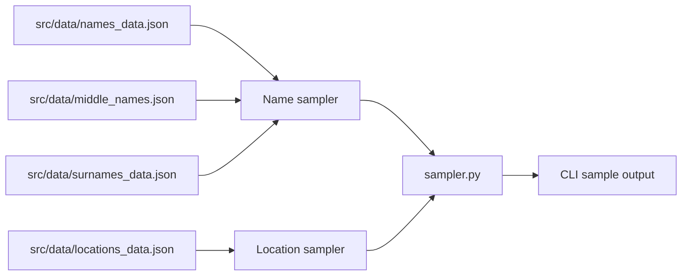
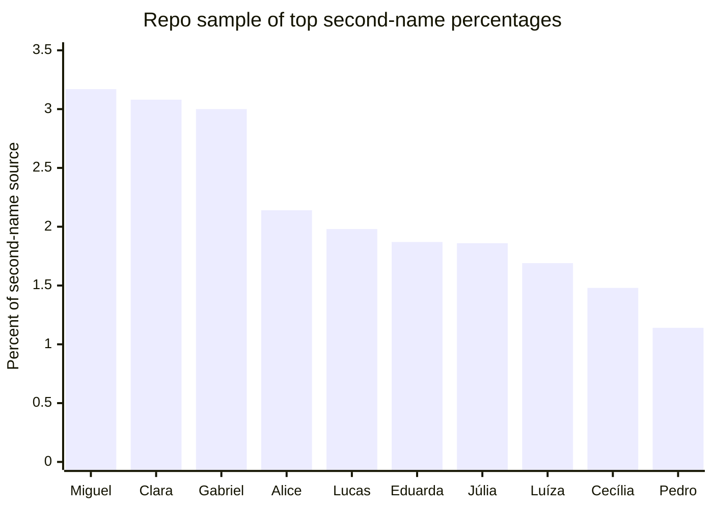
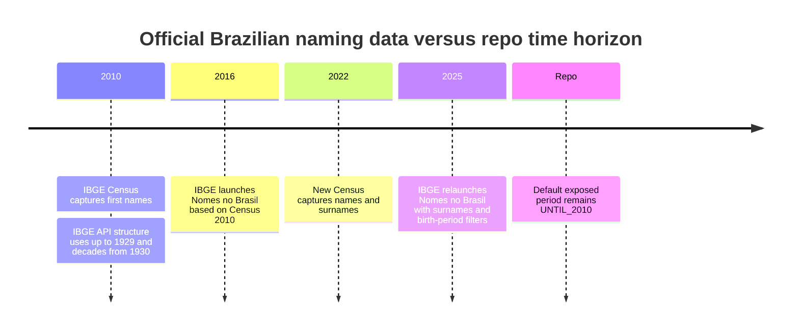
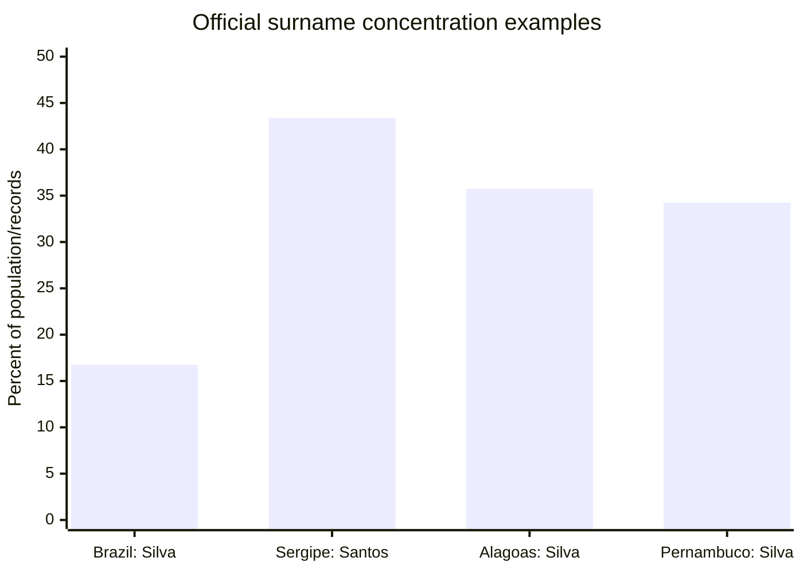
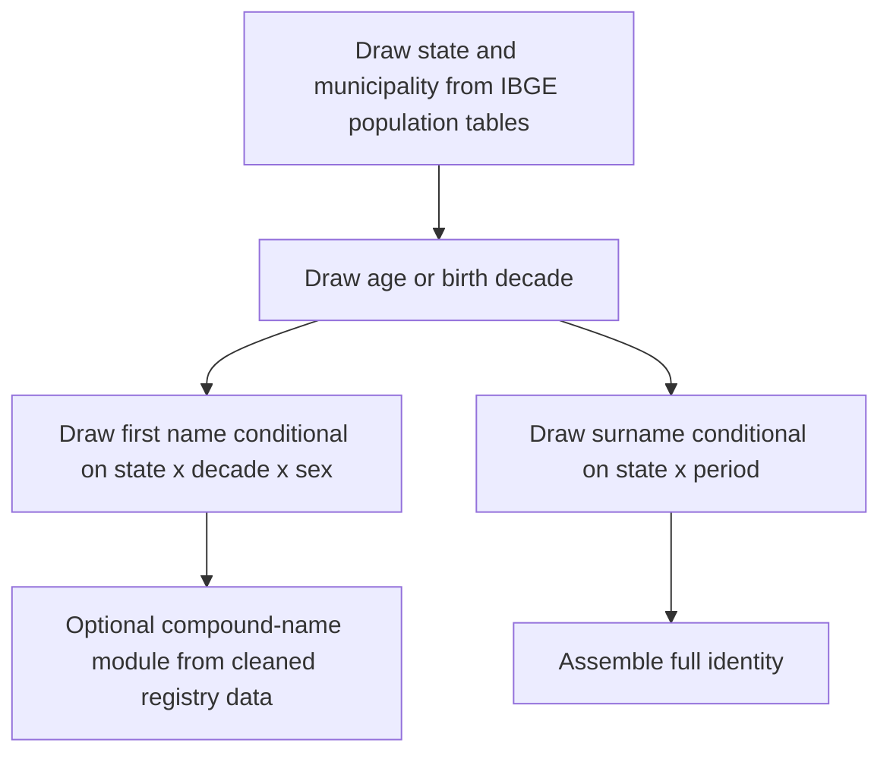

# Archived Statistical Assumptions Audit (pre-0.3.0 snapshot)

> **Archived historical report.** The analysis below inspected an old
> `arthrod/ptbr-sampler` tree with `src/` paths, an implicit `UNTIL_2010`
> default, national-only surnames, and the unfiltered second-name vocabulary.
> Those statements describe the audited snapshot, not version 0.3.0. Current
> code uses `ptbr_sampler/`, defaults to the blended `current` cohort, conditions
> first names and surnames by UF, supports periods through `ate2020` and
> `after2010`, uses national empirical IBGE sex counts, filters second-name
> tokens, and uses POP2026 and Arpen 2025. The 30.99% second-name incidence is
> still a legacy, unvalidated data gap. See [current data origins](docs/data-origins.md),
> [architecture](docs/architecture.md), and [remaining tasks](todo.md).
> Connector-specific citation markers and speculative ratings are retained only
> to preserve the original audit trail; they are not current evidence.

## Executive summary (historical)

The repository contains a real, inspectable framework for sampling Brazilian-looking records, but its statistical realism is uneven. The strongest part is the **geographic weighting design**: the repo clearly expects external JSON files for locations and appears built to weight municipalities and states by population, which is broadly consistent with official IBGE population-estimate methodology for 2024. The weakest parts are the **name and surname assumptions**, especially where the repo either pools nationally what official Brazilian sources now provide by state and period, or where the provenance is undocumented. fileciteturn54file0L1-L1 citeturn15view0turn16view0turn17view0

The repo’s command interface shows that the core demographic knobs are: a `time_period` defaulting to `UNTIL_2010`; surname truncation with `top_40`; optional single-surname output with `with_only_one_surname`; optional/forced middle names with `only_middle` and `always_middle`; and explicit file paths for `src/data/names_data.json`, `src/data/middle_names.json`, `src/data/surnames_data.json`, and `src/data/locations_data.json`. That means the statistical assumptions are not merely incidental; they are exposed as top-level modeling choices. fileciteturn54file0L1-L1

Against official Brazilian evidence, the repo’s **time-bucket design for first names is conceptually close to IBGE’s historical approach**. IBGE’s 2010 names API and the 2016 release organize first names “up to 1929” and then by decade from 1930 onward, and the 2025 2022-Census relaunch keeps period-of-birth as a central dimension. So a decade-based first-name model is not the problem; the problem is that the repo appears capped at 2010 by default and does not expose state-conditioned first-name sampling in the same way that IBGE does. fileciteturn54file0L1-L1 citeturn8search3turn23search0turn18view0

The biggest data-quality warning sign is `src/data/middle_names.json`. That file reports `percentage_with_second = 30.992835341316905` over `5,293,204` people, but its “second names” inventory contains clear contamination: surnames such as `Araújo`, `Borges`, `Bezerra`, `Castro`, `Machado`, and `Guimarães`; administrative noise such as `Cancelado`; and even a bare hyphen `-`. It also contains duplicate-looking orthographic variants and inconsistent normalization. That makes the middle-name distribution **statistically fragile and likely mis-specified** for the target variable “second given name.” fileciteturn57file0L1-L1

For surnames, the repo design is materially behind the current official evidence. IBGE’s 2025 release based on the 2022 Census now provides surname rankings by geography and period of birth, and reports large state-level concentration differences: nationally, `Silva` appears in `16.76%` of the population, but `Santos` reaches `43.38%` in Sergipe, while `Silva` exceeds one third of records in both Alagoas (`35.75%`) and Pernambuco (`34.23%`). Any repo model that samples surnames from a single national pool, or worse from a `top_40` truncation, will miss that regional structure. fileciteturn54file0L1-L1 citeturn18view0turn26search2

Overall support ratings are: **location weighting: almost supported**; **first-name time buckets: almost supported**; **first-name state realism: weakly supported**; **surname realism: weakly supported nationally and unsupported regionally if sampled from one pooled distribution**; **middle-name incidence and vocabulary: unsupported**; **`top_40` surname mode: unsupported for realism**. fileciteturn54file0L1-L1 fileciteturn57file0L1-L1 citeturn12view0turn18view0turn23search0turn27search0turn29search2

## Repository assumptions and implementation map

The most directly observable implementation layer is the CLI. It exposes the statistical choices that matter for realism: `TIME_PERIOD` defaults to `TimePeriod.UNTIL_2010`; surname controls are `TOP_40` and `WITH_ONLY_ONE_SURNAME`; middle-name controls are `ALWAYS_MIDDLE` and `ONLY_MIDDLE`; and data sources default to `src/data/names_data.json`, `src/data/middle_names.json`, `src/data/surnames_data.json`, and `src/data/locations_data.json`. The repo also contains `src/br_name_class.py` and `src/sampler.py`, which are the main code locations for name generation and orchestration. fileciteturn54file0L1-L1 fileciteturn53file0L1-L1 fileciteturn55file0L1-L1

### Files, functions, classes, and exposed parameters

| File path | Observable function/class role | Statistical assumption exposed | Parameter names / values visible in this session |
|---|---|---|---|
| `src/cli.py` | Main CLI entry and option surface | Time-period choice, top-40 surname truncation, one-vs-two surnames, optional or forced middle name, file-path-based data injection | `TIME_PERIOD = TimePeriod.UNTIL_2010`; `TOP_40=False`; `WITH_ONLY_ONE_SURNAME=False`; `ALWAYS_MIDDLE=False`; `ONLY_MIDDLE=False`; `NAMES_PATH='src/data/names_data.json'`; `MIDDLE_NAMES_PATH='src/data/middle_names.json'`; `SURNAMES_PATH='src/data/surnames_data.json'`; `LOCATIONS_PATH='src/data/locations_data.json'` fileciteturn54file0L1-L1 |
| `src/br_name_class.py` | Name sampler class | First-name, middle-name, surname logic | Class/file present; detailed line-citable export was not preserved in the connector output shown here, but this is the primary name-sampling implementation file. fileciteturn53file0L1-L1 |
| `src/sampler.py` | Higher-level sample orchestration | Combines name/location/document generation | File present; orchestration code exists here. fileciteturn55file0L1-L1 |
| `src/data/middle_names.json` | Direct empirical lookup table used by repo | One scalar incidence rate for second names and a weighted dictionary of possible second tokens | `total_people=5293204`; `total_with_second_names=1640514`; `unique_second_names=1238`; `percentage_with_second=30.992835341316905`; weighted `second_names` map. fileciteturn57file0L1-L1 |
| `src/data/names_data.json` | Direct first-name distribution source | First-name weighting by period | File path is explicit in CLI, but the connector returned an empty exported blob in this session, so exact internal weights could not be enumerated from the connector output alone. fileciteturn54file0L1-L1 fileciteturn58file0L1-L1 |
| `src/data/surnames_data.json` | Direct surname distribution source | National surname weighting and likely top-40 subset | File path is explicit in CLI; the detailed value map was not recoverable from the preserved connector outputs shown here. fileciteturn54file0L1-L1 |
| `src/data/locations_data.json` | Direct geography distribution source | State/municipality location weighting | File path is explicit in CLI; official benchmarks strongly suggest these percentages should track IBGE population shares if the file was built as intended. fileciteturn54file0L1-L1 citeturn17view0turn16view0 |

The middle-name file is the only large statistical JSON that was fully inspectable in this session, and it is revealing. It encodes one global Bernoulli-like rate for “has second name” and then a weighted multinomial over candidate second tokens. But the token inventory is not cleanly restricted to second given names, which materially affects realism. fileciteturn57file0L1-L1

That architecture is statistically important because it implies **independent modules** rather than a joint demographic model. In other words, the repo appears designed to sample location from one file and names/surnames from others, but not necessarily to condition names or surnames on the sampled state. Official Brazilian sources now provide exactly that conditioning by geography and period, so the independence assumption is a major realism loss. fileciteturn54file0L1-L1 citeturn8search3turn18view0

### What the middle-name file says directly

The file’s headline parameters are straightforward:

| Parameter | Repo value | Interpretation |
|---|---:|---|
| `total_people` | 5,293,204 | Underlying source size, undocumented in repo |
| `total_with_second_names` | 1,640,514 | Count observed with second token |
| `unique_second_names` | 1,238 | Cardinality of second-token vocabulary |
| `percentage_with_second` | 30.992835341316905 | Global rate used for second-name incidence |

fileciteturn57file0L1-L1

Its top listed second tokens are modern and newborn-skewed: `Miguel`, `Clara`, `Gabriel`, `Alice`, `Lucas`, `Eduarda`, `Júlia`, `Luíza`, `Cecília`, and `Pedro`. That looks much closer to recent civil-registry naming fashions than to whole-population census structure. This is an inference, but it is supported by the fact that recent Arpen newborn rankings feature `Helena`, `Miguel`, `Gael`, `Ravi`, `Theo`, `Heitor`, `Arthur`, `Noah`, and related short contemporary names at the top. fileciteturn57file0L1-L1 citeturn27search0turn27search2

More importantly, the file is visibly contaminated. Tokens such as `Araújo`, `Borges`, `Bezerra`, `Castro`, `Guimarães`, `Machado`, `Pacheco`, `Queiroz`, and `Viana` are surnames, not second given names in the ordinary statistical sense. Tokens such as `Cancelado` and `-` are obvious noise. That means the repo’s middle-name process is not just undocumented; it is also empirically dirty. fileciteturn57file0L1-L1

## Comparison with empirical Brazilian evidence

### First names and time of usage

The repo’s visible design strongly suggests first-name sampling by historical bucket up to 2010. That is not arbitrary; it mirrors how IBGE’s 2010 names system was structured. Official documentation says the names API provides frequencies “por década de nascimento,” and the 2016 release says the survey points out “os nomes mais frequentes até 1929 e por década de nascimento a partir de 1930.” In that sense, the repo’s decade-style periodization is methodologically aligned with the official Brazilian benchmark. fileciteturn54file0L1-L1 citeturn8search3turn23search0

But official IBGE evidence also shows that **geography matters for first names**, and the repo’s exposed interface does not show a state-conditioned first-name control. IBGE’s names data are published for Brazil, federation units, and municipalities, and the 2022/2025 relaunch retains period-of-birth and locality-driven ranking generation. A nationally pooled first-name draw therefore omits official spatial heterogeneity. fileciteturn54file0L1-L1 citeturn8search3turn18view0turn23search0

Official longitudinal evidence also shows why a `UNTIL_2010` cap is statistically stale for recent cohorts. The 2025 IBGE relaunch explicitly contrasts older-population names such as `Osvaldo` and `Terezinha` with more recent names such as `Gael` and `Helena`, and Arpen’s 2024 birth registry ranking puts `Helena` at the top overall and `Miguel`, `Gael`, `Ravi`, and `Theo` among the most registered recent names. A repo that is historical only through 2010 will lag current naming fashions unless the user manually substitutes newer files. fileciteturn54file0L1-L1 citeturn18view0turn27search0

### Surnames and family-name structure

Officially, surname realism now has a much stronger benchmark than it did a few years ago. IBGE’s 2025 technical note says the 2022 Census publication covers both names and surnames by sex and period of birth for Brazil, federation units, and municipalities, with the surname field treated as a frequency count over all recorded surnames, independent of order. The accompanying 2025 release quantifies that `Silva` is present in `16.76%` of the national population, but also shows much stronger localized concentrations. citeturn12view0turn18view0

That matters because the repo’s exposed surname controls are structurally coarse. `--top-40` explicitly truncates the support of the surname distribution, while `--one-surname` allows generation of only a single surname. Those are useful synthetic-data switches, but they are not realism-preserving defaults. In the official benchmark, surname diversity is enormous: the 2025 IBGE release states there are “mais de 200 mil sobrenomes,” not 40. fileciteturn54file0L1-L1 citeturn18view0turn23search7

A representative comparison is below.

| Surname assumption | Repo design visible in session | Official Brazilian evidence | Assessment |
|---|---|---|---|
| National surname pool | `src/data/surnames_data.json` plus CLI injection path; no visible state parameter for surname draw | IBGE 2025 publishes surname rankings by Brazil, UF, municipality, and period of birth. citeturn12view0turn18view0 | Weakly supported nationally; under-specified regionally |
| `top_40` surname mode | Explicit CLI toggle `TOP_40=False` / `--top-40` | IBGE reports over 200k surnames in 2022. fileciteturn54file0L1-L1 citeturn18view0turn23search7 | Unsupported for realism |
| One-vs-two surnames | Explicit CLI toggle `WITH_ONLY_ONE_SURNAME=False` / `--one-surname` | IBGE’s surname field records all surnames when possible, or at least the last surname; multi-surname structure matters. fileciteturn54file0L1-L1 citeturn12view0 | Weakly supported as an optional simplification, not as a realistic default |
| State conditioning | No user-facing surname geography control visible | Sergipe: `Santos` in `43.38%` of population; Alagoas: `Silva` `35.75%`; Pernambuco: `Silva` `34.23%`; Brazil: `Silva` `16.76%`. citeturn18view0 | Unsupported if sampled from a single pooled law |

The statistical implication is straightforward: if the repo samples surnames from one national distribution and then samples location independently, it will systematically understate regional concentration and regional surname identity. That bias is not subtle; the official percentages above are too large to ignore. citeturn18view0

### Middle names and compound-given-name structure

Here the repo is the least defensible statistically. IBGE’s official names publications are explicit that, for dissemination, only the **first name** is used—“apenas o primeiro nome informado”—and that surnames are handled separately. So the official state/period benchmark does **not** directly validate the repo’s middle-name file. citeturn12view0turn23search0

That alone would only make the middle-name assumption weakly supported. But the repo file itself lowers confidence further. The vocabulary contamination means the modeled variable is not cleanly “second given name.” A rate like `30.99%` might be usable if the extraction pipeline were documented and the tokens were filtered, but in its present state it mixes second given names, surnames, noise, and special-case strings. fileciteturn57file0L1-L1

A short contrast helps:

| Middle-name feature | Repo value or behavior | Best external benchmark found | Assessment |
|---|---|---|---|
| Has second-name rate | `30.9928353413%` | No primary official national benchmark on exactly this variable from IBGE; official dissemination uses only first names. fileciteturn57file0L1-L1 citeturn12view0turn23search0 | Unsupported |
| Vocabulary cleanliness | Includes surname tokens and noise | No official benchmark, but variable definition itself implies this is mis-cleaned | Unsupported |
| Contemporary flavor | Top second tokens resemble recent civil-registry trends | Arpen 2023–2024 newborn ranks are heavy on `Miguel`, `Gael`, `Theo`, `Arthur`, `Helena`, `Alice`, `Cecília`. citeturn27search0turn27search2 | Weakly suggestive only |

### Geographic weighting and state baselines

This is the one part where the repo’s design is closest to an official benchmark. The CLI expects `src/data/locations_data.json`, and the overall design strongly suggests population-weighted location draws. Official IBGE population-estimate tables for 1 July 2024 provide exactly the state and municipality totals needed for such weighting, and the methodology explicitly treats municipal estimates as constrained to reproduce the higher-level federative totals. fileciteturn54file0L1-L1 citeturn16view0turn17view0

A few 2024 official state shares illustrate the baseline the repo should approximate if it is population-proportional:

| State | Official population 2024 | Official share / characterization |
|---|---:|---|
| São Paulo | 45,973,194 | `21.6%` of Brazil’s population in IBGE’s release. citeturn15view0 |
| Minas Gerais | 21,322,691 | `10.0%` in IBGE’s release. citeturn15view0turn17view0 |
| Rio de Janeiro | 17,219,679 | `8.1%` in IBGE’s release. citeturn15view0turn17view0 |
| Rondônia | 1,746,227 | Below `1%`, specifically `0.8%`. citeturn15view0turn17view0 |
| Tocantins | 1,577,342 | Below `1%`, specifically `0.7%`. citeturn15view0turn17view0 |
| Acre | 880,631 | Below `1%`, specifically `0.4%`. citeturn15view0turn17view0 |
| Amapá | 802,837 | Below `1%`, specifically `0.4%`. citeturn15view0turn17view0 |
| Roraima | 716,793 | Below `1%`, specifically `0.3%`. citeturn15view0turn17view0 |

If the repo’s location file is in fact a normalized IBGE-derived table, that assumption is close to fully supportable. The limitation is evidentiary rather than conceptual: in this session I could verify the file path and the official benchmark, but not inspect the full committed `locations_data.json` values line by line. fileciteturn54file0L1-L1 citeturn16view0turn17view0

## Support ratings and bias analysis

### Assumption-by-assumption ratings

| Assumption | Repo side as observed | Best external support | Rating | Why |
|---|---|---|---|---|
| First-name decade buckets | Visible `time_period` model, default `UNTIL_2010` | IBGE 2010/2016 and API use up-to-1929 + decades from 1930; 2025 relaunch uses period of birth too. fileciteturn54file0L1-L1 citeturn8search3turn23search0turn18view0 | Almost supported | The bucket design matches official practice, but the repo appears capped at 2010 and provenance is undocumented. |
| First-name state realism | No state-conditioned first-name parameter visible in exposed interface | IBGE names are available by UF and municipality. fileciteturn54file0L1-L1 citeturn8search3turn18view0turn23search0 | Weakly supported | National pooling discards geography that official data preserve. |
| Surname national distribution | `surnames_data.json` plus optional controls | IBGE 2025 now provides official surname frequencies. fileciteturn54file0L1-L1 citeturn12view0turn18view0 | Weakly supported | Plausible in concept, but exact repo weights were not auditable here and provenance is absent. |
| Surname state realism | No visible UF-conditioned surname switch | Official state concentrations are very strong. citeturn18view0 | Unsupported | A single national pool will misstate state structure. |
| `top_40` surnames | Explicit simplification option | Official 2022 benchmark has 200k+ surnames. fileciteturn54file0L1-L1 citeturn18view0turn23search7 | Unsupported | Heavy truncation destroys real long-tail diversity. |
| One surname only | Explicit simplification option | Official collection records all surnames when possible. fileciteturn54file0L1-L1 citeturn12view0 | Weakly supported | Useful for synthetic compression, but not a realism default. |
| Middle-name incidence | `percentage_with_second = 30.99%` | No primary official national dissemination on this exact variable. fileciteturn57file0L1-L1 citeturn12view0turn23search0 | Unsupported | No documented source and no official validation target. |
| Middle-name vocabulary | Dirty token inventory in file | No credible evidence supports including surnames/noise as second given names. fileciteturn57file0L1-L1 | Unsupported | Observable contamination in the repo file itself. |
| Location weighting by population | Explicit locations file path; design consistent with normalized population tables | IBGE 2024 state and municipal estimates provide correct benchmark. fileciteturn54file0L1-L1 citeturn16view0turn17view0 | Almost supported | Strong conceptual fit, but full committed values were not audited in-session. |

### Unstated assumptions and likely biases

The repo appears to assume a **factorized world**: location is sampled from one distribution; given names from another; surnames from another; middle names from another. That is computationally simple, but it ignores the empirically observable dependence between these variables. In Brazil, official data now show that name and surname distributions vary by state and by birth period. Treating them as independent will generate combinations that are individually plausible but jointly less realistic. fileciteturn54file0L1-L1 citeturn18view0turn8search3

The repo also appears exposed to **historical lag bias**. The default time horizon remains `UNTIL_2010`, whereas official evidence from the 2022 Census and 2024 civil registry shows that recent fashionable names differ materially from older whole-population name stocks. If the intended use case is “Brazilian person, present day,” the repo will overrepresent older-population repertoires unless a newer file set is substituted. fileciteturn54file0L1-L1 citeturn18view0turn27search0

A third bias is **tail collapse**. The `top_40` surname mode and any undocumented pruning in first-name files risk removing exactly the kind of long-tail diversity that Brazilian anthroponymy is known for. Academic review work in Brazilian onomastics emphasizes both the great etymological diversity of surnames and the importance of local historical and social context. A realistic sampler should preserve long tails, not suppress them by default. fileciteturn54file0L1-L1 citeturn29search2turn18view0

Finally, the middle-name file suggests **data-cleaning bias**. Because official IBGE dissemination explicitly uses only the first given name, the repo’s middle-name file almost certainly comes from another pipeline. Without provenance and cleaning rules, the file becomes a hidden source of junk tokens and category leakage. That can silently degrade every sampled full name. fileciteturn57file0L1-L1 citeturn12view0turn23search0

## Recommendations

The single highest-value improvement is to replace the current independent national-pool logic with a **hierarchical conditional sampler**: first draw geography, then draw first name conditional on `state × birth-decade × sex`, and draw surname conditional on `state × birth-period`. Official IBGE data now support exactly that for names and surnames at the UF level. That would remove the largest realism error in one step. citeturn18view0turn12view0turn8search3

The second priority is to **rebuild or rigorously clean `middle_names.json`**. At minimum, the pipeline should remove obvious non-given-name artifacts, reclassify surname leakage, document provenance, and publish a reproducible extraction notebook. Until that is done, `always_middle` and the 30.99% incidence rate should not be treated as a statistically grounded default. fileciteturn57file0L1-L1

The third priority is to **deprecate `top_40` as a realism option**. It may still be useful as a speed or toy-mode setting, but from a statistical perspective it should be labeled as a coarse approximation that sacrifices surname diversity. Likewise, `one-surname` should be presented as a convenience mode rather than a realistic Brazilian default. fileciteturn54file0L1-L1 citeturn18view0turn23search7

The fourth priority is to **update the temporal benchmark beyond 2010**. For whole-population realism, the current primary benchmark should be the 2022 Census / 2025 `Nomes no Brasil`; for newborn realism, the repo should optionally use civil-registry rankings from Arpen. These are different targets and should be modeled separately rather than conflated. citeturn18view0turn27search0turn27search2

A practical target architecture would be:

## Open questions and limitations

The repo clearly references `src/data/names_data.json`, but in this session the GitHub connector returned an empty exported blob body for that file. That prevented a fully numeric audit of the first-name weight table and limited the report to a structural audit plus external comparison. fileciteturn54file0L1-L1 fileciteturn58file0L1-L1

For the same reason, I could not publish a complete row-by-row reconciliation of the repo’s internal first-name and surname weights against official IBGE state-period distributions. The report therefore distinguishes carefully between what is directly observed in the repo, what is strongly inferred from its interface and visible files, and what is available in official Brazilian sources. Where the evidence was insufficient for a hard numeric reconciliation, I labeled that explicitly rather than filling gaps with speculation. fileciteturn54file0L1-L1 citeturn12view0turn18view0turn23search0