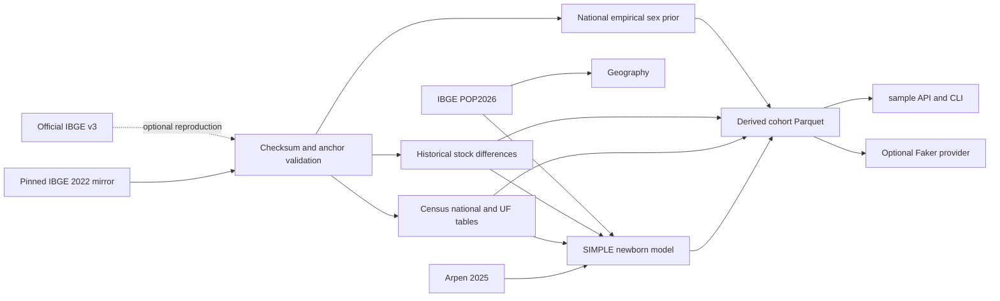

# Data and sampling architecture

This reference describes version 0.3.0. For source records and exact row counts,
see [data origins](data-origins.md); for the historical audit, see the archived
[research report](<../deep-research-report(4).md>).

## Data flow



The pinned mirror is input storage, not evidence that its code license applies
to IBGE data. Official v3 fetching is optional and may fail in a restricted or
timed-out environment. `THIRD_PARTY_NOTICES.md` separates code and data terms.

## Partitioned Parquet storage

The production entry points use `ptbr_sampler/data/parquet/`. Important groups
include:

```text
ibge2022/
├── first_names/scope=national/
├── first_names/uf=<UF>/
├── surnames/scope=national/
├── surnames/uf=<UF>/
├── historical/period=<1930|…|after2010|until2020>/
│   └── sex=<M|F>/                         # selected derived conditionals
└── sex_prior/scope=national/
arpen2025/
├── simple|compound|all/scope=national|uf=<UF>/
└── births/
cohorts/
└── cohort=<current|census2022|newborn2025>/
    ├── scope=national/
    │   └── sex=<M|F>/
    └── uf=<UF>/
        └── sex=<M|F>/
```

Legacy `first_names/period=<ateYYYY>`, `surnames/scope=national`,
`middle_names/`, and `states/` partitions remain for compatibility. The current
surname tables used by high-level profiles come from `ibge2022/surnames/`.

Distribution partitions contain `name`, `count`, and `weight`. Direct observed
partitions normalize source counts. Derived blends store exact `float64`
weights and zero counts so integer rounding cannot change probabilities.
Every generated group has `data_origin.json` sidecars. `data/manifest.json`
records paths and SHA-256 hashes for 867 managed artifacts, including M/F
partitions for all 12 derived historical stock/bin periods.

`pyarrow.dataset` reads only the selected partition. JSON fixtures and bespoke
`BrazilianNameSampler` data remain available for tests and custom callers.
Missing bundled modern tables fail clearly; the sampler does not silently
replace a selected modern cohort with a stale national JSON distribution.

## Alias sampling and caches

`ptbr_sampler/sampling/alias.py` implements the Walker/Vose alias method:
O(m) construction and O(1) weighted selection per item, with vectorized draws.
`PartitionStore` lazily loads Parquet. `BrazilianNameSampler` maintains a
bounded, condition-keyed LRU for alias tables; `lru_size` defaults to 32.
High-level sampler instances are cached by resolved data paths, Parquet root,
fixed UF, and cache size. A lock protects shared cache updates.

The same batch implementation handles one or many names. CLI `--batch` controls
JSONL write cadence, not the statistical algorithm. No fixed benchmark latency
is promised because cold reads, cache state, filesystem, and hardware vary.

## Geography and UF conditioning

The default first draws a UF from official POP2026 populations, then a city
within that UF from CEP-covered municipal populations. A fixed `uf='SP'` skips
UF selection and applies SP to location, first-name, and surname distributions.

Official UF totals include all 5,571 source municipalities. The legacy CEP base
contains 5,570; the missing municipality is Boa Esperança do Norte (`5101837`).
Thus national and alpha denominators use **214,211,951**, while CEP-covered
municipal rows total **214,205,968**. This distinction prevents the missing CEP
metadata from altering UF-level blend weights.

Direct name sampler calls without a UF use precomputed national marginals,
weighted by official UF populations. Arpen registration counts never select
geography. Surnames use pure IBGE 2022 data, not the first-name cohort blend.

## Cohort derivation

For each UF:

```text
p_census2022[i,u] = IBGE2022_count[i,u] / sum_i(IBGE2022_count[i,u])
p_observed[i,u] = Arpen_SIMPLE_count[i,u] / registrations_2025_u
residual_u = 1 - sum_top50(p_observed[i,u])
p_newborn_tail[i,u] = residual_u * national_after2010[i]
                      / sum(national_after2010 excluding UF top50 labels)
p_newborn2025 = observed top50 + modeled tail
alpha_u = registrations_2025_u / official_POP2026_population_u
p_current[i,u] = (1-alpha_u)*p_census2022[i,u] + alpha_u*p_newborn2025[i,u]
```

Only atomic SIMPLE Arpen rows are observed newborn inputs. COMPOUND and ALL
artifacts do not enter first-name or second-name distributions. Names in the
UF top 50 but absent from the national tail retain their observed mass. The
tail uses national 2011–2020 evidence, not UF-observed post-2010 history.
`current` is a recency-adjusted synthetic model, not an official future
population-name estimate.

`top_40` ranks the final selected UF surname probabilities and then normalizes.
Ties are stable. `random=True` draws uniformly from the final support rather
than from source counts, so it remains well-defined after blending and top-40
selection.

## Historical bins and sex conditioning

National historical bins are derived from IBGE stock endpoints: stock 1930;
stock 1940 minus stock 1930; and successive differences through 2020 minus
2010. `after2010` is that final difference and covers 2011–2020. `until2020`
is cumulative stock 2020. These are derived national stock bins, not disjoint
Census 2022 rows or observed UF-period-sex tables.

An explicit period disables cohort blending. Non-default cohort plus period is a
`ValueError`. `sex_conditioning='M'|'F'` computes:

```text
p_sex[i] ∝ selected_distribution[i] * national_IBGE_p_sex[i]
```

and renormalizes. `mixed` chooses M/F independently per row with equal
probability. National sex evidence does not establish UF-specific sex
conditionals. Null-sex names remain in unconditioned support and are omitted
only from M/F tables. No sex field is added to output records.

## Second names and output conventions

The cleaned legacy middle-name Parquet has 885 tokens. It retains the old
corpus ratio 1,640,514 / 5,293,204 = 30.99% as an unvalidated compatibility
setting. Arpen compound rankings do not validate that ratio. Vocabulary
filtering reduces surname/noise leakage but cannot turn the extract into a
nationally representative sample. Prefix probabilities such as `da Silva` are
authorial linguistic style weights, not measured population frequencies.

## Randomness and Faker

The public wrapper and provider accept an injected `random.Random`-compatible
stream. Alias tables initialize a private NumPy generator from that stream;
they never seed or advance NumPy's global RNG. The wrapper with `rng=None`
retains legacy `random.seed(...)` behavior.

`ptbr_sampler.faker.install_ptbr(fake, ...)` installs a configured provider on
one Faker instance using `self.generator.random`. Standard aliases are opt-in
with `aliases=True`. Reinstall removes only earlier PTBR providers and aliases,
while retaining later third-party formatter overrides. Multi-locale proxies
operate on each underlying generator independently.

Offline generation does not need an event loop and works inside async code.
Online CEP enrichment uses `asyncio.run`; synchronous `sample()` raises
`RuntimeError` if called with `make_api_call=True` while a loop is running.
Use a separate thread or a non-running loop for that synchronous API.

## Validation

Tests cover derived arithmetic, distribution totals, manifest hashes, packaged
artifacts, seeded RNG behavior, Faker instance isolation, selectors, and source
coverage. `ptbr-data validate` verifies runtime artifacts and weights. These
checks test implementation and source consistency; they do not prove that a
synthetic profile is population-representative or resolve upstream data terms.
