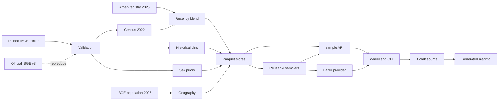

## Scope and deliverables

Implement the approved modernization in three destinations without making the main source repository public:

- Main package: `jandira-tech/ptbr-sampler`, cloned to `/home/arthrod/workspace/ptbr-sampler`, still private.
- Public notebooks: `jandira-tech/ptbr-sampler-notebooks`, at `/home/arthrod/workspace/ptbr-sampler-notebooks`.
- Public Python release: `ptbr-sampler` 0.3.0 on PyPI.

Save and commit this design as `docs/superpowers/specs/2026-11-07-ptbr-sampler-data-faker-notebooks-design.md`. Work in local reviewable commits. Do not push the private source repository or expose credentials.

## 1. Clone and establish a baseline

Clone `main` from the inspected private repository. Confirm both destination paths are safe before creating anything. Record the existing test, lint, build, CLI, and packaged-data behavior so regressions are distinguishable from pre-existing failures. Preserve any user work found in either destination.

## 2. Upgrade packaging and dependencies

Replace frontend metadata in `pyproject.toml` with the real supported environment: Python `>=3.12`, MIT, PyPI-ready project URLs, and explicit distribution of every bundled dataset.

- Upgrade direct runtime, test, dev, documentation, notebook, npm, and pinned GitHub Action dependencies to mutually compatible current releases. Recheck release versions at execution time.
- Remove the unused `richer` dependency and the orphaned README frontend page. Retain and update `cep-promise`, adding its missing npm lockfile.
- Regenerate `uv.lock` rather than leaving it stale after manifest changes.
- Add Faker as a `faker` optional extra. Add the tools needed to execute, convert, and check notebooks as development dependencies.
- Keep the Python compatibility floor at 3.12 unless an actual 3.12 incompatibility is evidenced; report any unresolved upstream incompatibility instead of silently retaining an old dependency.

## 3. Build reproducible, validated data ingestion

Replace the raw-Python build scripts with a Typer/Rich/`tqdm` CLI containing dataset status, fetch, validate, and build commands. Use HTTP timeouts, bounded retries, caching/resume support, checksums, source URLs, retrieval timestamps, upstream revisions, and row counts. Commit reproducible sanitized inputs and the compact derived Parquet/JSON data, but not virtual environments, caches, or unpackaged 97 MB SQLite files.

Authoritative inputs:

1. **IBGE 2022 names:** use the MIT-licensed `alexsantee/nomes_do_brasil_2022` snapshot pinned to `db1f66f397d00d4a6653204f8669c9e8c3adb256`. Verify `nomes.sqlite.zip` by SHA-256 before reading. Never execute mirror repository code. Preserve direct national and all-UF first-name and surname frequencies, national historical frequencies, and empirical national sex counts.
2. **Official reproduction:** add an official IBGE v3 downloader for the documented `nomes/2022/localidade/{UF}/ranking/{nome|sobrenome}` and name-history routes. Validate mirror data against published IBGE anchors, including Maria `12,284,478`, Silva `34,030,104`, Santos `21,367,475`, national sums, and representative UF values.
3. **IBGE 2022 history:** retain the authoritative stock rows 1930 through 2020 and 2022. Derive decade bins by subtracting the endpoint stocks: stock 1930; stock 1940 minus stock 1930; and so forth through stock 2020 minus stock 2010. Add `UNTIL_2020` and `AFTER_2010` partitions. Treat resulting counts and empirical sex conditionals as derived, not independently observed decade-by-sex data.
4. **IBGE 2026 geography:** use the latest official `POP2026_20261029.xlsx` table, retain the DOU table as a comparison/provenance reference, and join on official municipality codes, never fuzzy names. Rebuild both city JSON datasets together so all 5,570 municipalities and all 27 UF/DF rows survive. Preserve CEP, DDD, time zone, and coordinates. Standardize fields named `population_percentage_*` to percentages in `[0, 100]`; compute sampling weights from raw population counts. Assert municipality-to-UF-to-national totals and remove the current 273-municipality loss.
5. **Arpen 2025:** capture the primary portal’s national and per-UF simple/compound/all-name top-50 responses and birth totals, with retrieval timestamps. The verified national denominator is 2,537,697 registrations. Do not substitute stale secondary reporting.
6. **Sex data:** use IBGE 2022 empirical national male/female counts as the default name-sex prior. Keep names with withheld sex counts in unconditioned sampling; omit them from sex-conditioned distributions and measure that coverage loss. Retain Brasil.IO/Gemini only as historical provenance, not a fallback heuristic unless its use is separately requested in API options.

Every derived partition gets a sidecar describing source coverage, transformations, authorization/provenance, known suppression, and limitations. Add clear third-party notices: the project’s MIT license does not claim to relicense IBGE or Arpen data.

## 4. Implement the approved UF-conditioned blend

Use Mermaid as the canonical data-flow overview:



For each UF `u`, define:

```text
alpha_u = registrations_2025_u / population_2026_u
newborn_2025_u = observed_top50_probabilities_u + residual_mass_u * modeled_IBGE_post2010_tail_u
current_u = (1 - alpha_u) * census_2022_u + alpha_u * newborn_2025_u
```

The national blend is about 1.185%; calculate each actual UF weight from that UF’s data. Redistribute residual newborn mass only over the IBGE post-2010 tail excluded from that UF’s observed top 50, then normalize. This preserves a real name tail and keeps every source’s contribution explicit. Label the result a recency-adjusted synthetic distribution, not an official 2026 population-name estimate. Surnames remain pure IBGE 2022 because Arpen does not supply complementary recent surname counts.

Expose coherent cohort choices:

- `current` is the default blended, UF-conditioned distribution.
- `census2022` bypasses the recency adjustment.
- `newborn2025` uses observed 2025 counts plus the documented modeled tail.
- Explicit historical `time_period` values select historical bins and exclude the 2025 blend. Supplying both a non-default cohort and historical period is an error.

Names and surnames use UF conditioning by default. Name-only sampling retains the same national marginal by combining UF distributions using 2026 populations. Apply empirical name-sex priors only when sex conditioning is requested, then renormalize. `random=True` remains uniform over the selected support and ignores frequency weights. Route UF sex requests to real UF names plus empirical sex priors; retire `experimental_uf_sex_conditioning` through the existing compatibility shim and document migration. Define `top_40` against the selected cohort’s final ranked probabilities and normalize afterward.

Do not infer population-wide second-given-name incidence from a truncated registry ranking. Keep the documented 30.99% middle-name probability and flag it as a remaining data gap.

## 5. Add robust injecting RNG and a Faker provider

Refactor reusable sampler construction so name/location state can be reused across calls without reloading data or rebuilding all alias tables for every Faker field. Preserve the existing standalone `sample()` entry point and `random.seed(...)` reproducibility.

Route randomness explicitly through an injected stdlib `random.Random`-compatible object for names, locations, documents, addresses, phones, optional fields, and NumPy alias initialization. Never temporarily reseed or mutate module-global RNG state. `random=True` can initialize its NumPy generator from the supplied stream without restoring or replacing global state.

Publish `ptbr_sampler.faker` with an install helper and provider supporting:

- Namespaced full profiles and all major components: `ptbr_profile()`, `ptbr_name()`, `ptbr_first_name()`, `ptbr_middle_name()`, `ptbr_surname()`, city/state/CEP/address, CPF/RG/PIS/CNPJ/CEI, formatted and unformatted documents, and phone numbers.
- `install_ptbr(fake, aliases=False, ...)`: default registration never touches standard Faker locales, including `pt_BR`.
- `aliases=True`: explicitly opt in to standard aliases such as `name`, `first_name`, `last_name`, `city`, `state`, `postcode`, `cpf`, `cnpj`, `pis`, and `phone_number`, in addition to retaining `ptbr_*` methods.

The provider must use `self.generator.random` for every field. `Faker.seed()` and `seed_instance()` must reproduce batches across fresh instances. Scalar fields are independent; a profile remains internally coherent. Honor selected cohort/period/UF/sex formatting options through the same public sampler code paths as standalone use.

## 6. Correct documentation, license, and project truthfulness

Use the completed implementation as the documentation baseline. Reconcile README, README.en, architecture, data origins, all source pages, sampling/conditioning pages, `todo.md`, handoffs, research reports, and CLI examples. Remove placeholder repositories, obsolete data paths, national-only claims, unavailability claims contradicted by bundled data, contradictory checkboxes, and the unsupported Python 3.9 badge.

Replace `LICENSE` with the standard MIT text under Jandira Tech, add `THIRD_PARTY_NOTICES.md`, document optional Faker aliases and RNG behavior, population-derived blending, historical-bin subtraction, geographic denominators, sex-data suppression, and the still-unvalidated middle-name incidence. Add the public Colab and marimo badges only with URLs that will exist after publication.

## 7. Create the public notebook repository, Colab-first

Create `notebooks/ptbr_sampler_demo.ipynb` as the sole hand-authored notebook. Demonstrate installation of the released `ptbr-sampler[faker]==0.3.0`, default profiles/batches, all three cohorts, historical and sex-conditioned samples, and seeded Faker usage. Include concise provenance and limitation cells. The notebook must import only published artifacts, never the private checkout.

Use a checked-in synchronization script to run `marimo convert notebooks/ptbr_sampler_demo.ipynb -o notebooks/ptbr_sampler_demo.py`, add pinned PEP 723 dependencies, and fail if regenerated output differs from the committed marimo file. Do not manually maintain the generated file. Avoid IPython magics and repeated cell-level variable definitions; use a portable Colab-only subprocess installation cell while marimo uses its declared dependencies.

Publish Open in Colab and Open in marimo/molab badges in the public README and both main READMEs. Give the public repository its own MIT license and concise regeneration instructions. Verify Pyodide compatibility for the package’s Parquet/PyArrow path before linking the `/wasm` destination.

## 8. Validate behavior and built artifacts

Add and run focused tests alongside the complete existing suite:

- Exact source counts, checksums, all 27 UF partitions, all 5,570 municipalities, published IBGE/Arpen anchors, and population reconciliation.
- Historical subtraction arithmetic and explicit derived-data provenance.
- Positive finite probabilities summing to one for every current, census, newborn, historical, UF, and sex-conditioned case; withheld-sex names are excluded only in sex-conditioned cases.
- Independent hand-calculated small examples of residual-tail allocation and per-UF blending, plus real-data assertions that current differs from census2022 by exactly the specified mixture and does not collapse to top-50 support.
- Cohort/period conflict errors, `top_40`, `random=True`, CLI compatibility, and consistent name-only national marginals.
- Seeded standalone and Faker reproducibility, no global-RNG mutation, namespaced standard `pt_BR` methods unchanged by default, explicit alias behavior, unread formatted values, and checksum validation of synthetic identifiers.
- Fresh-process wheel inspection/install proving CLI imports and all packaged-data paths, including `sample()` and Faker calls.

Run full pytest, Ruff check/format checks, source-data validators, wheel/sdist builds, fresh wheel and PyPI installs, `nbconvert --execute`, `marimo check`, marimo script execution, Colab-to-marimo idempotence, and fresh-process notebook smoke tests. Test the actual published badge targets and molab/WASM path. Report any check that cannot be performed rather than claiming it passed.

## 9. Publish in dependency order

1. Commit the approved specification, implementation, tests, data provenance, and documentation locally in the private repository.
2. Build 0.3.0, inspect its contents, and publish it to PyPI with existing configured credentials/trusted publishing. Never print secrets. Recheck that the version is unused; never overwrite a release.
3. Install the published version in a fresh environment and rerun package, Faker, CLI, and notebook smoke tests.
4. Create and push the public notebook repository, then verify both hosted notebook/badges resolve and use the released package.
5. Finish with a summary separating commits, published artifacts, measured validation, remaining data limitations, and any credential or third-party blocker.