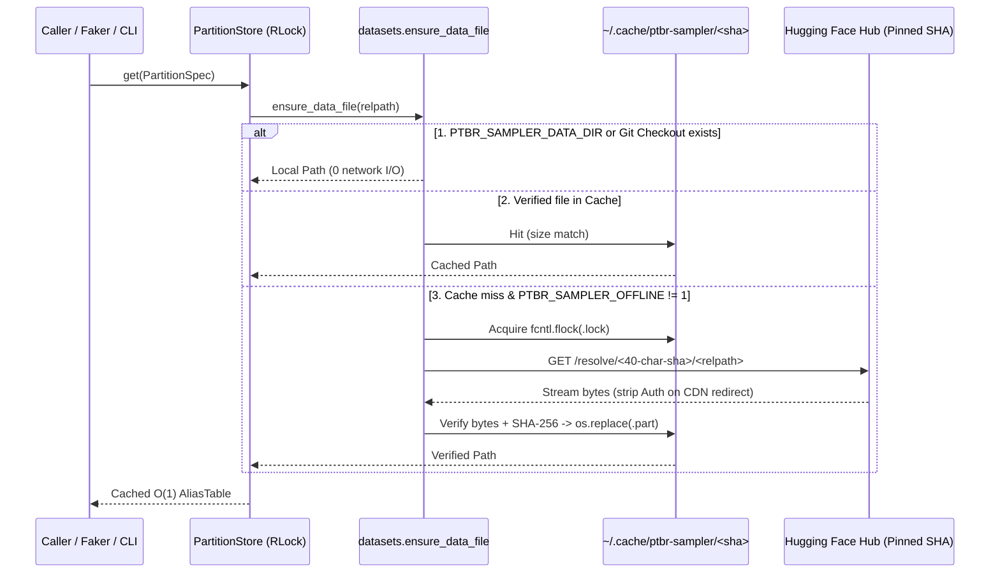

# `ptbr-sampler` Technical Report: Statistical Methodology, Numerical Algorithms, and Runtime Architecture (`v0.1.0` – `v0.3.0`)

**Authors:** Jandira Tech & Arthur Souza Rodrigues  
**Package Version:** `0.3.0`  
**Repository:** <https://github.com/jandira-tech/ptbr-sampler>  
**Runtime Dataset Hub:** <https://huggingface.co/datasets/arthrod/ptbr-sampler-data> (`c30ef6ac3dbf2d1508e41dce7b6a6e47d8e6dbde`)  
**Software License:** MIT License (`Copyright (c) 2026 Jandira Tech`; third-party data terms in [`THIRD_PARTY_NOTICES.md`](../THIRD_PARTY_NOTICES.md))

---

## Abstract

Generating realistic synthetic records for Brazilian software testing, privacy-preserving analytics, entity-resolution benchmarks, and simulation requires sampling from extreme heavy-tailed demographic distributions ($M = 128{,}458$ distinct given names and $M_S = 201{,}601$ surnames across $N_{\text{pop}} = 203{,}080{,}756$ residents in the 2022 IBGE Demographic Census) while preserving geographic coherence across 27 Federation Units (UFs) and 5,570 municipalities, postal-code (CEP) spans, telephone area codes (DDDs), and check-digit-valid synthetic identifiers (CPF, state-specific RG, PIS/PASEP, CNPJ, and CEI).

This technical report documents the complete scientific, numerical, and software engineering evolution of `ptbr-sampler` across three major generations (`0.1.0`, `0.2.0`, and `0.3.0`, alongside an assessment of the superseded `PR #45` architecture). We derive:
1. The exact four-regime confidentiality censoring conservation equations induced by IBGE Technical Note `Liv102228` (`< 20` national/decade, `< 15` UF, `< 10` municipality), showing that **99.8207%** (`190,041,904 / 190,383,184`) of published national given-name mass in the 2022 Census has directly observed empirical sex counts with **0.0%** Large Language Model (LLM) imputation;
2. The distinction between **strict observed marginals** (`conditioning_mode='strict'`) and **lazy Bayes conditional independence** (`conditioning_mode='estimated'`) for unobserved multi-axis intersections (`UF × sex`, `cohort × sex`);
3. The mathematical relationship between IBGE's headline person-level surname presence (`Silva = 16.76%`) and normalized token-slot probability ($q_{\text{Silva}} = 10.2040\%$ across $\bar{L} \approx 1.6422$ recorded surname tokens per resident), paired with conditional two-slot sampling without stem replacement ($S_2 \neq S_1$);
4. A floating-point error analysis of the Walker–Vose $O(1)$ alias method under Zipfian head hubs (`Silva` scaled weight $s_{\text{Silva}} \approx 20{,}571.4$), combining Shewchuk's exact summation (`math.fsum`) bulk hub absorption with Kahan (1965) compensated subtraction to achieve worst-case reconstruction error $\|p^{\text{alias}} - w\|_\infty = 1.39 \times 10^{-17}$ in `float64`;
5. An ultra-slim `< 150 KiB` Python wheel architecture backed by cryptographically pinned (`SHA-256`), `fcntl.flock`-synchronized lazy artifact caching from Hugging Face Hub, thread-safe `RLock` stores, isolated `random.Random` stream injection (`rng=`), and a first-class `Faker` provider (`ptbr_sampler.faker`); and
6. A four-layer goodness-of-fit (GoF) validation framework replacing statistically invalid nominal Kolmogorov–Smirnov and truncated top-50 $\chi^2$ checks with exact $O(M)$ alias probability reconstruction, exhaustive tail-pooled multinomial Pearson $X^2$ / log-likelihood $G^2$ testing ($E_j \ge 5$), Holm–Bonferroni family-wise error rate control ($\alpha_{\text{FWER}} = 0.001$), negative controls, and cross-table demographic coherence audits.

---

## Contents

1. [Historical Evolution (`0.1.0` → `0.2.0` → Exploratory `PR #45` → `0.3.0`)](#1-historical-evolution-010--020--exploratory-pr-45--030)
2. [IBGE Census 2022 Foundations & `Liv102228` Censoring Theory](#2-ibge-census-2022-foundations--liv102228-censoring-theory)
3. [Conditional Estimation, Surname Slot Mechanics, Geography, & Check-Digit Algebra](#3-conditional-estimation-surname-slot-mechanics-geography--check-digit-algebra)
4. [Numerical Analysis of $O(1)$ Kahan-Compensated Walker–Vose Sampling](#4-numerical-analysis-of-o1-kahan-compensated-walkervose-sampling)
5. [Ultra-Slim Packaging, Cryptographic Runtime Cache, Stream Isolation, & `Faker`](#5-ultra-slim-packaging-cryptographic-runtime-cache-stream-isolation--faker)
6. [Four-Layer Goodness-of-Fit Validation & Empirical Audit Results](#6-four-layer-goodness-of-fit-validation--empirical-audit-results)
7. [Methodological Limitations, Ethical Safeguards, & Licensing Boundaries](#7-methodological-limitations-ethical-safeguards--licensing-boundaries)
8. [References](#8-references)

---

## 1. Historical Evolution (`0.1.0` → `0.2.0` → Exploratory `PR #45` → `0.3.0`)

Understanding why `ptbr-sampler` `0.3.0` is structured around separated marginals, `float64` compensated alias tables, and externalized Hugging Face Hub artifacts requires tracing the concrete failure modes encountered in earlier iterations.

### 1.1 Era 1 — `0.1.0` Prototype (Early 2025, Commits `26162f1`–`b24863c`)

The initial `0.1.0` release originated under a flat `src/` package layout and bundled five monolithic JSON files directly inside the source tree:
- `names_data.json`: given-name percentages by 2010 Census birth decade (`ate1930` through `ate2010`) scraped from IBGE Nomes API v2;
- `surnames_data.json`: ~86,000 pooled national surnames without regional breakdown;
- `middle_names.json`: civil-registry second given names (`percentage_with_second = 30.99%`) containing unsanitized artifacts such as surname leakage (`Silva`, `Santos`), `'Cancelado'`, and `'-'`;
- `locations_data.json` and `cities_with_ceps.json`: state and municipal lookup tables paired with an optional Node.js `cep-promise` subprocess bridge (`cep_adapter.mjs`) and async `aiofiles` JSONL export.

**Technical & Statistical Deficiencies in `0.1.0`:**
1. **$O(M)$ / $O(\log M)$ Sampling Bottlenecks:** Name draws relied on `random.choices` (which recomputes cumulative weights in $O(M)$ on every invocation when `cum_weights` are not persisted) or Python-level binary search across tens of thousands of JSON keys.
2. **Missing Conditioning Axes:** Names could not be conditioned on sex or Federation Unit (UF), and surnames were purely national — erasing Brazil's pronounced regional surname geography.
3. **Invalid Statistical Tests:** Distribution tests applied `scipy.stats.ks_2samp` to string-encoded nominal categories (a mathematically ill-defined test whose statistic changes under arbitrary relabeling of names) and truncated Pearson $\chi^2$ checks to the top 50 categories after rescaling expected probabilities to sum to 1 (rendering the test completely blind to probability mass leaking from the top 50 into the long tail).

### 1.2 Era 2 — `0.2.0` Vectorized Parquet & 2010 Sex Priors (PRs #31–#43, Commits `6457b4b`–`86e3096`)

The `0.2.0` cycle refactored the codebase into a modern Python 3.12 package (`ptbr_sampler/`), migrated builds to `uv_build`, introduced the `ptbr` Typer CLI (`ptbr generate`, `ptbr sources`), and executed an internal statistical audit (`deep-research-report(4).md`):
- **Columnar Storage & Walker–Vose Sampling:** Added `PartitionStore` (`ptbr_sampler/sampling/store.py`) and `AliasTable` (`ptbr_sampler/sampling/alias.py`) over Apache Parquet partitions so draws became vectorized $O(1)$ per sample after an $O(M)$ load.
- **Vocabulary Hygiene (`vocabulary.py`):** Filtered registry noise (`Cancelado`, single-letter tokens, punctuation, and surname leakage in middle names).
- **2010 Sex Conditioning Pipeline:** Because IBGE's 2010 Nomes API v2 ranking endpoint exposed only top-20 lists per `(UF, sex, decade)`, `0.2.0` multiplied 2010 decade weights by per-name sex priors from Álvaro Justen's `brasil.io/genero-nomes` (`91.9%` match across `(name, period)` cells) and filled the remaining `8.1%` unmatched civil-registry spelling variants via `gemini-3.1-flash-lite-preview` (`scripts/classify_unmatched_names_gemini.py`).
- **Operational Fixes:** Added uniform `random=True` mode ("realism off") and fixed packaged CEP adapter path resolution (PR #42).

**Remaining Limitations in `0.2.0`:**
1. **15-Year Census Lag & LLM Dependence:** Post-2010 Brazilian cohorts (`Helena`, `Miguel`, `Gael`, `Theo`, `Heitor`, `Maitê`) were absent from the 2010 baseline, while sex conditioning relied partly on uncalibrated LLM classifications (`8.1%` of cells).
2. **`float32` Weight Quantization & Hub Cancellation:** Parquet weights were serialized as `pa.float32()`, introducing $\sim 10^{-7}$ normalization drift, and sequential floating-point subtractions inside Vose's loop suffered cancellation on high-frequency hubs.
3. **Repository & Package Payload Growth:** Committing raw and derived data directly into the repository pushed checkout footprints toward `~80 MiB`.

### 1.3 Exploratory Branch Assessment — `PR #45` (`feat/data-faker-notebooks`)

During the transition to `0.3.0`, an exploratory branch (`PR #45`) investigated two simultaneous tracks: (a) bundling 867 derived files (~80 MB), vendored `node_modules`, and a synthetic `current` mixture blending Census 2022 stocks with top-50 Arpen 2025 civil-registry newborn rankings (`alpha_u = registrations_2025_u / population_2026_u`) directly inside the Python wheel; and (b) introducing explicit `random.Random` stream injection and a `ptbr_sampler.faker` provider.

An architectural and statistical review separated those two tracks:
- **Why the Synthetic Stock-Flow Blend & 80 MB Wheel Were Superseded:** Arpen-Brasil publishes truncated top-50 **birth-flow** rankings (including compound names such as *Maria Cecília* counted separately from *Maria*), whereas IBGE Census *Nomes no Brasil* measures whole-population **resident stock** of first given-name tokens. Linearly mixing top-50 flow rankings with a modeled post-2010 census tail conflates two incompatible statistical estimands while shipping an ~80 MB wheel on every `pip install`.
- **What Was Cleanly Ported into `0.3.0`:** The pure software engineering improvements from `PR #45` — zero-global-mutation `rng=random.Random(...)` injection, `PTBRProvider` / `install_ptbr(fake, aliases=False)`, fixed `uf=` alignment across all profile fields, synchronous `asyncio`-safe execution, MIT licensing, and Rich CLI table rendering — were re-engineered via strict red-green TDD onto the Census 2022 + `< 150 KiB` Hugging Face runtime architecture.

### 1.4 Era 3 — `0.3.0` Summary Comparison Across Generations

| Dimension | `0.1.0` (Prototype) | `0.2.0` (Parquet + 2010) | `PR #45` (Exploratory, Superseded) | `0.3.0` (Current Production) |
| --- | --- | --- | --- | --- |
| **Default Name Vintage** | IBGE Census 2010 JSON | IBGE Census 2010 Parquet | Synthetic Census 2022 + Arpen 2025 blend | **IBGE Census 2022 (`TimePeriod.ALL`, $N=203.08\text{M}$)**; 2010 opt-in |
| **Given-Name / Surname Support** | ~64k given / ~86k national surnames | ~64k given / ~86k national surnames | 2022 + modeled Arpen top-50 tail | **`128,458` given + `201,601` national & 27-UF surnames** |
| **Sex Conditioning Provenance** | Unsupported | `genero-nomes` (`91.9%`) + Gemini LLM (`8.1%`) | 2022 empirical counts | **`99.8207%` observed IBGE 2022 mass (`0.0%` LLM in 2022)** |
| **Unobserved Joint Queries** | N/A | Silent fallback or 2010 prior product | Implicit UF × sex × blend product | **Explicit `strict` (observed only) vs. `estimated` (Bayes opt-in)** |
| **Weight Precision & Alias Error** | Python `float` (`random.choices`) | `float32` Parquet ($\sim 10^{-7}$ drift) | `float64` Vose | **`float64` + `math.fsum` + Kahan Vose ($L_\infty = 1.39 \times 10^{-17}$)** |
| **Published Wheel Size** | Multi-MB source JSONs | Multi-MB JSON + Parquet | `~80 MiB` (867 bundled files) | **`~100 KiB` (`< 150 KiB`, manifest-only + HF SHA-256 cache)** |
| **Determinism & Concurrency** | Module-global `random` | Module-global `random` + NumPy | `random.Random` injection | **Isolated `rng=random.Random`, `RLock` stores, `asyncio`-safe** |
| **Faker Integration** | None | None | `ptbr_sampler.faker` | **`ptbr_sampler.faker` (`PTBRProvider`, `install_ptbr`)** |
| **Statistical GoF Suite** | Invalid nominal KS + top-50 $\chi^2$ | Partial audit checks | Unit assertions | **4-Layer exact + tail-pooled $\chi^2$/$G^2$ + Holm–Bonferroni ($\alpha=0.001$)** |

---

## 2. IBGE Census 2022 Foundations & `Liv102228` Censoring Theory

### 2.1 Upstream Provenance & Cryptographic Pinning

On 4 November 2025, IBGE released the second edition of *Nomes no Brasil*, derived from the 1 August 2022 Demographic Census household register ($N_{\text{pop}} = 203{,}080{,}756$ residents) and documented in [Technical Note `Liv102228`](https://biblioteca.ibge.gov.br/visualizacao/livros/liv102228.pdf). For the first time in Brazilian statistical history, IBGE published both **first given names** and **surnames**, disaggregated nationally, by sex, by birth cohort, and across all 27 Federation Units.

Because IBGE's interactive portal (`censo2022.ibge.gov.br/nomes`) relies on internal web-application endpoints rather than a versioned SIDRA bulk archive, `ptbr-sampler` `0.3.0` ingests Gabriel Lobo's public Parquet compilation [`olob0/ibge-nomes-no-brasil-2022`](https://huggingface.co/datasets/olob0/ibge-nomes-no-brasil-2022) pinned at immutable commit `05efb85c92af43da2ed4ed088d1e0c9f17160e65` (`8,630,643` bytes across 5 files):

| Upstream File | Rows | Bytes | Verified `SHA-256` | Tabular Grain |
| --- | ---: | ---: | --- | --- |
| `name_ranking.parquet` | `330,059` | `1,738,567` | `635691d3ce52eb59c242ecb886dbaab62b4b42e6bed4b4f1766f8c6725636c64` | `128,458` given (`190,383,184`) + `201,601` surname (`333,496,261`) |
| `name_detail.parquet` | `330,058` | `2,250,879` | `91518f2d0d1da8e438ab9f557127da06633e186914aecb717f1bbf7bfb6b2943` | National `male_count`, `female_count`, `median_age` |
| `name_by_decade.parquet` | `221,524` | `910,784` | `9f852814bf42a47358841c054a70939c763c4fc70c7e38564ad44fb94b7fbdef` | National 2022 survivor counts by birth decade (`1930..2020`) |
| `name_by_state.parquet` | `828,567` | `3,729,128` | `5588f012d43bb38b07691044010eb7e96cb2bfc359dd3b53a6c3b0ea46f1504e` | `379,474` UF given + `449,093` UF surname (`UF` codes `11..53`) |
| `state.parquet` | `27` | `1,285` | `5d4aa2a4faf4cdef421f2563de63cd8298b58113779774045a29b9e13ddebc55` | Exact 2022 Census UF resident denominators ($\sum = 203{,}080{,}756$) |

*Upstream WAF anomaly (`('perl', 'surname')`):* `name_detail.parquet` has `330,058` rows — one fewer than `name_ranking.parquet` — because IBGE's edge Web Application Firewall blocked HTTP requests containing the literal path segment `/perl` (`frequency = 24` as a surname). `scripts/audit_datasets.py` verifies that all `128,458` given names join `1:1` with `name_detail.parquet` and explicitly records this single surname detail omission.

### 2.2 Decreasing Confidentiality Suppression Thresholds (`Liv102228`)

Per IBGE `Liv102228`, cell counts below scope-specific confidentiality thresholds $\tau_{\text{scope}}$ are suppressed prior to dissemination. Crucially, $\tau_{\text{scope}}$ **decreases** at finer geographic resolutions:

$$\tau_{\text{national}} = 20, \qquad \tau_{\text{decade}} = 20, \qquad \tau_{\text{UF}} = 15, \qquad \tau_{\text{municipality}} = 10$$

Consequently:
- National given-name frequencies ($N_i \ge 20$ across $M = 128{,}458$ names) sum to $\sum_{i=1}^M N_i = 190{,}383{,}184$, accounting for **$93.7475\%$** of Brazil's $203{,}080{,}756$ residents. The remaining $12{,}697{,}572$ residents ($6.2525\%$) carry rare or uniquely spelled names with national frequency $< 20$.
- Exact unrounded population ratios $100 \times \sum_i \text{frequency}_i / N_{\text{pop}}$ ($N_{\text{pop}} = 203{,}080{,}756$) sum to $93.7475\%$ for given names and $164.2185\%$ for surnames, whereas summing upstream's 4-decimal-rounded `percentage` column directly yields $92.3126\%$ (given names) and $161.9529\%$ (surnames) due to tail truncation. Therefore, `scripts/ingest_to_parquet.py` **never** uses rounded `percentage` fields as probabilities; every partition normalizes integer `frequency` directly in `float64` via `math.fsum`.

### 2.3 Exact Four-Regime Sex-Cell Conservation Decomposition

For every published national given name $i \in \{1, \dots, 128{,}458\}$ with total resident count $N_i \ge 20$, let $(N_{i,M}, N_{i,F}) \in \mathbb{Z}_{\ge 0}^2$ denote the true latent male and female counts satisfying the exact conservation law:

$$N_i = N_{i,M} + N_{i,F}$$

Because IBGE suppresses sex-specific cells strictly below $\tau_{\text{national}} = 20$, `name_detail.parquet` reveals censored observations:

$$N_{i,s}^{\text{obs}} = \begin{cases} N_{i,s} & \text{if } N_{i,s} \ge 20 \\ \text{NULL} & \text{if } 0 \le N_{i,s} \le 19 \end{cases} \qquad (s \in \{M, F\})$$

Treating `NULL` naively as `0` would systematically understate minority-sex usage on predominantly gendered names (`1 <= N_{i,s} <= 19`) and drop rare unisex names where $20 \le N_i \le 38$ with both $N_{i,M} \le 19$ and $N_{i,F} \le 19$. Conversely, subtracting $N_{i,\text{obs}}$ from $N_i$ separates **deductive exact zeros** from **suppressed positive counts** without statistical guesswork:

1. **`both_observed` ($N_{i,M}^{\text{obs}} \neq \text{NULL} \land N_{i,F}^{\text{obs}} \neq \text{NULL}$):**  
   Both $N_{i,M} \ge 20$ and $N_{i,F} \ge 20$. Across all **`10,582`** such names (`Maria` has `12,229,635` F and `54,843` M; `Jose` has `5,141,822` M and `23,936` F), the residual $N_i - (N_{i,M}^{\text{obs}} + N_{i,F}^{\text{obs}}) = 0$ holds **identically across 100% of rows**, confirming exact conservation in the upstream IBGE compilation. Empirical sex rates are exact: $p_{i,M} = N_{i,M}/N_i$, $p_{i,F} = N_{i,F}/N_i$.

2. **`one_null_exact_zero` (one `NULL` cell and $N_i - N_{i,\text{obs}} = 0$):**  
   Since $N_{i,M} + N_{i,F} = N_i$ and $N_{i,\text{null}} \ge 0$, observing $N_i - N_{i,\text{obs}} = 0$ proves **deductively** that $N_{i,\text{null}} = 0$ (`55,210` distinct names). Thus $p_{i,\text{obs}} = 1.0$ and $p_{i,\text{null}} = 0.0$ with zero approximation error.

3. **`one_null_suppressed_positive` (one `NULL` cell and $1 \le N_i - N_{i,\text{obs}} \le 19$):**  
   Across **`57,941`** names, the observed sex satisfies $p_{i,\text{obs}} = N_{i,\text{obs}} / N_i < 1.0$, while the residual $R_i = N_i - N_{i,\text{obs}} \in \{1, \dots, 19\}$ is a strictly positive censored count totaling **`232,758`** occurrences (`0.1223%` of national given-name mass). Even though arithmetic subtraction reveals $R_i$ nationally, `ptbr-sampler` **refuses to impute or publish withheld `< 20` sex counts**: $p_{i,\text{obs}} = N_{i,\text{obs}}/N_i$ is recorded accurately while the suppressed cell remains `None`/`NaN` in `sex_prior/scope=national/part.parquet` and is excluded from sex-conditioned marginals (`first_names/sex=M` and `sex=F`), faithfully honoring IBGE `Liv102228` confidentiality rules.

4. **`both_null_suppressed` (both `NULL` cells; $20 \le N_i \le 38$ with $1 \le N_{i,M}, N_{i,F} \le 19$):**  
   Across **`4,725`** rare unisex names totaling **`108,522`** occurrences (`0.0570%` of national given-name mass; maximum observed $N_i = 38 = 19 + 19$), neither sex reaches 20. These names remain in unconditioned `first_names/scope=national/part.parquet` and are excluded (`NaN`) from sex-conditioned tables.

| Censoring Regime | Count Identity | Distinct Names | Share of Types | Observed Sex Mass | Suppressed Residual Mass |
| --- | --- | ---: | ---: | ---: | ---: |
| `both_observed` | $N_{i,M} \ge 20, N_{i,F} \ge 20$ | `10,582` | `8.24%` | `105,627,199` | `0` (`0.0000%`) |
| `one_null_exact_zero` | $N_i - N_{i,\text{obs}} = 0$ | `55,210` | `42.98%` | `12,186,431` | `0` (`0.0000%`) |
| `one_null_suppressed_positive` | $1 \le N_i - N_{i,\text{obs}} \le 19$ | `57,941` | `45.10%` | `72,228,274` | `232,758` (`0.1223%`) |
| `both_null_suppressed` | $20 \le N_i \le 38; N_{i,M}, N_{i,F} \le 19$ | `4,725` | `3.68%` | `0` | `108,522` (`0.0570%`) |
| **Total (`census_year=2022`)** | $N_i = N_{i,M} + N_{i,F}$ | **`128,458`** | **`100.00%`** | **`190,041,904` (`99.8207%`)** | **`341,280` (`0.1793%`)** |

Observed sex marginals partition the `190,041,904` occurrences into **`60,954` male rows** (`92,287,140` occurrences, $48.5615\%$) and **`73,361` female rows** (`97,754,764` occurrences, $51.4385\%$), which directly parameterizes `sex_conditioning='population'`.

### 2.4 Birth-Cohort Endpoint vs. Decade-Start Alignment

A subtle historical trap separates the 2010 and 2022 Census schemas:
- Legacy 2010 `names_data.json` keyed cohorts by **upper boundary** (`ate1940` = born `1930–1939`, ..., `ate2010` = born `2000–2009`).
- Upstream 2022 `name_by_decade.parquet` keys cohorts by `int16` **decade start** (`decade = 1940` for `1940–1949`, ..., `decade = 2000` for `2000–2009`, `decade = 2010` for `2010–2019`, `decade = 2020` for `2020–1 Aug 2022`, and `decade = 1930` pooling survivors born $\le 1939$).

Computing pairwise Total Variation Distance ($\mathrm{TVD}$) between 2010 and 2022 cohorts empirically validates this alignment: matching 2010 `ate2010` against 2022 `decade = 2000` yields $\mathrm{TVD} = 0.133$ (with `Enzo` at `0.144%` in 2010 vs. `0.139%` in 2022), whereas misaligning `ate2010` with `decade = 2010` causes `Enzo` to jump 7.8× to `1.079%`. Accordingly, `TimePeriod` maps `UNTIL_1940..UNTIL_2010` to `decade = 1930..2000`, adds `UNTIL_2020` (`decade = 2010`) and `PERIOD_2020_2022` (`decade = 2020`), sets `TimePeriod.ALL` as the `0.3.0` default, and raises `ValueError` for `UNTIL_1930` under `census_year=2022` rather than silently aliasing it to `<= 1939`.

---

## 3. Conditional Estimation, Surname Slot Mechanics, Geography, & Check-Digit Algebra

### 3.1 `strict` Observed Marginals vs. `estimated` Bayes Conditional Independence

IBGE disseminates 1D marginals $P_{\text{obs}}(X \mid \text{UF}=u)$, $P_{\text{obs}}(X \mid \text{cohort}=t)$, and $P_{\text{obs}}(X \mid S=s)$, but does not publish cross-tabulated 2022 cubes $P(X \mid \text{UF}=u, S=s)$ or $P(X \mid \text{cohort}=t, S=s)$. Rather than materializing $27 \times 10 \times 2 = 540$ speculative Parquet files on disk or silently dropping conditioning arguments, `ptbr-sampler` exposes `conditioning_mode`:

- **`conditioning_mode='strict'` (default):** Serves exclusively directly observed IBGE marginals. Any unobserved multi-axis combination (`UF × sex`, `cohort × sex`, `UF × cohort`) raises an explicit `ValueError` instructing the caller how to opt into `conditioning_mode='estimated'`.
- **`conditioning_mode='estimated'` (explicit opt-in):** Under the conditional sex-ratio invariance assumption

$$P(S = s \mid X = i, G = g) \approx \hat{p}_{i,s}^{\text{obs}} = \frac{N_{i,s}^{\text{obs}}}{N_i} \qquad \text{for } G \in \{\text{UF}, \text{cohort}\},$$

Bayes' theorem yields the in-memory reweighted distribution over observed support $\mathcal{S}_{g,s} = \{i : P_{\text{obs}}(X=i \mid G=g) > 0 \land N_{i,s}^{\text{obs}} \ge 20\}$:

$$\hat{P}(X = i \mid G = g, S = s) = \frac{P_{\text{obs}}(X = i \mid G = g)\,\hat{p}_{i,s}^{\text{obs}}}{\sum_{k \in \mathcal{S}_{g,s}} P_{\text{obs}}(X = k \mid G = g)\,\hat{p}_{k,s}^{\text{obs}}}$$

Because `PartitionStore` caches the resulting `AliasTable` under a composite key `(census_year, 'estimated', axis, group, sex)` protected by `RLock`, first construction takes $< 5\text{ ms}$ and subsequent draws run in $O(1)$. Note that **`UF × cohort` remains rejected even in `estimated` mode**, because demographic age pyramids differ sharply across Brazilian states (e.g., median age in Rio Grande do Sul vs. Roraima), invalidating marginal product independence between state and birth decade.

### 3.2 Surname Token-Slot Share vs. Person-Level Union Presence

In IBGE's 2022 surname table (`201,601` surnames with national count $C_i \ge 20$), each resident contributes once to the count $C_i$ of every distinct surname token present in their registered full name. Summing across all published surnames gives:

$$C_{\text{total}} = \sum_{i=1}^{201,601} C_i = 333{,}496{,}261 \implies \bar{L} = \frac{C_{\text{total}}}{N_{\text{pop}}} = \frac{333{,}496{,}261}{203{,}080{,}756} \approx 1.642185 \text{ tokens/person}$$

IBGE's press headline **`Silva = 16.76%`** (`34,030,104 / 203,080,756`) is therefore the **person-level union event** $P(\text{Silva} \in \text{person's surname set})$, whereas the normalized categorical probability for a single surname slot is:

$$q_i = \frac{C_i}{C_{\text{total}}} \implies q_{\text{Silva}} = \frac{34{,}030{,}104}{333{,}496{,}261} = 0.10204044 \;(10.2040\%), \qquad q_{\text{Santos}} = \frac{21{,}367{,}475}{333{,}496{,}261} = 0.06407111 \;(6.4071\%)$$

In default two-surname mode (`with_only_one_surname=False`), independent i.i.d. draws $S_1, S_2 \stackrel{\text{iid}}{\sim} \mathbf{q}$ would produce identical consecutive stems (`"Joao da Silva Silva"`) with probability $\sum_i q_i^2 \approx 1.71\%$ (`~1.04%` from `Silva` alone). Under `census_year=2022`, `BrazilianNameSampler` samples $S_1 \sim \mathbf{q}$ and resamples $S_2 \sim \mathbf{q}$ conditioned on $S_2 \neq S_1$:

$$P(S_1 = i, S_2 = j) = \frac{q_i\,q_j}{1 - q_i}\,\mathbf{1}_{[i \neq j]}$$

Under this conditional two-slot law, the probability that surname $i$ appears in a two-surname draw is:

$$P(i \in \{S_1, S_2\}) = q_i + \sum_{k \neq i} q_k \frac{q_i}{1 - q_k}$$

Evaluating this exact expression on the 2022 national surname vector gives $P(\text{Silva} \in \{S_1, S_2\}) \approx 19.65\%$ for two-slot draws (consistent with the empirical `16.76%` population average across $\bar{L} \approx 1.6422$ slots, where roughly one-third of residents carry a single surname). Moreover, when UF conditioning is active (`uf='SE'` or `uf_conditioning=True`), surnames automatically dispatch to `census_year=2022/surnames/uf=<UF>/part.parquet`, capturing strong regional concentrations such as `Santos` in Sergipe (`43.38%` presence) and `Silva` in Alagoas (`35.75%`) and Pernambuco (`34.23%`).

### 3.3 Geography, Postal Spans, & Check-Digit Algebra

Location sampling (`BrazilianLocationSampler`) draws states and municipalities weighted by IBGE's 1 July 2024 *Estimativas da População* (`212.6M` residents across 27 UFs and 5,570 municipalities), paired with municipal Correios/ViaCEP postal prefix intervals and Anatel two-digit DDD mobile numbers (`(DD) 9XXXX-XXXX`). When `uf` is pinned (`sample(uf='RJ')`, `ptbr generate --uf RJ`, or `fake.ptbr_profile(uf='RJ')`), state, municipality, CEP, DDD, given name, regional surname, and RG issuer (`DETRAN-RJ`) are all constrained to that UF.

Synthetic Brazilian document generators (`ptbr_sampler/utils/`) construct uniformly random stems and append exact mathematical check digits — guaranteeing 100% syntactic/checksum validity for downstream form and database validators without ever consulting real registries:

| Identifier | Format | Stem Domain | Check-Digit Formula |
| --- | --- | --- | --- |
| **CPF** | `000.000.000-00` (11 digits) | $d_1 \dots d_9 \in [10^8, 10^9-1]$ | $d_{10} = \bigl(\sum_{k=1}^9 k\,d_k \bmod 11\bigr) \bmod 10$; $d_{11} = \bigl(\sum_{k=1}^9 k\,d_{k+1} \bmod 11\bigr) \bmod 10$ |
| **CNPJ** | `00.000.000/0000-00` (14 digits) | 8-digit firm + branch `0001..0005` | Modulo-11 with weights $\mathbf{w}^{(1)}=(5,4,3,2,9,8,7,6,5,4,3,2)$, $\mathbf{w}^{(2)}=(6,5,4,3,2,9,8,7,6,5,4,3,2)$: $r = S \bmod 11$, check $= 0$ if $r < 2$ else $11 - r$ |
| **PIS/PASEP** | `000.0000.000-0` (11 digits) | $d_1 \dots d_{10} \in [10^9, 10^{10}-1]$ | Modulo-11 with weights $(3,2,9,8,7,6,5,4,3,2)$: $r = S \bmod 11$, $d_{11} = 0$ if $r < 2$ else $11 - r$ |
| **CEI** | `00.000.00000/00` (12 digits) | UF code `11..53` + 9 digits | Base-10 digit-sum folding with weights $(7,4,1,8,5,2,1,6,3,7,4)$: let $S_{100} = S \bmod 100$, $m = (\lfloor S_{100}/10 \rfloor + (S_{100} \bmod 10)) \bmod 10$; $d_{12} = (10 - m) \bmod 10$ |
| **RG** | 27 UF-specific masks | State digit mask (`#` slots) | State-specific lengths/punctuation + issuing agency (`SSP-SP`, `DETRAN-RJ`, probabilistic `MG` state prefix) |

---

## 4. Numerical Analysis of $O(1)$ Kahan-Compensated Walker–Vose Sampling

### 4.1 Asymptotic Complexity & Vectorized Execution

Sampling $k$ items from a discrete distribution $\mathbf{w} = (w_0, \dots, w_{M-1})$ with $M = 201{,}601$ faces steep algorithmic trade-offs:
- **Repeated cumulative summation (`random.choices` without precomputed `cum_weights`, or `np.random.choice(..., p=w)`):** $O(M + k \log M)$ *on every call*, spending milliseconds rebuilding prefix sums even when $k = 1$.
- **Cached CDF + Binary Search (`np.searchsorted`):** $O(M)$ setup and $O(k \log M)$ per batch (`~18` cache-unfriendly binary-search probes per sample at $M = 201{,}601$).
- **Walker–Vose Alias Method (`ptbr_sampler/sampling/alias.py`):** $O(M)$ setup once per cached `AliasTable`, followed by **$O(k)$ time (`O(1)` per sample) strictly independent of $M$**. Drawing $k$ samples requires a single uniform array $U \sim \text{Uniform}[0, M)^k$, integer floor $I = \lfloor U \rfloor$, fractional offset $F = U - I \in [0, 1)$, and one branchless vectorized `np.where(F < prob[I], I, alias[I])`.

### 4.2 Catastrophic Cancellation on Zipfian Hubs & Compensated Solution

In Vose's (1991) linear worklist algorithm, scaled weights $q_i = M w_i$ ($\sum_{i=0}^{M-1} q_i = M$) are split into `small` ($q_i < 1$) and `large` ($q_i \ge 1$) stacks. At each step, a `small` bucket $s$ is paired with a `large` hub $\ell$, setting $\text{alias}[s] = \ell$ and updating:

$$q_\ell \leftarrow (q_\ell + q_s) - 1$$

On uniform or mildly skewed vocabularies, standard IEEE-754 arithmetic suffices. On Brazilian Census surnames ($M = 201{,}601$), however, `Silva` has initial scaled weight:

$$q_{\text{Silva}}^{(0)} = 201{,}601 \times 0.10204044 \approx 20{,}571.45$$

while over $180{,}000$ rare surnames have $q_s \approx 201{,}601 \times \frac{20}{333{,}496{,}261} \approx 0.01209$. A single `large` hub therefore undergoes $> 20{,}000$ sequential subtract-near-unity updates while holding magnitude $\sim 10^4$, losing $\log_2(2 \times 10^4) \approx 14.3$ bits of mantissa precision per update and accumulating $O(M \varepsilon_{\text{mach}})$ drift (compounded to $\sim 10^{-7}$ when weights were previously stored in `float32`).

`build_alias` in `ptbr_sampler/sampling/alias.py` eliminates both numerical drift and Python loop overhead via three mechanisms:
1. **Exact `float64` Normalization:** Total weight $\sum_{i=0}^{M-1} w_i$ is accumulated using Python's `math.fsum` (Shewchuk's exact adaptive-precision expansion), ensuring initial $\bigl|\sum_i q_i - M\bigr| \le M \varepsilon_{\text{mach}}$.
2. **Bulk C-Level `math.fsum` Hub Absorption:** Whenever the popped `large` hub satisfies $q_\ell \ge 2.0$ and $|\text{small}| > 1$, `build_alias` pops $k_{\text{absorb}} = \min(|\text{small}|, \lfloor q_\ell \rfloor - 1)$ `small` buckets in a single list slice and computes the net update

$$\Delta = \operatorname{fsum}_{s \in \text{chunk}}(q_s) - k_{\text{absorb}} - c_\ell$$

in C-speed exact floating-point arithmetic, cutting tens of thousands of Python loop iterations down to a single bulk operation.
3. **Per-Bucket Kahan (1965) Compensation:** Every hub $\ell$ maintains a running rounding-error accumulator $c_\ell$, updating $q_\ell \leftarrow q_\ell^{\text{prev}} + y$ and $c_\ell \leftarrow (q_\ell - q_\ell^{\text{prev}}) - y$ across both bulk and single-step transitions, before pinning terminal unit buckets to `1.0`.

### 4.3 Exact $O(M)$ Induced-Distribution Reconstruction

Because slot $i \in \{0, \dots, M-1\}$ is chosen uniformly with probability $1/M$, stays at $i$ with probability $\text{prob}[i]$, and redirects to $\text{alias}[i]$ with probability $1 - \text{prob}[i]$, the **exact mathematical probability** assigned to category $j$ by the constructed arrays $(\text{prob}, \text{alias})$ is:

$$p_j^{\text{alias}} = \frac{1}{M}\left(\text{prob}[j] + \sum_{i:\,\text{alias}[i]=j} \bigl(1 - \text{prob}[i]\bigr)\right)$$

`reconstruct_alias_probabilities` (`ptbr_sampler/sampling/validation.py`) evaluates each target's incoming donor sum via stable `mergesort` grouping and `math.fsum`. Measured directly on the `201,601`-row Census 2022 national surname partition and the `128,458`-row given-name partition:

$$\|p^{\text{alias}} - w\|_\infty = 1.39 \times 10^{-17}, \qquad \mathrm{TVD}(p^{\text{alias}}, w) = \frac{1}{2}\|p^{\text{alias}} - w\|_1 < 10^{-13}$$

confirming exact IEEE-754 `float64` fidelity with zero Monte Carlo sampling uncertainty.

---

## 5. Ultra-Slim Packaging, Cryptographic Runtime Cache, Stream Isolation, & `Faker`

### 5.1 `< 150 KiB` Wheel & Cryptographic Hugging Face Runtime Resolution

Shipping `195` Parquet and JSON files directly inside a PyPI wheel penalizes every CI job, serverless function, and microservice with tens of megabytes of unused regional and historical partitions. In `0.3.0`, `[tool.uv.build-backend]` excludes all `parquet/**` and bulk JSON payloads from both wheel and sdist builds, shipping **only `ptbr_sampler/data/dataset_manifest.json`** (`~16 KiB`) inside an **`~100 KiB` (`< 150 KiB`) wheel**.

**Security and Reliability Invariants (`ptbr_sampler/datasets.py`):**
- **Immutable Commit Pinning:** `dataset_manifest.json` pins the 40-character Hugging Face commit OID (`c30ef6ac3dbf2d1508e41dce7b6a6e47d8e6dbde`) on `arthrod/ptbr-sampler-data`, plus exact byte size and `SHA-256` hex digest for all `195` runtime files.
- **Cross-Origin Redirect Credential Protection:** A custom `_StripAuthOnCrossOriginRedirectHandler` strips `Authorization: Bearer <HF_TOKEN>` headers whenever `huggingface.co` redirects to external CDN origins (`*.hf.co`), preventing token leakage.
- **Multi-Process Atomic Cache Placement:** Concurrent `pytest -n auto` or Gunicorn/Uvicorn workers synchronize per-artifact downloads via `fcntl.flock` on `<dest>.lock`, double-check cache presence after acquiring the lock, stream into `<dest>.<pid>.part`, verify exact byte count and `SHA-256` digest, and atomically commit via POSIX `os.replace`.
- **Air-Gapped & Docker Operation:** `ptbr datasets prefetch --census-year 2022` pre-warms caches at image build time, `PTBR_SAMPLER_DATA_DIR` mounts read-only container volumes, and `PTBR_SAMPLER_OFFLINE=1` deterministically blocks all runtime HTTP egress.

### 5.2 Isolated `random.Random` Stream Propagation & Concurrency

Shared global random number generators break reproducibility in multi-tenant applications and test suites. In `0.3.0`:
1. **Explicit `rng: random.Random | None` Threading:** Every public function (`sample`), class (`BrazilianNameSampler`, `BrazilianLocationSampler`, `DocumentSampler`, `BrazilianRG`), and utility (`random_cpf`, `random_pis`, `random_cnpj`, `random_cei`, `generate_random_phone`, `generate_random_address`) accepts an optional `random.Random` instance.
2. **Ephemeral Child NumPy Generators:** Whenever vectorized NumPy draws are needed inside `AliasTable`, an injected `rng: random.Random` spawns a local `np.random.default_rng(rng.getrandbits(128))` without reading, reseeding, or restoring global `random` or `np.random` state.
3. **Deterministic Grouping & `RLock` Synchronization:** `sample()` sorts `(uf, sex)` batch groups lexicographically before drawing from `PartitionStore`, ensuring output sequences depend solely on the seed and never on hash/set ordering. Both `PartitionStore` LRU mutations and module-level sampler caches are guarded by `threading.RLock`.
4. **`asyncio`-Loop Compatibility:** Offline calls (`cep_discovery=False, save_to_jsonl=None`) execute through a purely synchronous fast path (`_generate_offline_address_batch`), allowing `sample()` and `PTBRProvider` to run seamlessly inside active Jupyter, marimo, or FastAPI event loops without `RuntimeError: asyncio.run() cannot be called from a running event loop`.

### 5.3 First-Class `Faker` Provider (`ptbr_sampler.faker`)

`install_ptbr(fake, aliases=False, **options)` registers `PTBRProvider` (or `_AliasedPTBRProvider` when `aliases=True`) onto single-locale `Faker('pt_BR')` or multi-locale `Faker(['pt_BR', 'en_US'])` instances:
- **Non-Invasive Default (`aliases=False`):** Exposes 22 `ptbr_*` formatters (`ptbr_profile`, `ptbr_name`, `ptbr_first_name`, `ptbr_first_name_female`, `ptbr_first_name_male`, `ptbr_middle_name`, `ptbr_surname`, `ptbr_state`, `ptbr_state_abbr`, `ptbr_city`, `ptbr_cep`, `ptbr_postcode`, `ptbr_street`, `ptbr_street_address`, `ptbr_neighborhood`, `ptbr_building_number`, `ptbr_address`, `ptbr_cpf`, `ptbr_pis`, `ptbr_cnpj`, `ptbr_cei`, `ptbr_rg`, `ptbr_phone`, `ptbr_phone_number`) without overriding built-in `Faker('pt_BR')` methods.
- **Opt-In Standard Locale Aliases (`aliases=True`):** Binds `name`, `first_name`, `first_name_female`, `first_name_male`, `last_name`, `city`, `state`, `state_abbr`, `postcode`, `address`, `street_address`, `bairro`, `neighborhood`, `building_number`, `cpf`, `cnpj`, `rg`, and `phone_number` to Census 2022 demographic samplers.
- **Seed Reproducibility:** Every formatter inside `PTBRProvider` pulls entropy exclusively from `self.generator.random`, so `fake.seed_instance(S)` produces isolated bit-identical sequences across single-locale `Faker` instances (for multi-locale `Faker(['pt_BR', 'en_US'])` proxies, Faker's proxy layer dispatches across factories via Faker's shared module-level `random`, reproduced via `Faker.seed(S)`) while reusing shared `RLock`-cached `AliasTable` partitions.

---

## 6. Four-Layer Goodness-of-Fit Validation & Empirical Audit Results

### 6.1 Why Legacy Categorical GoF Approaches Fail

Two statistical anti-patterns appeared in earlier synthetic-data test suites and in the literature:
1. **Nominal Kolmogorov–Smirnov (`ks_2samp`):** The empirical CDF $F_n(x) = \frac{1}{n}\sum_{k=1}^n \mathbf{1}_{[X_k \le x]}$ requires a total order on the sample space. On nominal strings (`"Maria" < "Miguel" < "Silva"`), permuting category labels changes $\sup_x |F_n(x) - F(x)|$, violating permutation invariance of categorical distributions.
2. **Truncated Rescaled Top-$K$ Pearson $\chi^2$:** Restricting observed counts to the top 50 names and renormalizing $p_j' = p_j / \sum_{r=1}^{50} p_r$ tests only *relative proportions within the head*. If an implementation bug leaks 5% of total probability mass uniformly from the top 50 into the long tail, $p_j'$ is unchanged and the truncated $\chi^2$ test passes with high $p$-value despite a catastrophic distributional defect.

### 6.2 Four-Layer Validation Architecture

`ptbr-sampler` `0.3.0` replaces those checks with four complementary layers (`ptbr_sampler/sampling/validation.py`, `scripts/audit_datasets.py`, `tests/test_distribution_validation.py`):

- **Layer A — Deterministic Schema, Conservation, & Hash Audit (`< 2 s`):** Verifies all 5 upstream `SHA-256` digests, `pa.float64()` Parquet schemas, $\|\mathbf{w}\|_1 = 1$ within $10^{-12}$, exact 4-regime `Liv102228` identity sums across all `128,458` given names, and `195`-entry `dataset_manifest.json` integrity.
- **Layer B — Exact $O(M)$ Alias Probability Reconstruction (`< 50 ms`, Zero Monte Carlo Noise):** Reconstructs $p^{\text{alias}}$ deterministically on every partition and asserts $\mathrm{TVD}(p^{\text{alias}}, w) < 10^{-13}$ and $\|p^{\text{alias}} - w\|_\infty < 10^{-14}$.
- **Layer C — Exhaustive Tail-Pooled Multinomial GoF with Holm–Bonferroni Control (`@pytest.mark.slow`):** Sorts target probabilities $p_{(1)} \ge \dots \ge p_{(M)}$ and greedily pools long-tail categories into $K$ exhaustive disjoint bins $(B_1, \dots, B_K)$ such that every expected count satisfies Cochran's (1952) criterion $E_j = n \sum_{i \in B_j} p_i \ge 5.0$ and $\sum_{j=1}^K E_j = n = \sum_{j=1}^K O_j$ holds **without rescaling**. Computes both Pearson's statistic and the log-likelihood ratio ($G$-test):

$$X^2 = \sum_{j=1}^K \frac{(O_j - E_j)^2}{E_j}, \qquad G^2 = 2 \sum_{j:\,O_j > 0} O_j \ln\!\left(\frac{O_j}{E_j}\right), \qquad X^2, G^2 \stackrel{H_0}{\sim} \chi^2_{K-1}$$

  Across a family of $m$ simultaneous partition tests with ordered $p$-values $p_{(1)} \le \dots \le p_{(m)}$, Holm's (1979) step-down procedure rejects $H_{(r)}$ iff $p_{(j)} \le \frac{\alpha}{m - j + 1}$ for all $j \le r$ at $\alpha_{\text{FWER}} = 0.001$. Two mandatory **negative controls** verify statistical power on every test run: (i) injecting a 2% head-to-tail probability leak is rejected with $p < 10^{-10}$, and (ii) drawing from `top_40=True` against the full surname marginal is rejected immediately ($X^2 = \infty, p = 0$).
- **Layer D — Cross-Table Demographic Coherence Audit (`scripts/audit_datasets.py`):** Quantifies structural suppression bounds across independent IBGE tables:

| Cross-Table Coherence Diagnostic | Measured Value | Theoretical Explanation |
| --- | ---: | --- |
| $\mathrm{TVD}\!\left(\sum_{u=1}^{27} \frac{\text{Pop}_u}{N_{\text{pop}}} P(\cdot \mid u),\, P_{\text{nat}}\right)$ | **`0.030919` (`3.09%`)** | Bounded strictly by per-UF `< 15` cell suppression across 27 states |
| $\dfrac{\sum_{d} \sum_i N_{i,d}}{\sum_i N_i}$ (decade sum / national given sum) | **`0.978767` (`97.88%`)** | `186,340,745 / 190,383,184`; `2.12%` gap from `< 20` per-decade suppression |
| $\mathrm{TVD}(P_{2010,\text{ate2010}},\, P_{2022,\text{decade}=2000})$ | **`0.133`** | Confirms 2000–2009 cohort alignment (+12 years mortality/migration delta) |

---

## 7. Methodological Limitations, Ethical Safeguards, & Licensing Boundaries

1. **Unobserved Multi-Axis Census Cubes (`UF × cohort`, `UF × sex × cohort`):** IBGE's public *Nomes no Brasil* 2022 dissemination provides 1D/2D marginals rather than full multi-dimensional cross-tabulations. `UF × sex` and `cohort × sex` are available via explicit `conditioning_mode='estimated'`, whereas `UF × cohort` is rejected to avoid imposing invalid state-by-age independence assumptions.
2. **Mixed Reference Dates (`2022` Names vs. `2024` Geography):** Default given-name and surname tables reflect the **1 August 2022** Census resident stock (`203,080,756`), whereas municipal and UF population weights in `BrazilianLocationSampler` reflect IBGE's **1 July 2024** municipal population estimates (`212.6M`).
3. **Upstream Orthographic Diacritic Folding:** Official IBGE 2022 tables strip diacritical marks (`Joao`, `Jose`, `Goncalves`, `Conceicao`) while preserving distinct letter spellings (`Ana` vs. `Anna`, `Luis` vs. `Luiz`, `Vitor` vs. `Victor`). `ptbr-sampler` converts tokens to Title Case without applying heuristic accent restoration that could distort orthographic equivalence classes.
4. **Authorial Second Given Names & Connectives:** Because IBGE disseminates only the first recorded given name and bare surname roots, second-name incidence (`percentage_with_second = 30.99%` in `middle_names.json`, sanitized via `vocabulary.py`) and surname prepositions (`da`, `de`, `dos`, `das`, `do`) reflect civil-registry/authorial conventions documented in [`docs/data-origins.md`](data-origins.md).
5. **Privacy & Zero Real-Person Linkage:** Every profile generated by `ptbr-sampler` samples aggregate marginal name frequencies (`>= 20` nationally, `>= 15` per UF) independently of purely algorithmic check-digit stems. No individual microdata record exists anywhere in the build pipeline, runtime cache, or source repository.
6. **Software vs. Data Licensing:** All software code in `ptbr-sampler` is released under the **MIT License** (`Copyright (c) 2026 Jandira Tech`). Public-sector IBGE/Anatel/Correios disseminations and third-party open compilations (`olob0/ibge-nomes-no-brasil-2022`; `brasil.io/genero-nomes` under `CC-BY-SA-4.0` for legacy `census_year=2010`) retain their respective attribution terms documented in [`THIRD_PARTY_NOTICES.md`](../THIRD_PARTY_NOTICES.md).

---

## 8. References

1. **IBGE (2025).** *Censo Demográfico 2022: Nomes no Brasil — Nota Técnica Liv102228.* Rio de Janeiro: Instituto Brasileiro de Geografia e Estatística. <https://biblioteca.ibge.gov.br/visualizacao/livros/liv102228.pdf>
2. **IBGE (2024).** *Estimativas da População Residente para os Municípios e para as Unidades da Federação com Data de Referência em 1º de Julho de 2024.* Rio de Janeiro: IBGE. <https://ftp.ibge.gov.br/Estimativas_de_Populacao/Estimativas_2024/estimativa_dou_2024.pdf>
3. **IBGE (2016).** *Censo Demográfico 2010: Nomes no Brasil & API de Serviço de Dados v2.* <https://servicodados.ibge.gov.br/api/docs/nomes?versao=2>
4. **Lobo, G. (`olob0`) (2025).** *`ibge-nomes-no-brasil-2022` Parquet Dataset Compilation* (Commit `05efb85c92af43da2ed4ed088d1e0c9f17160e65`). Hugging Face Hub. <https://huggingface.co/datasets/olob0/ibge-nomes-no-brasil-2022>
5. **Justen, Á. (`@turicas`) / Brasil.IO (2019).** *Classificando Nomes por Gênero Usando Dados Públicos (`genero-nomes`, CC-BY-SA-4.0).* <https://brasil.io/dataset/genero-nomes/files/>
6. **Arpen-Brasil (2025).** *Portal da Transparência do Registro Civil — Ranking Nacional de Nomes de Recém-Nascidos 2024.* <https://transparencia.registrocivil.org.br/>
7. **Walker, A. J. (1977).** "An Efficient Method for Generating Discrete Random Variables with General Distributions." *ACM Transactions on Mathematical Software (TOMS)*, 3(3), 253–256. <https://doi.org/10.1145/355744.355749>
8. **Vose, M. D. (1991).** "A Linear Algorithm for Generating Random Numbers with a Given Distribution." *IEEE Transactions on Software Engineering*, 17(9), 972–975. <https://doi.org/10.1109/32.92917>
9. **Kahan, W. (1965).** "Pracniques: Further Remarks on Reducing Truncation Errors." *Communications of the ACM*, 8(1), 40. <https://doi.org/10.1145/363707.363723>
10. **Shewchuk, J. R. (1997).** "Adaptive Precision Floating-Point Arithmetic and Fast Robust Geometric Predicates." *Discrete & Computational Geometry*, 18(3), 305–363. <https://doi.org/10.1007/PL00009321>
11. **Pearson, K. (1900).** "On the Criterion that a Given System of Deviations from the Probable in the Case of a Correlated System of Variables is Such that it Can be Reasonably Supposed to have Arisen from Random Sampling." *Philosophical Magazine*, Series 5, 50(302), 157–175. <https://doi.org/10.1080/14786440009463897>
12. **Cochran, W. G. (1952).** "The $\chi^2$ Test of Goodness of Fit." *The Annals of Mathematical Statistics*, 23(3), 315–345. <https://doi.org/10.1214/aoms/1177729380>
13. **Holm, S. (1979).** "A Simple Sequentially Rejective Multiple Test Procedure." *Scandinavian Journal of Statistics*, 6(2), 65–70. <https://www.jstor.org/stable/4615733>
